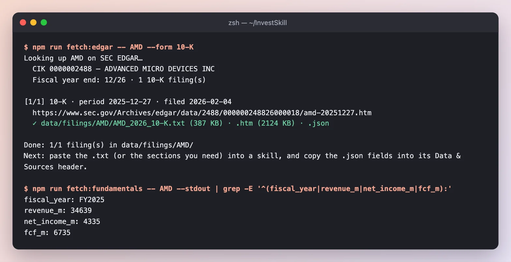
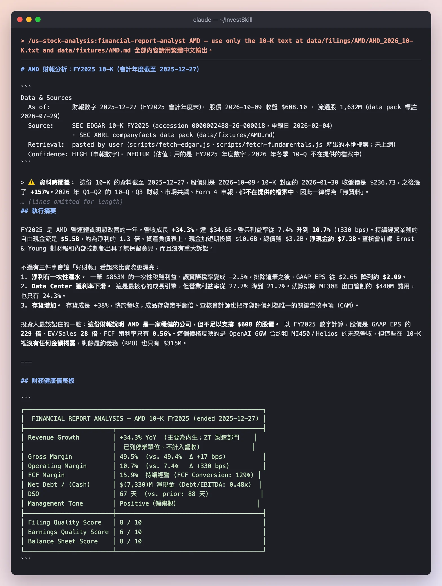
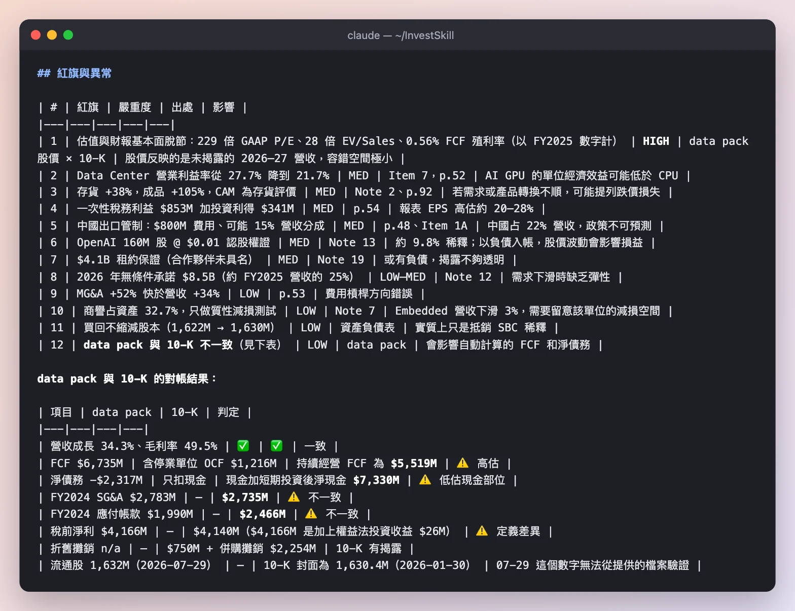
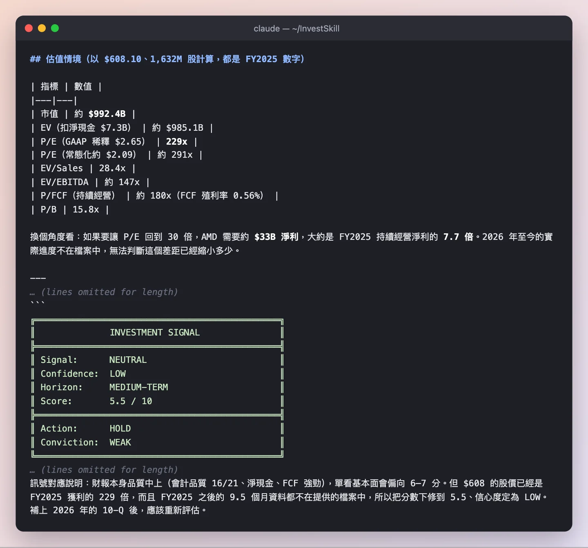
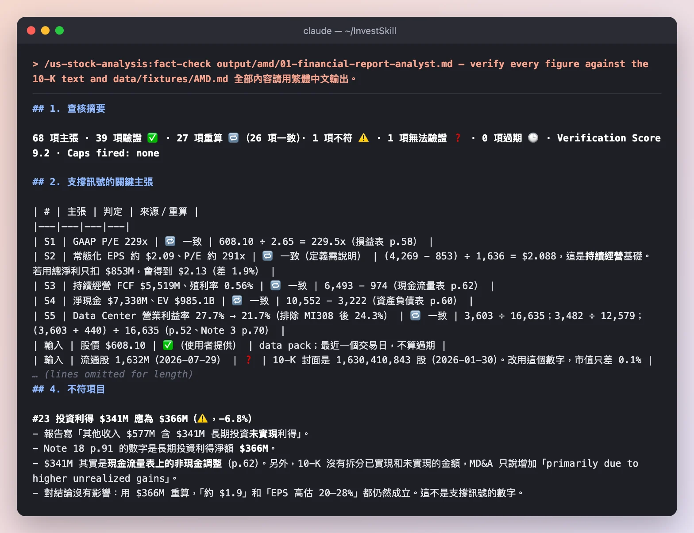

# AMD 10-K 深度解析：先讀財報，再驗證讀法

這份示範先用 `financial-report-analyst` 分析超微半導體（AMD）FY2025 的年度報告（Form 10-K），再把輸出交給 `fact-check` 逐一驗證每個數字。每一步都包含：下了什麼指令、真實輸出的截圖、該注意哪些地方，以及結果。

以下全部是 **2026-10-11** 真實執行的結果。技能只能讀兩個本地檔案：SEC EDGAR 上的 10-K 全文，以及 SEC XBRL 資料包，外加 **2026-10-09 那斯達克收盤價 $608.10**。不上網、不憑記憶補數字。完整輸出在[頁面最下方](#完整輸出)。英文版用同樣兩個步驟分析 NVIDIA：[NVDA 10-K Deep Dive](FULL-DEMO-NVDA.md)。

> **僅供教育用途，不構成投資建議。** AMD 的會計年度結束於 2025-12-27，到 2026 年 10 月，這些數字已經超過 9 個月。技能本身也會說明這一點。

**快速跳轉：** [0 · 取得財報](#步驟-0--取得財報) · [1 · 分析](#步驟-1--分析-10-kfinancial-report-analyst) · [2 · 驗證](#步驟-2--逐一驗證數字fact-check) · [結果](#最後得到了什麼)

---

## 整體計畫

| 步驟 | 問題 | 技能 | 執行時間 | 結果 |
|------|------|------|----------|------|
| 0 | 取得第一手資料 | `fetch:edgar` + `fetch:fundamentals` | 幾秒 | 10-K 全文＋XBRL 資料包 |
| 1 | 這份財報健康嗎？有什麼變化？ | `financial-report-analyst` | 3 分 41 秒 | **NEUTRAL · 5.5 / 10 · HOLD**，12 項紅旗 |
| 2 | 步驟 1 的數字對嗎？ | `fact-check` | 9 分 4 秒 | 查核分數 **9.2 / 10**，1 項不符 |

---

## 步驟 0 · 取得財報



*會計年度截至 2025-12-27、申報日 2026-02-04 的 10-K，存成 387 KB 的純文字。XBRL 資料包是公司自己申報的數字。股價由我們手動填入。*

**結果：** `data/filings/AMD/AMD_2026_10-K.txt` 和 `data/fixtures/AMD.md`，下面的技能只讀這兩個檔案。

---

## 步驟 1 · 分析 10-K（`financial-report-analyst`）

指令最後加一句「全部內容請用繁體中文輸出」，整份分析就會用繁體中文產出。

```text
/us-stock-analysis:financial-report-analyst AMD — use only the 10-K text at data/filings/AMD/AMD_2026_10-K.txt and data/fixtures/AMD.md 全部內容請用繁體中文輸出。
```

### 1a · 資料來源、摘要與儀表板



*先交代資料來源與時間差，再用一段話給出結論，最後用儀表板為財報品質、盈餘品質、資產負債表打分數。*

**注意這幾點**

- **它先提醒時間差。** 10-K 封面揭露的 2026-01-30 收盤價是 $236.73，到 2026-10-09 已經漲到 $608.10（**+157%**）。2026 年的季報不在檔案中，所以一律標為「無資料」。
- **財報很穩健：** 營收 +34.3% 到 $34.6B，營業利益率從 7.4% 升到 10.7%，淨現金約 $7.3B，會計師出具無保留意見。
- **但有三件事讓財報看起來更漂亮：** 一筆 $853M 的一次性稅務利益（排除後 EPS 從 $2.65 降到約 $2.09）、Data Center 營業利益率從 27.7% 降到 21.7%，以及存貨 +38%（成品幾乎翻倍）。

### 1b · 紅旗，以及資料包對帳



*每項紅旗都標出在財報的哪裡找到。最後一項是：資料包本身和 10-K 有出入。*

**注意這幾點**

- **唯一的 HIGH 紅旗是估值。** 以 FY2025 數字計算，股價是 GAAP EPS 的 **229 倍**、EV/Sales 28 倍、FCF 殖利率 0.56%。這個價格反映的是 OpenAI 合約和 MI450 的未來營收，但 10-K 裡沒有揭露金額。
- **它抓出資料包的錯。** 資料包的 FCF $6,735M 包含停業單位，持續經營的 FCF 其實是 **$5,519M**；淨債務只扣了現金，加上短期投資後其實是淨現金 $7,330M。還有幾個前期數字和 10-K 不一致。
- **OpenAI 認股權證：** 160M 股、每股 $0.01，約 9.8% 的潛在稀釋，而且以負債入帳，股價波動會直接影響損益。

### 1c · 估值情境與結論



*用 FY2025 數字算出的估值倍數，以及為什麼基本面 6–7 分、最後只給 5.5 分。*

**注意這幾點**

- **一個好懂的換算：** 要讓本益比回到 30 倍，AMD 需要約 **$33B 淨利**，大約是 FY2025 持續經營淨利的 7.7 倍。
- **信心 LOW 的原因寫得很清楚：** 不是懷疑財報數字，而是 FY2025 之後 9.5 個月的資料都不在檔案中。補上 2026 年的 10-Q 後應該重新評估。

**步驟 1 的結果：** **NEUTRAL（中性）· 信心 LOW · 5.5 / 10 · HOLD。** 會計品質 16/21，公司穩健，但財報本身不足以支撐現在的股價。

---

## 步驟 2 · 逐一驗證數字（`fact-check`）

分析裡引用了上百個數字。`fact-check` 會把每一個都抽出來，對照同樣兩個來源檔案。

```text
/us-stock-analysis:fact-check output/amd/01-financial-report-analyst.md — verify every figure against data/filings/AMD/AMD_2026_10-K.txt and data/fixtures/AMD.md 全部內容請用繁體中文輸出。
```



*抽出 68 項主張，每一項都對照 10-K 的頁碼，先驗證支撐訊號的關鍵數字。*

**注意這幾點**

- **支撐訊號的五個數字全部成立：** 229 倍 P/E、常態化 EPS 約 $2.09、持續經營 FCF $5,519M、淨現金 $7,330M、Data Center 利益率從 27.7% 降到 21.7%，每一項都附上 10-K 頁碼與算式。
- **它找到一個取錯表的數字。** 報告寫投資利得 $341M，但附註 18 的長期投資利得淨額是 **$366M**；$341M 其實是現金流量表上的非現金調整。用正確數字重算，「EPS 高估 20–28%」的結論仍然成立。
- **步驟 1 自己做的資料包對帳表，五項判定全部成立。** 也就是說，分析師抓出的資料包錯誤是真的。

**步驟 2 的結果：** **查核分數 9.2 / 10。** 原報告的 NEUTRAL / HOLD 照抄不變；數字可信。

---

## 最後得到了什麼

| 技能 | 訊號 | 分數 | 一句話重點 |
|------|------|------|------------|
| `financial-report-analyst` | NEUTRAL · HOLD | 5.5 / 10 | 穩健的公司，但 $608 的股價遠超過財報能支撐的範圍 |
| `fact-check` | （照抄）NEUTRAL · HOLD | 查核 9.2 / 10 | 68 項主張幾乎全部成立；1 個投資利得數字取錯表 |

**這份示範告訴我們**

1. **財報分析不只是比率。** 最重要的發現（一次性稅務利益、OpenAI 認股權證、未具名的租約保證）都在附註裡，不在標題數字上。
2. **資料包是起點，不是標準答案。** 分析師發現資料包的 FCF 含停業單位、淨債務沒算短期投資。
3. **再驗證一次。** 用第二個技能驗證第一個，成本很低，卻能告訴你剛剛讀到的東西有多可信。

---

## 自己跑一次

```bash
export EDGAR_USER_AGENT="Your Name you@example.com"
npm run fetch:edgar -- AMD --form 10-K
npm run fetch:fundamentals -- AMD        # 接著在 price: 那一行填上今天的股價

# 在 Claude Code 裡
/us-stock-analysis:financial-report-analyst AMD — use only data/filings/AMD/AMD_2026_10-K.txt and data/fixtures/AMD.md 全部內容請用繁體中文輸出。
/us-stock-analysis:fact-check <存下來的輸出> — verify every figure against the same two files 全部內容請用繁體中文輸出。
```

這裡的每次執行都用 `claude -p "<指令>" --allowedTools Read`。其他 AI 工具可以先貼上 [`prompts/financial-report-analyst.md`](https://github.com/yennanliu/InvestSkill/blob/main/prompts/financial-report-analyst.md)，再貼上財報全文。其他示範請看[示範總覽](full-demo-zh-tw.html)。

---

## 完整輸出

<details>
<summary><strong>步驟輸出：<code>financial-report-analyst</code></strong></summary>

~~~~text
# AMD 財報分析：FY2025 10-K（會計年度截至 2025-12-27）

```
Data & Sources
  As of:      財報數字 2025-12-27（FY2025 會計年度末）· 股價 2026-10-09 收盤 $608.10 · 流通股 1,632M（data pack 標註 2026-07-29）
  Source:     SEC EDGAR 10-K FY2025（accession 0000002488-26-000018，申報日 2026-02-04）
              · SEC XBRL companyfacts data pack（data/fixtures/AMD.md）
  Retrieval:  pasted by user（scripts/fetch-edgar.js、scripts/fetch-fundamentals.js 產出的本地檔案；未上網）
  Confidence: HIGH（申報數字）· MEDIUM（估值：用的是 FY2025 年度數字，2026 年各季 10-Q 不在提供的檔案中）
```

> ⚠️ **資料時間差：** 這份 10-K 的資料截至 2025-12-27，股價則是 2026-10-09。10-K 封面的 2026-01-30 收盤價是 $236.73，之後漲了 **+157%**。2026 年 Q1–Q2 的 10-Q、Q3 財報、市場共識、Form 4 申報，都**不在提供的檔案中**，因此一律標為「無資料」。

---

## 執行摘要

FY2025 是 AMD 營運體質明顯改善的一年。營收成長 **+34.3%**，達 $34.6B。營業利益率從 7.4% 升到 **10.7%**（+330 bps）。持續經營業務的自由現金流是 **$5.5B**，約為淨利的 1.3 倍。資產負債表上，現金加短期投資 $10.6B，總債務 $3.2B，**淨現金約 $7.3B**。查核會計師 Ernst & Young 對財報和內部控制都出具了無保留意見，而且沒有重大訴訟。

不過有三件事會讓「好財報」看起來比實際更漂亮：
1. **淨利有一次性灌水。** 一筆 $853M 的一次性稅務利益，讓實際稅率變成 −2.5%。排除這筆之後，GAAP EPS 從 $2.65 降到約 **$2.09**。
2. **Data Center 獲利率下滑。** 這是最核心的成長引擎，但營業利益率從 27.7% 降到 21.7%。就算排除 MI308 出口管制的 $440M 費用，也只有 24.3%。
3. **存貨增加。** 存貨成長 +38%，快於營收；成品存貨幾乎翻倍。查核會計師也把存貨評價列為唯一的關鍵查核事項（CAM）。

投資人最該記住的一點：**這份財報說明 AMD 是一家穩健的公司，但不足以支撐 $608 的股價。** 以 FY2025 數字計算，股價是 GAAP EPS 的 **229 倍**、EV/Sales **28 倍**、FCF 殖利率只有 **0.56%**。這個價格反映的是 OpenAI 6GW 合約和 MI450／Helios 的未來營收，但這些在 10-K 裡**沒有任何金額揭露**，剩餘履約義務（RPO）也只有 $315M。

---

## 財務健康儀表板

```
┌─────────────────────────────────────────────────────────────────┐
│  FINANCIAL REPORT ANALYSIS — AMD 10-K FY2025 (ended 2025-12-27) │
├────────────────────────┬────────────────────────────────────────┤
│ Revenue Growth         │ +34.3% YoY  (主要為內生；ZT 製造部門    │
│                        │  已列停業單位，不計入營收)              │
│ Gross Margin           │ 49.5%  (vs. 49.4%  Δ +17 bps)          │
│ Operating Margin       │ 10.7%  (vs. 7.4%   Δ +330 bps)         │
│ FCF Margin             │ 15.9%  持續經營 (FCF Conversion: 129%) │
│ Net Debt / (Cash)      │ $(7,330)M 淨現金 (Debt/EBITDA: 0.48x)  │
│ DSO                    │ 67 天  (vs. prior: 88 天)              │
│ Management Tone        │ Positive（偏樂觀）                     │
├────────────────────────┼────────────────────────────────────────┤
│ Filing Quality Score   │ 8 / 10                                 │
│ Earnings Quality Score │ 6 / 10                                 │
│ Balance Sheet Score    │ 8 / 10                                 │
└────────────────────────┴────────────────────────────────────────┘
```

---

## Phase 1：文件基本資訊

| 項目 | 內容 |
|---|---|
| 申報類型 | 10-K 年報 |
| 會計期間 | FY2025，截至 2025-12-27（52 週制） |
| 查核會計師 | Ernst & Young LLP，財報與內控（ICFR）都是**無保留意見**（報告日 2026-02-03） |
| 會計師更換 | 無跡象 |
| 申報時點 | 2026-02-04，會計年度結束後 39 天，屬正常時程 |
| 重編 | 封面的回溯追索勾選欄未勾，沒有重編 |
| 關鍵查核事項（CAM） | **存貨評價**（存貨跌價與呆滯準備，p.92–93） |
| 部門重分類 | 2025 Q1 起，Client 和 Gaming 合併成單一報告部門，前期數字已追溯調整 |

---

## Phase 2：MD&A 深度解讀

### 2.1 營收拆解（Item 7，p.52）

| 部門 | FY2025 | FY2024 | YoY | MD&A 說明 |
|---|---|---|---|---|
| Data Center | $16,635M | $12,579M | **+32.2%** | EPYC 第五代、Instinct MI350 |
| Client | $10,640M | $7,054M | **+50.8%** | 出貨量 +31%、ASP +15% |
| Gaming | $3,910M | $2,595M | **+50.7%** | 半客製遊戲機 SoC、Radeon |
| Embedded | $3,454M | $3,557M | −2.9% | 「certain end market demand remained mixed」 |
| **合計** | **$34,639M** | **$25,785M** | **+34.3%** | |

| 地區（依附註） | FY2025 | FY2024 | YoY | 占營收 |
|---|---|---|---|---|
| 美國 | $11,363M | $8,693M | +30.7% | 32.8% |
| 中國（含香港） | $7,751M | $6,231M | +24.4% | **22.4%** |
| 台灣 | $5,186M | $3,301M | +57.1% | 15.0% |
| 新加坡 | $4,284M | $3,614M | +18.5% | 12.4% |
| 其他 | $6,055M | $3,946M | +53.4% | 17.5% |

重點：
- **成長來源：** 以內生成長為主。ZT Systems 的製造部門已在 2025-10 賣給 Sanmina，列為停業單位，所以營收成長不是靠併購撐起來的。Client 的成長同時來自量（+31%）和價（+15%），品質不錯。
- **最大部門的成長反而比 Client 慢：** Data Center +32% 低於 Client & Gaming 的 +51%。市場的 AI 敘事集中在 Data Center，但 FY2025 帶頭成長的其實是 PC 和遊戲機。
- **客戶集中度：** FY2025 和 FY2024 都沒有任何客戶超過營收的 10%。FY2023 曾有一家 Client & Gaming 客戶占 18%。應收帳款方面，最大一家客戶占約 11%（前一年是 24%）。集中度下降是正面訊號。
- **積壓訂單 / RPO：** 原始期間超過一年的合約只有 **$315M**，其中 $201M 預計在 12 個月內認列。**OpenAI 6GW 合約沒有反映在 RPO 中**，10-K 也沒有揭露合約金額。
- **前景指引：** 10-K 沒有提供數字型財測，相關內容不在檔案中。

### 2.2 利潤率趨勢

| 指標 | FY2025 | FY2024 | 變化 | MD&A 說明 |
|---|---|---|---|---|
| 毛利率 | 49.5% | 49.4% | +17 bps | 產品組合改善，被 MI308 約 $440M 淨存貨相關費用部分抵銷 |
| 營業利益率 | 10.7% | 7.4% | +330 bps | 營收槓桿；無形資產攤銷下降 |
| 淨利率 | 12.5% | 6.4% | +615 bps | 受 $853M 稅務利益灌水 |
| EBITDA 率 | 19.3% | — | — | 計算方式：EBIT 3,694 + 折舊攤銷 750 + 併購無形資產攤銷 2,254 |
| FCF 率（持續經營） | 15.9% | 9.3% | +660 bps | 持續經營 OCF $6,493M − 資本支出 $974M |

**各部門營業利益率：**

| 部門 | FY2025 | FY2024 | Δ |
|---|---|---|---|
| Data Center | **21.7%** | 27.7% | **−600 bps** |
| Client & Gaming | 19.6% | 12.3% | +730 bps |
| Embedded | 36.0% | 39.9% | −390 bps |

⚠️ Data Center 營收成長 32%，營業利益卻只多了 $121M（+3.5%）。MD&A 的解釋是「higher cost of sales… MI308 charges… higher operating expenses」，但沒有量化 GPU 和 CPU 各自的毛利率差異。合理推測是 Instinct GPU 的毛利率低於 EPYC，但 **10-K 沒有拆分揭露**。

### 2.3 流動性與資本資源（p.54–56）

| 項目 | 數值 |
|---|---|
| 現金及約當現金 | $5,539M |
| 短期投資 | $5,013M |
| 合計 | **$10,552M**（前一年 $5,132M） |
| 總債務（帳面） | $3,222M（一年內到期 $874M，長期 $2,348M）；本金 $3.3B，全部為固定利率 |
| 淨現金 | **$7,330M** |
| 循環信用額度 | $3.0B，未動用，2027-04-29 到期 |
| 商業本票額度 | $3.0B，期末無流通在外 |
| 持續經營 OCF | $6,493M（停業單位另有 $1,216M） |
| FCF（持續經營） | **$5,519M** |
| 庫藏股授權餘額 | $9.4B（總授權 $14B） |
| 股利 | 無 |
| 無條件採購承諾 | **$12.2B**，其中 **$8.5B 在 2026 年**（晶圓、基板、雲端算力） |
| 期後事項 | 為某合作夥伴（未具名）的資料中心租約提供保證，**最大曝險 $4.1B**，期間 15 年 |

### 2.4 前瞻性語言

| 項目 | 原文 | 明確程度 |
|---|---|---|
| 營收 | 無數字指引；只有「seasonally… higher in the second half」 | 模糊 |
| 毛利率 | 無 | 無資料 |
| 資本支出 | 無 | 無資料 |
| 產品節奏 | 「annual cadence of leadership」、MI450 用於 OpenAI 首個 1GW | 方向明確，時程模糊 |
| 流動性 | 「sufficient… over the next 12 months and beyond… we cannot assure…」 | 常見的避險用語 |
| 中國 MI308 | 「U.S. government officials have expressed an expectation that the U.S. government will receive 15%…」 | **高度不確定** |

---

## Phase 3：財務報表深度檢查

### 3.1 損益表品質

| 項目 | FY2025 | FY2024 | 變化 | 品質註記 |
|---|---|---|---|---|
| 營收 | $34,639M | $25,785M | +34.3% | 內生成長 |
| 銷貨成本（含攤銷） | $17,487M | $13,060M | +33.9% | 含 $1,031M 無形資產攤銷 |
| 毛利 | $17,152M | $12,725M | 49.5% | |
| R&D | $8,091M | $6,456M | +25.3%（占營收 23.4%） | 增聘 AI 人力 |
| MG&A | $4,144M | $2,735M | **+51.5%**（占營收 12.0%） | ⚠️ 成長快於營收 |
| 營業利益 | $3,694M | $1,900M | 10.7% | |
| 利息費用 | $131M | $92M | +42% | 2025-03 新發行 $1.5B 公司債 |
| 其他收入 | $577M | $181M | | ⚠️ 含 $341M 長期投資**未實現利得** |
| 實際稅率 | **−2.5%** | 19% | | ⚠️ 含 $853M 不確定稅務部位迴轉 |
| 持續經營淨利 | $4,269M | $1,641M | | |
| 淨利（GAAP） | $4,335M | $1,641M | +164% | 含停業單位 $66M |
| 稀釋 EPS（GAAP） | $2.65 | $1.00 | | 持續經營 $2.61 |
| **常態化 EPS（估算）** | **約 $2.09** | — | | 排除 $853M 稅務利益（實際稅率回到約 18%）；若再排除投資利得，約 $1.9 |
| Non-GAAP EPS | 10-K 未提供 | | | 無資料 |

- **營收認列：** 依 ASC 606。變動對價（返利、價格保護、退貨）屬於關鍵會計估計；隨時間認列的收入占 9%，FY2023 為 25%。政策沒有改變。
- **塞貨訊號：** 沒有。應收帳款只增加 +2%，營收增加 +34%，DSO 從 88 天降到 67 天。
- **遞延收入：** 10-K 正文沒有單獨列示合約負債的金額，無法判斷趨勢。

### 3.2 資產負債表

```
Balance Sheet Health Check (2025-12-27):
Asset Quality:
  Cash & Equivalents + STI:   $10,552M  (13.7% of total assets)
  Accounts Receivable:        $6,315M   DSO: 67 days  (vs. prior: 88)
  Inventory:                  $7,920M   DIO: 176 days (vs. prior: 173)  ← +38% YoY
     ├ Raw materials          $909M     (vs. $351M, +159%)
     ├ Work in process        $4,768M   (vs. $4,289M, +11%)
     └ Finished goods         $2,243M   (vs. $1,094M, +105%)
  Goodwill & Intangibles:     $41,831M  (54.4% of total assets；商譽本身 32.7%)
  Other Long-Term Assets:     $5,452M   (vs. $3,918M；含非上市股權投資 $1.3B)

Liability Structure:
  Short-Term Debt:            $874M
  Long-Term Debt:             $2,348M
  Total Debt:                 $3,222M
  Net Debt/(Cash):            $(7,330)M
  Interest Coverage Ratio:    28.2x  (EBIT 3,694 / Interest 131)
  Debt/EBITDA:                0.48x

Equity Quality:
  Retained Earnings Trend:    Growing ($2,364M → $6,699M)
  Treasury Stock:             $(7,079)M  (FY2025 買回 $1,316M + 扣繳稅款 $625M)
  AOCI:                       $(3)M  (無退休金負擔，影響微小)
```

- 商譽占總資產 32.7%，超過 30% 的警戒線，但主要來自已知的 Xilinx、ZT 等併購，而且減損測試**只做了質性評估**（qualitative）。
- 流通股從 1,622M 增加到 1,630M。$1.3B 的買回（12.4M 股，平均約 $106）不足以抵銷 SBC 和 ZT 併購發行的股數，**股數沒有減少**。

### 3.3 現金流量表

```
Cash Flow Quality Analysis (FY2025, continuing operations):
Operating Cash Flow:          $6,493M   (含停業單位：$7,709M)
Less: Capex:                  $(974)M
Free Cash Flow:               $5,519M   FCF Margin: 15.9%
FCF Conversion Rate:          129%      (FCF / 持續經營淨利 4,269)

Working Capital Changes:
  AR Change (use):            $(121)M
  Inventory Change (use):     $(2,189)M   ← 最大資金流出
  AP Change (source):         +$410M
  Accrued & other (use):      $(467)M
  Net Working Capital Impact: 約 $(2,378)M

SBC Add-Back:                 $1,638M  (4.7% of Revenue；FY2024 為 5.5%)
D&A Add-Back:                 $750M + 併購攤銷 $2,254M
Capex vs. D&A:                974 > 750 → 沒有投資不足
```

- FCF 減去 SBC 後約 **$3.9B**，等於營收的 11.2%。
- 營運資金主要被存貨吃掉（−$2.2B）。MD&A 說這是為了 Data Center 先進製程產品的量產備貨。

---

## Phase 4：風險因子

### 4.1 新增／刪除／升級的風險因子
與前一年 10-K 的逐條比較：**無資料**（沒有提供前一年的 10-K）。以下是本期文字中**明確提到 2025 年事件**的風險，可視為新增或升級：

| 風險 | 類別 | 內容 |
|---|---|---|
| 美國出口管制（MI308／中國） | 監管 | 2025 Q2 認列約 $800M 費用，Q4 迴轉約 $360M；美國政府「預期」抽取 15% 營收，但尚無法規依據 |
| AI Diffusion Rule 的替代規則 | 監管 | BIS 已宣布撤銷並將另訂新規則，範圍未知 |
| 產品週期加快 | 競爭／營運 | 「shorter launch cycles」，新舊產品並行，增加存貨管理難度 |
| 晶圓代工集中 | 供應鏈 | 7nm 以下的 CPU／GPU 晶圓**全部**由台積電生產 |
| 灰色市場／轉運到受限地區 | 合規 | 專段描述 |

### 4.2 訴訟
Note 12 寫明：「As of December 27, 2025, there were no material legal proceedings.」沒有 SEC 或 DOJ 調查的揭露，也沒有持續經營疑慮或債務條款違約風險。

---

## Phase 5：會計政策與附註

| 關鍵估計 | 內容 |
|---|---|
| 營收認列 | 變動對價依歷史經驗估計；政策未改 |
| 存貨評價 | **CAM**；成本與淨變現價值孰低。MI308 費用迴轉 $360M 是準備迴轉的實例，會讓毛利率出現波動 |
| 商譽減損 | 三個報告單位，2025 年只做質性測試，結論是無減損 |
| 企業合併 | ZT Systems：$3.2B 現金加 8.3M 股；製造部門以 $2.4B 現金加 1.2M 股 Sanmina 股票出售，另有最多 $450M 的或有價款 |
| 遞延所得稅 | 遞延所得稅資產從 $688M 降到 $384M（OBBBA 研發費用加速扣除）；州稅與境外的評價備抵維持 |
| **OpenAI 認股權證** | 最多 **160M 股、行使價 $0.01**，依 GPU 採購里程碑和股價目標分批既得，到 2030-10-05。期末尚未既得，對財報無影響；**未來會以負債入帳**，股價波動會造成損益起伏 |
| 關係人交易 | Item 13 引用股東會委託書（proxy），不在提供的檔案中，無資料 |
| 部門報導 | Client 和 Gaming 合併成一個部門，但營收仍分開揭露，透明度可以接受 |

---

## Phase 6：管理層語氣

```
Tone Assessment:
Section              Tone Score   Key Language
──────────────────────────────────────────────────────────────────
MD&A Overview        4.5 / 5      "strong annual revenue growth", "leadership products"
Revenue Discussion   4 / 5        "strong demand"（Embedded: "mixed"）
Margin Discussion    3 / 5        "product mix"（未量化）, MI308 charges
Guidance Language    N/A          10-K 無數字財測
Risk Factors Framing 3 / 5        出口管制篇幅長、語氣謹慎
CEO Letter           無資料（不在 10-K 中）
──────────────────────────────────────────────────────────────────
Overall Tone:        約 3.7 / 5（偏正面）
Change vs. Prior:    無資料（未提供前期文件）
```

**避險用語：**
- 「we cannot assure that such funds will be available on favorable terms, or at all」：常見的標準用語
- 「certain end market demand remained mixed」（Embedded）：用模糊字眼帶過負面消息
- 「U.S. government officials have expressed an expectation…」：監管不確定性最高的一句
- 毛利率改善歸因於「product mix」，但沒有提供細節，正是本框架列出的紅旗用語

**管理層可信度追蹤**（前四季的財測與實際對照）：無資料。

---

## Phase 7：季度比較
這是年報，季度數字不在提供的檔案中，無資料。

## Phase 8：內部人動態
- Item 9B：CTO Mark Papermaster 在 2025-11-14 採用 10b5-1 計畫，最多可出售 124,936 股，計畫到 2026-11-16 結束。這屬於預定排程的賣出，參考價值有限。
- Form 4 的公開市場買賣紀錄：無資料。

---

## 重點洞見

**正面（看多訊號）：**
- 營收 +34.3%，而且是內生成長；Client 的量與價同時上升（Item 7，p.52）
- 營業利益率擴張 330 bps；持續經營 FCF $5.5B，轉換率 129%（現金流量表，p.62）
- DSO 從 88 天降到 67 天，應收帳款最大客戶占比從 24% 降到 11%（Note 2）
- 淨現金 $7.3B，利息保障 28 倍，債務全為固定利率（Item 7A）
- 會計師無保留意見、內控有效、無重大訴訟（p.92–96、Note 12）
- SBC 占營收比從 5.5% 降到 4.7%
- OpenAI 6GW 合約加上 MI450 和 Helios 機櫃方案，打開了 AI GPU 的長期空間（p.48）

**負面（看空訊號）：**
- Data Center 營業利益率 −600 bps，成長沒有轉化成利潤（p.52）
- 淨利含 $853M 一次性稅務利益和 $341M 未實現投資利得；常態化 EPS 約 $2.09（p.54）
- 存貨 +38%，成品 +105%，DIO 上升；會計師把存貨列為 CAM（Note 2、p.92）
- MG&A +52%，費用槓桿方向錯誤（p.53）
- 中國占營收 22.4%，出口管制可能直接拿走 15% 的 MI308 營收（p.48）
- OpenAI 認股權證是約 9.8% 的潛在稀釋，行使價 $0.01（Note 13）
- 2026 年 $8.5B 採購承諾，加上 $4.1B 的租約保證（Note 12、Note 19）

**中性／觀察事項：**
- 庫藏股授權 $9.4B，但 FY2025 股數沒有下降
- 停業單位貢獻了 $1.2B OCF，屬一次性；data pack 的 FCF 把它算進去了
- 2026 年無形資產攤銷預計 $2.15B，持續下降，GAAP 利潤率會自然改善
- 研發資本化方面，OBBBA 降低了 FDII 的適用，未來實際稅率可能上升

---

## 紅旗與異常

| # | 紅旗 | 嚴重度 | 出處 | 影響 |
|---|---|---|---|---|
| 1 | 估值與財報基本面脫節：229 倍 GAAP P/E、28 倍 EV/Sales、0.56% FCF 殖利率（以 FY2025 數字計） | **HIGH** | data pack 股價 × 10-K | 股價反映的是未揭露的 2026–27 營收，容錯空間極小 |
| 2 | Data Center 營業利益率從 27.7% 降到 21.7% | MED | Item 7，p.52 | AI GPU 的單位經濟效益可能低於 CPU |
| 3 | 存貨 +38%，成品 +105%，CAM 為存貨評價 | MED | Note 2、p.92 | 若需求或產品轉換不順，可能提列跌價損失 |
| 4 | 一次性稅務利益 $853M 加投資利得 $341M | MED | p.54 | 報表 EPS 高估約 20–28% |
| 5 | 中國出口管制：$800M 費用、可能 15% 營收分成 | MED | p.48、Item 1A | 中國占 22% 營收，政策不可預測 |
| 6 | OpenAI 160M 股 @ $0.01 認股權證 | MED | Note 13 | 約 9.8% 稀釋；以負債入帳，股價波動會影響損益 |
| 7 | $4.1B 租約保證（合作夥伴未具名） | MED | Note 19 | 或有負債，揭露不夠透明 |
| 8 | 2026 年無條件承諾 $8.5B（約 FY2025 營收的 25%） | LOW–MED | Note 12 | 需求下滑時缺乏彈性 |
| 9 | MG&A +52% 快於營收 +34% | LOW | p.53 | 費用槓桿方向錯誤 |
| 10 | 商譽占資產 32.7%，只做質性減損測試 | LOW | Note 7 | Embedded 營收下滑 3%，需要留意該單位的減損空間 |
| 11 | 買回不縮減股本（1,622M → 1,630M） | LOW | 資產負債表 | 實質上只是抵銷 SBC 稀釋 |
| 12 | **data pack 與 10-K 不一致**（見下表） | LOW | data pack | 會影響自動計算的 FCF 和淨債務 |

**data pack 與 10-K 的對帳結果：**

| 項目 | data pack | 10-K | 判定 |
|---|---|---|---|
| 營收成長 34.3%、毛利率 49.5% | ✅ | ✅ | 一致 |
| FCF $6,735M | 含停業單位 OCF $1,216M | 持續經營 FCF 為 **$5,519M** | ⚠️ 高估 |
| 淨債務 −$2,317M | 只扣現金 | 現金加短期投資後淨現金 **$7,330M** | ⚠️ 低估現金部位 |
| FY2024 SG&A $2,783M | — | **$2,735M** | ⚠️ 不一致 |
| FY2024 應付帳款 $1,990M | — | **$2,466M** | ⚠️ 不一致 |
| 稅前淨利 $4,166M | — | $4,140M（$4,166M 是加上權益法投資收益 $26M） | ⚠️ 定義差異 |
| 折舊攤銷 n/a | — | $750M + 併購攤銷 $2,254M | 10-K 有揭露 |
| 流通股 1,632M（2026-07-29） | — | 10-K 封面為 1,630.4M（2026-01-30） | 07-29 這個數字無法從提供的檔案驗證 |

---

## 會計品質評分

| 項目 | 分數 (0–3) | 說明 |
|---|---|---|
| 營收認列清晰度 | 3 | ASC 606 政策清楚，量價拆解明確，客戶集中度下降 |
| Non-GAAP 調節品質 | 2 | 10-K 沒有 Non-GAAP；「All Other」把攤銷和 SBC 清楚分出，但 Data Center 的 GPU／CPU 獲利沒有拆開 |
| FCF 轉換率 | 3 | 持續經營 129%，資本支出高於折舊 |
| 營運資金趨勢 | 1 | 存貨 +38%、成品 +105%；DSO 改善只能部分抵銷 |
| 附註透明度 | 2 | MI308、認股權證、期後保證都有揭露，但保證對象未具名，OpenAI 合約金額和股價門檻也未揭露 |
| 會計師意見 | 3 | EY 無保留意見，內控有效，CAM 只有一項 |
| 關係人交易 | 2 | 10-K 沒有看到異常；Item 13 引用 proxy，不在檔案中 |
| **合計** | **16 / 21** | **Average（中上）** |

評分標準：18–21 = 高品質 | 12–17 = 平均 | <12 = 需進一步審查

---

## 估值情境（以 $608.10、1,632M 股計算，都是 FY2025 數字）

| 指標 | 數值 |
|---|---|
| 市值 | 約 **$992.4B** |
| EV（扣淨現金 $7.3B） | 約 $985.1B |
| P/E（GAAP 稀釋 $2.65） | **229x** |
| P/E（常態化約 $2.09） | 約 291x |
| EV/Sales | 28.4x |
| EV/EBITDA | 約 147x |
| P/FCF（持續經營） | 約 180x（FCF 殖利率 0.56%） |
| P/B | 15.8x |

換個角度看：如果要讓 P/E 回到 30 倍，AMD 需要約 **$33B 淨利**，大約是 FY2025 持續經營淨利的 **7.7 倍**。2026 年至今的實際進度不在檔案中，無法判斷這個差距已經縮小多少。

---

## 論點失效條件（Thesis Invalidation）

本次訊號為**中性**。

**如果轉為看多（BULLISH）的觀點成立，在以下情況會失效：**
- 會計師出具持續經營疑慮，或公告重大重編
- Data Center 營業利益率（排除一次性費用）低於 20%，代表 AI GPU 量產會壓縮整體獲利
- 存貨 DIO 超過 200 天，或單季提列超過 $500M 的跌價損失

**如果轉為看空（BEARISH）的觀點成立，在以下情況會失效：**
- 新任會計師釐清所有疑慮，且重編結果有利
- 2026 年報顯示營收 ≥ $50B（+45% 以上）、GAAP 營業利益率 ≥ 20%，而且 OpenAI 合約的金額或 RPO 開始實質揭露
- FCF 減 SBC 後超過 $15B，讓 FCF 殖利率回到 1.5% 以上

**以下情況發生時請重新分析：**
- [ ] 下一次財報發布（2026 Q3；日期不在檔案中）
- [ ] 股價距 $608.10 變動 ±15%（低於 $516.9 或高於 $699.3）
- [ ] 滿 60 天（2026-12-10）
- [ ] 重大事件：OpenAI 認股權證首批既得、出口管制新規、MI450／Helios 出貨、$4.1B 保證被觸發

```
╔══════════════════════════════════════════════╗
║              INVESTMENT SIGNAL               ║
╠══════════════════════════════════════════════╣
║ Signal:      NEUTRAL                         ║
║ Confidence:  LOW                             ║
║ Horizon:     MEDIUM-TERM                     ║
║ Score:       5.5 / 10                        ║
╠══════════════════════════════════════════════╣
║ Action:      HOLD                            ║
║ Conviction:  WEAK                            ║
╚══════════════════════════════════════════════╝
```

評分標準：8.0–10.0 強烈看多 | 6.0–7.9 溫和看多 | 4.0–5.9 中性 | 2.0–3.9 溫和看空 | 0.0–1.9 強烈看空
信心度：HIGH（資料充分、訊號明確）| MEDIUM（訊號混雜）| LOW（資料有限或訊號互相矛盾）
期間：SHORT-TERM（1 週–3 個月）| MEDIUM-TERM（3 個月–1 年）| LONG-TERM（1 年以上）

訊號對應說明：財報本身品質中上（會計品質 16/21、淨現金、FCF 強勁），單看基本面會偏向 6–7 分。但 $608 的股價已經是 FY2025 獲利的 229 倍，而且 FY2025 之後的 9.5 個月資料都不在提供的檔案中，所以把分數下修到 5.5、信心度定為 LOW。補上 2026 年的 10-Q 後，應該重新評估。

**Disclaimer:** 僅供教育用途，非投資建議。
~~~~

</details>

<details>
<summary><strong>步驟輸出：<code>fact-check</code></strong></summary>

~~~~text
# AMD 財報分析事實查核（output/amd/01-financial-report-analyst.md）

這份報告的數字底子很扎實：Verification Score **9.2 / 10**，沒有觸發任何上限。報告結論 NEUTRAL 5.5 的依據都成立，需要修正的是三處數字或措辭，以及五處引用位置。

我原本把完整查核寫進 `output/amd/02-fact-check.md`，但寫檔權限被拒絕了，所以結果直接貼在下面。第 7 節原本是逐段附引用的完整修正版，這裡改成只列修改處。要存檔的話，同意寫入就好。

```
Data & Sources
  As of:      財報數字 2025-12-27（FY2025 會計年度末）· 股價 2026-10-09 收盤 · 流通股：data pack 標註 2026-07-29（無法驗證）
  Source:     AMD Form 10-K FY2025 全文（data/filings/AMD/AMD_2026_10-K.txt；accession 0000002488-26-000018，申報日 2026-02-04）
              · SEC XBRL data pack（data/fixtures/AMD.md）
  Retrieval:  pasted by user（本地檔案；依指示未上網）
  Confidence: HIGH（申報數字：逐項對照 10-K 原文）· LOW–MEDIUM（股價與流通股：只有使用者提供的來源）
```

> ⚠️ **市場數據沒有即時查證。** 依指示未上網。股價 $608.10 和流通股 1,632M 都取自 data pack，沒有獨立驗證。本次查核**沒有使用任何訓練資料估計值**。頁碼是 10-K 原文頁尾的頁碼。

---

## 1. 查核摘要

**68 項主張 · 39 項驗證 ✅ · 27 項重算 🔁（26 項一致）· 1 項不符 ⚠️ · 1 項無法驗證 ❓ · 0 項過期 🕒 · Verification Score 9.2 · Caps fired: none**

## 2. 支撐訊號的關鍵主張

| # | 主張 | 判定 | 來源／重算 |
|---|---|---|---|
| S1 | GAAP P/E 229x | 🔁 一致 | 608.10 ÷ 2.65 = 229.5x（損益表 p.58） |
| S2 | 常態化 EPS 約 $2.09、P/E 約 291x | 🔁 一致（定義需說明） | (4,269 − 853) ÷ 1,636 = $2.088，這是**持續經營**基礎。若用總淨利只扣 $853M，會得到 $2.13（差 1.9%） |
| S3 | 持續經營 FCF $5,519M、殖利率 0.56% | 🔁 一致 | 6,493 − 974（現金流量表 p.62） |
| S4 | 淨現金 $7,330M、EV $985.1B | 🔁 一致 | 10,552 − 3,222（資產負債表 p.60） |
| S5 | Data Center 營業利益率 27.7% → 21.7%（排除 MI308 後 24.3%） | 🔁 一致 | 3,603 ÷ 16,635；3,482 ÷ 12,579；(3,603 + 440) ÷ 16,635（p.52、Note 3 p.70） |
| 輸入 | 股價 $608.10 | ✅（使用者提供） | data pack；最近一個交易日，不算過期 |
| 輸入 | 流通股 1,632M（2026-07-29） | ❓ | 10-K 封面是 1,630,410,843 股（2026-01-30）。改用這個數字，市值只差 0.1% |

## 3. 主張總帳（摘要）

68 項主張中，以下幾類都逐項對照了原文，全部一致：
- **損益表、資產負債表、現金流量表：** 營收、成本、各項費用、利息、稅、淨利、EPS、現金、債務、OCF、資本支出、存貨明細、權益項目。
- **部門與地區：** 部門營收和營業利益（p.52、Note 4 p.71），地區營收和占比（Note 4 p.72）。
- **附註：** 客戶集中度、RPO $315M／$201M、MI308 的 $440M／$800M／$360M／15%、承諾 $12.2B／$8.5B、$4.1B 保證（Note 19）、ZT／Sanmina 交易條件、OpenAI 認股權證條款。
- **其他章節：** EY 查核意見與 CAM（p.92–94）、Papermaster 10b5-1 計畫（Item 9B p.96）、Item 1A 的四項風險。

所有衍生數字都已重算，包括比率、成長率、DSO／DIO、EBITDA、各項估值倍數、會計品質合計 16/21，以及重新分析的觸發價位和日期。

報告自己的 data pack 對帳表，五項判定**全部成立**。

## 4. 不符項目

**#23 投資利得 $341M 應為 $366M（⚠️，−6.8%）**
- 報告寫「其他收入 $577M 含 $341M 長期投資**未實現**利得」。
- Note 18 p.91 的數字是長期投資利得淨額 **$366M**。
- $341M 其實是**現金流量表上的非現金調整**（p.62）。另外，10-K 沒有拆分已實現和未實現的金額，MD&A 只說增加「primarily due to higher unrealized gains」。
- 對結論沒有影響：用 $366M 重算，「約 $1.9」和「EPS 高估 20–28%」都仍然成立。這不是支撐訊號的數字。

**#66 語氣平均分 3.7 應為 3.6（🔁 不一致）**
- 表中四個分數的平均是 (4.5 + 4 + 3 + 3) ÷ 4 = 3.625。差距很小，不影響訊號。

## 5. 重算重點

| 項目 | 算式 | 結果 |
|---|---|---|
| 毛利率 | 17,152 ÷ 34,639 | 49.52% ✓ |
| 營業利益率 | 3,694 ÷ 34,639 | 10.66% ✓ |
| 淨利率 | 4,335 ÷ 34,639 | 12.51% ✓ |
| FCF 率 | 5,519 ÷ 34,639 | 15.93% ✓ |
| FCF 轉換率 | 5,519 ÷ 4,269 | 129.3% ✓ |
| EBITDA | 3,694 + 750 + 2,254 = 6,698 | 19.34% ✓ |
| Debt/EBITDA | 3,222 ÷ 6,698 | 0.48x ✓ |
| 市值 | 608.10 × 1,632 | $992.42B ✓ |
| EV/Sales | | 28.44x ✓ |
| EV/EBITDA | | 147.1x ✓ |
| P/FCF | | 179.8x ✓ |
| P/B | | 15.75x ✓ |
| DSO | | 66.5 天（前一年 87.7）✓ |
| DIO | | 175.7 天（前一年 172.8）✓ |
| 營運資金變動 | | −2,378 ✓（含報告沒列出的預付款項 −11） |
| Embedded 營業利益率變化 | | −396 bps（報告寫 −390，在容許範圍內） |

## 6. 報告一致性檢查

- **引用位置錯誤（5 處）：**
  - 認股權證寫 Note 13，應為 **Note 14**（Note 13 是 EPS）。
  - 商譽寫 Note 7，應為 **Note 6 p.75**（Note 7 是 ATMP 合資）。
  - 應收帳款客戶集中寫 Note 2，應為 **Note 11 p.81**。
  - 中國占營收 22.4% 寫 p.48，應為 **Note 4 p.72**。
  - $236.73 寫「10-K 封面」，應為 **Item 5**。
  - 另外，存貨明細在 **Note 3 p.69**，不是 Note 2。
- **為什麼不觸發 0.0 上限：** 這些文件真實存在，數字就在隔壁的附註或章節，屬於位置標錯，不是捏造。我把它計入「來源品質」扣分。如果用最嚴格的標準解讀，你可以推翻這個判斷。
- **選擇性比較：** 「隨時間認列 9%，FY2023 為 25%」跳過了 FY2024 的 **8%**。實際上 9% 比前一年略升，原寫法容易讓人以為一路下降。
- **措辭：** 「GAAP EPS $2.65 → $2.09」，比較準確的寫法是「持續經營 EPS $2.61 → $2.09」。
- **推論寫成事實：** 「OpenAI 合約沒有反映在 RPO 中」，10-K 沒有這樣寫，應標明是推論。「以負債入帳」少了原文的限定條件：直到符合權益分類條件為止。
- **data pack 差異的原因：**
  - 應付帳款：$1,990M + $476M = $2,466M。$476M 是 ATMP 合資的應付款（Note 7），已經重分類進應付帳款（Note 2），所以 data pack 用的是重分類前的數字。
  - SG&A：差額 $48M 剛好等於 FY2024 的 licensing gain。可能是呈現方式調整，但 10-K 沒有明說，這只是推測。
  - data pack 自己也有矛盾：它說數字都出自 10-K，但流通股標的日期是 2026-07-29，不可能出自這份 10-K 的封面。
- **報告標頭：** 「pasted by user · HIGH（申報數字）· MEDIUM（估值）」得到查核支持，沒有誇大。
- **訊號與分數：** NEUTRAL 配 5.5，落在中性區間，一致。

## 7. 修正處（原文用刪除線，修正值用粗體）

- Phase 3.1、重點洞見、紅旗 #4：投資利得 ~~$341M 未實現~~ **$366M 長期投資利得淨額** [Note 18 p.91]
- Phase 6：語氣平均 ~~3.7~~ **3.6**
- 執行摘要：~~GAAP EPS 從 $2.65~~ **持續經營 EPS 從 $2.61** 降到約 $2.09
- 資料時間差說明：10-K ~~封面~~ **Item 5** 的 2026-01-30 收盤價
- 營收認列：補上「**FY2024 為 8%**」
- 引用位置：~~Note 13~~ **Note 14**；~~Note 7~~ **Note 6**；~~Note 2~~ **Note 11**（應收帳款）／**Note 3**（存貨）；中國 22.4% 補上 **Note 4 p.72**
- 流通股 1,632M 標註 `[?]`；「OpenAI 合約沒有反映在 RPO 中」標註「（推論）」

**References（節錄）：** 以下都是 AMD Form 10-K FY2025，accession 0000002488-26-000018，申報日 2026-02-04，本地 .txt 檔。
- 損益表 p.58
- 資產負債表 p.60
- 權益變動表 p.61
- 現金流量表 p.62
- MD&A p.47–56
- Item 7A p.57
- Note 3 p.69–70
- Note 4 p.70–72
- Note 6 p.75
- Note 7 p.76
- Note 11 p.81
- Note 12 p.81–82
- Note 13 p.82
- Note 14
- Note 18／19 p.91
- EY 查核報告 p.92–94
- Item 9B p.96
- 使用者提供：data/fixtures/AMD.md（股價和流通股未經獨立驗證）

## 8. Verification Score

| 組成 | 權重 | 分數 |
|---|---|---|
| 覆蓋率（95.6%） | 30% | 10 |
| 關鍵主張準確度 | 30% | 9.5 |
| 重算 | 15% | 9.5 |
| 來源品質（5 處引用位置錯誤） | 15% | 7 |
| 時效性 | 10% | 9 |
| **總分** | | **9.2** |

**Caps fired: none。** 分數 ≥ 6.0，代表報告的輸入數字可靠。

## 9. 論點失效條件

以下情況發生時，這次查核的判定會失效，需要重新查核：
- AMD 發布 8-K 或 10-K/A 重編數字
- 股價或流通股被一級來源證明不同
- 市場數據的基準日超過 90 天（2027-01-07 以後）
- 下一份 10-Q 或 10-K 發布、01 號報告被修改，或報告要拿來分享或決定部位之前

```
╔══════════════════════════════════════════════╗
║              INVESTMENT SIGNAL               ║
╠══════════════════════════════════════════════╣
║ Signal:      NEUTRAL                         ║
║ Confidence:  HIGH                            ║
║ Horizon:     MEDIUM-TERM                     ║
║ Score:       9.2 / 10                        ║
╠══════════════════════════════════════════════╣
║ Action:      HOLD                            ║
║ Conviction:  WEAK                            ║
╚══════════════════════════════════════════════╝
```

Score Guide: 8.0–10.0 Strongly Bullish | 6.0–7.9 Moderately Bullish | 4.0–5.9 Neutral | 2.0–3.9 Moderately Bearish | 0.0–1.9 Strongly Bearish
Confidence: HIGH (strong data, clear signals) | MEDIUM (mixed signals) | LOW (limited data, conflicting signals)
Horizon: SHORT-TERM (1 week–3 months) | MEDIUM-TERM (3 months–1 year) | LONG-TERM (1+ years)

**說明：** 訊號沿用原報告，只引用、不重新推導（Mirrors the report's signal — quoted, not re-derived）。Score 9.2 是 Verification Score，Confidence HIGH 是指查核的信心度。原報告對股票本身的判斷仍然是 NEUTRAL、5.5 / 10、信心度 LOW。

**Disclaimer:** 僅供教育用途，非投資建議。查核範圍限於執行當下可取得的來源；無法驗證的主張，既未被證實，也未被推翻。
~~~~

</details>

---

**免責聲明：** 僅供教育用途，不構成投資建議。數字以文中標示的日期為準，之後會過時。
