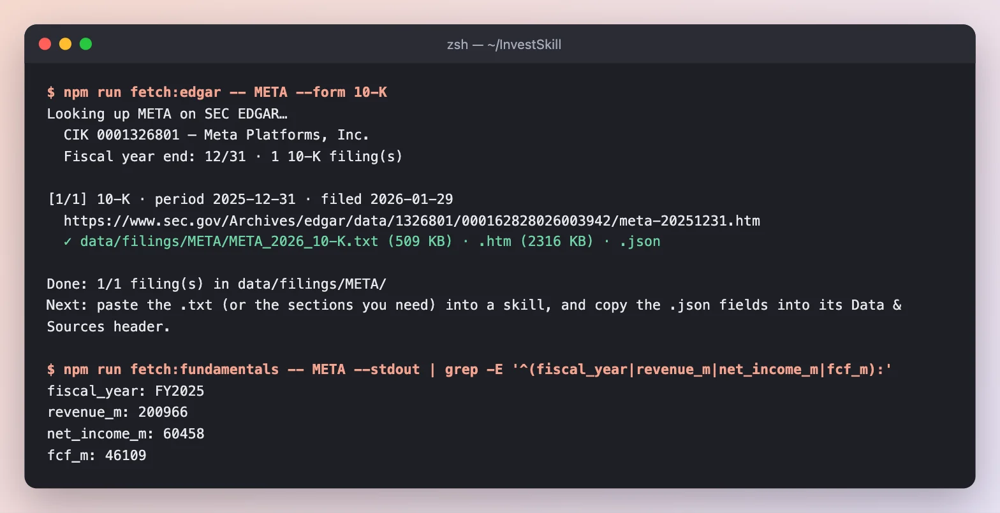
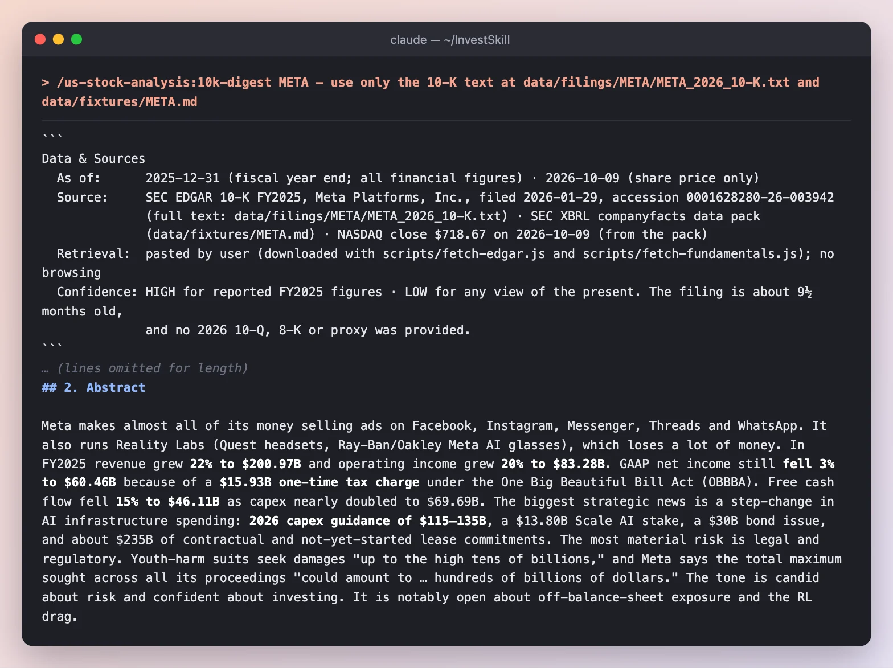
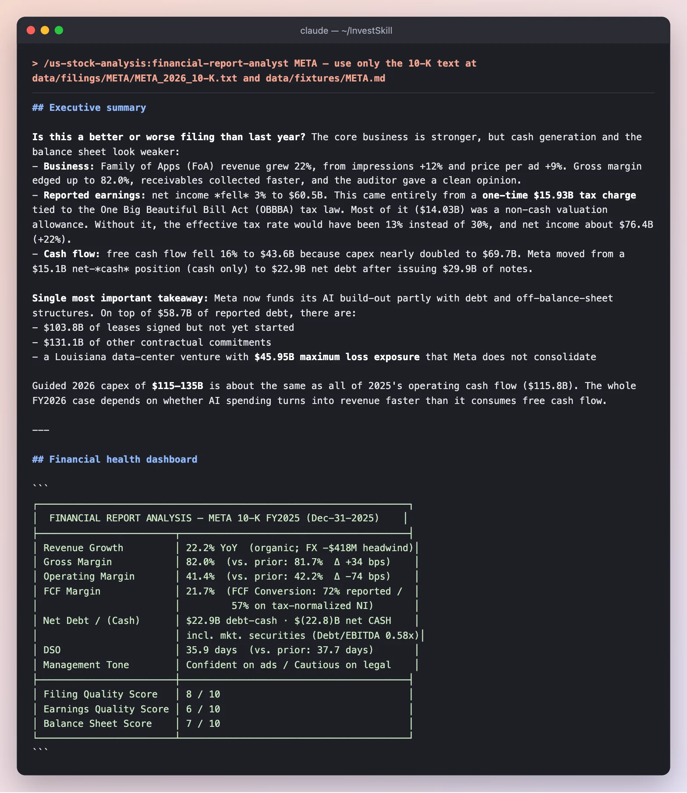
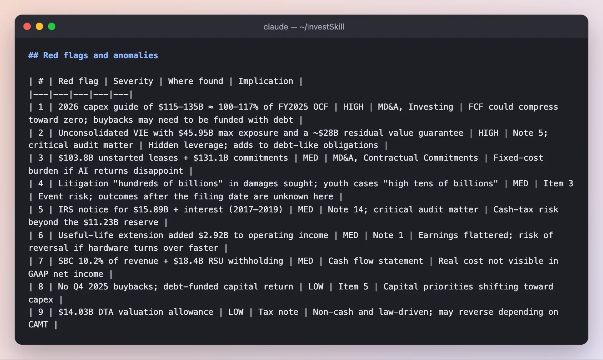
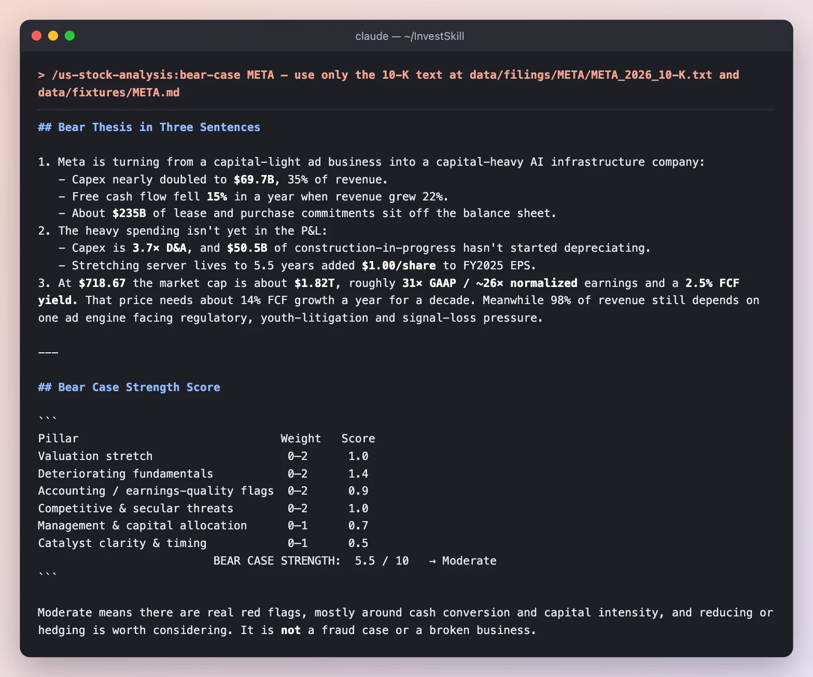
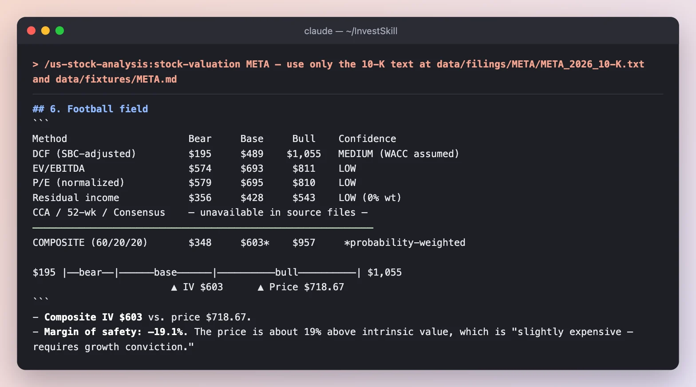
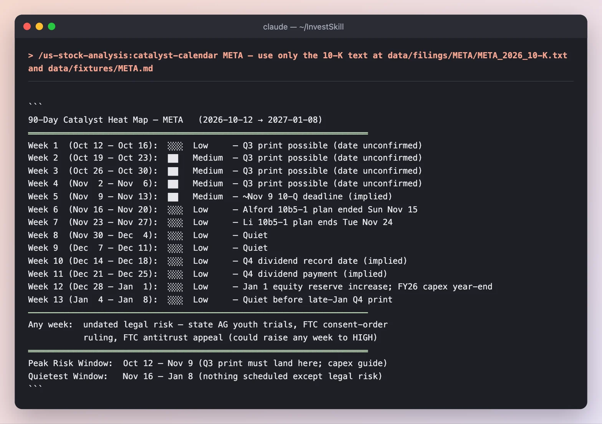

# META 10-K Deep Dive — Six Skills, One Filing

This demo takes one document, Meta Platforms' annual report (Form 10-K) for fiscal 2025, and runs six InvestSkill skills over it in sequence. Each step shows the command, a screenshot of the real output, what to notice, and the result carried into the next step.

Everything below was run for real on **2026-10-11**. The skills could read two local files and nothing else: the 10-K text from SEC EDGAR and an SEC XBRL data pack, plus the **$718.67 NASDAQ close on 2026-10-09**. No web browsing, no figures from memory. The full, unedited outputs are at the [bottom of the page](#full-outputs).

> **Educational only — not investment advice.** The filing covers the year ended 2025-12-31, so by October 2026 its numbers are more than nine months old. Every skill says so, and you'll see how each one handles it.

**Jump to:** [0 · Get the filing](#step-0--get-the-filing) · [1 · Digest](#step-1--read-the-whole-filing-10k-digest) · [2 · Analyze](#step-2--analyze-the-statements-financial-report-analyst) · [3 · Red team](#step-3--argue-against-it-bear-case) · [4 · Value](#step-4--what-is-it-worth-stock-valuation) · [5 · Calendar](#step-5--what-happens-next-catalyst-calendar) · [6 · Audit](#step-6--audit-the-analysis-result-validator) · [Results](#what-we-ended-up-with)

---

## The plan at a glance

A 10-K is 130+ pages. The point of chaining skills is that each one asks a different question of the same document.

| Step | Question | Skill | Run time | Result |
|------|----------|-------|----------|--------|
| 1 | What does the filing say, in one page? | `10k-digest` | 3 min 40 s | Abstract, section summaries, key metrics |
| 2 | How healthy are the statements? | `financial-report-analyst` | 2 min 51 s | **NEUTRAL · 5.6 / 10**, 9 red flags |
| 3 | What is the strongest case against it? | `bear-case` | 2 min 9 s | Bear strength **5.5 / 10** |
| 4 | What is it worth? | `stock-valuation` | 6 min 13 s | Composite value **$603** vs $718.67 |
| 5 | What could move it in the next 90 days? | `catalyst-calendar` | 2 min 12 s | Q3 print + capex guide is the peak risk |
| 6 | Is the step 2 analysis trustworthy? | `result-validator` | ⏳ in progress | ⏳ in progress |

---

## Step 0 · Get the filing

Two keyless helpers in the repo pull everything from the SEC: the full 10-K text, and the XBRL figures as a data pack.



*`fetch:edgar` saved the 10-K filed 2026-01-29 as plain text (509 KB). `fetch:fundamentals` pulled the reported figures. We added the latest close to the pack by hand, since the SEC carries no prices.*

**Result:** two files every skill below reads: `data/filings/META/META_2026_10-K.txt` and `data/fixtures/META.md`.

---

## Step 1 · Read the whole filing (`10k-digest`)

Start with the map. `10k-digest` reads every section and produces a structured summary with sources.

```text
/us-stock-analysis:10k-digest META — use only the 10-K text at data/filings/META/META_2026_10-K.txt and data/fixtures/META.md
```



*The digest opens with where the data came from and how fresh it is, then a one-paragraph abstract of the whole filing.*

**What to notice**

- **It flags its own staleness.** Confidence is HIGH for FY2025 figures but **LOW for any view of the present**: the filing is about 9½ months old and no 2026 10-Q was provided.
- **It corrected the data pack.** The XBRL "SG&A" line is really G&A only (marketing & sales is separate), and Meta's own FCF definition also subtracts finance-lease principal ($43.59B vs the pack's $46.11B). It shows both.
- **The headline story:** revenue +22% to $200.97B, but GAAP net income *fell* 3% because of a **$15.93B one-time tax charge**, and FCF fell 15% as capex nearly doubled to $69.69B. 2026 capex guidance is **$115–135B**.

**Result:** a one-page map of the filing, including what's missing (no prior-year 10-K, so no promise tracker or risk-factor diff).

---

## Step 2 · Analyze the statements (`financial-report-analyst`)

Now the deep read: MD&A, income statement, balance sheet, cash flow, footnotes and tone.

```text
/us-stock-analysis:financial-report-analyst META — use only the 10-K text at data/filings/META/META_2026_10-K.txt and data/fixtures/META.md
```

### 2a · The summary and the health dashboard



*It answers "better or worse than last year?" first, then scores filing quality, earnings quality and balance sheet on one dashboard.*

### 2b · The red flags



*Every red flag cites where in the filing it was found and what it implies.*

**What to notice**

- **Business stronger, cash weaker.** Gross margin edged up to 82.0%, but Meta went from $15.1B net cash to $22.9B net debt (cash only) after issuing $29.9B of notes.
- **The real story is off the balance sheet:** $103.8B of leases signed but not started, $131.1B of other commitments, and a Louisiana data-center venture with **$45.95B maximum loss exposure** that Meta does not consolidate.
- **An accounting change flattered earnings.** Extending server lives to 5.5 years added $2.92B to operating income. That's red flag #6.
- **Scores:** filing quality 8/10, earnings quality 6/10, accounting quality **17/21**. The books are clean; the concern is capital intensity.

**Result of step 2:** **NEUTRAL · MEDIUM confidence · 5.6 / 10 · HOLD.** An excellent core business set against a sharp FCF drop and more than $280B of off-balance-sheet commitments.

---

## Step 3 · Argue against it (`bear-case`)

A deliberate red team: the strongest case for *not* owning the stock.

```text
/us-stock-analysis:bear-case META — use only the 10-K text at data/filings/META/META_2026_10-K.txt and data/fixtures/META.md
```



*Three numbered sentences, then a score on six pillars so you can see which arguments carry weight.*

**What to notice**

- **The bear thesis:** Meta is turning from a capital-light ad business into a capital-heavy AI infrastructure company. Capex is **3.7× depreciation**, and $50.5B of construction-in-progress hasn't started depreciating yet, so the cost isn't in the P&L.
- **Strongest pillar: deteriorating fundamentals (1.4 / 2).** Weakest: catalyst timing (0.5 / 1).
- **It argues against itself.** It concedes the best bull point: about 25× normalized earnings for 22% growth and 82% gross margins is not obviously expensive. Its probability-weighted target is **≈ $619 (−14%)**: "not a compelling short."

**Result of step 3:** bear strength **5.5 / 10 (Moderate)** → **NEUTRAL · 4.5 / 10 · HOLD.**

---

## Step 4 · What is it worth? (`stock-valuation`)

Several valuation methods, each with its confidence, combined into one range.

```text
/us-stock-analysis:stock-valuation META — use only the 10-K text at data/filings/META/META_2026_10-K.txt and data/fixtures/META.md
```



*The "football field": bear, base and bull values from each method, with the price marked against the composite.*

**What to notice**

- **Composite intrinsic value $603 vs price $718.67**, so the margin of safety is **−19.1%**.
- **It says what it couldn't do.** Comparable-company, 52-week and consensus rows read "unavailable in source files" instead of being filled from memory.
- **The swing variable is capex, not revenue.** If capex intensity stays near 30% instead of falling to 20%, the base case drops below $400. And at a 7.5% discount rate instead of 9.5%, the stock looks fairly valued. That's why confidence is LOW.

**Result of step 4:** expected return about **−16%**, but **NEUTRAL · LOW confidence · 4.2 / 10 · HOLD**, because the gap disappears under plausible assumptions.

---

## Step 5 · What happens next? (`catalyst-calendar`)

A 90-day calendar of dated events, built only from what the filing states or implies.

```text
/us-stock-analysis:catalyst-calendar META — use only the 10-K text at data/filings/META/META_2026_10-K.txt and data/fixtures/META.md
```



*A week-by-week heat map from 2026-10-12 to 2027-01-08, with undated legal risk called out separately.*

**What to notice**

- **It derived a date it wasn't given.** The Q3 date isn't in the filing, but Meta is a "large accelerated filer", so the 10-Q is due about **40 days after quarter end → ≈ 2026-11-09**. It labels this "implied", not confirmed.
- **The FCF break-even math:** at the $125B capex midpoint and flat operating cash flow, FY2026 FCF would be about **−$9B**. OCF needs to grow about 8% just to break even, so every capex revision at the Q3 print moves FCF almost dollar for dollar.
- **It refuses to invent magnitudes.** No options data or beat history means "n/a" for expected moves, not made-up percentages.

**Result of step 5:** peak risk window **Oct 12 – Nov 9** (Q3 print and the capex guide); 30-day bias NEUTRAL.

---

## Step 6 · Audit the analysis (`result-validator`)

Finally, check the step 2 analysis itself: its data quality, methodology and signal consistency.

```text
/us-stock-analysis:result-validator output/meta/02-financial-report-analyst.md — validate against data/filings/META/META_2026_10-K.txt and data/fixtures/META.md
```

> ⏳ **This step is still running** — its screenshot and notes will be added to this page shortly.

---

## What we ended up with

| Skill | Signal | Score | One-line takeaway |
|-------|--------|-------|-------------------|
| `10k-digest` | NEUTRAL · HOLD | 5.6 / 10 | An excellent ad engine funding a very large, uncertain AI bet |
| `financial-report-analyst` | NEUTRAL · HOLD | 5.6 / 10 | Clean books (17/21); the risk is capital intensity and off-balance-sheet commitments |
| `bear-case` | NEUTRAL · HOLD | 4.5 / 10 (bear 5.5) | Real cash-conversion concerns, but not a short |
| `stock-valuation` | NEUTRAL · HOLD | 4.2 / 10 | Composite $603, 19% below price, but highly assumption-sensitive |
| `catalyst-calendar` | 30-day bias NEUTRAL | — | Everything hinges on the Q3 capex guide |
| `result-validator` | ⏳ in progress | — | — |

**What this demo shows**

1. **One document, many questions.** Each skill read the same 10-K and found something the others didn't: the digest corrected the data pack, the analyst found the off-balance-sheet venture, the bear found the depreciation still to come, the calendar derived a filing deadline.
2. **Agreement across opposite jobs.** Five skills, including a deliberate red team, landed on NEUTRAL / HOLD.
3. **Honest about time.** Every output flagged that the filing is nine months old. The next step is obvious: add the 2026 10-Qs (`npm run fetch:edgar -- META --form 10-Q`) and re-run.

---

## Run it yourself

```bash
export EDGAR_USER_AGENT="Your Name you@example.com"
npm run fetch:edgar -- META --form 10-K
npm run fetch:fundamentals -- META        # then add today's price on the `price:` line

# Inside Claude Code — each step reads the same two files
/us-stock-analysis:10k-digest META — use only data/filings/META/META_2026_10-K.txt and data/fixtures/META.md
/us-stock-analysis:financial-report-analyst META — use only data/filings/META/META_2026_10-K.txt and data/fixtures/META.md
/us-stock-analysis:bear-case META — use only data/filings/META/META_2026_10-K.txt and data/fixtures/META.md
/us-stock-analysis:stock-valuation META — use only data/filings/META/META_2026_10-K.txt and data/fixtures/META.md
/us-stock-analysis:catalyst-calendar META — use only data/filings/META/META_2026_10-K.txt and data/fixtures/META.md
/us-stock-analysis:result-validator output/meta/02-financial-report-analyst.md
```

Each run here used `claude -p "<command>" --allowedTools Read`, so the skills could read files but not browse. For other assistants, paste the matching file from [`prompts/`](https://github.com/yennanliu/InvestSkill/tree/main/prompts) followed by the filing text. See the [Live Walkthrough](walkthrough.html) for the method step by step, and the [Demo Overview](full-demo.html) for the other demos.

---

## Full outputs

The complete, unedited output of every run above.

<details>
<summary><strong><code>10k-digest</code> — full output</strong></summary>

~~~~text
I've finished reading the 10-K and the data pack. Here's the digest.

---

```
Data & Sources
  As of:      2025-12-31 (fiscal year end; all financial figures) · 2026-10-09 (share price only)
  Source:     SEC EDGAR 10-K FY2025, Meta Platforms, Inc., filed 2026-01-29, accession 0001628280-26-003942
              (full text: data/filings/META/META_2026_10-K.txt) · SEC XBRL companyfacts data pack
              (data/fixtures/META.md) · NASDAQ close $718.67 on 2026-10-09 (from the pack)
  Retrieval:  pasted by user (downloaded with scripts/fetch-edgar.js and scripts/fetch-fundamentals.js); no browsing
  Confidence: HIGH for reported FY2025 figures · LOW for any view of the present. The filing is about 9½ months old,
              and no 2026 10-Q, 8-K or proxy was provided.
```

> ⚠️ **Not in the files (marked "unavailable" below):** FY2024 10-K (so there's no Promise Tracker and no risk-factor diff) · 2026 proxy (Items 10–14, executive pay and board) · any 2026 quarterly results · how the 2026 trials listed in Item 3 turned out. Page numbers come from the filing's own pagination.
>
> **Data-pack notes:** (1) The pack's "SG&A $12,152M" line is really **G&A only**. Marketing & sales ($11,991M) is a separate line in the filing, so true SG&A is $24,143M. (2) The pack computes FCF as OCF − capex = **$46.11B**. Meta's own definition also subtracts finance-lease principal, giving **$43.59B** (p.78). I show both. (3) "Total debt" leaves out leases. Operating-lease liabilities are another $25.15B.

# Meta Platforms, Inc. (META): 10-K Digest
**Fiscal Year:** FY2025, ended 12/31/2025
**Filed:** 2026-01-29 (auditor's reports dated 2026-01-28)
**Source:** SEC EDGAR: https://www.sec.gov/Archives/edgar/data/1326801/000162828026003942/meta-20251231.htm
**Prepared:** 2026-10-11
**Language:** English

---

## 2. Abstract

Meta makes almost all of its money selling ads on Facebook, Instagram, Messenger, Threads and WhatsApp. It also runs Reality Labs (Quest headsets, Ray-Ban/Oakley Meta AI glasses), which loses a lot of money. In FY2025 revenue grew **22% to $200.97B** and operating income grew **20% to $83.28B**. GAAP net income still **fell 3% to $60.46B** because of a **$15.93B one-time tax charge** under the One Big Beautiful Bill Act (OBBBA). Free cash flow fell **15% to $46.11B** as capex nearly doubled to $69.69B. The biggest strategic news is a step-change in AI infrastructure spending: **2026 capex guidance of $115–135B**, a $13.80B Scale AI stake, a $30B bond issue, and about $235B of contractual and not-yet-started lease commitments. The most material risk is legal and regulatory. Youth-harm suits seek damages "up to the high tens of billions," and Meta says the total maximum sought across all its proceedings "could amount to … hundreds of billions of dollars." The tone is candid about risk and confident about investing. It is notably open about off-balance-sheet exposure and the RL drag.

---

## 3. Section Summaries

### 3.1 Business Overview (Item 1, pp. 6–11)
Meta reports two segments. **Family of Apps** brought in $198.76B, almost all of it advertising, and **Reality Labs** brought in $2.21B. The stated mission now includes delivering "personal superintelligence for everyone." Meta defines superintelligence as AI that surpasses human intelligence, and it builds a mix of open (Llama) and closed models. New in 2025: Meta Ray-Ban Display glasses with the Meta Neural Band (an EMG wristband), and Meta AI as an assistant inside the apps, as a standalone app, and on glasses. In 2026 management expects about **70% of RL operating expenses to go to wearables** and 30% to VR/Horizon. Headcount was 78,865 (+6%).

### 3.2 Risk Factors (Item 1A, pp. 12–47)
- **Count:** **48 headed risk factors** by my count, in five groups: Product Offerings 10, Business Operations & Financial Results 23, Government Regulation 6, Data/Security/IP 5, Class A Stock Ownership 4.
- **Top 3 by placement and length:** (1) keeping users and their engagement, with TikTok named as a competitor; (2) "substantially all" revenue comes from advertising, and advertisers sign no long-term commitments; (3) the loss of ad-targeting data signals. That third one includes the EU's **April 2025 final DMA decision** against the "subscription for no ads" model. Meta has appealed, but warns of a possible "significant impact to our European business and revenue."
- **Added or removed vs. prior year:** N/A, because the prior filing wasn't provided. Some passages must be new or updated because they cite 2025 events: the OBBBA/CAMT tax effects, Brazil's June 2025 intermediary-liability ruling, AI-agent and prompt-injection security risk, FTC and state-AG scrutiny of AI chatbots, and a new expected 2026 RL loss figure.
- **Assessment:** These are specific and material, not boilerplate. They name dollar amounts, rulings and trial dates. Key-person risk explicitly mentions Mr. Zuckerberg's combat sports and aviation.

### 3.3 Properties & Other (Items 1B–2, pp. 47–51)
Item 1B: no unresolved staff comments. Meta owns **30 data center locations** and leases others. It has about 10M sq ft at and around Menlo Park HQ, of which **about 2M sq ft is unoccupied** and slated to be subleased, terminated or abandoned. Item 1C reports no cybersecurity threats in 2025 that materially affected the business. Item 6 is "[Reserved]", so there is no Selected Financial Data table.

### 3.4 MD&A (Item 7, pp. 60–80)
- **Revenue:** $200.97B (+22%), all organic as far as the filing says (2025 acquisitions were "not significant"). Ad impressions rose 12% and average price per ad rose 9%. Online commerce was the biggest contributor to growth. On a constant-currency basis revenue would have been $418M higher. FoA Other revenue rose 50% to $2.58B (WhatsApp paid messaging, Meta Verified). RL revenue rose only 3%: AI glasses grew and Quest declined.
- **Margins:** Gross margin 82.0% (+34 bps). Operating margin 41% vs 42%. FoA margin 52% (54% prior). RL operating loss $(19.19)B. R&D grew 31% (AI staff and infrastructure) and G&A grew 25%, partly because 2024 benefited from a $1.55B release of legal accruals.
- **Management's explanation:** AI-driven ad-ranking and targeting improvements pushed up demand and price. Reels and Asia-Pacific impressions monetize at lower rates and offset some of that.
- **Forward statements:** 2026 capex of $115–135B. 2026 tax rate of 13–16%. RL 2026 losses "similar to 2025."
- **Liquidity:** Cash plus marketable securities was $81.59B. Long-term debt was $58.74B ($59.0B face, maturing 2027–2064; nothing due in 2026 and $2.75B due in 2027). Meta also has $131.05B of non-cancelable commitments ($30.63B due in 2026) and $103.77B of leases that haven't started yet. Capital returned in 2025 was $31.57B, plus $18.40B of tax paid on net-settled RSUs.

### 3.5 Financial Statements (Item 8, pp. 82–127)
- Revenue $200.97B vs $164.50B. Net income $60.46B vs $62.36B. Diluted EPS **$23.49 vs $23.86**.
- OCF $115.80B. Capex $69.69B. FCF $46.11B (OCF − capex), or **$43.59B** on Meta's definition.
- Total assets $366.02B. Long-term debt $58.74B. Equity $217.24B.
- **Auditor:** Ernst & Young LLP, auditor since 2007. **Unqualified** opinion on the statements and on internal control. Critical audit matters: loss contingencies, uncertain tax positions, and the accounting for the Louisiana data-center joint venture (a variable interest entity, or VIE; Meta does *not* consolidate it).
- **Accounting changes:** Server and network useful lives were extended to 5.5 years from 1/1/2025. That **cut depreciation by $2.92B and raised net income by $2.59B ($1.00/diluted share)**. No restatements.

### 3.6 Market Risk (Item 7A, pp. 80–81)
FX exposure is mostly the euro. FX turned into a $352M gain in 2025, vs a $690M loss in 2024. A **+100 bp rate move would lower the value of debt securities and cash equivalents by $711M**. A **10% drop in marketable equities would cost $599M**. Non-marketable equity holdings rose to $20.08B (measurement alternative) plus $7.45B (equity method), up from about $6.07B, which adds new valuation risk.

### 3.7 Controls & Procedures (Item 9A, p. 128)
Disclosure controls and internal control over financial reporting were effective as of 12/31/2025. **No material weaknesses** and no Q4 changes to internal control.

### 3.8 Legal Proceedings (Item 3, pp. 51–57; Note 11)
- **Youth/"social media addiction":** state AG, school-district and personal-injury cases, plus mass-arbitration demands from more than 100,000 claimants. Damages sought go "up to the high tens of billions." Trials were scheduled to start 1/27/2026 (LA JCCP), 2/2/2026 (New Mexico AG) and 6/15/2026 (multidistrict litigation, or MDL, bellwether). **Outcomes are unavailable in these files.**
- **FTC antitrust (Instagram/WhatsApp):** Meta **won at trial on 11/18/2025**. The FTC appealed on 1/20/2026.
- **FTC consent-order modification:** the FTC wants to bar commercial use of minors' data and to change the board's composition. The case is still being litigated.
- **EU:** Facebook Marketplace fine of about €798M (under appeal). DMA fine of €200M (under appeal). IDPC GDPR fine of €1.2B (stayed). Spain's AMI judgment of **about €542M** (11/19/2025, under appeal). DSA preliminary findings issued 10/24/2025.
- **Flo Health:** jury found Meta liable on 8/1/2025. Plaintiffs seek $5,000 per member for up to about 1.6M members, which would be up to about $8B (my arithmetic, theoretical).
- **AI copyright (Kadrey):** Meta won fair use on summary judgment for the named plaintiffs. New cases were filed from November 2025.
- **Accruals:** legal-related accruals were **$6.87B** (up from $5.52B). For the aggregate exposure, see the "hundreds of billions" maximum-sought language in the Abstract.

### 3.9 Executive Compensation & Governance (Items 10–14, p. 129)
Incorporated by reference to the **2026 proxy, which wasn't provided**, so CEO/CFO pay and board independence and tenure are **unavailable**. From the 10-K itself: Meta is a "controlled company" under Nasdaq rules. Class B shares carry 10 votes each; there were 343M of them, giving the CEO majority voting control. In Q4 2025, COO Javier Olivan and CFO Susan Li adopted Rule 10b5-1 selling plans, and director Peggy Alford adopted one for $1M (Item 9B).

---

## 4. Key Metrics Table

| Metric                    | FY2025          | FY2024          | YoY Change |
|---------------------------|-----------------|-----------------|------------|
| Revenue                   | $200.97 B       | $164.50 B       | +22.2%     |
| Gross Profit (derived)    | $164.79 B       | $134.34 B       | +22.7%     |
| Gross Margin %            | 82.0%           | 81.7%           | +34 bps    |
| Operating Income          | $83.28 B        | $69.38 B        | +20.0%     |
| Operating Margin %        | 41.4%           | 42.2%           | −74 bps    |
| Net Income (GAAP)         | $60.46 B        | $62.36 B        | −3.0%      |
| EPS Diluted (GAAP)        | $23.49          | $23.86          | −1.6%      |
| Operating Cash Flow       | $115.80 B       | $91.33 B        | +26.8%     |
| Capital Expenditures      | $69.69 B        | $37.26 B        | +87.1%     |
| Free Cash Flow (OCF−capex)| $46.11 B        | $54.07 B        | −14.7%     |
| FCF (Meta definition)     | $43.59 B        | $52.10 B        | −16.3%     |
| Cash & Equivalents        | $35.87 B        | $43.89 B        | −18.3%     |
| Cash + Marketable Sec.    | $81.59 B        | $77.82 B        | +4.9%      |
| Total Debt (ex-leases)    | $58.74 B        | $28.83 B        | +103.8%    |
| Net Debt / (Net Cash), cash only | $22.87 B | $(15.06) B     | swing $37.9 B |
| Net Cash incl. mkt. securities | $22.85 B  | $48.99 B        | −53.4%     |
| Shares Outstanding (dil., wtd.) | 2.574 B   | 2.614 B         | −1.5%      |

*Sources: Item 8 income statement p.89, balance sheet p.88; Item 7 FCF reconciliation p.78; Note 3 EPS p.103; data pack (XBRL). Gross profit is revenue − cost of revenue (Meta doesn't report a gross-profit line). Year-end shares outstanding were 2,187M Class A + 343M Class B = 2.53B.*

**Market context (my arithmetic at the $718.67 close on 2026-10-09):** market cap ≈ **$1.85T** on diluted weighted shares. P/E ≈ **30.6×** FY2025 GAAP EPS. If you add back the $14.03B valuation-allowance charge, adjusted EPS is about $28.9 and P/E is about **24.8×**. FCF yield ≈ **2.5%** (2.4% on Meta's definition). Dividends used 11.5% of FCF. Dividend yield ≈ 0.29% ($0.525 quarterly). The stock is up 8.9% from the $660.09 close on 12/31/2025. These use FY2025 earnings, because trailing-twelve-month 2026 figures are **unavailable**.

---

## 5. Highlights & Concerns

**Highlights**
- **Ads are growing in both volume and price.** Revenue grew 22%, with impressions +12% and price per ad +9%, and Meta credits AI ad-ranking gains. *(Item 7)*
- **The core business is very profitable.** FoA earned $102.47B of operating income at a 52% margin, enough to fund the RL losses and the AI build-out. *(Item 7, Note 15)*
- **Cash generation is strong.** OCF of $115.80B (+27%) paid for $69.69B of capex and still returned $31.57B to shareholders. *(Item 7)*
- **Non-ad revenue is starting to grow.** FoA Other revenue rose 50% (WhatsApp paid messaging, Meta Verified), and AI-glasses sales grew. *(Item 7)*
- **Meta won the FTC antitrust case.** Judgment for Meta on 11/18/2025 lowers the risk of a forced Instagram/WhatsApp divestiture, although the FTC has appealed. *(Item 3)*

**Concerns**
- **Capex is outrunning cash flow.** 2026 guidance of $115–135B is at or above all of 2025's $115.8B OCF. FCF is already falling (−15%). *(Item 7)*
- **Large off-balance-sheet commitments.** $131.05B of contracts, $103.77B of not-yet-started leases, and up to $45.95B of maximum exposure to the Louisiana JV, including a residual value guarantee (RVG) of about $28B. *(Item 7, Note 5, Note 11)*
- **Legal overhang is growing.** Youth trials began in 2026, the €542M AMI judgment came down, Flo Health went against Meta, and legal accruals rose to $6.87B. *(Item 3, Note 9)*
- **Tax disputes.** The IRS asserts **$15.89B** more tax for 2017–2019. In the 2010-year case the Tax Court valued the transferred IP $1.48B above what Meta reported. *(Note 14)*
- **Part of the earnings improvement is accounting.** Longer server lives added $1.00 to EPS. SBC was $20.43B (about 10% of revenue), plus $18.40B of tax paid on net-settled RSUs. *(Note 1, Item 7)*

---

## 6. Management Outlook & Forward Guidance

| Guidance Item         | What Management Said | Time Horizon | Source |
|-----------------------|----------------------|--------------|--------|
| Revenue growth        | No numeric guidance in the 10-K. Future ad revenue to come from "a combination of price and ad impressions." Reels to "monetize at a lower rate … for the foreseeable future" | Multi-year | Item 7 |
| Capex / capacity      | **About $115–135B** "to support our AI efforts and core business." AI needs "significantly increased investment in infrastructure" | FY2026 | Item 7 p.77 |
| Tax rate              | **13–16%** effective tax rate, "absent any changes to our tax landscape" | FY2026 | Item 7 p.77 |
| Reality Labs          | Operating losses to "remain similar to 2025" (~$19.2B). About 70% wearables / 30% VR+Horizon | FY2026 | Items 1, 7 |
| Expenses              | Expenses "to continue to increase," led by AI infrastructure and staff | Ongoing | Item 1A |
| Capital allocation    | Plans to keep paying a quarterly dividend ($0.525). $25.03B buyback authorization left, no expiry. No buybacks in Q4 2025 | Ongoing | Items 5, 7 |
| Strategic priorities  | AI (including superintelligence), Reels/discovery engine, wearables, monetization, youth, integrity, infrastructure | FY2026 | Item 1 |

---

## 7. Prior-Year Promise Tracker

**N/A, prior filing not retrieved.** The FY2024 10-K isn't in the provided files, so FY2024 commitments can't be scored against FY2025 results.

**Management credibility read:** unavailable from these files.

---

## 8. Bull vs. Bear Synthesis

**Bull case**
- The ad engine is compounding at scale: 22% growth on a $164B base, 3.58B daily active people (+7%), and annual ARPP up 15% to $57.03.
- FoA's 52% operating margin and $115.8B OCF can fund the AI build-out without risking the balance sheet. There are no financial covenants and no maturities in 2026.
- Without the one-time OBBBA charge, the 2025 tax rate would have been 13% and EPS about $28.9. Guidance of 13–16% for 2026 implies a big drop back in the tax rate.
- Meta is building optionality: it won the antitrust trial, and it has the Scale AI stake, the AI glasses and WhatsApp monetization.

**Bear case**
- The 2026 capex guide (up to $135B) could push FCF close to zero before any OCF growth. Long-dated leases, cloud contracts and the JV RVG make that spending hard to reverse.
- The legal and regulatory tail is unusually wide: tens of billions sought in youth cases, a $15.89B IRS notice, EU DMA/DSA rulings, and a possible FTC order restricting the use of minors' data.
- At the 10/09 price the stock trades at about 30.6× GAAP EPS with a 2.5% FCF yield. That price already assumes the AI spending pays off.
- RL still loses about $19B a year, and its revenue grew only 3% with Quest sales declining.

**Net read:** The FY2025 filing shows an excellent core business funding a very large, uncertain AI bet. At today's price the evidence is about evenly balanced, which gives a neutral read rather than a clear buy or sell.

---

## 9. Notable Disclosures

- **OBBBA tax charge of $15.93B** (including a $14.03B valuation allowance on US deferred tax assets, driven by the 15% corporate minimum tax). Without it, the 2025 tax rate would have been 13%. *(Item 7, p.76)*
- **Useful-life change:** servers and network gear moved to 5.5 years, adding $2.92B less depreciation and $1.00/share to EPS. *(Note 1)*
- **Scale AI minority stake of $13.80B**, closed in 2025. Jio stake carried at $5.82B. *(Note 5)*
- **Louisiana data-center JV:** Meta holds 20% and is not consolidating it. Total development cost is about $27B. Leases worth $12.31B start in 2029. The RVG is about $28B, and maximum exposure is $45.95B. *(Note 5)*
- **$30.0B of senior notes** issued November 2025 in six series due 2030–2065. Face debt rose to $59.0B. *(Note 10)*
- **Bot/spam estimate changed:** under a new Q4 2025 methodology, "less than 5%" of daily active people are violating accounts. That's higher than before, which Meta attributes to the method change. *(Limitations of Key Metrics)*
- **Acquisitions:** $4.09B in cash plus $450M in stock, with $3.88B booked as goodwill, mainly for AI talent and tech. *(Note 8)*
- **Customer concentration:** no customer is ≥10% of revenue. Meta does disclose "meaningful revenue" from a small number of China-based resellers, which is exposed to trade-policy action. *(Note 2, Item 1A)*

---

## 10. References

1. **SEC EDGAR filing:** Meta Platforms, Inc. 10-K, FY2025
   URL: https://www.sec.gov/Archives/edgar/data/1326801/000162828026003942/0001628280-26-003942-index.htm
   Filed: 2026-01-29 | Accession No.: 0001628280-26-003942 | CIK 0001326801
2. **Item 1 (Business):** pp. 6–11
3. **Item 1A (Risk Factors):** pp. 12–47. Item 1C (Cybersecurity): pp. 48–50
4. **Items 2–3 (Properties; Legal Proceedings):** pp. 51–57
5. **Item 5 (Market for Common Equity):** pp. 58–59
6. **Item 7 (MD&A):** pp. 60–80. Item 7A: pp. 80–81
7. **Item 8 (Financial Statements):** pp. 82–127 (EY reports pp. 83–87; Note 5 p.106; Notes 10–11 pp. 111–118; Note 14 p.124)
8. **Items 9A–9B (Controls; Other Information):** pp. 128–129
9. **SEC XBRL data pack:** data/fixtures/META.md, generated 2026-10-11 from https://data.sec.gov/api/xbrl/companyfacts/CIK0001326801.json; FY2024 comparatives from the 10-K filed 2025-01-30 (accession 0001326801-25-000017). Includes the NASDAQ close of $718.67 on 2026-10-09.
10. **2026 proxy (Items 10–14):** incorporated by reference, **not provided**

---

## Thesis Invalidation

**Re-run this digest when:**
- [ ] Meta files its FY2026 10-K. Based on the last two filing dates (2025-01-30 and 2026-01-29), that should be around late January 2027. A 10-K/A amendment also counts.
- [ ] A material 8-K discloses a restatement or auditor change
- [ ] 12 months have passed since the filing date (2027-01-29)
- [ ] *Digest-specific:* 2026 10-Qs or 8-Ks show actual 2026 capex against the $115–135B guide, verdicts in the youth trials, a Tax Court decision, or a ruling on the FTC appeal. Each of these was pending in the filing and is unavailable here.

```
╔══════════════════════════════════════════════╗
║              INVESTMENT SIGNAL               ║
╠══════════════════════════════════════════════╣
║ Signal:      NEUTRAL                         ║
║ Confidence:  LOW                             ║
║ Horizon:     LONG-TERM                       ║
║ Score:       5.6 / 10                        ║
╠══════════════════════════════════════════════╣
║ Action:      HOLD                            ║
║ Conviction:  WEAK                            ║
╚══════════════════════════════════════════════╝
```

Score Guide: 8.0–10.0 Strongly Bullish | 6.0–7.9 Moderately Bullish | 4.0–5.9 Neutral | 2.0–3.9 Moderately Bearish | 0.0–1.9 Strongly Bearish
Confidence: HIGH (strong data, clear signals) | MEDIUM (mixed signals) | LOW (limited data, conflicting signals)
Horizon: SHORT-TERM (1 week–3 months) | MEDIUM-TERM (3 months–1 year) | LONG-TERM (1+ years)

How the score was set: the core business would score in the 7s on its own. The score is pulled down by the 2026 capex guide, the falling FCF, the wide legal and tax exposure, and a valuation of about 30× GAAP / about 25× adjusted earnings at a 2.5% FCF yield. Confidence is LOW even though the FY2025 figures themselves are high quality. The filing is about 9½ months old, and none of 2026's results, trial outcomes or proxy data were provided.

**Disclaimer:** Educational analysis only. Not financial advice.
~~~~

</details>

<details>
<summary><strong><code>financial-report-analyst</code> — full output</strong></summary>

~~~~text
# META: FY2025 10-K financial report analysis

```
Data & Sources
  As of:      2025-12-31 (fiscal year end) · price as of 2026-10-09 close
  Source:     SEC EDGAR 10-K FY2025, filed 2026-01-29, accession 0001628280-26-003942
              (data/filings/META/META_2026_10-K.txt) · XBRL companyfacts pack
              (data/fixtures/META.md) · NASDAQ close $718.67 (2026-10-09, from the pack)
  Retrieval:  pasted by user (local files; no browsing)
  Confidence: HIGH for reported FY2025 figures · LOW for anything about 2026
```

> ⚠️ **Stale-period warning.** This filing covers a period that ended more than 9 months ago. The 2026 10-Qs (Q1 and Q2) aren't in the provided files, so I can't check anything that happened in 2026 against filed data. That includes 2026 revenue, actual capex vs. guidance, buybacks, and the outcomes of the 2026 trials the 10-K lists. The price is current, but the fundamentals are not.

**Two data-pack issues to know before reading on:**
1. The pack's "SG&A" of $12,152M is **G&A only**. Marketing & sales is a separate $11,991M line, so true SG&A is $24,143M.
2. The pack defines FCF as OCF − capex = **$46,109M**. Meta's own definition also subtracts finance-lease principal, giving **$43,585M**. I use the company's figure unless I say otherwise.

---

## Executive summary

**Is this a better or worse filing than last year?** The core business is stronger, but cash generation and the balance sheet look weaker:
- **Business:** Family of Apps (FoA) revenue grew 22%, from impressions +12% and price per ad +9%. Gross margin edged up to 82.0%, receivables collected faster, and the auditor gave a clean opinion.
- **Reported earnings:** net income *fell* 3% to $60.5B. This came entirely from a **one-time $15.93B tax charge** tied to the One Big Beautiful Bill Act (OBBBA) tax law. Most of it ($14.03B) was a non-cash valuation allowance. Without it, the effective tax rate would have been 13% instead of 30%, and net income about $76.4B (+22%).
- **Cash flow:** free cash flow fell 16% to $43.6B because capex nearly doubled to $69.7B. Meta moved from a $15.1B net-*cash* position (cash only) to $22.9B net debt after issuing $29.9B of notes.

**Single most important takeaway:** Meta now funds its AI build-out partly with debt and off-balance-sheet structures. On top of $58.7B of reported debt, there are:
- $103.8B of leases signed but not yet started
- $131.1B of other contractual commitments
- a Louisiana data-center venture with **$45.95B maximum loss exposure** that Meta does not consolidate

Guided 2026 capex of **$115–135B** is about the same as all of 2025's operating cash flow ($115.8B). The whole FY2026 case depends on whether AI spending turns into revenue faster than it consumes free cash flow.

---

## Financial health dashboard

```
┌─────────────────────────────────────────────────────────────────┐
│  FINANCIAL REPORT ANALYSIS — META 10-K FY2025 (Dec-31-2025)    │
├────────────────────────┬────────────────────────────────────────┤
│ Revenue Growth         │ 22.2% YoY  (organic; FX −$418M headwind)│
│ Gross Margin           │ 82.0%  (vs. prior: 81.7%  Δ +34 bps)    │
│ Operating Margin       │ 41.4%  (vs. prior: 42.2%  Δ −74 bps)    │
│ FCF Margin             │ 21.7%  (FCF Conversion: 72% reported /  │
│                        │         57% on tax-normalized NI)       │
│ Net Debt / (Cash)      │ $22.9B debt−cash · $(22.8)B net CASH    │
│                        │ incl. mkt. securities (Debt/EBITDA 0.58x)│
│ DSO                    │ 35.9 days  (vs. prior: 37.7 days)       │
│ Management Tone        │ Confident on ads / Cautious on legal    │
├────────────────────────┼────────────────────────────────────────┤
│ Filing Quality Score   │ 8 / 10                                 │
│ Earnings Quality Score │ 6 / 10                                 │
│ Balance Sheet Score    │ 7 / 10                                 │
└────────────────────────┴────────────────────────────────────────┘
```

---

## Phase 1: Document orientation

| Item | Finding |
|---|---|
| Filing | 10-K, FY ended 2025-12-31, filed 2026-01-29. That is about 29 days after year end, well inside the deadline. |
| Auditor | Ernst & Young LLP, auditor since 2007. **Unqualified opinion.** Internal controls over financial reporting were judged effective. |
| Auditor change | None. |
| Restatements | None. The cover-page check box for restatements requiring a compensation-recovery analysis is unchecked. |
| Critical audit matters | Three: (1) loss contingencies, (2) uncertain tax positions (IRS transfer pricing), and (3) **new in FY2025: whether to consolidate the Louisiana data-center venture**. |
| Accounting estimate change | Server and network useful lives extended to 5.5 years from 1 Jan 2025. This cut depreciation by **$2.92B** and raised net income by **$2.59B ($1.00/diluted share)**. |

---

## Phase 2: MD&A

### 2.1 Revenue ($M)

| Segment / Line | FY2025 | FY2024 | YoY | Commentary |
|---|---|---|---|---|
| Advertising | 196,175 | 160,633 | +22% | Impressions +12%, price/ad +9%. Online commerce was the biggest contributor. |
| FoA Other revenue | 2,584 | 1,722 | +50% | WhatsApp paid messaging and Meta Verified. |
| **Family of Apps** | **198,759** | **162,355** | **+22%** | |
| Reality Labs (RL) | 2,207 | 2,146 | +3% | AI glasses up, Quest down. |
| **Total** | **200,966** | **164,501** | **+22.2%** | Constant currency: $201.38B. |
| Geography (user-based) | — | — | US&C +21%, Europe +24%, APAC +20%, RoW +27% | Dollar amounts by region aren't in the text file (charts were dropped). |

- **Growth drivers:** growth was organic, with no material acquisitions. Price per ad rose because of better ad performance, which management attributes to "AI-driven targeting/measurement." That price growth was partly offset by the shift toward lower-priced Reels and APAC impressions.
- **Users and revenue per user:** daily active people (DAP) were 3.58B (+7%), and average revenue per person (ARPP) was $57.03 (+15%).
- **Price growth slowed slightly** (+9% vs. +10% in FY2024), while impression growth picked up (+12% vs. +11%).
- **Remaining performance obligations (RPO) and deferred revenue:** not disclosed as meaningful. This is a short-cycle ad business with no backlog metric.

### 2.2 Margins

| Metric | FY2025 | FY2024 | Δ | Explanation from MD&A |
|---|---|---|---|---|
| Gross margin | 82.0% | 81.7% | +34 bps | Helped by slower depreciation growth after the useful-life change. |
| Operating margin | 41.4% | 42.2% | −74 bps | R&D +31% (AI compensation and infrastructure); G&A +25% (FY2024 had a $1.55B legal-accrual reversal that didn't repeat). |
| FoA operating margin | 52% | 54% | −2 pts | |
| RL operating loss | $(19.19)B | $(17.73)B | −8% | Guided "similar" in 2026. |
| Net margin | 30.1% | 37.9% | −780 bps | OBBBA tax charge; about 38.0% normalized. |
| FCF margin | 21.7% | 31.7% | −10 pts | Capex. |

**Red flag check:**
- Operating margin compressed even with the $2.92B useful-life tailwind. Without that change, operating margin would have been about **39.9%**.
- SBC grew 22%, in line with revenue. Non-GAAP exclusions aren't an issue because Meta reports almost no non-GAAP earnings figures.

### 2.3 Liquidity and capital resources

| Item | Value |
|---|---|
| Cash + marketable securities | $81.59B (+$3.78B YoY) |
| Long-term debt | $58.74B carrying; $59.0B principal; maturities 2027–2064. Nothing due within 12 months; 2027 maturity amounts aren't broken out in the text. |
| Revolving credit facility | **Unavailable** (not found in the MD&A text reviewed) |
| Operating cash flow | $115.80B (+27%) |
| Capex (incl. finance-lease principal) | $72.22B |
| FCF (company definition) | $43.59B (FY2024: $52.10B) |
| Buybacks / dividends | $26.26B (40M shares retired) / $5.32B. **No buybacks in Q4 2025.** |
| Taxes paid on RSU net settlement | $18.40B (a cash cost of equity compensation) |
| Buyback authorization left | $25.03B |
| Dividend | $0.525/quarter (up from $0.50) |
| Leases not yet commenced | $103.77B (start 2026–2030) |
| Contractual commitments | $131.05B ($30.63B due in 2026) |

**Cash leaving for shareholders and equity compensation exceeded FCF.** Buybacks, dividends and RSU tax totaled $49.97B against $43.59B of FCF, and the $29.9B November note issuance covered the gap. The share count barely moved: Class A + B outstanding went from 2,534M to 2,530M (−0.2%).

### 2.4 Forward-looking guidance in the 10-K

| Item | Language | Strength |
|---|---|---|
| Capex 2026 | "approximately $115 billion to $135 billion" | **Specific.** Midpoint is +72% over FY2025 capex. |
| Tax rate 2026 | "13-16%" absent changes | Specific |
| RL losses 2026 | "remain similar to 2025" | Directional |
| Revenue | None in the 10-K. Ads expected to be "driven by a combination of price and ad impressions." | Vague. Guidance from earnings calls isn't in these files. |
| Headcount | 78,865 (+6%). No forward number. | n/a |
| Infrastructure | "AI initiatives will require significantly increased investment" | Directional, explicitly expansionary |

---

## Phase 3: Financial statements

### 3.1 Income statement quality

| Line | FY2025 | FY2024 | Change | Quality note |
|---|---|---|---|---|
| Revenue | 200,966 | 164,501 | +22.2% | Clean: impression/action-based recognition; net basis where Meta isn't principal. |
| COGS | 36,175 | 30,161 | +19.9% | Flattered by the useful-life extension. |
| Gross profit | 164,791 (82.0%) | 134,340 | +22.7% | |
| R&D | 57,372 (28.5%) | 43,873 (26.7%) | +30.8% | AI talent and infrastructure; technical headcount +8%. |
| M&S | 11,991 (6.0%) | 11,347 | +5.7% | |
| G&A | 12,152 (6.0%) | 9,740 | +24.8% | Legal costs; FY2024 had a non-recurring $1.55B accrual reversal. |
| Operating income | 83,276 (41.4%) | 69,380 | +20.0% | |
| Interest expense | 1,165 | 715 | +63% | Will rise further on the $30B of new notes. |
| Other income | 2,656 | 1,283 | +107% | Includes $1.14B of **unrealized** equity gains. Low quality. |
| Tax rate | 29.6% | 11.8% | | 13% excluding the OBBBA charge. |
| Net income | 60,458 | 62,360 | −3.0% | About 76.4B normalized (+22%). |
| Diluted EPS | $23.49 | $23.86 | −1.6% | About $29.68 excluding the charge, of which about $1.00 is the useful-life benefit. |

Revenue recognition policy didn't change. Accounts receivable grew 16.3%, slower than revenue at 22.2%, so there's no sign of channel stuffing.

### 3.2 Balance sheet

```
Asset Quality:
  Cash & Equivalents:      $35.9B  (9.8% of assets; 22.3% incl. $45.7B mkt. securities)
  Accounts Receivable:     $19.8B  DSO: 35.9 days (vs. prior: 37.7)
  Inventory:               not separately reported (RL inventory immaterial on face)
  Goodwill & Intangibles:  $24.5B goodwill (6.7% of assets) — low impairment risk
  PP&E, net:               $176.4B (+45%) — now 48% of total assets
  Non-marketable equity:   $27.5B (vs. $6.1B) — Scale AI $13.80B, Jio $5.82B,
                           equity-method $7.45B (incl. Venture $1.83B)

Liability Structure:
  Short-Term Debt:         $0
  Long-Term Debt:          $58.7B  (vs. $28.8B)
  Net Debt/(Cash):         $22.9B (debt − cash) · $(22.8)B net cash incl. securities
  Operating lease liab.:   $25.2B on-balance-sheet
  Interest Coverage:       71.5x (EBIT $83.3B / $1.165B)
  Debt/EBITDA:             0.58x (EBITDA ≈ $101.9B = EBIT + D&A)

Equity Quality:
  Retained earnings:       $121.2B, growing (+$18.7B)
  Treasury stock:          n/a — repurchased shares are retired
  AOCI:                    +$271M (vs. −$3,097M) — no pension exposure
  Long-term income taxes:  $21.0B (vs. $10.0B) — $11.23B uncertain tax positions
```

**Red flags found:**
- **Off-balance-sheet exposure.** The Louisiana venture is 20%-owned and not consolidated. It comes with $12.31B of lease commitments starting in 2029, a residual value guarantee threshold of about $28B, and a $45.95B maximum loss. The auditor flagged the consolidation call as a critical audit matter.
- **$27.5B of private equity stakes** that can only be valued with significant judgment.

### 3.3 Cash flow

```
Operating Cash Flow:      $115.80B
Less: Capex:              $(69.69)B   (+ $(2.52)B finance-lease principal)
Free Cash Flow:           $43.59B     FCF Margin: 21.7%
FCF Conversion:           72% of reported NI · 57% of tax-normalized NI  (<80% bar)

Working Capital:
  AR change:              $(1.82)B use
  Prepaids/other:         $(0.57)B use
  AP change:              $(0.01)B
  Accrued & other liab.:  +$1.51B source
  Net WC impact:          ≈ $(0.88)B — negligible

SBC add-back:             $20.43B  (10.2% of revenue — above the 5% threshold)
D&A add-back:             $18.62B  (9.3% of revenue)
Deferred tax add-back:    $18.74B  (non-cash OBBBA valuation allowance)
Capex / D&A:              3.7x — heavy growth investment, not under-investment
```

Operating cash flow is high quality: working capital barely moved, and growth came from customer collections plus lower cash taxes ($7.58B paid).

FCF conversion is weak because of the investment cycle, not because earnings are fake. Two points to keep in mind:
- **SBC at 10% of revenue is a real cost.** Meta spent $18.4B on RSU withholding taxes plus $26.3B on buybacks just to keep the share count flat.
- **Illustrative 2026 FCF (my assumption, not company guidance):** if OCF grows about 20% to roughly $139B and capex lands at the $115–135B guide, 2026 FCF would be only about **$4–24B**.

---

## Phase 4: Risks and legal

**4.1 New, removed and elevated risk factors: unavailable.** The prior-year 10-K isn't in the provided files, so I can't compare the two lists. Items that are clearly new in *this* filing's disclosures:
- **NEW:** the OBBBA Corporate Alternative Minimum Tax (CAMT) valuation allowance (Tax/Regulatory)
- **NEW:** the Louisiana venture's residual value guarantee and the VIE consolidation judgment (Off-balance-sheet)
- **NEW:** the IRS 2017–2019 Notice of Deficiency (Sept 2025) for **$15.89B of additional tax** plus interest and penalties (Tax)
- **NEW:** Spain AMI judgment of about €542M (Nov 2025, under appeal) (Legal)
- **NEW:** DSA preliminary findings (Oct 2025) (Regulatory)
- **NEW:** Flo Health jury verdict on liability (Aug 2025). Plaintiffs seek $5,000 × up to about 1.6M class members, roughly **$8B**; damages are undetermined. (Legal)

**4.2 Litigation** (Item 3). The 10-K says aggregate damages sought "could amount to … up to hundreds of billions of dollars."

| Matter | Status at filing | Exposure |
|---|---|---|
| FTC antitrust (Instagram/WhatsApp divestiture) | Meta won (Nov 18, 2025); FTC appealed (Jan 20, 2026) | Structural |
| Youth / "social media addiction" | First trials began Jan 27, 2026 (LA) and Feb 2, 2026 (NM AG); MDL bellwether June 15, 2026; 100k+ arbitration demands | "Up to the high tens of billions" in some cases |
| IRS transfer pricing | 2010 Tax Court opinion: intellectual property valued $1.48B higher than Meta reported; 2017–2019 Notice for $15.89B | Partly reserved in the $11.23B of uncertain tax positions |
| EU DMA "subscription for no ads" | €200M fine, under appeal; further changes to the model possible | "Significant impact to our European business" |
| EU Marketplace (Art. 102) | €798M fine, under appeal | |
| GDPR data transfers (IDPC) | €1.2B fine, stayed | |
| AI copyright (Kadrey et al.) | Fair-use summary judgment won for named plaintiffs; new suits filed Nov 2025; trials expected mid-2027 | Per-work statutory damages |

**Outcomes of the 2026 trials are unavailable in the provided files.** Some of those trials were scheduled after the filing date and before today.

There's no going-concern language, no debt-covenant risk and no material weakness. No single customer above 10% of revenue is disclosed.

---

## Phase 5: Accounting policy

- **Critical estimates (as Meta lists them):** loss contingencies, income taxes (now including the CAMT-driven valuation allowance), and valuation of non-marketable equity investments.
- **Useful-life extension to 5.5 years:** this is an aggressive choice at a time when AI hardware is turning over quickly. It added $1.00 to EPS. If GPU economic lives turn out shorter, this reverses as higher depreciation or impairments. Servers and network depreciation is already $13.36B and rising.
- **Deferred tax assets:** a **new $14.03B valuation allowance**. This is a warning-type item, but it was caused by a tax-law change (CAMT), not by weak operations.
- **Related-party transactions: unavailable.** Item 13 is incorporated by reference from the 2026 proxy, which isn't in the files.
- **Segments:** unchanged (FoA and RL). Segment reporting is not hiding underperformance; the RL losses are fully visible.

## Phase 6: Management tone

| Section | Tone (1–5) | Key language |
|---|---|---|
| MD&A overview | 4 | "increase of 22%," "remain focused on operating efficiently" |
| Revenue | 4 | "ongoing improvements to our ad performance" |
| Margins / costs | 3 | "significantly increased investment in infrastructure" |
| Guidance | 3 | Specific on capex and tax; silent on revenue |
| Risk framing | 2 | "hundreds of billions of dollars," "materially worse user experience for European users" |
| RL | 3 | "may only be fully realized in the next decade" |
| **Overall** | **3.2 / 5** | Change vs. prior year: unavailable (no prior filing) |

The hedging is standard ("we believe," "we expect"). The noteworthy part is that headwinds are spelled out ("will continue to adversely impact our advertising revenue for the foreseeable future"), alongside explicit plans to raise capital: "may also seek to raise additional capital through debt, equity, or other financing arrangements."

**Guidance accuracy scorecard (Phase 6.3): unavailable.** It needs quarterly guidance and actuals that aren't in these files.

## Phase 7: Quarterly comparison

Not applicable to a 10-K, and the 2026 10-Qs are unavailable. Seasonality from the filing: Q3→Q4 revenue rose 17% in 2025.

## Phase 8: Insider activity

**Unavailable.** No Form 4 or proxy data in the files. The filing does disclose two related items:
- a settlement in principle of the Delaware derivative suit, which included an insider-trading claim against Mark Zuckerberg
- an amended and restated Zuckerberg offer letter, listed as an exhibit

---

## Valuation context at $718.67 (2026-10-09)

These figures are trailing FY2025, so they are about 9 months stale.

| Metric | Value |
|---|---|
| Market cap (2,530M Class A + B shares at 12/31/25) | about $1.82T. The current share count is unavailable. |
| P/E on reported EPS $23.49 | 30.6x |
| P/E on tax-normalized EPS of about $29.68 | 24.2x |
| EV (market cap + $58.7B debt − $81.6B cash and securities) | about $1.80T. EV/EBITDA is about 17.6x. |
| FCF yield ($43.6B) | 2.4% |
| Dividend payout (div ÷ FCF) | 11.5% on the pack's FCF; 12.2% on the company's |
| Price vs. 12/31/25 close of $660.09 | +8.9% |

---

## Key insights

**Positives**
- 22% organic growth at $200B scale, with both price and volume rising (MD&A, "Revenue").
- DSO improved by about 2 days; working capital is neutral; FX was only a $418M headwind.
- The FTC antitrust case was won at trial (Item 3).
- The OBBBA charge is mostly non-cash; guided 2026 tax rate is 13–16%. Lower cash taxes helped OCF rise 27%.
- Debt/EBITDA is 0.58x and interest coverage 71x. Capacity to borrow more is large.

**Negatives**
- FCF fell 16% while capex doubled. The 2026 guide implies FCF could shrink sharply (Liquidity section).
- Over $280B of off-balance-sheet and future commitments: $103.8B in unstarted leases, $131.1B in contracts, and $45.95B of venture exposure (Notes 5 and 7, MD&A).
- SBC is 10% of revenue. Buybacks of $26.3B only offset dilution, and Q4 buybacks stopped.
- EPS was flattered by $1.00 from the depreciation-life change, and other income included $1.14B of unrealized gains.
- RL lost $19.2B on $2.2B of revenue, with no improvement guided.

**Watch items**
- Results of the 2026 youth trials, the FTC appeal, the IRS 2017–2019 notice, and EU DMA changes to the European ad model.
- Valuation of the Scale AI stake ($13.8B), and whether the venture's residual value guarantee becomes probable.

## Red flags and anomalies

| # | Red flag | Severity | Where found | Implication |
|---|---|---|---|---|
| 1 | 2026 capex guide of $115–135B ≈ 100–117% of FY2025 OCF | HIGH | MD&A, Investing | FCF could compress toward zero; buybacks may need to be funded with debt |
| 2 | Unconsolidated VIE with $45.95B max exposure and a ~$28B residual value guarantee | HIGH | Note 5; critical audit matter | Hidden leverage; adds to debt-like obligations |
| 3 | $103.8B unstarted leases + $131.1B commitments | MED | MD&A, Contractual Commitments | Fixed-cost burden if AI returns disappoint |
| 4 | Litigation "hundreds of billions" in damages sought; youth cases "high tens of billions" | MED | Item 3 | Event risk; outcomes after the filing date are unknown here |
| 5 | IRS notice for $15.89B + interest (2017–2019) | MED | Note 14; critical audit matter | Cash-tax risk beyond the $11.23B reserve |
| 6 | Useful-life extension added $2.92B to operating income | MED | Note 1 | Earnings flattered; risk of reversal if hardware turns over faster |
| 7 | SBC 10.2% of revenue + $18.4B RSU withholding | MED | Cash flow statement | Real cost not visible in GAAP net income |
| 8 | No Q4 2025 buybacks; debt-funded capital return | LOW | Item 5 | Capital priorities shifting toward capex |
| 9 | $14.03B DTA valuation allowance | LOW | Tax note | Non-cash and law-driven; may reverse depending on CAMT |

## Accounting quality score

| Criterion | Score (0–3) | Notes |
|---|---|---|
| Revenue recognition clarity | 3 | Simple ad recognition; principal vs. agent disclosed |
| Non-GAAP reconciliation quality | 3 | Only FCF and constant currency; FCF definition conservative (includes finance leases) |
| FCF conversion rate | 1 | 72% reported, 57% normalized; below the 80% bar |
| Working capital trends | 3 | DSO down, WC neutral |
| Footnote transparency | 2 | Very detailed VIE, commitment and tax disclosure, but large off-balance-sheet economics and a favorable useful-life change |
| Auditor opinion | 3 | EY unqualified; internal controls effective; 3 critical audit matters |
| Related-party transactions | 2 | Not assessable; incorporated from the proxy, which isn't provided |
| **Total** | **17 / 21** | **Average, top of the range.** Quality is fine; the concern is the capital intensity. |

---

## Thesis invalidation

**If the signal is BULLISH, the thesis breaks if:**
- the auditor issues a going-concern warning or a material restatement is announced
- 2026 FCF turns negative while ad revenue growth drops below 15% YoY
- the venture's residual value guarantee becomes probable, or a server impairment over $5B is recorded

**If the signal is BEARISH, the thesis breaks if:**
- a new auditor clears all concerns and the restatement is resolved favorably
- 2026 capex comes in at the low end ($115B) while revenue growth stays at or above 20%, keeping FCF at or above $40B
- youth-litigation and IRS matters settle below $10B combined

**Neutral (this call), re-rate up or down on the triggers above.**

**Re-run this analysis when:**
- [ ] Next earnings release. The Q3 2026 10-Q is likely due within weeks and is the first 2026 data to load.
- [ ] Price moves ±15% from $718.67
- [ ] 60 days have elapsed
- [ ] Material news event (youth trial verdicts, FTC appeal, IRS Tax Court decision)

╔══════════════════════════════════════════════╗
║              INVESTMENT SIGNAL               ║
╠══════════════════════════════════════════════╣
║ Signal:      NEUTRAL                         ║
║ Confidence:  MEDIUM                          ║
║ Horizon:     MEDIUM-TERM                     ║
║ Score:       5.6 / 10                        ║
╠══════════════════════════════════════════════╣
║ Action:      HOLD                            ║
║ Conviction:  MODERATE                        ║
╚══════════════════════════════════════════════╝

Score Guide: 8.0–10.0 Strongly Bullish | 6.0–7.9 Moderately Bullish | 4.0–5.9 Neutral | 2.0–3.9 Moderately Bearish | 0.0–1.9 Strongly Bearish
Confidence: HIGH (strong data, clear signals) | MEDIUM (mixed signals) | LOW (limited data, conflicting signals)
Horizon: SHORT-TERM (1 week–3 months) | MEDIUM-TERM (3 months–1 year) | LONG-TERM (1+ years)

The score reflects an excellent core business (22% growth, 82% gross margin, clean audit) set against a sharp drop in free cash flow from the AI build-out, more than $280B of off-balance-sheet commitments, and a 2.4% trailing FCF yield. Confidence is MEDIUM rather than HIGH only because the fundamentals are more than 9 months old and none of the 2026 filings were provided.

**Disclaimer:** Educational analysis only. Not financial advice.
~~~~

</details>

<details>
<summary><strong><code>bear-case</code> — full output</strong></summary>

~~~~text
# META: Bear Case (Red-Team)

```
Data & Sources
  As of:      Fundamentals 2025-12-31 (FY2025) · Share count 2026-01-23 · Price 2026-10-09 close
  Source:     SEC EDGAR 10-K FY2025 (accession 0001628280-26-003942), full text data/filings/META/META_2026_10-K.txt
              XBRL companyfacts data pack data/fixtures/META.md
  Retrieval:  pasted by user (local files only, no browsing)
  Confidence: HIGH for reported FY2025 figures · LOW for the current picture (see gap below)
```

> ⚠️ **Data gap.** The latest fundamentals are about **9 months old**. The price is from 2026-10-09, but the files contain no 2026 quarterly results, guidance, consensus estimates, 52-week range, short interest or Form 4 insider data. Those are **unavailable** here. The market may already have priced 2026 results this analysis cannot see.

> ⚠️ This is a **deliberately one-sided bear case** built to surface counterevidence. Pair it with `/stock-eval` (or a bull-case analysis) for a balanced view.

---

## Bear Thesis in Three Sentences

1. Meta is turning from a capital-light ad business into a capital-heavy AI infrastructure company:
   - Capex nearly doubled to **$69.7B**, 35% of revenue.
   - Free cash flow fell **15%** in a year when revenue grew 22%.
   - About **$235B** of lease and purchase commitments sit off the balance sheet.
2. The heavy spending isn't yet in the P&L:
   - Capex is **3.7× D&A**, and **$50.5B** of construction-in-progress hasn't started depreciating.
   - Stretching server lives to 5.5 years added **$1.00/share** to FY2025 EPS.
3. At **$718.67** the market cap is about **$1.82T**, roughly **31× GAAP / ~26× normalized** earnings and a **2.5% FCF yield**. That price needs about 14% FCF growth a year for a decade. Meanwhile 98% of revenue still depends on one ad engine facing regulatory, youth-litigation and signal-loss pressure.

---

## Bear Case Strength Score

```
Pillar                              Weight   Score
Valuation stretch                    0–2      1.0
Deteriorating fundamentals           0–2      1.4
Accounting / earnings-quality flags  0–2      0.9
Competitive & secular threats        0–2      1.0
Management & capital allocation      0–1      0.7
Catalyst clarity & timing            0–1      0.5
                          BEAR CASE STRENGTH:  5.5 / 10   → Moderate
```

Moderate means there are real red flags, mostly around cash conversion and capital intensity, and reducing or hedging is worth considering. It is **not** a fraud case or a broken business.

---

## Detailed Findings

### 1. Valuation stretch: moderate severity

Market cap = (2,187.2M Class A + 342.4M Class B) × $718.67 ≈ **$1,818B**.

| Metric | Value | Math |
|---|---|---|
| P/E, GAAP | **30.6×** | 718.67 ÷ 23.49 |
| P/E, normalized (removes the one-off tax charge) | **24.7×** | Pre-tax $85.93B at the 13% "absent the charge" tax rate the 10-K gives = $74.8B, or $29.05/share |
| P/E, normalized and without the useful-life benefit | **25.6×** | $29.05 − $1.00 = $28.05 |
| Price / sales | **9.0×** | 1,818 ÷ 201.0 |
| Price / FCF | **39.4×** (FCF yield 2.5%) | 1,818 ÷ 46.1 |
| FCF after SBC | **$25.7B, a 1.4% yield** | 46.1 − 20.4 |
| Price / book | **8.4×** | Book value $85.88/share |

- **Reverse DCF** (9% discount rate, 3% terminal growth): today's price needs FCF to grow about **14% a year for 10 years**, starting from FCF that just *fell* 15%.
- **Not available:** the 5-year multiple range, peer multiples, consensus and PEG. So "stretched vs. history/peers" can't be tested, which is why this pillar is held to 1.0.

### 2. Deteriorating fundamentals: elevated severity

| | FY2024 | FY2025 | Δ |
|---|---|---|---|
| Revenue | 164.5B | 201.0B | **+22%** |
| Costs & expenses | 95.1B | 117.7B | **+24%** (costs grew faster than revenue) |
| R&D | 43.9B | 57.4B | **+31%** |
| Operating margin | 42.2% | 41.4% | −0.8 pt |
| FoA (Family of Apps) operating margin | 54% | 52% | −2 pt |
| Net income | 62.4B | 60.5B | −3% |
| Diluted EPS | $23.86 | $23.49 | −2% |
| Capex | 37.3B | 69.7B | **+87%** |
| Capex / revenue | 22.6% | 34.7% | |
| FCF (OCF − capex) | 54.1B | 46.1B | **−15%** |
| FCF, company definition (also subtracts finance-lease principal) | 52.1B | 43.6B | −16% |
| Long-term debt | 28.8B | 58.7B | **+104%** |
| Interest expense | 0.7B | 1.2B | +63% |

**Net debt depends on the definition.**
- The data pack shows **$22.9B net debt**, but it counts cash only ($35.9B).
- Including $45.7B of short-term investments, Meta has **$22.85B net cash** ($81.59B − $58.74B).
- Either way, the balance sheet moved about $38B toward leverage in one year.

**The depreciation wave is ahead, not behind:**
- D&A was $18.6B against $69.7B of capex.
- Net PP&E rose $55B to $176.4B.
- $50.5B of construction-in-progress isn't depreciating yet.

**Ad pricing is softening.** Price per ad growth slowed from 10% to 9%. The 10-K says Reels "monetizes at a lower rate… for the foreseeable future."

**Concession:** working capital is clean. Receivables grew 16% vs. revenue's 22%, and DSO fell from about 37.7 to about 35.9 days.

### 3. Accounting and earnings quality: moderate severity

- **The useful-life change flatters earnings.** Server and network lives were stretched to 5.5 years from Jan 1, 2025. That cut depreciation by **$2.92B** and added **$1.00 to diluted EPS** (about 4% of EPS). Adding to EPS by stretching lives on AI hardware is the opposite of conservative accounting.
- **Off-balance-sheet obligations are large:**
  - $103.77B of leases that haven't started yet (2026–2030, terms up to 30 years)
  - $131.05B of non-cancelable commitments, with $30.63B due in 2026
  - Together about **$235B, roughly 4× reported debt**
  - An unconsolidated data-center joint venture (a VIE) with **$45.95B maximum loss exposure**, including about $28B of residual value guarantees that carry **no recorded liability**
- **SBC is a real cost:**
  - $20.4B of stock comp equals 44% of FCF.
  - $54.8B of unrecognized SBC is still to come over about 3 years.
  - Buybacks of $26.3B retired 40M shares, but diluted shares fell only 1.5% (2,614M → 2,574M), so most of the buyback just offsets dilution.
- **The tax rate is noisy.** There was a $15.93B one-off charge ($14.03B of it a write-down of deferred tax assets). Corporate Alternative Minimum Tax (CAMT) applies from 2025. The company says its future tax rate depends on how CAMT plays out, so the 13% "clean" rate shouldn't be treated as a durable base.
- **No hard red flags:** no restatement, auditor change or material weakness appears in the filing.

### 4. Competitive and secular threats: moderate severity

- **Concentration:** advertising was $196.2B of $201.0B, or **97.6% of revenue**. "Substantially all" of it comes from Facebook and Instagram.
- **Signal loss and regulation:**
  - The EU ruled the "subscription for no ads" model breaches the Digital Markets Act and fined Meta **€200M** (April 2025). Meta appealed in July 2025. The 10-K warns further changes "could result in… a significant impact to our European business and revenue."
  - Opt-in "less personalized ads" are described by the company itself as "less relevant and effective."
  - Apple's iOS changes are expected to "continue to negatively impact" ad budgets.
- **Younger users:** the 10-K says Meta continues "to face competition… in particular younger users," and an increasing number of laws limit services to minors.
- **Legal overhang:**
  - The FTC lost its case to unwind Instagram and WhatsApp (Nov 2025) but **appealed on 2026-01-20**.
  - The first youth-addiction personal-injury trial began 2026-01-27.
  - The first state attorney general trial (New Mexico) was set for 2026-02-02.
  - EU Digital Services Act proceedings on minors are open.
  - A UK class action is set for trial in Sep 2027.
  - **Outcomes of the 2026 trials are unavailable** in these files.
  - G&A rose 25%, partly on legal costs.

**Concession:** DAP grew 7% to 3.58B and ad impressions grew 12%, so the core engine isn't eroding in the reported data.

### 5. Management and capital allocation: elevated severity (0.7 / 1)

- **Reality Labs** lost $16.1B, $17.7B and $19.2B in 2023–2025, **$53.0B over three years**. Its revenue grew 3% to $2.2B, an operating margin of **−870%**. Quest sales are declining.
- **Governance:**
  - Class B shares carry 10 votes each, so 342.4M Class B shares hold about **61% of the vote**.
  - The CEO controls the outcome of every shareholder vote, including any merger. Shareholders can't discipline the AI or metaverse spending.
- **Leverage:** debt doubled in a year while $31.6B went to buybacks and dividends.
- **Not available:** insider selling (no Form 4 data).

### 6. Downside catalysts and timing

| Window | Trigger | Possible size | Status |
|---|---|---|---|
| 0–6 months | Rising depreciation from 2025 capex and CIP coming into service squeezes margins | Several points of margin | Partly visible in 2026 data I don't have |
| 0–6 months | Youth-harm verdicts or settlements (personal injury and state AG cases) | Fines plus possible product changes | Trials started Q1 2026; **outcomes unavailable** |
| 6–18 months | Rulings in the EU DMA appeal force further changes to the ad model | 10-K: "significant impact" on European revenue | Pending |
| 6–18 months | FTC appeal | Remote divestiture risk | Pending |
| Structural | AI spending doesn't earn its cost of capital; P/E de-rates toward 20× | Multiple compression | Unknowable yet |

Catalyst clarity is limited because the 2026 milestones may already have resolved without the files showing it.

### 7. Downside quantification

Bear price targets (forward EPS figures are **labeled assumptions**, not data):

| Scenario | Probability | EPS assumption | Multiple | Target | vs. $718.67 |
|---|---|---|---|---|---|
| **Base-bear:** depreciation and opex growth absorb revenue growth, EPS flat at normalized level | 50% | $28.05 | 20× | **$561** | −22% |
| **Severe-bear:** ad slowdown plus EU/legal hit, EPS −15%, AI-capex de-rating | 20% | $24.00 | 16× | **$384** | −47% |
| **Bear is wrong:** AI capex pays back, EPS +25% | 30% | $35.00 | 25× | **$875** | +22% |
| **Probability-weighted** | | | | **≈ $619** | **≈ −14%** |

- **Asymmetry:** downside to the base-bear case (−22%) is about the same as the upside if wrong (+22%). The skew is moderately unfavorable, but **not a compelling short**.
- **Floor:** book value is $85.88/share and net cash about $9/share. Neither limits downside meaningfully at 8.4× book. The real floor is the FoA franchise itself: $102.5B of segment operating income at a 52% margin.

---

## Thesis-Killers (what would prove the bear wrong)

1. **Capex turns into revenue.** Price-per-ad growth re-accelerates above 10%, or ad revenue growth holds at 20%+ while FoA margin stays at or above 52%.
2. **FCF stabilizes.** FY2026 FCF (OCF − capex) at or above FY2025's $46.1B despite higher capex would undercut the "cash burn" pillar.
3. **Reality Labs losses shrink.** The 10-K says about 70% of 2026 Reality Labs spend goes to wearables, and AI-glasses sales are growing. A falling Reality Labs loss would remove the biggest capital-allocation complaint.
4. **Legal clears.** Favorable youth-trial outcomes, the FTC appeal denied, and the EU accepting the ad model.
5. **Normalized P/E is already reasonable.** About 25× normalized earnings for 22% revenue growth and 82% gross margins is the strongest bull counterargument. The bear only partly disagrees: earnings are about to absorb much higher depreciation.

**Biggest risk to being short:** a $1.8T megacap with $81.6B of cash and securities, $102B of FoA operating profit and a controlling founder has no takeover, financing or squeeze vulnerability. Short-interest data is unavailable here.

---

## Thesis Invalidation

**Signal is NEUTRAL, leaning bearish. The bear thesis breaks if:**
- Margin or revenue growth re-accelerates and beats consensus with a guidance raise
- A thesis-killer fires: FCF holds above $46B on rising capex, Reality Labs losses shrink, or legal overhangs clear
- Valuation compresses to about 20× normalized EPS (about $560), which already prices in the base-bear case

**Re-run this analysis when:**
- [ ] Next earnings release, or as soon as the 2026 10-Qs are added to `data/filings/META/`
- [ ] Price moves ±15% from current level
- [ ] 60 days have elapsed
- [ ] Material news event (youth-trial verdict, DMA appeal ruling, FTC appeal decision)

```
╔══════════════════════════════════════════════╗
║              INVESTMENT SIGNAL               ║
╠══════════════════════════════════════════════╣
║ Signal:      NEUTRAL                         ║
║ Confidence:  LOW                             ║
║ Horizon:     MEDIUM-TERM                     ║
║ Score:       4.5 / 10                        ║
╠══════════════════════════════════════════════╣
║ Action:      HOLD                            ║
║ Conviction:  WEAK                            ║
╚══════════════════════════════════════════════╝
```

Score Guide: 8.0–10.0 Strongly Bullish | 6.0–7.9 Moderately Bullish | 4.0–5.9 Neutral | 2.0–3.9 Moderately Bearish | 0.0–1.9 Strongly Bearish
Confidence: HIGH (strong data, clear signals) | MEDIUM (mixed signals) | LOW (limited data, conflicting signals)
Horizon: SHORT-TERM (1 week–3 months) | MEDIUM-TERM (3 months–1 year) | LONG-TERM (1+ years)

**Note:** The Score above uses the standard bullish scale for cross-skill comparability. A strong bear case produces a LOW score (bearish). This bear case scored 5.5/10 (Moderate), which maps to 10 − 5.5 = **4.5**: neutral, leaning bearish. Confidence is LOW because nine months of 2026 operating data are missing from the files. Because this analysis is deliberately one-sided, always pair it with `/stock-eval` before acting.

**Disclaimer:** Educational analysis only. Not financial advice.
~~~~

</details>

<details>
<summary><strong><code>stock-valuation</code> — full output</strong></summary>

~~~~text
# META (Meta Platforms) — Multi-Method Valuation

```
Data & Sources
  As of:      Fundamentals 2025-12-31 (FY2025) · Price 2026-10-09 close
  Source:     SEC EDGAR 10-K FY2025, filed 2026-01-29 (acc. 0001628280-26-003942), full text
              + XBRL data pack data/fixtures/META.md · Price: NASDAQ close $718.67 (in data pack)
  Retrieval:  pasted by user (fetch-edgar.js / fetch-fundamentals.js); no browsing
  Confidence: HIGH for reported figures · LOW for the discount rate, peer, consensus and 2026-YTD inputs (none are in the files)
```

> ⚠️ **Data gaps (the files don't contain these, so I didn't fill them in):** the 10-year Treasury yield, beta, peer multiples, analyst consensus and targets, the 52-week range, and the Q1–Q2 2026 10-Qs. The balance sheet is about 9 months old. Where I needed a discount rate or multiple, I've marked it as **[assumption]**.

**Two reconciliations with the data pack:**
- **FCF.** The pack's FCF of $46,109M is OCF minus capex. Meta's own definition also subtracts finance-lease principal ($2,524M), which gives **$43,585M** (10-K p.78). I use Meta's figure.
- **Net debt.** The pack's "net debt $22,871M" counts cash only. Adding $45,719M of marketable securities turns it into **net cash of $22,848M**. That's the figure I use in the EV bridge.

---

## 1. Business summary
- **Family of Apps (FoA):** $198.8B of revenue (98.9%) at a 52% operating margin.
- **Reality Labs (RL):** $2.2B of revenue and a **–$19.2B** operating loss. Meta expects 2026 RL losses to be "similar to 2025."
- **Users and ads:** 3.58B daily active people (+7%). Ad impressions +12%, average price per ad +9%.
- **The key driver for valuation is spending, not revenue.** 2025 capex including finance leases was **$72.2B**, and **2026 guidance is $115–135B**. On top of that:
  - $103.8B of leases that haven't started yet
  - $131.1B of other contractual commitments
  - up to $45.95B of exposure to an off-balance-sheet data-center venture (including about $28B of residual value guarantees)

## 2. Base metrics (FY2025)
| Metric | Value | Note |
|---|---|---|
| Revenue | $200,966M | +22.2% YoY (FY24 +21.9%) |
| OCF / Capex+FL | $115,800M / $72,215M | Capex was 35.9% of revenue (22.6% in FY24) |
| FCF (Meta's definition) | $43,585M | 21.7% margin, down from 31.7% |
| SBC | $20,427M | 10.2% of revenue |
| **FCF after SBC** | **$23,158M** | **11.5% margin** (FY24: 21.5%) |
| GAAP EPS | $23.49 | Effective tax rate 30%, inflated by a one-time OBBBA charge |
| **Normalized EPS** | **$28.94** | Adds back the $14.03B valuation-allowance charge. 13% tax rate, as the 10-K states |
| Diluted shares | 2,574M | Cover page, 2026-01-23: 2,529.6M basic |
| Cash + securities / Debt | $81,592M / $58,744M | Net cash $22,848M |
| Non-marketable equity investments | $27,524M | Treated as a non-operating asset |
| 2026 tax-rate guidance | 13–16% | 10-K p.76 |

**Market multiples at $718.67:**
- Market cap: $1,850B (diluted)
- EV: $1,827B
- EV/EBITDA: **17.9x**
- EV/Revenue: 9.1x
- P/FCF: 42.4x (FCF yield 2.4%; **1.25% after SBC**)
- P/E: 30.6x GAAP, **24.8x normalized**
- P/B: 8.5x

## 3. Which methods I used
| Method | Used? | Why |
|---|---|---|
| DCF (SBC-adjusted FCF) | ✅ 60% weight | Large free-cash-flow business. The whole debate is about capex. |
| CCA (peer comps) | ❌ | No peer data in the files |
| EV/EBITDA | ✅ 20% weight, LOW confidence | Multiples are my judgment. EBITDA flatters Meta because capex is 3.9× D&A. |
| P/E (normalized) | ✅ 20% weight, LOW confidence | Multiples are my judgment. Earnings are stable. |
| Residual income | Shown, 0% weight | Assumes high returns persist at low growth, and book value is swollen by recent capex |

## 4. DCF

**WACC (my assumptions: risk-free rate, beta, equity risk premium)**
```
Rf 4.25% [assumption] + β 1.10 [assumption] × ERP 5.0%      = Ke 9.75%
Kd: interest $1,165M ÷ avg debt $43,785M = 2.66% → after-tax (15%) 2.26%  (likely understated)
E $1,849,857M (96.9%) · D $58,744M (3.1%)                    → WACC ≈ 9.5%
```

**How the cash flow is built:** FCF = OCF margin − SBC % − (capex + finance-lease principal) %, all as a share of revenue.
- **Year 1 (2026):** capex is 53% of revenue, about $128B. That's the midpoint of guidance plus finance leases.
- **Later years:** capex intensity fades back toward its pre-AI level. It was 20.0% in FY23.
- **Timing:** mid-year discounting from 2025-12-31, then rolled forward 0.77 years to 2026-10-09.

| Scenario (prob.) | Revenue CAGR Y1–5 / Y6–10 | OCF % | SBC % | Capex % Y1 → Y10 | FCF margin Y10 | WACC / g |
|---|---|---|---|---|---|---|
| Bull (20%) | 17.2% / 9.0% | 57 | 9 | 50 → 16 | 32% | 8.5% / 3.0% |
| Base (60%) | 14.4% / 7.0% | 56 → 54 | 10 | 53 → 20 | 24% | 9.5% / 2.5% |
| Bear (20%) | 10.4% / 4.4% | 55 → 50 | 10 | 56 → 23 | 17% | 10.5% / 2.0% |

**Base case ($M)**
```
Year  Revenue   FCF mgn   FCF       DF       PV
2026  241,159    -7%    -16,881   0.9556  -16,132
2027  279,745     0%          0   0.8727        0
2028  318,909     6%     19,135   0.7970   15,251
2029  357,178    12%     42,861   0.7279   31,197
2030  392,895    16%     62,863   0.6647   41,786
2031  428,256    19%     81,369   0.6070   49,395
2032  462,517    21%     97,129   0.5544   53,847
2033  494,893    22%    108,876   0.5063   55,122
2034  524,586    23%    120,655   0.4624   55,786
2035  550,816    24%    132,196   0.4222   55,819
───────────────────────────────────────────────────
Sum of PV                                 342,071
Terminal value (2.5%, 9.5%)             1,935,729 → PV 781,094   (69.5% of EV)
Enterprise value                        1,123,165
+ Net cash 22,848  + Non-marketable 27,524  = Equity 1,173,537
÷ 2,574M shares = $455.92 at 12/31/25  →  rolled to 10/9/26: $488.92
```

**Scenario values:**

| Scenario | Value per share | Terminal value share of EV |
|---|---|---|
| Bull | **$1,055** | 72% |
| Base | **$489** | 70% |
| Bear | **$195** | 74% |
| **Probability-weighted** | **$543** | |

**Sensitivity (base-case cash flows, $/share)**
```
WACC \ g   1.5%   2.0%   2.5%   3.0%   3.5%
 7.5%      626    669    720    783    862
 8.5%      522    551    585    625    672
 9.5%      445    466    489    516    547   ← base
10.5%      386    401    418    437    458
11.5%      340    351    363    377    392
```
Only the 7.5% WACC row reaches the current price, from 2.5% terminal growth upward. Almost the whole grid sits below $718.67.

**Reverse DCF: what is today's price assuming?** Holding the base growth path, $718.67 needs one of these:
1. About a **7.5% WACC**.
2. A **~36% FCF margin after SBC** by 2035 (the base case has 24%; FY24 was 21.5%).
3. **SBC treated as free.** Adding SBC back to base FCF gives about **$728** per share, roughly today's price. In effect, the market is paying for the base case and ignoring dilution. In FY25 that cost was $20.4B of SBC plus $18.4B of cash paid for RSU withholding taxes.

## 5. Multiple-based methods (FY2025 figures; the multiples are my judgment, not peer data)
| | Conservative | Base | Premium |
|---|---|---|---|
| EV/EBITDA ($101,892M) at 14x / 17x / 20x | $574 | $693 | $811 |
| P/E on normalized EPS ($28.94) at 20x / 24x / 28x | $579 | $695 | $810 |

- **PEG (normalized):** about 1.2 (24.8x P/E vs. ~21% normalized EPS growth). There's no forward consensus to compare against.
- **Residual income:** book value $84.40/share, normalized ROE 37.3%. Justified P/B 4.2–6.4x gives **$356 / $428 / $543**. This is a cross-check only, with 0% weight.

## 6. Football field
```
Method                     Bear     Base     Bull    Confidence
DCF (SBC-adjusted)         $195     $489    $1,055   MEDIUM (WACC assumed)
EV/EBITDA                  $574     $693     $811    LOW
P/E (normalized)           $579     $695     $810    LOW
Residual income            $356     $428     $543    LOW (0% wt)
CCA / 52-wk / Consensus    — unavailable in source files —
───────────────────────────────────────────────────────────
COMPOSITE (60/20/20)       $348     $603*    $957     *probability-weighted

$195 |──bear──|──────base──────|──────────bull──────────| $1,055
                        ▲ IV $603      ▲ Price $718.67
```
- **Composite IV $603** vs. price $718.67.
- **Margin of safety: –19.1%.** The price is about 19% above intrinsic value, which is "slightly expensive — requires growth conviction."

## 7. Risk-adjusted expected return
| Scenario | Prob. | Composite target | Return | Contribution |
|---|---|---|---|---|
| Bull | 20% | $957 | +33.2% | +6.6% |
| Base | 60% | $571 | –20.6% | –12.4% |
| Bear | 20% | $348 | –51.6% | –10.3% |
| **Expected** | | **$603** | | **–16.0%** |

The upside/downside ratio is **0.64x**, well short of 3:1.

## 8. Key valuation risks
1. **Whether capex comes back down.** This is the biggest input. If capex intensity stays near 30% instead of falling to 20%, the base case drops below $400. If it falls to about 16%, the bull case is reachable.
2. **The discount rate is assumed.** At 7.5% versus 9.5% the stock is fairly valued; at 9.5% it isn't. Neither the risk-free rate nor beta is in the files.
3. **Large obligations outside the reported debt.** $103.8B of leases not yet started, $131.1B of commitments ($30.6B due in 2026), and $45.95B of venture exposure. None of it is in my net-cash figure.
4. **Tax.** The OBBBA minimum tax limits future tax benefits. There's also an unresolved IRS transfer-pricing case and $11.2B of uncertain tax positions.
5. **Terminal value is about 70% of EV in every scenario,** which makes the result very sensitive to long-run assumptions.

## 9. Analyst consensus
**Not available.** The files contain no Street targets or ratings.

---

## Thesis Invalidation
**This NEUTRAL call turns BULLISH if:**
- The price falls below about **$543** (the probability-weighted DCF). That would give a margin of safety against the composite $603.
- Or 2026 capex lands at or below $115B, and the 2027 plan shows capex under about 40% of revenue while revenue growth stays at 18% or more.

**It turns BEARISH if:**
- The 2027 capex plan comes in above the 2026 level while revenue growth slows below 15%.
- Or RL losses grow past $19.2B, or new off-balance-sheet data-center commitments exceed about $50B.
- Or the composite IV falls more than 20% (below about $480) on updated inputs.

**Re-run this analysis when:**
- [ ] Next earnings release (Q3 2026 10-Q; the date isn't in the files)
- [ ] The price moves ±15% from $718.67
- [ ] 60 days have passed
- [ ] Material news (capex guidance change, tax ruling, a large financing or JV)

```
╔══════════════════════════════════════════════╗
║              INVESTMENT SIGNAL               ║
╠══════════════════════════════════════════════╣
║ Signal:      NEUTRAL                         ║
║ Confidence:  LOW                             ║
║ Horizon:     LONG-TERM                       ║
║ Score:       4.2 / 10                        ║
╠══════════════════════════════════════════════╣
║ Action:      HOLD                            ║
║ Conviction:  WEAK                            ║
╚══════════════════════════════════════════════╝
```

Score Guide: 8.0–10.0 Strongly Bullish | 6.0–7.9 Moderately Bullish | 4.0–5.9 Neutral | 2.0–3.9 Moderately Bearish | 0.0–1.9 Strongly Bearish
Confidence: HIGH (strong data, clear signals) | MEDIUM (mixed signals) | LOW (limited data, conflicting signals)
Horizon: SHORT-TERM (1 week–3 months) | MEDIUM-TERM (3 months–1 year) | LONG-TERM (1+ years)

The model points mildly bearish: price is about 19% above the $603 composite, with a –16% expected return. I kept the signal at NEUTRAL with LOW confidence because the gap disappears at a 7.5% WACC, or if SBC is treated as non-cash, and the files contain neither a market discount rate nor 2026 year-to-date results to settle that.

**Disclaimer:** Educational analysis only. Not financial advice.
~~~~

</details>

<details>
<summary><strong><code>catalyst-calendar</code> — full output</strong></summary>

~~~~text
# Catalyst Calendar: META (Meta Platforms, Inc.)

**Window:** 2026-10-12 → 2027-01-09 (90 days, all catalyst types)

```
Data & Sources
  As of:      Financials 2025-12-31 (FY2025) · Price 2026-10-09 close · Analysis date 2026-10-11
  Source:     SEC EDGAR 10-K FY2025, filed 2026-01-29 (acc. 0001628280-26-003942) — data/filings/META/META_2026_10-K.txt
              SEC XBRL companyfacts pack + NASDAQ close $718.67 (2026-10-09) — data/fixtures/META.md
  Retrieval:  pasted by user (local files; no browsing per instruction)
  Confidence: HIGH for reported FY2025 figures and filing-stated dates · LOW for anything inferred about Q1–Q3 2026
```

> ⚠️ **Some data is stale or missing.** The fundamentals are 9+ months old. The Q1 and Q2 2026 10-Qs and all 8-Ks filed after 2026-01-29 aren't in these files. So anything that happened between Feb and Oct 2026 is **unavailable**: trial outcomes, dividend changes, guidance updates. That includes the scheduled 2026 trials. The only market data is one closing price. There is no consensus, options chain, price history or macro calendar.

---

## Section A: Earnings Events

### A1. Next earnings date

| Item | Finding | Basis |
|---|---|---|
| Next report | **Q3 FY2026** (quarter ended 2026-09-30) | Fiscal year = calendar year (10-K) |
| Date | **Unavailable.** The company hasn't confirmed one in these files. | Not in filing |
| Outer bound | 10-Q due **≈ 2026-11-09** | Implied: the cover page says "Large accelerated filer", and the SEC deadline for that status is 40 days after quarter end. The results release normally comes before the 10-Q. |
| After that | Q4 FY2026 and FY2027 guidance in **late Jan 2027**, outside this window | Implied by the FY2025 10-K being signed 2026-01-28 |

### A2–A6. Consensus, beat/miss history, implied move, drift, reaction guide

**All unavailable.** These need consensus estimates, quarterly price reactions and an options chain, and none of that is in the 10-K or the XBRL pack. I left the 8-quarter beat/miss table out rather than filling it from memory.

**What the filing does say about the Q3 print.** It's the first hard check on three FY2026 targets the company stated in the 10-K:

| FY2026 target (10-K) | FY2025 actual | What Q3 tests |
|---|---|---|
| Capex **$115–135B** | Capex $69.7B (PP&E purchases; $72.2B including finance-lease principal) | Midpoint $125B is **+79%** vs. FY2025 |
| Effective tax rate **13–16%** | 29.6% reported. **11.1%** excluding the $15.93B OBBBA/CAMT charge in Q3 2025. | Whether the low-teens rate holds |
| Reality Labs operating loss "similar to 2025" | $19.19B loss | Whether wearables spend pushes it higher |

**FCF math (my arithmetic on reported figures):** FY2025 operating cash flow was $115.8B. If OCF stays flat, the capex midpoint gives FY2026 FCF of about **−$9B**, down from +$46.1B in FY2025. Just to break even on FCF at the midpoint, OCF has to grow about 8%. Each capex revision at the Q3 print therefore moves FCF almost dollar-for-dollar.

**Seasonality (stated in the 10-K):** Q4 revenue rose **+17% / +19% / +17%** over Q3 in 2023, 2024 and 2025. The Q4 revenue guide given with Q3 results should be read against that range.

---

## Section B: Macro Catalyst Calendar

| Item | Status |
|---|---|
| B1. FOMC dates and expectations | **Unavailable** (not in files) |
| B2. CPI / PCE dates | **Unavailable** |
| B3. NFP dates | **Unavailable** |
| B4. Treasury auctions | **Unavailable** |

**Sensitivity, from the filing only:**
- **Balance sheet: low rate sensitivity.** All $59.0B of debt is fixed-rate senior notes, with no financial covenants. Net debt is $22.9B. FY2025 EBITDA was about $101.9B ($83.3B operating income + $18.6B D&A), so net debt/EBITDA is about **0.22×**.
- **Valuation: moderate-to-high duration.** At $718.67 the price is **30.6×** FY2025 GAAP EPS of $23.49. Excluding the one-time $15.93B tax charge, EPS is about $29.68 and the multiple about **24.2×**. TTM EPS through Q2 2026 is unavailable.
- **Cyclical exposure:** advertising is the bulk of revenue, and the filing names marketer spending fluctuations as a risk factor. That makes META **cyclical**: strong jobs and macro data are risk-on for it, weak data is a headwind.

---

## Section C: Company-Specific Catalysts

| # | Category | Finding in window | Source |
|---|---|---|---|
| C1 | Investor day | None stated. **Unavailable.** | — |
| C2 | Product launches | No dated launch. The 10-K says 2026 Reality Labs opex is about 70% wearables / 30% VR+Horizon, and lists AI, Reels, wearables and infrastructure as 2026 priorities. | 10-K Item 1 |
| C3 | FDA | N/A | — |
| C4 | Index events | Already in the S&P 500 and Nasdaq indices (comparison graph in the 10-K). No inclusion/exclusion catalyst. | 10-K Item 5 |
| C5 | Lock-up | N/A (no recent IPO or secondary) | — |
| C6 | Debt maturities | **None in 2026.** $2.75B matures in 2027 from the Aug-2022 series, month not stated. No refinancing risk at 0.22× leverage. | Note 10 |
| C7 | Contracts / budgets | N/A | — |
| C8 | Conferences | **Unavailable** | — |

**Dated or implied items that do fall in the window:**

| Date | Event | Basis |
|---|---|---|
| By ~2026-11-09 | Q3 FY2026 results and 10-Q | Implied (see A1) |
| **2026-11-15** | Director Peggy Alford's 10b5-1 sales plan ends (up to $1M of stock) | Stated, 10-K Item 9B |
| **2026-11-24** | CFO Susan Li's 10b5-1 plan ends (up to 112,273 shares plus net 2026 vesting) | Stated, 10-K Item 9B |
| ~mid-Dec record / late-Dec payment | Q4 2026 dividend. Pattern: record Dec 15–16 and payment Dec 23–27 in 2024 and 2025. Last disclosed rate is $0.525/qtr, about a 0.29% yield on the annualized $2.10. Any 2026 rate change is unavailable. | Implied, Note 12 |
| **2027-01-01** | Automatic increase to the 2025 equity plan share reserve: the lesser of 2.5% of Class A shares outstanding or a board-set number. On 2026-01-01 the board approved 55M shares, about 2.5% of ~2,187M. | Stated mechanism, Note 13 |
| Year-end 2026 | $30.63B of 2026 contractual commitments come due. Some of the $103.77B in not-yet-started leases begin (they start between 2026 and 2030). | Stated, Notes 9/11 |
| Undated, possibly in window | **Youth / "social media addiction" state attorney general trials**, "scheduled or expected… in the second half of 2026 or in 2027". Plaintiffs seek damages "up to the high tens of billions." | Stated, Note 11 |
| Undated, possibly in window | **FTC consent-order modification case.** Briefing was due to finish by May 2026, so a ruling could land in the window. The FTC's proposed order would ban commercial use of minors' data and restrict product launches. | Stated, Note 11 |
| Undated, possibly in window | **FTC v. Meta (Instagram/WhatsApp) appeal.** Meta won at trial on 2025-11-18 and the FTC appealed on 2026-01-20. Appellate timing unavailable. | Stated, Note 11 |
| Before window, outcome unavailable | School-district bellwether trial (started 2026-06-15). Kadrey AI-copyright summary judgment hearing (2026-07-16). New Mexico AG trial (2026-09-08). | Stated dates; results not in files |

Just outside the window: Olivan 10b5-1 plan ends 2027-02-20; Q4 results in late Jan 2027; UK CAT trial Sep 2027; French media trial in 2027; AI-copyright trials from mid-2027.

---

## Section D: Catalyst Impact Scoring

These files contain no options data, price history or consensus, so **I can't source bull/bear % magnitudes.** I've marked them n/a. Ranking is by qualitative severity, not computed expected value.

| Est. Date | Event | Prob. (bull) | Bull | Bear | Net Bias | Pre-event Action |
|---|---|---|---|---|---|---|
| ≤ 2026-11-09 (unconfirmed) | **Q3 FY26 results + Q4 guide + capex update** | n/a | n/a | n/a | **Binary** | Hedge or hold. Watch the capex range vs. $115–135B and OCF growth vs. the ~8% FCF break-even. |
| Undated (H2-26/2027) | State AG youth trials, any verdict | n/a | n/a | n/a | Bearish skew (damages sought up to the high tens of billions) | Hold; size for headline risk |
| Undated | FTC consent-order ruling | n/a | n/a | n/a | Binary (a remedy would restrict minors' data and launches) | Hold |
| Undated | FTC antitrust appeal | Med–High (Meta won at trial) | n/a | n/a | Neutral / slightly bullish | Hold |
| ~mid/late Dec 2026 | Q4 dividend | High | Minimal | Minimal | Neutral | Hold |
| 2026-11-15 / 11-24 | Alford and Li 10b5-1 plans end | — | Minimal | Minimal | Neutral (sales were pre-scheduled) | Hold. A new plan disclosure in the next 10-K is a minor signal. |
| 2027-01-01 | Equity-plan reserve +≤2.5% of Class A | — | — | Minimal | Neutral (dilution overhang, partly offset by buybacks) | Hold |

**Priority order:** (1) Q3 print and capex guide, (2) youth litigation verdicts, (3) FTC consent-order ruling, (4) FTC appeal, (5) everything else (negligible).

---

## Section E: Event-Driven Strategy Suggestions

- **E1. Pre-event positioning:** The >65% beat-rate rule can't be applied because beat history is unavailable. Without it, don't build positions ahead of the print on a drift assumption.
- **E2. After the print:** The filing makes FY2026 capex the swing variable. If capex is guided **above $135B** without a matching acceleration in OCF, FY2026 FCF turns clearly negative. Treat that as a thesis-level change, not a dip to buy. If capex holds in range and Q4 revenue is guided at or above the +17–19% seasonal step-up, a post-print dip is more likely a valuation reset than a fundamental one.
- **E3. Binary hedges:** The litigation catalysts are undated and could resolve at any point, so a fixed-expiry protective put fits them poorly. A **collar** on an existing position, or a put spread bracketing the earnings date once it's confirmed, matches the risk better. Premium cost is unavailable (no options data).
- **E4. Stacking:** The only possible convergence is the Q3 print landing alongside a youth-trial or FTC ruling. Neither date is known, so the stacking risk is real but can't be scheduled. Size for it rather than trying to time it.
- **Buyback support:** $25.03B of authorization was left at 2025-12-31 (2026 usage unavailable). It has no expiry and is executed partly through 10b5-1 plans, which gives some price support through the window.

---

## Section F: 90-Day Catalyst Heat Map

```
90-Day Catalyst Heat Map — META   (2026-10-12 → 2027-01-08)
════════════════════════════════════════════════════════════════════
Week 1  (Oct 12 – Oct 16):  ░░░  Low     — Q3 print possible (date unconfirmed)
Week 2  (Oct 19 – Oct 23):  ██   Medium  — Q3 print possible (date unconfirmed)
Week 3  (Oct 26 – Oct 30):  ██   Medium  — Q3 print possible (date unconfirmed)
Week 4  (Nov  2 – Nov  6):  ██   Medium  — Q3 print possible (date unconfirmed)
Week 5  (Nov  9 – Nov 13):  ██   Medium  — ~Nov 9 10-Q deadline (implied)
Week 6  (Nov 16 – Nov 20):  ░░░  Low     — Alford 10b5-1 plan ended Sun Nov 15
Week 7  (Nov 23 – Nov 27):  ░░░  Low     — Li 10b5-1 plan ends Tue Nov 24
Week 8  (Nov 30 – Dec  4):  ░░░  Low     — Quiet
Week 9  (Dec  7 – Dec 11):  ░░░  Low     — Quiet
Week 10 (Dec 14 – Dec 18):  ░░░  Low     — Q4 dividend record date (implied)
Week 11 (Dec 21 – Dec 25):  ░░░  Low     — Q4 dividend payment (implied)
Week 12 (Dec 28 – Jan  1):  ░░░  Low     — Jan 1 equity reserve increase; FY26 capex year-end
Week 13 (Jan  4 – Jan  8):  ░░░  Low     — Quiet before late-Jan Q4 print
────────────────────────────────────────────────────────────────────
Any week:  undated legal risk — state AG youth trials, FTC consent-order
           ruling, FTC antitrust appeal (could raise any week to HIGH)
════════════════════════════════════════════════════════════════════
Peak Risk Window:  Oct 12 – Nov 9 (Q3 print must land here; capex guide)
Quietest Window:   Nov 16 – Jan 8 (nothing scheduled except legal risk)
```

---

## Thesis Invalidation

**The NEUTRAL call breaks bearish if:**
- FY2026 capex is guided above $135B, or OCF growth stalls so that FCF guides clearly negative
- Reality Labs losses widen well past the $19.19B "similar to 2025" target
- The effective tax rate breaks above the 13–16% guide
- A state AG youth verdict lands toward the "high tens of billions" claimed, or the FTC wins the consent-order modification

**It breaks bullish if:**
- Capex holds in range with OCF growing more than ~8%, keeping FY2026 FCF positive
- The Q4 guide is at or above the historical +17–19% Q3→Q4 step-up
- Youth-trial outcomes are favorable, or the FTC antitrust appeal is dismissed or affirmed for Meta

**Re-run when:**
- [ ] The Q3 FY2026 earnings date is confirmed (8-K / IR)
- [ ] The Q3 10-Q is filed: add it to `data/filings/META/`
- [ ] Q1 and Q2 2026 10-Qs are added, to fill in 2026 trial outcomes and dividend/buyback changes
- [ ] Any youth-litigation verdict or FTC ruling comes out
- [ ] 30 days have passed, or options data becomes available for the implied-move work in A4

---

```
╔══════════════════════════════════════════════════════════╗
║         INVESTMENT SIGNAL — CATALYST CALENDAR            ║
╠══════════════════════════════════════════════════════════╣
║ Next Catalyst:   Q3 FY26 results — by ~2026-11-09 (est.) ║
║ 30-Day Bias:     NEUTRAL                                 ║
║ Catalyst Density: MEDIUM (Oct–Nov) → LOW (Dec–Jan)       ║
╠══════════════════════════════════════════════════════════╣
║ Highest Impact:  Q3 print + FY26 capex guide — ±% n/a    ║
║ Risk Window:     2026-10-12 → 2026-11-09                 ║
╚══════════════════════════════════════════════════════════╝
```

**Confidence:** LOW–MEDIUM. Filing-stated dates are HIGH confidence. The earnings date, magnitudes and all of 2026 to date are unavailable from these files. **Horizon:** 90 days (through 2027-01-09).

**Disclaimer:** Educational analysis only. Not financial advice.
~~~~

</details>

---

**Disclaimer:** Educational content only. Not financial advice. Figures are as of the dates shown and will go stale.
