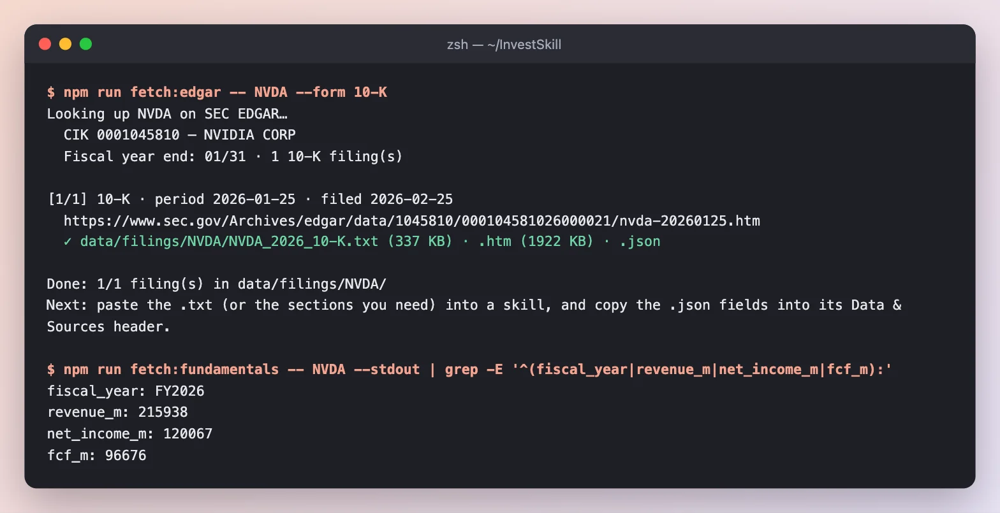
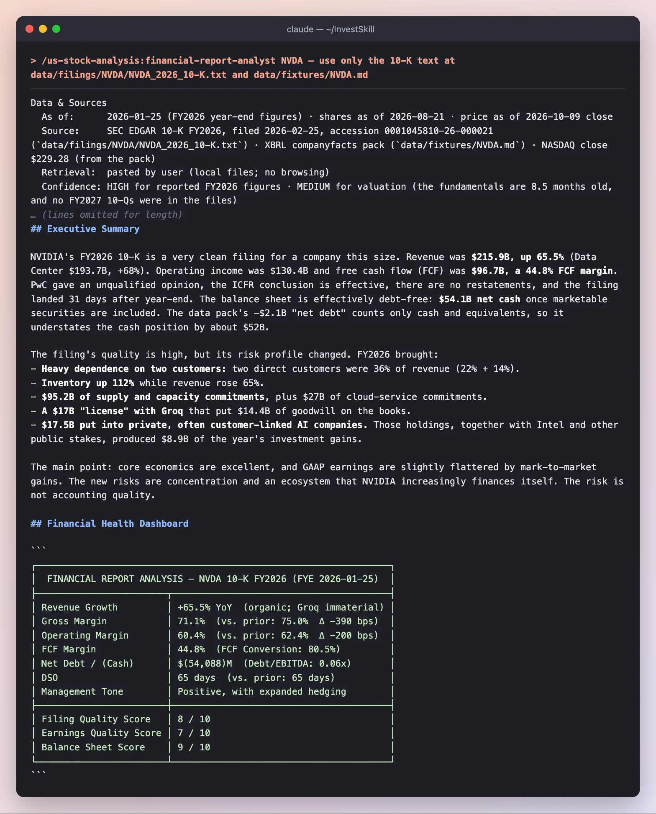
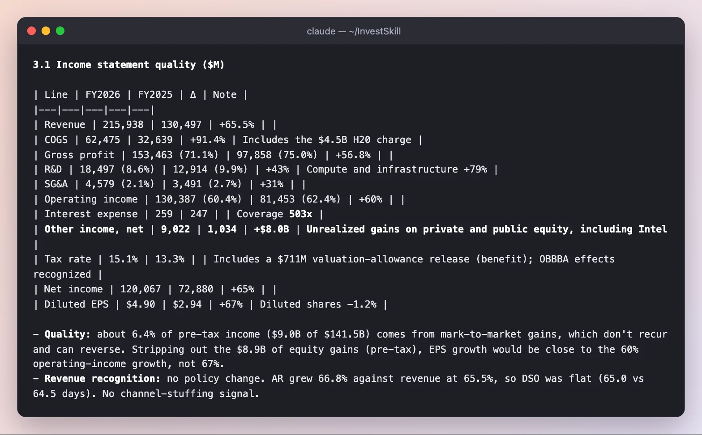
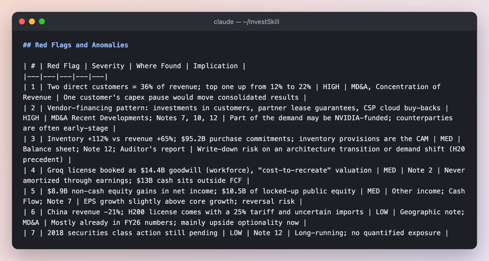
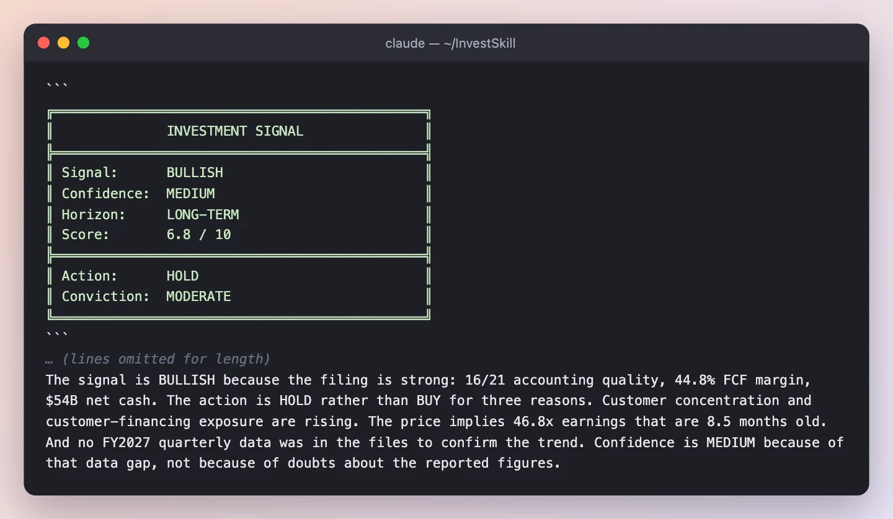

# NVDA 10-K Deep Dive — Read the Filing, Then Check the Reading

This demo runs `financial-report-analyst` on NVIDIA's annual report (Form 10-K) for fiscal 2026, then hands its output to `fact-check` to verify every number. Each step shows the command, screenshots of the real output, what to notice, and the result.

Everything below was run for real on **2026-10-11**. The skills could read two local files and nothing else: the 10-K text from SEC EDGAR and an SEC XBRL data pack, plus the **$229.28 NASDAQ close on 2026-10-09**. No web browsing, no figures from memory. The full outputs are at the [bottom of the page](#full-outputs). A Traditional Chinese counterpart runs the same two steps on AMD: [AMD 10-K 深度解析](FULL-DEMO-AMD.md).

> **Educational only — not investment advice.** NVIDIA's fiscal year ended 2026-01-25, so by October 2026 the figures are about 8½ months old. The skills say so.

**Jump to:** [0 · Get the filing](#step-0--get-the-filing) · [1 · Analyze](#step-1--analyze-the-10-k-financial-report-analyst) · [2 · Verify](#step-2--check-every-number-fact-check) · [Results](#what-we-ended-up-with)

---

## The plan at a glance

| Step | Question | Skill | Run time | Result |
|------|----------|-------|----------|--------|
| 0 | Get the primary source | `fetch:edgar` + `fetch:fundamentals` | seconds | 10-K text + XBRL data pack |
| 1 | How healthy is this filing, and what changed? | `financial-report-analyst` | 2 min 37 s | **BULLISH · 6.8 / 10 · HOLD**, 7 red flags |
| 2 | Are the numbers in step 1 right? | `fact-check` | ⏳ in progress | ⏳ in progress |

---

## Step 0 · Get the filing



*The 10-K for the year ended 2026-01-25, filed 2026-02-25, saved as 337 KB of plain text. The XBRL pack gives revenue of $215.9B, net income of $120.1B and FCF of $96.7B, as reported.*

**Result:** `data/filings/NVDA/NVDA_2026_10-K.txt` and `data/fixtures/NVDA.md`, with the latest close added by hand.

---

## Step 1 · Analyze the 10-K (`financial-report-analyst`)

```text
/us-stock-analysis:financial-report-analyst NVDA — use only the 10-K text at data/filings/NVDA/NVDA_2026_10-K.txt and data/fixtures/NVDA.md
```

### 1a · Sources, summary and dashboard



*It states where every number came from, gives the one-paragraph verdict, then scores filing quality, earnings quality and balance sheet.*

**What to notice**

- **It corrected the data pack.** The pack's "net debt" of −$2.1B counts only cash and equivalents. Including marketable securities, NVIDIA has **$54.1B net cash**, about $52B more than the pack implies.
- **Quality is not the question; concentration is.** Revenue **$215.9B (+65.5%)**, FCF margin 44.8%, clean PwC opinion. But two direct customers were **36% of revenue**, inventory rose 112%, and NVIDIA committed $95.2B to supply and capacity.

### 1b · Where the earnings came from



*A line-by-line income statement with a note on each change.*

**What to notice**

- **Other income jumped from $1.0B to $9.0B**, mostly unrealized gains on private and public equity stakes, including Intel. That's 6.4% of pre-tax income that doesn't recur and can reverse.
- **Its own adjustment, labeled as such.** It adds back the disclosed $4.5B H20 charge to show underlying gross margin (73.2%) and says the 10-K itself presents no non-GAAP figures.

### 1c · Red flags and the verdict





*Each red flag cites where in the filing it was found. The signal explains why BULLISH still means HOLD.*

**What to notice**

- **Two HIGH flags:** customer concentration (the top customer went from 12% to 22%), and a **vendor-financing pattern**: $17.5B invested in private AI companies that buy NVIDIA products, $3.5B of lease guarantees to early-stage partners, and $27B of cloud capacity bought back from customer clouds.
- **An unusual accounting call.** A non-exclusive license from Groq plus hired staff was booked as a business combination, creating **$14.4B of goodwill** that will never amortize through earnings.
- **BULLISH but HOLD.** The filing is strong (accounting quality 16/21), but the price is 46.8× earnings that are 8½ months old, and no FY2027 quarter was in the files to confirm the trend.

**Result of step 1:** **BULLISH · MEDIUM confidence · 6.8 / 10 · HOLD.**

---

## Step 2 · Check every number (`fact-check`)

The analysis cites hundreds of figures. `fact-check` pulls out every one and checks it against the same two source files.

```text
/us-stock-analysis:fact-check output/nvda/01-financial-report-analyst.md — verify every figure against data/filings/NVDA/NVDA_2026_10-K.txt and data/fixtures/NVDA.md
```

> ⏳ **This step is still running** — its screenshot and notes will be added to this page shortly.

---

## What we ended up with

| Skill | Signal | Score | One-line takeaway |
|-------|--------|-------|-------------------|
| `financial-report-analyst` | BULLISH · HOLD | 6.8 / 10 | Excellent economics; new risks are concentration and a customer-financed ecosystem |
| `fact-check` | ⏳ in progress | — | — |

**What this demo shows**

1. **A filing analysis is more than ratios.** The most important findings here (customer concentration, customer financing, the Groq goodwill) are in the notes, not the headline numbers.
2. **The data pack is a starting point, not gospel.** The analyst caught that the pack's net-debt line ignored $52B of marketable securities.
3. **Then check the checker.** A second skill re-verifying the first is cheap, and it tells you how much to trust what you just read.

---

## Run it yourself

```bash
export EDGAR_USER_AGENT="Your Name you@example.com"
npm run fetch:edgar -- NVDA --form 10-K
npm run fetch:fundamentals -- NVDA        # then add today's price on the `price:` line

# Inside Claude Code
/us-stock-analysis:financial-report-analyst NVDA — use only data/filings/NVDA/NVDA_2026_10-K.txt and data/fixtures/NVDA.md
/us-stock-analysis:fact-check <saved output> — verify every figure against the same two files
```

Each run here used `claude -p "<command>" --allowedTools Read`. For other assistants, paste [`prompts/financial-report-analyst.md`](https://github.com/yennanliu/InvestSkill/blob/main/prompts/financial-report-analyst.md) followed by the filing text. See the [Demo Overview](full-demo.html) for the other demos.

---

## Full outputs

<details>
<summary><strong><code>financial-report-analyst</code> — full output</strong></summary>

~~~~text
Data & Sources
  As of:      2026-01-25 (FY2026 year-end figures) · shares as of 2026-08-21 · price as of 2026-10-09 close
  Source:     SEC EDGAR 10-K FY2026, filed 2026-02-25, accession 0001045810-26-000021 (`data/filings/NVDA/NVDA_2026_10-K.txt`) · XBRL companyfacts pack (`data/fixtures/NVDA.md`) · NASDAQ close $229.28 (from the pack)
  Retrieval:  pasted by user (local files; no browsing)
  Confidence: HIGH for reported FY2026 figures · MEDIUM for valuation (the fundamentals are 8.5 months old, and no FY2027 10-Qs were in the files)

> ⚠️ **Some data isn't in these files.** I couldn't find the 52-week range, any FY2027 quarterly results (Q1/Q2 10-Qs), consensus estimates, Form 4 trades, the proxy (Item 13 related parties), or the prior-year 10-K text. Anything that depends on them is marked *unavailable* below. The valuation multiples compare an October 2026 price with fiscal-year earnings that ended in January 2026.

---

## Executive Summary

NVIDIA's FY2026 10-K is a very clean filing for a company this size. Revenue was **$215.9B, up 65.5%** (Data Center $193.7B, +68%). Operating income was $130.4B and free cash flow (FCF) was **$96.7B, a 44.8% FCF margin**. PwC gave an unqualified opinion, the ICFR conclusion is effective, there are no restatements, and the filing landed 31 days after year-end. The balance sheet is effectively debt-free: **$54.1B net cash** once marketable securities are included. The data pack's −$2.1B "net debt" counts only cash and equivalents, so it understates the cash position by about $52B.

The filing's quality is high, but its risk profile changed. FY2026 brought:
- **Heavy dependence on two customers:** two direct customers were 36% of revenue (22% + 14%).
- **Inventory up 112%** while revenue rose 65%.
- **$95.2B of supply and capacity commitments**, plus $27B of cloud-service commitments.
- **A $17B "license" with Groq** that put $14.4B of goodwill on the books.
- **$17.5B put into private, often customer-linked AI companies.** Those holdings, together with Intel and other public stakes, produced $8.9B of the year's investment gains.

The main point: core economics are excellent, and GAAP earnings are slightly flattered by mark-to-market gains. The new risks are concentration and an ecosystem that NVIDIA increasingly finances itself. The risk is not accounting quality.

## Financial Health Dashboard

```
┌─────────────────────────────────────────────────────────────────┐
│  FINANCIAL REPORT ANALYSIS — NVDA 10-K FY2026 (FYE 2026-01-25)  │
├────────────────────────┬────────────────────────────────────────┤
│ Revenue Growth         │ +65.5% YoY  (organic; Groq immaterial) │
│ Gross Margin           │ 71.1%  (vs. prior: 75.0%  Δ −390 bps)  │
│ Operating Margin       │ 60.4%  (vs. prior: 62.4%  Δ −200 bps)  │
│ FCF Margin             │ 44.8%  (FCF Conversion: 80.5%)         │
│ Net Debt / (Cash)      │ $(54,088)M  (Debt/EBITDA: 0.06x)       │
│ DSO                    │ 65 days  (vs. prior: 65 days)          │
│ Management Tone        │ Positive, with expanded hedging        │
├────────────────────────┼────────────────────────────────────────┤
│ Filing Quality Score   │ 8 / 10                                 │
│ Earnings Quality Score │ 7 / 10                                 │
│ Balance Sheet Score    │ 9 / 10                                 │
└────────────────────────┴────────────────────────────────────────┘
```

## Phase 1 — Document Orientation

| Item | Finding |
|---|---|
| Filing | 10-K, fiscal year ended 2026-01-25 (52-week year) |
| Auditor / opinion | PricewaterhouseCoopers LLP. Unqualified ("present fairly, in all material respects"); ICFR audited and effective |
| Critical audit matter | Inventory provisions and excess purchase commitments, which depend on demand assumptions |
| Auditor change | None disclosed |
| Timeliness | Filed 2026-02-25, 31 days after year-end. Timely |
| Restatements | The cover-page error-correction / clawback box is unchecked; none disclosed |

## Phase 2 — MD&A

**2.1 Revenue by market and geography ($M)**

| Line | FY2026 | FY2025 | YoY | MD&A commentary |
|---|---|---|---|---|
| Data Center | 193,737 | 115,186 | +68.2% | Blackwell was the majority; compute +59%, **networking +142%** (NVLink, Ethernet, InfiniBand) |
| Gaming | 16,042 | 11,350 | +41.3% | Blackwell; **"supply constraints to be a headwind… Q1 FY27 and beyond"** |
| Pro Visualization | 3,191 | 1,878 | +69.9% | Blackwell, DGX Spark |
| Automotive | 2,349 | 1,694 | +38.7% | Self-driving platforms |
| OEM & Other | 619 | 389 | +59.1% | — |
| US (customer HQ) | 149,617 | 77,482 | +93.1% | 69% of revenue |
| Taiwan | 42,345 | 23,600 | +79.4% | — |
| **China incl. HK** | **19,677** | **25,048** | **−21.4%** | Down to 9.1% of revenue from 19.2%; H20 export license |
| Other | 4,299 | 4,367 | −1.5% | — |
| **Total** | **215,938** | **130,497** | **+65.5%** | Segments: C&N +67%, Graphics +57% |

- **Organic or acquired?** Organic. Groq was a technology license plus hired employees, with "no customer contracts, existing products" (Note 2). Acquisitions cost $1.5B net cash, and pro forma results were "not material."
- **Mix:** a move to full-rack Blackwell systems carries lower gross margin than Hopper HGX boards (MD&A).
- **Backlog / RPO:** RPO on contracts longer than one year is only **$2.3B** (42% recognized within 12 months). Deferred revenue additions were $11.1B, up from $5.1B. Hardware backlog isn't disclosed, so forward visibility from the filing is thin.

**2.2 Margins**

| Metric | FY2026 | FY2025 | Δ | MD&A explanation |
|---|---|---|---|---|
| Gross margin | 71.1% | 75.0% | −390 bps | Hopper → Blackwell systems, plus a **$4.5B H20 charge** |
| GM excluding H20 charge* | 73.2% | 75.0% | −180 bps | The underlying mix effect |
| Operating margin | 60.4% | 62.4% | −200 bps | Opex +41% against revenue +65%, so opex leverage held |
| Op margin excl. H20* | 62.5% | 62.4% | +10 bps | Flat on an underlying basis |
| Net margin | 55.6% | 55.8% | −20 bps | Held up by $9.0B of other income |
| FCF margin | 44.8% | 46.6% | −180 bps | Working-capital build |

*My adjustment, adding back the disclosed $4.5B charge. The 10-K itself presents no non-GAAP figures.

Inventory provisions were $7.2B gross against $3.7B, with net GM drag of 2.6 pts against 2.3 pts. Even excluding H20, provisions rose, which fits the CAM focus.

**2.3 Liquidity and capital resources**

- **Cash plus marketable securities: $62.6B.** Marketable securities now include public equities, and $10.5B of them are under lock-up (Note 7).
- **Debt:** $8.468B of senior notes. $1.0B is due within one year, $2.75B in one to five years, and $4.75B after that. The covenants are non-financial. The commercial paper program was raised from $575M to **$25.0B**, with nothing outstanding.
- **Debt-like item:** $4B still owed to Groq within one year, sitting in accrued liabilities.
- **OCF:** $102.7B. Capex $6.0B; FCF $96.7B.
- **Capital return:** $40.1B cash buybacks (282M shares) and $974M dividends, which together are 42.5% of FCF. A further **$7.9B** went to employee stock-plan tax withholding, which is effectively a cash cost of SBC. $58.5B of buyback authorization remains.
- **Off-balance-sheet commitments (Note 12):**
  - $95.2B manufacturing, supply and capacity, "substantially all" payable through FY2027
  - $27B multi-year cloud services
  - $11.4B investment commitments
  - $3.4B other
  - $3.5B lease guarantees to early-stage partners, with $712M in escrow

**2.4 Forward-looking language**

| Item | Language | Strength |
|---|---|---|
| Revenue | No numeric guidance in the 10-K (quarterly guidance comes in earnings releases, which aren't in these files) | Unavailable |
| Margin | None | Unavailable |
| Capex | "expect to increase capital expenditures in fiscal year 2027" | Directional |
| Gaming | "supply constraints to be a headwind… Q1 FY27 and beyond" | Specific (negative) |
| Product timing | "one-year product cadence, including our Rubin platform"; GB300 shipping since Q2 FY26 | Specific |
| China | H200 license granted Feb 2026; "have not generated any revenue… do not yet know whether any imports will be allowed into China"; 25% tariff applies | Hedged |
| OpenAI | "finalizing an investment and partnership agreement… no assurance" | Hedged |

## Phase 3 — Financial Statements

**3.1 Income statement quality ($M)**

| Line | FY2026 | FY2025 | Δ | Note |
|---|---|---|---|---|
| Revenue | 215,938 | 130,497 | +65.5% | |
| COGS | 62,475 | 32,639 | +91.4% | Includes the $4.5B H20 charge |
| Gross profit | 153,463 (71.1%) | 97,858 (75.0%) | +56.8% | |
| R&D | 18,497 (8.6%) | 12,914 (9.9%) | +43% | Compute and infrastructure +79% |
| SG&A | 4,579 (2.1%) | 3,491 (2.7%) | +31% | |
| Operating income | 130,387 (60.4%) | 81,453 (62.4%) | +60% | |
| Interest expense | 259 | 247 | | Coverage **503x** |
| **Other income, net** | **9,022** | **1,034** | **+$8.0B** | **Unrealized gains on private and public equity, including Intel** |
| Tax rate | 15.1% | 13.3% | | Includes a $711M valuation-allowance release (benefit); OBBBA effects recognized |
| Net income | 120,067 | 72,880 | +65% | |
| Diluted EPS | $4.90 | $2.94 | +67% | Diluted shares −1.2% |

- **Quality:** about 6.4% of pre-tax income ($9.0B of $141.5B) comes from mark-to-market gains, which don't recur and can reverse. Stripping out the $8.9B of equity gains (pre-tax), EPS growth would be close to the 60% operating-income growth, not 67%.
- **Revenue recognition:** no policy change. AR grew 66.8% against revenue at 65.5%, so DSO was flat (65.0 vs 64.5 days). No channel-stuffing signal.

**3.2 Balance sheet**

```
Asset Quality:
  Cash + marketable securities:  $62,556M  (30.2% of assets)
  Accounts Receivable:           $38,466M  DSO: 65 days (vs. prior: 65)
  Inventory:                     $21,403M  DIO: 125 days (vs. prior: 113)  ← +112% YoY
     WIP 8,822 (from 3,399) · Finished goods 8,774 (from 3,273) · Raw 3,807
  Goodwill & Intangibles:        $24,138M  (11.7% of assets; goodwill 20,832, up from 5,188)
  Non-marketable equity:         $22,251M  (from 3,387; 10.8% of assets, level-3-style marks)
  Deferred tax assets:           $13,258M

Liability Structure:
  Short-Term Debt:               $999M
  Long-Term Debt:                $7,469M
  Total Debt:                    $8,468M  (+$4B Groq payable, debt-like)
  Net Debt/(Cash):               $(54,088)M  (excluding the Groq payable)
  Interest Coverage:             503x
  Debt/EBITDA:                   0.06x  (EBITDA ≈ $133.2B = EBIT + D&A)

Equity Quality:
  Retained earnings:             $146,973M, growing (from 68,038)
  Buybacks charged to RE:        $40,158M in FY26
  AOCI:                          $178M, immaterial; no pension exposure
```

**3.3 Cash flow, the check on earnings**

```
Operating Cash Flow:        $102,718M
Less: Capex:                 $(6,042)M
Free Cash Flow:              $96,676M   FCF Margin: 44.8%
FCF Conversion:              80.5%      (prior: 83.5%; ~87% vs NI ex-equity gains, pre-tax)
FCF after Groq cash:         $83,676M   (69.7% of NI, if the $13.0B license is treated as capex)

Working Capital:
  AR change:                 $(15,399)M  use
  Inventory change:          $(11,324)M  use  ← biggest drag
  AP change:                 +$3,096M    source
  Accrued/other current:     +$5,257M    source
  Net WC impact:             ≈ $(15,949)M (incl. prepaid & LT liabilities)

SBC Add-Back:                $6,386M  (3.0% of revenue, down from 3.6%; below the 5% threshold)
D&A Add-Back:                $2,843M  (1.3% of revenue; capex/D&A = 2.1x, investing above maintenance)
Non-cash gains deducted:     $(8,918)M
```

FCF above 80% of net income passes the quality bar. The $13.0B Groq payment and the $17.5B of private investments sit in investing, below the FCF line, so reported FCF overstates the cash actually left after "strategic" spending.

## Phase 4 — Risk Factors and Legal

The prior-year 10-K text isn't in the files, so a strict new/removed comparison is **unavailable**. The items below are ones the FY2026 filing itself describes as FY2026 events:

```
NEW in FY2026 (by content):
  1. Groq IP license: "significant, nonrefundable payments"; integration may not deliver (Business/Tech)
  2. Multi-year cloud-service agreements ($27B): timing "changed and may continue to shift" (Business)
  3. OpenAI investment/partnership "no assurance" of completion (Business/Counterparty)
  4. Lease guarantees to early-stage partners ($3.5B) and a "commercial arrangements… counterparty risks" factor (Credit)
  5. H200 China license with a 25% US import tariff; China import approval unknown (Regulatory)
  6. Customers' data-center, energy and capital constraints named as a limit on deployments (Macro)
  7. Open-source models running on competitors' platforms (Competition)

ELEVATED:
  1. Customer concentration: top direct customer 22% (from 12%); top two 36%. One AI lab is
     "a meaningful amount" of revenue through cloud intermediaries
  2. Supply/demand mismatch: the H20 charge shows the risk already happened

REMOVED: unavailable (needs the prior 10-K text)
```

- **Going concern / covenant breach:** none. Covenants are non-financial and in compliance.
- **Legal:** the 2018 securities class action (*In re NVIDIA Corp. Securities Litigation*, 4:18-cv-07669) is still pending, and the derivative suits (N.D. Cal., D. Del., Del. Chancery *Horanic v. Huang*) are stayed. The filing gives no quantified exposure. Separately, unrecognized tax benefits total $4.0B, and the IRS is examining FY2023–24.

## Phase 5 — Accounting Policies and Footnotes

| Estimate | Assessment |
|---|---|
| Revenue recognition | Standard ASC 606; distinct performance obligations; no change |
| Inventory / purchase commitments | **The highest-judgment area and the CAM.** $95.2B of commitments against $21.4B of inventory leaves a lot exposed to a demand shift |
| **Goodwill (Groq)** | **Unusual.** A *non-exclusive license plus hired staff* was booked as a business combination: $14.4B goodwill and $2.5B intangible (5-year life), "valued using a cost-to-recreate methodology." Goodwill is "primarily attributable to the workforce." The $14.4B won't amortize, so it never hits operating income unless impaired. The $2.5B intangible adds about $0.5B a year of amortization |
| Non-marketable equity | Measurement alternative (cost ± observable price changes). The $22.3B book value grew roughly 6.5x. Many investees are **customers** ("AI model makers that purchase our products"), which links the gains to revenue |
| Deferred tax assets | $711M **release** of valuation allowance, a positive sign |
| Pension / OPEB | None material |
| Related parties | Item 13 is incorporated from the proxy: **unavailable** |
| Segments | Unchanged (Compute & Networking, Graphics) |

## Phase 6 — Management Tone

```
Section              Tone (1–5)   Key language
──────────────────────────────────────────────────────────────────────────
MD&A Overview          5          "data center scale AI infrastructure company reshaping all industries"
Revenue Discussion     5          "major platform shifts – accelerated computing and AI"
Margin Discussion      3          Margin decline attributed to model transition + H20; candid on provisions
Guidance Language      3          Directional only; Gaming "headwind"; China "do not yet know"
Risk Factors Framing   3          Many new "no assurance" clauses (Groq, OpenAI, investments, guarantees)
CEO Letter             n/a        Not in a 10-K
──────────────────────────────────────────────────────────────────────────
Overall Tone:        4 / 5
Change vs. Prior:    Unavailable (no prior 10-K text). Hedging density around ecosystem deals visibly up.
```

Hedging flags: "there can be no assurance that we will realize a return" (private investments), "may not become profitable in the near term, or at all" (investees), "may not deliver anticipated benefits" (cloud agreements). The negatives are stated in active voice, so I don't see evasive phrasing.

**Guidance accuracy scorecard (Phase 6.3) and the YoY/sequential quarterly comparison (Phase 7):** unavailable, because there are no earnings releases or 10-Qs in the files.

## Phase 8 — Insider Activity

From Item 9B, the only insider data in the files:
- **CFO Colette Kress** adopted a 10b5-1 plan (2025-12-18) to sell up to **500,000 shares** through 2027-03-23.
- **Director John Dabiri** adopted a plan for about 3,984 shares.

Scheduled 10b5-1 sales carry little signal. Open-market buys and sells (Form 4) are **unavailable**.

## Valuation Snapshot (price $229.28, 2026-10-09)

| Metric | Value | Note |
|---|---|---|
| Market cap | ~$5.53T | 24,100M shares × $229.28 |
| EV | ~$5.47T | Less $54.1B net cash |
| P/E (FY2026 EPS $4.90) | 46.8x | Earnings are about 8.5 months old; trailing-twelve-month EPS is unavailable |
| EV / FY26 revenue | 25.3x | |
| EV / FY26 EBIT | 42.0x | |
| FCF yield | 1.75% | |

These multiples look backward. If FY2027 has grown at anything like FY2026's pace, the real multiple is lower, but nothing in these files lets me check that.

## Key Insights

**Positives (bullish signals):**
- 65.5% revenue growth at a 60.4% operating margin, all organic (MD&A, FY2026 Summary).
- Networking +142% shows the platform is broadening beyond GPUs (Segment discussion).
- Underlying operating margin was flat at about 62.5% excluding H20, despite the shift to full systems.
- FCF of $96.7B, 80.5% conversion; SBC fell to 3.0% of revenue (Cash Flow Statement).
- $54.1B net cash, 503x interest coverage, no going-concern, covenant or auditor issues (Liquidity; Item 9A).
- Share count down 0.7% even after SBC; $58.5B of buyback authorization left.

**Negatives (bearish signals):**
- Two customers are 36% of revenue, and the top one rose from 12% to 22% (Concentration of Revenue).
- Inventory up 112% against revenue +65%, DIO up 12 days. A $4.5B write-down already happened with H20 (Balance sheet; Note 9).
- **Circular-financing exposure:** $17.5B into private AI firms that buy NVIDIA products, $3.5B of lease guarantees to early-stage partners, a pending OpenAI deal, and $27B of cloud capacity bought back from customer-CSPs (MD&A; Note 12).
- $8.9B of GAAP profit is unrealized investment gains, which can reverse (Other income).
- The Groq "license" was booked as $14.4B of non-amortizing goodwill (Note 2).
- China revenue fell 21%, and H200 sales there are uncertain and carry a 25% tariff.

**Neutral / watch items:**
- $95.2B of supply commitments due through FY2027: watch inventory provisions and the CAM.
- The $25B commercial paper program is undrawn. Ask why the capacity is being set up.
- FY2027 capex is guided up. The IRS is examining FY2023–24, with $4.0B of uncertain tax positions.

## Red Flags and Anomalies

| # | Red Flag | Severity | Where Found | Implication |
|---|---|---|---|---|
| 1 | Two direct customers = 36% of revenue; top one up from 12% to 22% | HIGH | MD&A, Concentration of Revenue | One customer's capex pause would move consolidated results |
| 2 | Vendor-financing pattern: investments in customers, partner lease guarantees, CSP cloud buy-backs | HIGH | MD&A Recent Developments; Notes 7, 10, 12 | Part of the demand may be NVIDIA-funded; counterparties are often early-stage |
| 3 | Inventory +112% vs revenue +65%; $95.2B purchase commitments; inventory provisions are the CAM | MED | Balance sheet; Note 12; Auditor's report | Write-down risk on an architecture transition or demand shift (H20 precedent) |
| 4 | Groq license booked as $14.4B goodwill (workforce), "cost-to-recreate" valuation | MED | Note 2 | Never amortized through earnings; $13B cash sits outside FCF |
| 5 | $8.9B non-cash equity gains in net income; $10.5B of locked-up public equity | MED | Other income; Cash Flow; Note 7 | EPS growth slightly above core growth; reversal risk |
| 6 | China revenue −21%; H200 license comes with a 25% tariff and uncertain imports | LOW | Geographic note; MD&A | Mostly already in FY26 numbers; mainly upside optionality now |
| 7 | 2018 securities class action still pending | LOW | Note 12 | Long-running; no quantified exposure |

## Accounting Quality Score

| Criterion | Score (0–3) | Notes |
|---|---|---|
| Revenue recognition clarity | 3 | Standard ASC 606; DSO flat; no policy change |
| Non-GAAP reconciliation quality | 2 | No non-GAAP in the 10-K; GAAP net income includes $8.9B mark-to-market gains |
| FCF conversion rate | 2 | 80.5%, at the threshold; ~70% if Groq cash counts as capex |
| Working capital trends | 1 | Inventory doubled; $27.6B of combined AR and inventory build |
| Footnote transparency | 3 | Commitments, guarantees, Groq and investments all disclosed in detail |
| Auditor opinion | 3 | PwC unqualified; ICFR effective; timely filing |
| Related party transactions | 2 | Item 13 deferred to the proxy, which is unavailable; customer-investee overlap is related-in-substance |
| **Total** | **16 / 21** | **Average, upper end.** Clean books; the questions are about business structure |

---

## Thesis Invalidation

**If signal is BULLISH — thesis breaks if:**
- auditor issues going concern warning OR material restatement announced
- Inventory provisions plus purchase-obligation charges exceed **4% of revenue** in any fiscal year (FY26 gross was 3.3%), or inventory keeps growing more than 2x faster than revenue for another year
- The top direct customer's share rises **above 30%**, or any top-two customer cuts purchases more than 25% year on year. Also if non-marketable equity marks are **written down more than $5B**, which would show the investee ecosystem is cracking

**If signal is BEARISH — thesis breaks if:**
- new auditor clears all concerns AND restatement resolved favorably
- Revenue growth stays above 40% with GM back at or above 73% and DIO back under 100 days. That would show the inventory build was demand-backed
- Customer concentration falls (top two under 25%) while Data Center growth continues

**Re-run this analysis when:**
- [ ] Next earnings release (the Q2/Q3 FY2027 10-Qs aren't in these files; load them first)
- [ ] Price moves ±15% from $229.28
- [ ] 60 days have elapsed (by 2026-12-10)
- [ ] Material news event (OpenAI deal close, China H200 import decision, Groq integration, a large customer capex change)

## Investment Signal

```
╔══════════════════════════════════════════════╗
║              INVESTMENT SIGNAL               ║
╠══════════════════════════════════════════════╣
║ Signal:      BULLISH                         ║
║ Confidence:  MEDIUM                          ║
║ Horizon:     LONG-TERM                       ║
║ Score:       6.8 / 10                        ║
╠══════════════════════════════════════════════╣
║ Action:      HOLD                            ║
║ Conviction:  MODERATE                        ║
╚══════════════════════════════════════════════╝
```

Score Guide: 8.0–10.0 Strongly Bullish | 6.0–7.9 Moderately Bullish | 4.0–5.9 Neutral | 2.0–3.9 Moderately Bearish | 0.0–1.9 Strongly Bearish
Confidence: HIGH (strong data, clear signals) | MEDIUM (mixed signals) | LOW (limited data, conflicting signals)
Horizon: SHORT-TERM (1 week–3 months) | MEDIUM-TERM (3 months–1 year) | LONG-TERM (1+ years)

The signal is BULLISH because the filing is strong: 16/21 accounting quality, 44.8% FCF margin, $54B net cash. The action is HOLD rather than BUY for three reasons. Customer concentration and customer-financing exposure are rising. The price implies 46.8x earnings that are 8.5 months old. And no FY2027 quarterly data was in the files to confirm the trend. Confidence is MEDIUM because of that data gap, not because of doubts about the reported figures.

**Disclaimer:** Educational analysis only. Not financial advice.
~~~~

</details>

---

**Disclaimer:** Educational content only. Not financial advice. Figures are as of the dates shown and will go stale.
