# PLTR Full Demo — Ten Skills on Palantir, Step by Step

This demo runs ten InvestSkill skills on one stock, Palantir Technologies, grouped into four questions: *Is it a good business? What is it worth? What is the market saying? What could go wrong?* Each step shows the command, a screenshot of the real output, what to notice, and the result.

Everything below was run for real on **2026-10-11**. Each skill started from two SEC files, the FY2025 10-K figures (as an XBRL data pack) and the Q2 2026 10-Q text, plus the **$209.05 NASDAQ close on 2026-10-09**. Unlike the 10-K demos, these skills were **allowed to browse** for data the filings don't carry: price history, Form 4 trades, short interest, call transcripts, peer multiples. Every web figure is dated and sourced in its output. The full outputs are at the [bottom of the page](#full-outputs). The Traditional Chinese counterpart runs the same skills on Rocket Lab: [RKLB 完整示範](FULL-DEMO-RKLB.md).

> **Educational only — not investment advice.** Market data changes daily, and web sources are less reliable than SEC filings. That's why the last step fact-checks the first.

**Jump to:** [0 · Data](#step-0--get-the-data) · [Part 1 · The business](#part-1--is-it-a-good-business) · [Part 2 · The price](#part-2--what-is-it-worth) · [Part 3 · The market](#part-3--what-is-the-market-saying) · [Part 4 · The challenge](#part-4--what-could-go-wrong) · [Results](#what-we-ended-up-with)

---

## The plan at a glance

| Part | Step | Skill | Result |
|------|------|-------|--------|
| 1 · Business | 1 | `stock-eval` | **NEUTRAL · 4.5 / 10 · HOLD** |
| | 2 | `competitor-analysis` | Moat **7.7 / 10**, narrow and widening → NEUTRAL · 5.9 |
| | 3 | `earnings-call-analysis` | Largest guidance raise in its history → BULLISH · 6.5 |
| 2 · Price | 4 | `stock-valuation` | Composite value **$148** → **BEARISH · 3.0 / 10 · SELL** |
| | 5 | `dividend-analysis` | Capital allocation **5.6 / 10**, grade C |
| 3 · Market | 6 | `technical-analysis` | Young uptrend, overbought → **BULLISH · 7.0 / 10 · BUY on pullback** |
| | 7 | `insider-trading` | $869M sold, almost all automatic → NEUTRAL · 4.6 |
| | 8 | `short-interest` | 2.6% of float, no squeeze → NEUTRAL · 5.0 |
| 4 · Challenge | 9 | `bear-case` | Bear strength **5.0 / 10** → NEUTRAL · 5.0 |
| | 10 | `fact-check` | ⏳ in progress |

---

## Step 0 · Get the data

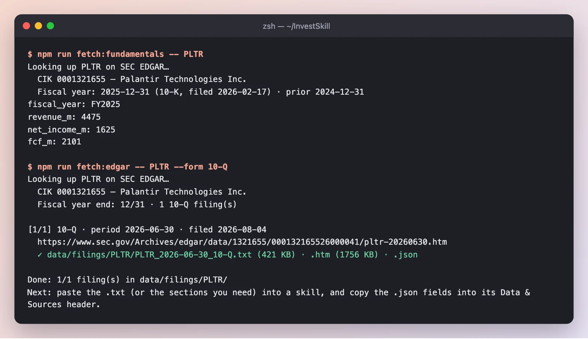

*FY2025 revenue $4.48B, net income $1.63B and FCF $2.10B as reported, plus the full Q2 2026 10-Q (421 KB of text). The latest close was added to the pack by hand.*

**Result:** `data/fixtures/PLTR.md` and `data/filings/PLTR/PLTR_2026-06-30_10-Q.txt`, the starting point for every skill below. Each command ended with the same instruction: *start from these two files, use the web only for data not in them, and cite each source with its date.*

---

## Part 1 · Is it a good business?

### Step 1 · `stock-eval` — the all-round view

```text
/us-stock-analysis:stock-eval PLTR — start from data/fixtures/PLTR.md and the latest 10-Q; use the web only for data not in them
```

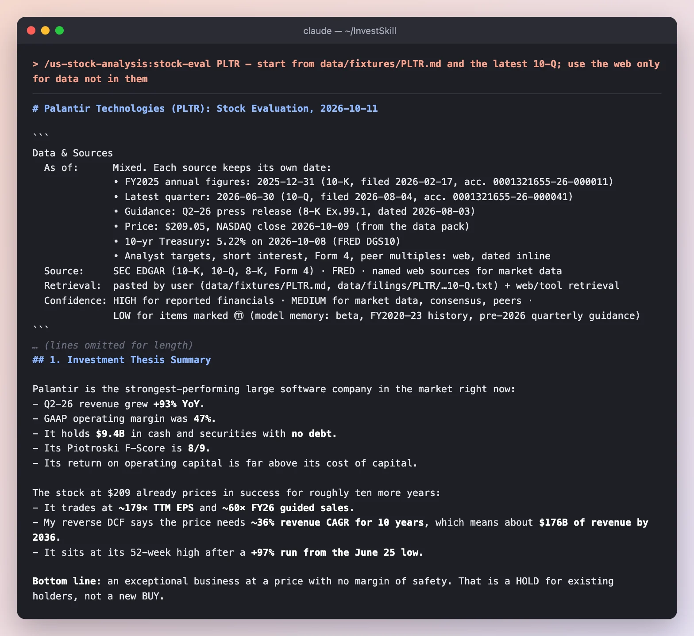

*Every source gets its own date, from the 10-K to a 10-year Treasury yield, and items recalled from model memory are marked ⓜ with LOW confidence.*

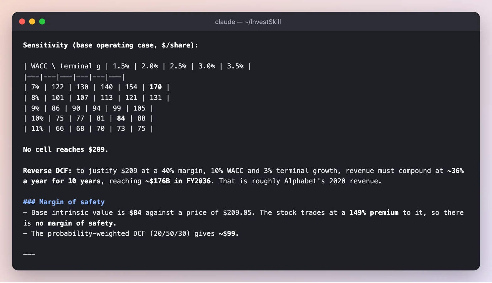

*The DCF treats stock compensation as a cash cost, then runs the model backwards to see what the price implies.*

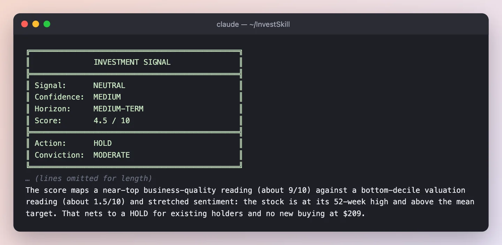

**What to notice**

- **An exceptional business:** Q2 revenue **+93%**, 47% GAAP operating margin, $9.4B of cash with no debt, Piotroski F-Score 8/9.
- **At a price with no margin of safety:** about **179× trailing EPS**. No cell of the DCF sensitivity table reaches $209, and the reverse DCF needs **~36% revenue growth a year for ten years** (about $176B of revenue by 2036).
- **It caught a data conflict.** One web source dated the $209.05 close to Oct 8; the pack and CNBC say Oct 9. It says which one it used.

**Result:** **NEUTRAL · MEDIUM · 4.5 / 10 · HOLD** — business quality about 9/10, valuation about 1.5/10. "$209 is not an entry."

### Step 2 · `competitor-analysis` — how wide is the moat?

```text
/us-stock-analysis:competitor-analysis PLTR — start from data/fixtures/PLTR.md and the latest 10-Q; use the web only for data not in them
```

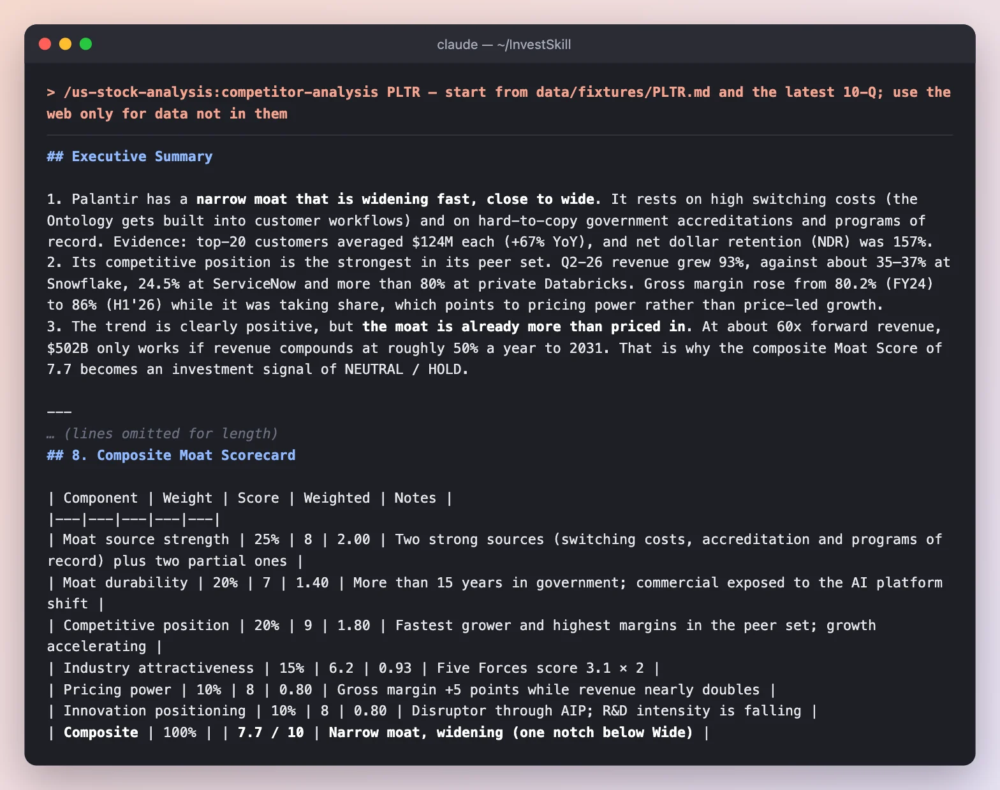

**What to notice**

- **Two strong moat sources:** switching costs (the Ontology gets built into customer workflows; net dollar retention 157%) and government accreditations and programs of record.
- **Pricing power shows in the numbers:** gross margin rose from 80.2% to 86% while revenue nearly doubled.
- **Moat ≠ buy.** A 7.7 moat still maps to NEUTRAL, because about 60× forward revenue only works if revenue compounds at roughly 50% a year to 2031.

**Result:** narrow moat, widening → **NEUTRAL · 5.9 / 10 · HOLD.**

### Step 3 · `earnings-call-analysis` — what did management say?

```text
/us-stock-analysis:earnings-call-analysis PLTR — most recent quarterly call
```

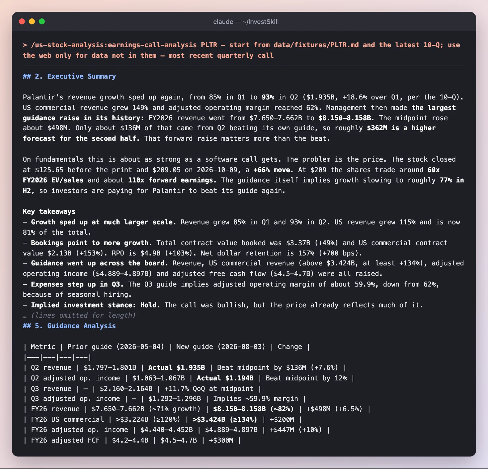

**What to notice**

- **The forward raise matters more than the beat.** FY2026 revenue guidance rose about $498M; only $136M came from beating Q2's own guide, so about **$362M is a higher forecast for the second half**.
- **It checked the transcript against the filing.** Quotes come from a machine-assisted transcript, so they're MEDIUM confidence, but every financial figure was matched to the 10-Q.
- **The catch:** the guidance itself implies growth slowing to about **77% in H2** from 89% in H1.

**Result:** **BULLISH · 6.5 / 10 · HOLD** — "the call was bullish, but the price already reflects much of it."

---

## Part 2 · What is it worth?

### Step 4 · `stock-valuation` — several methods, one range

```text
/us-stock-analysis:stock-valuation PLTR — start from data/fixtures/PLTR.md and the latest 10-Q; use the web only for data not in them
```

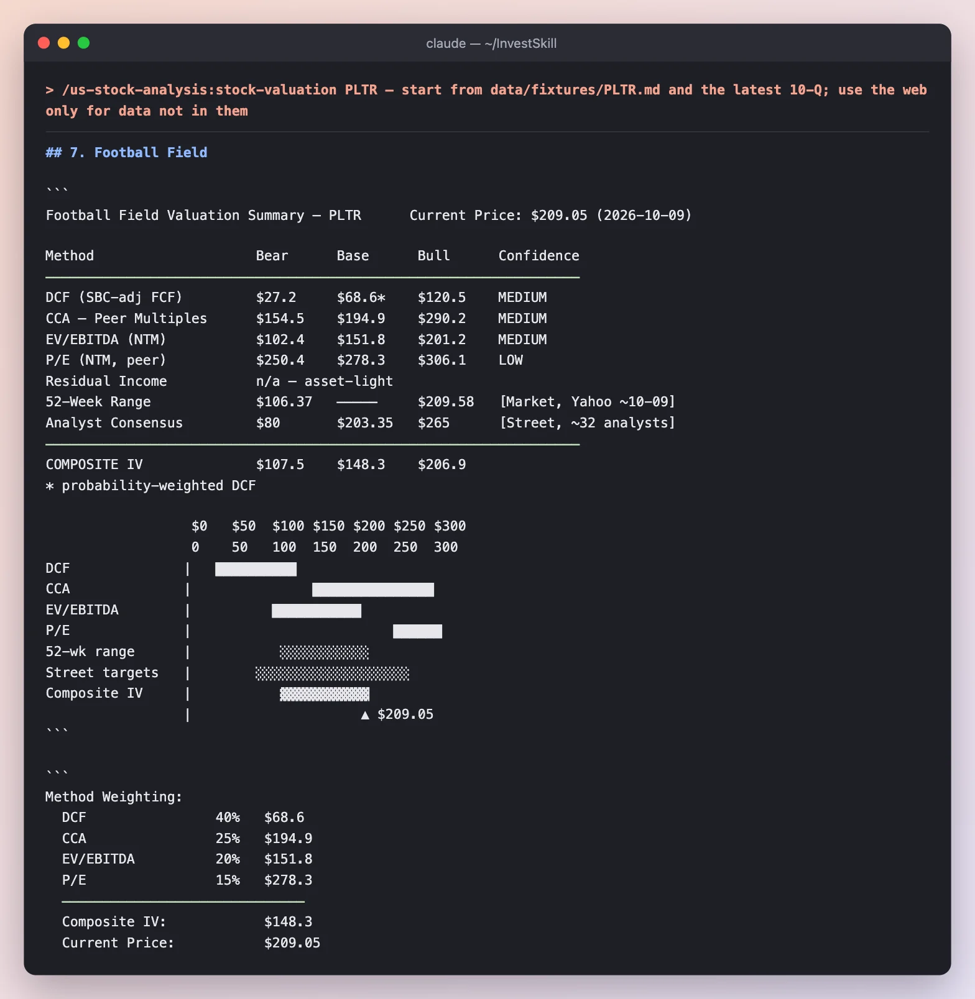

**What to notice**

- **Methods disagree by 4×:** the DCF base case is $69, peer P/E gives $278. The composite weights them to **$148**, a **−41% margin of safety**.
- **Even the composite bull case ($207) sits right at today's price.** Probability-weighted expected return: about **−27%**.
- **This is where two skills disagree.** `stock-eval` said NEUTRAL / HOLD; `stock-valuation` says **SELL**. It explains why: SELL here means "trim or don't initiate at $209", a call on price, not on the business.

**Result:** **BEARISH · MEDIUM · 3.0 / 10 · SELL.**

### Step 5 · `dividend-analysis` — what does it do with its cash?

```text
/us-stock-analysis:dividend-analysis PLTR — start from data/fixtures/PLTR.md and the latest 10-Q; use the web only for data not in them
```

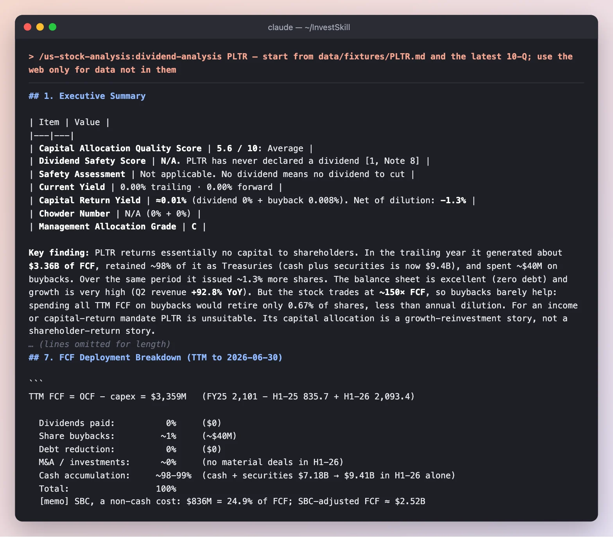

**What to notice**

- **It adapts to a company that pays no dividend.** Instead of forcing a dividend-safety score, it scores capital allocation as a whole and marks the dividend rows "not applicable".
- **About 98% of trailing FCF ($3.36B) was kept as cash.** Buybacks were about $40M while the share count grew about 1.3%, so the net capital return is **negative**.
- **Why it doesn't matter much yet:** at about 150× FCF, spending all of it on buybacks would retire only 0.67% of shares.

**Result:** capital allocation **5.6 / 10 (grade C)** → **NEUTRAL · HOLD**. A strong balance sheet, almost nothing returned.

---

## Part 3 · What is the market saying?

### Step 6 · `technical-analysis` — the chart

```text
/us-stock-analysis:technical-analysis PLTR — start from data/fixtures/PLTR.md and the latest 10-Q; use the web only for data not in them
```

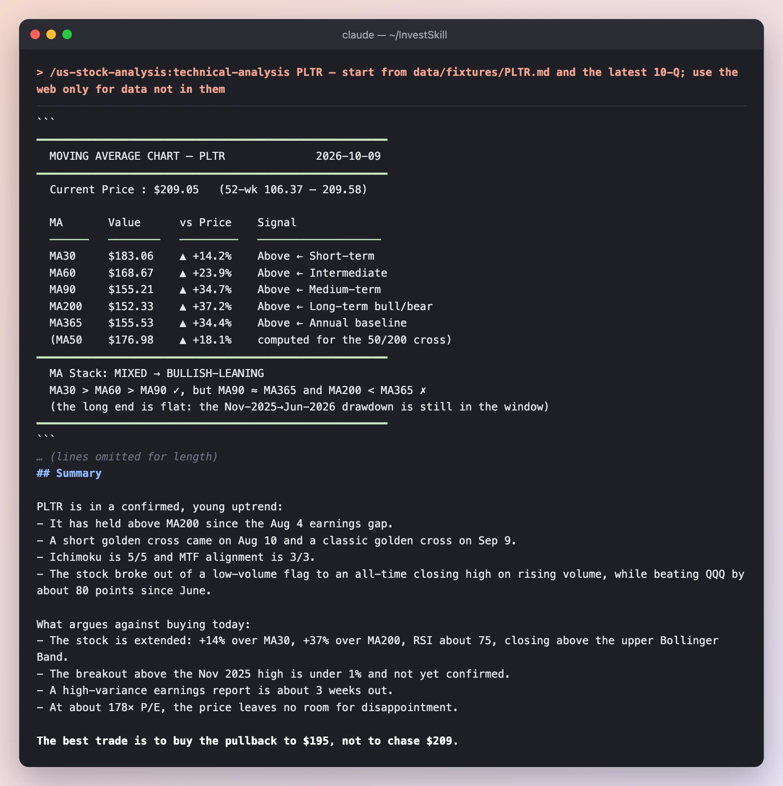

**What to notice**

- **It downloaded 18 months of daily bars and computed every indicator itself**, then checked its transcription against three outside data points (an Oct 2 close, an Oct 6 turnover figure and the Oct 9 close in the SEC pack). All three matched.
- **A young uptrend:** golden crosses on Aug 10 (short) and Sep 9 (classic), Ichimoku 5/5, multi-timeframe alignment 3/3, about 80 points ahead of QQQ since June.
- **But extended:** +37% over MA200, RSI about 75, closing above the upper Bollinger Band, with earnings about three weeks out. Hence "buy the pullback to $195, not chase $209."

**Result:** **BULLISH · MEDIUM · 7.0 / 10 · BUY on pullback** (short-term swing horizon). The only BUY in this demo, and it's a timing call, not a valuation call.

### Step 7 · `insider-trading` — are insiders buying or selling?

```text
/us-stock-analysis:insider-trading PLTR — start from data/fixtures/PLTR.md and the latest 10-Q; use the web only for data not in them
```

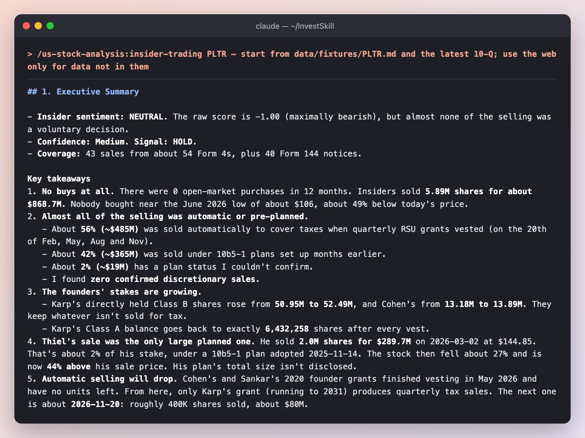

**What to notice**

- **The raw score is maximally bearish (−1.00)**: no buys at all and **$868.7M** of sales in 12 months.
- **But it read the footnotes.** About 56% was automatic tax withholding on RSU vests, 42% was under 10b5-1 plans set up months earlier, and **zero sales were confirmed discretionary**. The founders' directly held stakes actually grew.
- **It checked its source.** Average sale prices from an aggregator were matched against four original Form 4 filings.

**Result:** **NEUTRAL · 4.6 / 10 · HOLD** — "insider data neither supports nor argues against the position."

### Step 8 · `short-interest` — are the bears crowded?

```text
/us-stock-analysis:short-interest PLTR — start from data/fixtures/PLTR.md and the latest 10-Q; use the web only for data not in them
```

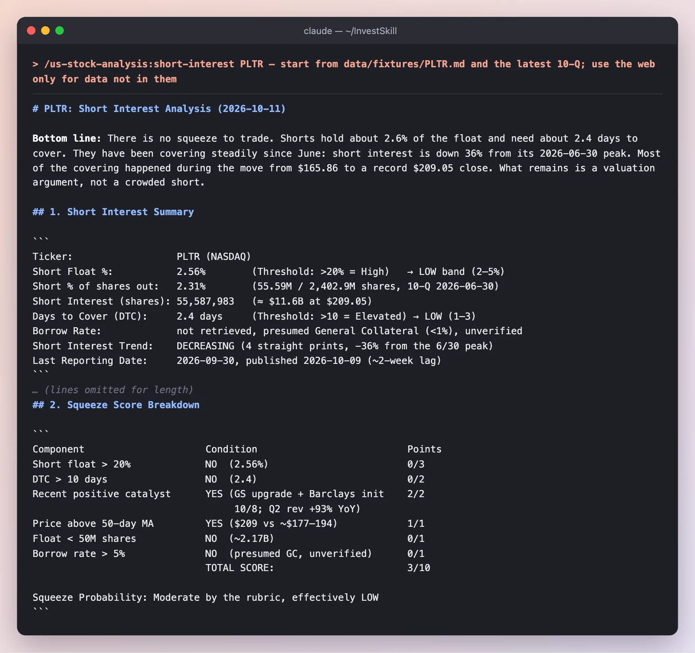

**What to notice**

- **No squeeze to trade.** 2.56% of float, 2.4 days to cover, and short interest **down 36%** from its June peak: shorts closing a losing trade, not new bears.
- **A rubric that doesn't fool itself.** The squeeze score is 3/10 ("moderate"), but all three points come from momentum, none from positioning, so it calls the real probability LOW.
- **Dates matter.** This uses the 2026-09-30 settlement; the bear case in step 9 quotes 2.80% from the 09-15 settlement. Both are right for their date.

**Result:** **NEUTRAL · 5.0 / 10 · HOLD.**

---

## Part 4 · What could go wrong?

### Step 9 · `bear-case` — the red team

```text
/us-stock-analysis:bear-case PLTR — start from data/fixtures/PLTR.md and the latest 10-Q; use the web only for data not in them
```

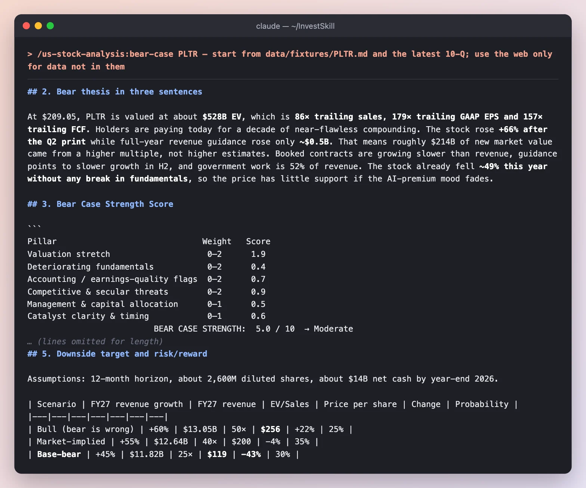

**What to notice**

- **The whole case is the price.** Valuation stretch scores **1.9 / 2**; deteriorating fundamentals only **0.4 / 2**. The bear can't find a business problem.
- **A sharp observation:** the stock rose about 66% after the Q2 print while full-year guidance rose only about $0.5B, so roughly **$214B of new market value came from a higher multiple**, not higher estimates.
- **Base-bear target $119 (−43%)**, probability-weighted ~$177 (−15%). It recommends defined-risk puts over an outright short, because momentum is the real danger.

**Result:** bear strength **5.0 / 10 (Moderate)** → **NEUTRAL · 5.0 / 10 · HOLD.**

### Step 10 · `fact-check` — check the first report

```text
/us-stock-analysis:fact-check output/pltr/01-stock-eval.md — verify every figure against data/fixtures/PLTR.md and the 10-Q; mark web-only figures unverifiable
```

> ⏳ **This step is still running** — its screenshot and notes will be added to this page shortly.

---

## What we ended up with

| Skill | Signal | Score |
|-------|--------|-------|
| `stock-eval` | NEUTRAL · HOLD | 4.5 |
| `competitor-analysis` | NEUTRAL · HOLD | 5.9 |
| `earnings-call-analysis` | BULLISH · HOLD | 6.5 |
| `stock-valuation` | **BEARISH · SELL** | 3.0 |
| `dividend-analysis` | NEUTRAL · HOLD | 5.6 |
| `technical-analysis` | **BULLISH · BUY** (on a pullback to ~$195) | 7.0 |
| `insider-trading` | NEUTRAL · HOLD | 4.6 |
| `short-interest` | NEUTRAL · HOLD | 5.0 |
| `bear-case` | NEUTRAL · HOLD | 5.0 |
| `fact-check` | ⏳ in progress | — | — |

**What this demo shows**

1. **Every skill agrees on the business and disagrees about the price.** No skill found a fundamental problem; the spread from BUY (the chart, a short-term timing call) to SELL (the valuation) is about time horizon and how much of the future $209 already pays for.
2. **Disagreement is information.** `stock-eval` (HOLD) and `stock-valuation` (SELL) weigh the same facts differently. Reading both tells you more than either alone.
3. **Raw signals need context.** The insider score was maximally bearish until the skill read the footnotes. The squeeze score was "moderate" until it looked at where the points came from.
4. **Web data needs dates.** Two skills quoted different short-interest figures because they used different settlement dates. Every figure carries its date, so you can tell.

---

## Run it yourself

```bash
export EDGAR_USER_AGENT="Your Name you@example.com"
npm run fetch:fundamentals -- PLTR        # then add today's price on the `price:` line
npm run fetch:edgar -- PLTR --form 10-Q

# Inside Claude Code — the same instruction after each skill
/us-stock-analysis:stock-eval PLTR — start from data/fixtures/PLTR.md and the latest 10-Q in data/filings/PLTR/; use the web only for data not in them, and cite each source with its date
```

Each run here used `claude -p "<command>" --allowedTools Read,WebSearch,WebFetch`. Swap `stock-eval` for any skill above. For other assistants, paste the matching file from [`prompts/`](https://github.com/yennanliu/InvestSkill/tree/main/prompts). See the [Demo Overview](full-demo.html) for the other demos.

---

## Full outputs

The complete, unedited output of every run above. Steps 2 and 5 were run earlier the same day with the same data.

<details>
<summary><strong><code>stock-eval</code> — full output</strong></summary>

~~~~text
# Palantir Technologies (PLTR): Stock Evaluation, 2026-10-11

```
Data & Sources
  As of:      Mixed. Each source keeps its own date:
              • FY2025 annual figures: 2025-12-31 (10-K, filed 2026-02-17, acc. 0001321655-26-000011)
              • Latest quarter: 2026-06-30 (10-Q, filed 2026-08-04, acc. 0001321655-26-000041)
              • Guidance: Q2-26 press release (8-K Ex.99.1, dated 2026-08-03)
              • Price: $209.05, NASDAQ close 2026-10-09 (from the data pack)
              • 10-yr Treasury: 5.22% on 2026-10-08 (FRED DGS10)
              • Analyst targets, short interest, Form 4, peer multiples: web, dated inline
  Source:     SEC EDGAR (10-K, 10-Q, 8-K, Form 4) · FRED · named web sources for market data
  Retrieval:  pasted by user (data/fixtures/PLTR.md, data/filings/PLTR/…10-Q.txt) + web/tool retrieval
  Confidence: HIGH for reported financials · MEDIUM for market data, consensus, peers ·
              LOW for items marked ⓜ (model memory: beta, FY2020–23 history, pre-2026 quarterly guidance)
```

**Data quality notes**
- **Price date conflict.** One web snapshot dates the $209.05 close to Oct 8. The data pack and CNBC put it on Oct 9, with a 52-week high of $209.58 that day. I used the pack's date.
- **TTM method.** TTM means the four quarters Q3-25 to Q2-26. It is calculated as FY25 − H1-25 + H1-26, using the 10-K and 10-Q.
- **Hand arithmetic.** Running a calculation script wasn't approved in this session, so all derived figures and the DCF were calculated by hand. Run `fact-check` over this report before relying on any precise number.
- **Missing inputs.** I didn't retrieve consensus EPS revision history, a current options chain (the latest IV data is from 2026-05-29), or a single-date peer-multiple set. These gaps are marked where they matter.

---

## 1. Investment Thesis Summary

Palantir is the strongest-performing large software company in the market right now:
- Q2-26 revenue grew **+93% YoY**.
- GAAP operating margin was **47%**.
- It holds **$9.4B** in cash and securities with **no debt**.
- Its Piotroski F-Score is **8/9**.
- Its return on operating capital is far above its cost of capital.

The stock at $209 already prices in success for roughly ten more years:
- It trades at **~179× TTM EPS** and **~60× FY26 guided sales**.
- My reverse DCF says the price needs **~36% revenue CAGR for 10 years**, which means about **$176B of revenue by 2036**.
- It sits at its 52-week high after a **+97% run from the June 25 low**.

**Bottom line:** an exceptional business at a price with no margin of safety. That is a HOLD for existing holders, not a new BUY.

---

## 2. Company Overview

| Item | Detail (10-Q unless noted) |
|---|---|
| Platforms | Gotham (defense/intel), Foundry (data operations + Ontology), Apollo (continuous delivery), AIP (generative-AI platform) |
| Customers | 1,049 TTM customers vs 849 a year ago (**+24%**). Top-20 customers averaged **$124M** each (TTM), **+67%** |
| Segment mix, Q2-26 | Government $990.0M (**+79%**), contribution margin 71% · Commercial $945.4M (**+110%**), contribution margin 78% |
| US vs. rest of world, Q2-26 | US $1,573.0M (**81%** of revenue, +115%) · Rest of world $362.4M (19%, **+34%**) |
| Key sub-lines, Q2-26 (8-K) | US commercial **$764M, +149%** · US government **$809M, +90%** · TCV (contract value booked) **$3.37B, +49%** · Rule of 40 score: 155% |
| Concentration | No customer is ≥10% of revenue, but "Customer I" holds **27% of receivables** (25% at Dec-25) |
| Backlog | Remaining performance obligations **$4.9B**, 43% due within 12 months. Many contracts can be **terminated for convenience** |
| Related party | $6M in H1-26 for use of the CEO's aircraft |

**Demand quality.** The growth is US-driven and broad, with both US commercial and US government up 90%+. International commercial is the weak spot, up only about 26% by my estimate (implied from segment minus US commercial).

---

## 3. Financial Health

### Revenue & earnings

| Year | Revenue ($M) | Growth | GAAP EBIT ($M) | Net income ($M) | Diluted EPS |
|---|---|---|---|---|---|
| 2021 ⓜ | 1,542 | 41% | (411) | (520) | (0.27) |
| 2022 ⓜ | 1,906 | 24% | (161) | (374) | (0.18) |
| 2023 ⓜ | 2,225 | 17% | 120 | 210 | 0.09 |
| 2024 | 2,866 | 29% | 310 | 462 | 0.19 |
| 2025 | 4,475 | **56.2%** | 1,414 | 1,625 | 0.63 |
| **TTM Q2-26** | **6,155.5** | — | **2,634.6** | **3,016.7** | **1.17** |
| FY26 guide (8-K) | **8,150–8,158** | **~82%** | adj. op. income 4,889–4,897 | — | — |

- **Growth rates.** 3-year revenue CAGR (FY22→FY25) is **32.9%**. 5-year CAGR (FY20→FY25) is ~32.6%ⓜ. Growth is still speeding up.
- **What the guidance implies.** Q3 guide of $2.162B is **+83% YoY**. The implied Q4 of $2.424B is **+72% YoY**. Guidance builds in a slowdown.
- **Guidance has been conservative.** Q2 beat the midpoint of its own guide by **7.6%** ($1,935.5M vs $1,799M). A realistic FY26 is about **$8.3–8.5B**.

### Margins

| | FY24 | FY25 | TTM | Q2-26 |
|---|---|---|---|---|
| Gross margin | 80.2% | 82.4% | 84.8% | 84.7% |
| Operating margin (GAAP) | 10.8% | 31.6% | 42.8% | **47.1%** |
| Net margin | 16.1% | 36.3% | 49.0% | 54.9% |
| Adj. op. margin (excl. stock comp) | — | — | — | 62% |

Margins are expanding fast.
- **Incremental operating margin:** Q2 YoY was **69%**, meaning 69 cents of every new revenue dollar reached operating income.
- **Stock-based compensation (SBC)** was **13.6% of TTM revenue** ($835.5M). That is a real cost and I deduct it in the DCF.

### Operating leverage (DOL)

| Period | Revenue growth | EBIT growth | DOL |
|---|---|---|---|
| FY24 | 28.8% | 158%ⓜ | 5.5× |
| FY25 | 56.2% | 356% | 6.3× |
| H1-26 YoY | 89.0% | 274% | 3.1× |
| Q2-26 YoY | 92.8% | 239% | 2.6× |

DOL is falling as margins mature. Earnings will grow closer to the rate of revenue from here, so the extra margin-expansion boost is shrinking.

### Balance sheet & liquidity (Jun 30, 2026)

| Item | Value |
|---|---|
| Cash + marketable securities | **$9,409M** ($9.2B of this is cash and short-term Treasuries) |
| Debt | **$0**. A $500M revolver is undrawn |
| Current ratio / quick ratio | **7.23× / 7.09×** (Dec-25 current ratio: 7.11×) |
| Total equity | $9,885M |

### Working capital

| Metric | FY24 | FY25 | TTM |
|---|---|---|---|
| DSO (days to collect, on TTM revenue) | 73 | 85 | **88** ⚠️ rising |
| DIO / DPO | n/m (no inventory; AP ≈ $8M) | | |
| Operating NWC (AR + prepaids − payables, deferred revenue, deposits) | — | $5M | $155M (2.5% of revenue) |
| Contract liabilities | — | $0.8B | $1.1B |

The cash conversion cycle is effectively near zero because customer deposits and deferred revenue fund the receivables.
- **Watch item:** receivables grew **+42.5% in six months**, and DSO keeps rising. Customer I's 27% share of receivables is a collection-timing risk. It is not a credit risk if Customer I is a US agency, but the 10-Q does not name it.

### Cash flow (TTM)

| Item | Value |
|---|---|
| Operating cash flow | $3,399.8M |
| Capex | $42.1M (about 0.7% of revenue, so maintenance capex is negligible) |
| Free cash flow (FCF) | **$3,357.7M** (FCF yield **0.67%**) |
| FCF − SBC | $2,522M (yield **0.50%**) |
| FY26 adj. FCF guide | **$4.5–4.7B** |

**FY25 cash flow waterfall:**

| Item | $M |
|---|---|
| Operating cash flow | 2,134 |
| Capex | (34) |
| FCF | 2,101 |
| Dividends | 0 |
| Buybacks | (75) |
| M&A | n/a |
| Debt | 0 |

Cash and equivalents fell by $675M during FY25 only because cash was moved into Treasury securities.

---

## 4. Valuation Metrics

Basis: price **$209.05**.
- Basic shares at 6/30/26: 2,402.9M (Class A + B + F), giving a **market cap of $502.3B**.
- On Q2 diluted weighted shares (2,568.7M), market cap is **$537.0B**.
- **EV = $492.9B** (basic market cap minus $9.4B cash and securities).

| Metric | Current | 1-Yr Ago | 10-Yr Median | Sector / Peer |
|---|---|---|---|---|
| P/E (TTM, GAAP) | **178.7×** | n/r | — | Peer avg 43.9× (Simply Wall St) |
| P/E (normalized: 21% tax, excl. securities gains) | **~226×** | — | — | — |
| P/E (forward, FY26 adj. EPS ≈ $1.67, my estimate) | **~125×** | — | — | GuruFocus 115× (Sep 1) · software median 19.7× |
| PEG (forward P/E ÷ ~60% EPS growth) | ~2.1 | — | — | — |
| P/B | 51.4× | — | — | — |
| P/S (TTM) | 81.6× | — | — | — |
| EV/Sales (TTM / FY26 guide) | **80.1× / 60.5×** | — | **29.5×** (GuruFocus) | NET ~49.9×, DDOG ~23.4× (trailing, 9/29/26) · NOW P/S ~9.4× (10/7/26) |
| EV/EBITDA (TTM) | **185×** | — | — | — |
| EV/FCF (TTM) · diluted mkt cap / FY26 adj. FCF | 147× · **117×** | — | — | — |
| Dividend yield / payout | 0% / n/a | — | — | — |

n/r = not retrieved.

**Peer context (mixed dates and bases, MEDIUM confidence):**
- CrowdStrike: P/S ~51×, forward P/E ~215× (Motley Fool, Oct 7 2026).
- ServiceNow: P/S ~9.4×, forward P/E ~33× (same source).
- Snowflake: ~7.9× NTM EV/revenue (TIKR, May 1 2026, stale).

PLTR is the most expensive large-cap software stock on every sales and earnings multiple. Its growth (~82–93%) is also roughly 2–4× faster than any of those peers, which partly but not fully explains the gap.

---

## 5. Key Ratios

| Ratio | Current (TTM / Jun-26) | Assessment |
|---|---|---|
| ROE | **35.2%** (FY25: 26.2%) | Excellent, and achieved with no leverage |
| ROA | 29.3% (FY25 avg-asset basis: 21.3%) | Excellent |
| ROIC (operating capital) | **~367%** | Asset-light; the measure is close to meaningless |
| Gross / operating / net margin | 84.8% / 42.8% / 49.0% | Top of software |
| Current / quick ratio | 7.23× / 7.09× | Fortress |
| Debt-to-equity | 0.00 | — |
| Interest coverage | n/m (no debt) | — |
| Asset turnover | 0.60× | Held down by the $9.4B cash pile |

---

## 6. DuPont Decomposition

**3-factor**

| | Net margin | Asset turnover | Equity multiplier | ROE |
|---|---|---|---|---|
| TTM Q2-26 | 49.0% | 0.598 | 1.199 | **35.2%** |
| FY25 | 36.3% | 0.587 | 1.230 | **26.2%** |
| FY24 (ending-balance basis) | 16.1% | 0.452 | 1.27 | 9.2% |

**5-factor (FY25)**

| Tax burden | Interest burden | EBIT margin | Asset turnover | Equity multiplier | ROE |
|---|---|---|---|---|---|
| 0.981 | **1.172** | 31.6% | 0.587 | 1.230 | 26.2% |

ROE is driven almost entirely by **margin**, the highest-quality driver. Two parts of it are flattering and will fade:
- **Interest burden above 1.0.** Interest income on the cash pile adds to pre-tax income.
- **Tax burden of ~0.98.** The effective tax rate is about 1.4% because a valuation allowance shelters profits from tax. At a normal ~21% tax rate, TTM net income would be about **$2.38B**, not $3.02B.

---

## 7. Competitive Position (Porter's Five Forces)

| Force | Intensity | Evidence |
|---|---|---|
| New entrants | M | Hyperscaler AI agent stacks, Databricks, Snowflake, Microsoft Fabric. Barriers are security accreditations and Ontology-driven workflows |
| Supplier power | L–M | Cloud hosting and LLM providers. A multi-model setup reduces dependence on any one |
| Buyer power | **M–H** | US government is ~42% of Q2 revenue. Contracts allow termination for convenience. Procurement and budget cycles apply |
| Substitutes | M | Customers building in-house on cloud-native tools. AI coding agents lower build costs |
| Rivalry | M | Few full-stack equivalents in classified work. Crowded in commercial analytics |

**Moat: Narrow, and widening.** The moat comes from:
- switching costs embedded in the Ontology,
- defense and intelligence accreditations,
- the forward-deployed engineering model,
- 157% net dollar retention (secondary source, GuruFocus summary; not in the SEC filings).

It is not yet proven durable for 20+ years in commercial markets.

---

## 8. Quality Scoring

### Piotroski F-Score: **8/9 (strong)**

| # | Criterion | FY25 vs FY24 | Score |
|---|---|---|---|
| 1 | ROA > 0 | 18.3% | 1 |
| 2 | Operating cash flow > 0 | $2,134M | 1 |
| 3 | ROA improved | 18.3% vs 7.3% | 1 |
| 4 | Cash flow / assets > ROA | 24.0% > 18.3% | 1 |
| 5 | Leverage not higher | No debt in either year | 1 |
| 6 | Current ratio improved | 7.23× vs 7.11× (Jun-26 vs Dec-25; FY24 not in the pack) | 1 |
| 7 | No dilution | Diluted shares 2,565M vs 2,451M (**+4.7%**) | **0** |
| 8 | Gross margin up | 82.4% vs 80.2% | 1 |
| 9 | Asset turnover up | 0.503 vs 0.452 | 1 |

### Earnings quality

- **Accruals ratio (FY25):** (1,625 − 2,134) / 7,620 = **−6.7%**. Profits are cash-backed.
- **Cash conversion:** operating cash flow / net income is 1.31× for FY25 and **1.13× TTM**. It is drifting lower because of receivables growth and non-cash gains.
- **Non-recurring items:**
  - H1-26 other income of $160M includes $64M of unrealized gains on public equity stakes, most of which can't be sold for now.
  - The near-zero tax rate won't last. Normalized TTM EPS is **~$0.92 vs $1.17 reported**.
- **Revenue recognition:** revenue is ratable and low risk. Risks to watch:
  - pilots and bootcamps run at the company's own cost,
  - accepting equity securities as payment (flagged in the 10-Q),
  - rising DSO.

---

## 9. ROIC / WACC

| ROIC component (TTM) | Value |
|---|---|
| EBIT | $2,634.6M |
| Tax rate (normalized; actual ~1.4%) | 21% |
| NOPAT | $2,081M |
| Operating invested capital (PP&E 61 + lease assets 230 + other operating assets 120 + operating NWC 155) | ~$567M |
| **ROIC** | **~367%** (FY25: ~296%) |
| NOPAT / total equity (if you count the cash pile) | 21.1% |

| WACC component | Value |
|---|---|
| Risk-free rate (FRED DGS10, 2026-10-08) | 5.22% |
| Beta (raw 5-yr monthly ~2.6ⓜ → Blume-adjusted) | **2.07** |
| Equity risk premium | 5.0% |
| Cost of equity = WACC (no debt) | **15.6%** |
| **EVA** = (367% − 15.6%) × $567M | **≈ +$2.0B / year** |

Two conclusions:
- **Value creation:** the business creates value at any reasonable cost of capital.
- **Discount-rate problem:** CAPM with a 2+ beta and a 5.2% risk-free rate gives a discount rate that would make the stock look very cheap to sell. I use a deliberately **generous 10%** for the base DCF and still find the stock overvalued.

---

## 10. DCF Valuation

**Method:**
- Value as of end-FY26. Explicit forecast for FY27–FY36.
- **FCF is measured after SBC**, treating stock compensation as a cash cost.
- Add $9.4B of net cash plus about $2.3B of H2-26 FCF.
- Divide by 2,568.7M diluted shares.

| Assumption | Bull | Base | Bear |
|---|---|---|---|
| FY26 revenue | $8.4B | $8.3B | $8.2B |
| Growth FY27→FY31 | 65/55/45/38/30% | 52/40/30/24/20% | 40/27/20/15/12% |
| Growth FY32→FY36 | 25/20/16/12/8% | 16/13/10/7/5% | 10/8/6/5/4% |
| FY36 revenue | **$118B** | **$55B** | $31B |
| FCF-after-SBC margin | 45% | 40% | 32% |
| WACC / terminal growth | 9% / 3.5% | 10% / 3.0% | 11% / 2.5% |
| **Value per share** | **~$231** | **~$84** | **~$36** |

- **Terminal value weight (base):** 62% of EV.
- **Exit-multiple cross-check:** the base terminal value equals about 12× FY36 EBITDA, which is reasonable for mature software.
- **At the CAPM WACC of 15.6%:** the base case is worth about $44.

**Sensitivity (base operating case, $/share):**

| WACC \ terminal g | 1.5% | 2.0% | 2.5% | 3.0% | 3.5% |
|---|---|---|---|---|---|
| 7% | 122 | 130 | 140 | 154 | **170** |
| 8% | 101 | 107 | 113 | 121 | 131 |
| 9% | 86 | 90 | 94 | 99 | 105 |
| 10% | 75 | 77 | 81 | **84** | 88 |
| 11% | 66 | 68 | 70 | 73 | 75 |

**No cell reaches $209.**

**Reverse DCF:** to justify $209 at a 40% margin, 10% WACC and 3% terminal growth, revenue must compound at **~36% a year for 10 years**, reaching **~$176B in FY2036**. That is roughly Alphabet's 2020 revenue.

### Margin of safety
- Base intrinsic value is **$84** against a price of $209.05. The stock trades at a **149% premium** to it, so there is **no margin of safety**.
- The probability-weighted DCF (20/50/30) gives **~$99**.

---

## 11. Management Quality

**Capital allocation:** good on discipline, but the cash is idle.
- No debt and no large acquisitions.
- The cash pile keeps growing.
- Buybacks are effectively dormant: **$1.5M in H1-26** and $75M in FY25.
- Net dilution has slowed. Basic shares grew **+1.3% YoY** and Q2 diluted weighted shares were up only +0.2% YoY, even with SBC at 13.6% of revenue.

**Guidance track record:** revenue beat guidance in **8 of 8** quarters. Palantir does not give EPS guidance.

| Quarter | Revenue guide (midpoint) | Actual | Result |
|---|---|---|---|
| Q3-24ⓜ | $699M | $725.5M | Beat |
| Q4-24ⓜ | $777M | $827.5M | Beat |
| Q1-25ⓜ | $860M | $883.9M | Beat |
| Q2-25ⓜ | $936M | $1,003.7M | Beat |
| Q3-25ⓜ | $1,085M | $1,181.1M | Beat |
| Q4-25ⓜ | $1,329M | $1,406.4M | Beat |
| Q1-26 | n/r | $1,632.6M (8-K) | Beat (per release) |
| Q2-26 | **$1,799M (8-K)** | **$1,935.5M** | **Beat, +7.6%** |

Guidance is systematically conservative ("sandbagged"). The street knows this, so the bar for each print is the raise, not the guide.

**Insider ownership and alignment:**
- Founders control votes through the **Class B/F share structure**. Alignment is high, but governance protections for outside holders are weak.
- **Karp's Form 4, 2026-08-20:** converted 402,348 shares, then sold about 31K shares at roughly $172–174 under a **10b5-1 plan**. He holds about 6.8M shares directly.
- There are **no open-market insider buys**. Insiders sell steadily but on schedule. This is low-signal, but not supportive either.

**Compensation:** SBC is heavy, but net dilution is now about 1% a year. Say-on-pay results were not retrieved.

---

## 12. Analyst Consensus

| Metric | Value |
|---|---|
| Rating | **Moderate Buy** (MarketBeat, 36 analysts) · Buy (StockAnalysis, 31 analysts) |
| Split | ~20 Buy/Strong Buy, ~9 Hold, a few Sell (low target $80) |
| Mean target | **$195.33** (MarketBeat) · $195.57 (StockAnalysis) · $200.53 (TipRanks) |
| High / low target | $255 / $80 |
| **Upside to mean target** | **−6.6%**: the stock is above consensus |
| Latest move | **Goldman Sachs upgraded to Buy, $230 target (Oct 8, 2026)** |
| Estimate revisions | **Up** after the record Aug 3 guidance raise (inferred). The 30/90-day revision history and the ERM signal were not retrieved |

The mean target below the current price, plus fresh upgrades, means analysts are now chasing the stock. That is a sentiment-stretch signal.

**Positioning:**
- **Short interest:** low at ~2.8–3.6% of float, with 2.3 days to cover (Equibles, Aug 21; Brimind, Sep 4). There is no squeeze fuel and no strong bear pressure.
- **Options:** last observed ATM implied volatility was 51.7% with an IV rank of 33 (May 29, stale). The market priced a ±11.5% move into the Aug 3 print. The 2-year average earnings move is ±15.1%.
- **Next earnings:** about Nov 2–9, 2026 (Yahoo estimates Nov 2; Investing.com lists Nov 9).

---

## 13. Risk Assessment

**Business risk**

| Factor | Level | Note |
|---|---|---|
| Cyclicality | L–M | Government revenue acts as ballast. Commercial AI budgets are discretionary |
| Competition / disruption | M | Hyperscaler agent platforms and cheaper in-house builds |
| Customer concentration | **M** | US government ~42% of revenue. Customer I holds 27% of receivables |
| Regulatory / political | **M–H** | Exposure to the federal budget, FASA procurement changes, and AI regulation |
| ESG / litigation | M | Surveillance and defense controversy. Litigation is "not material" per the 10-Q |

**Financial risk:** **LOW** across the board. No debt, net cash of $9.4B, current ratio 7.2×, no pension obligations.
- Minor items: $167M in private equity stakes, and public equity stakes received as payment that can add volatility.

**Valuation risk** (the dominant risk)

| Scenario | Value | Premium of price to value |
|---|---|---|
| Bull DCF | $231 | price −9% |
| Base DCF | $84 | 2.5× |
| Bear DCF | $36 | 5.8× |

- **Multiple compression:** EV/sales falling from 60× to 25× on FY27 sales of about $12.6B would mean roughly **$127/share** (−39%) even if growth is delivered.
- **Guidance miss:** a guide that merely "meets", with no raise, has historically produced moves of ±13–15%. At 125× forward earnings, a 10–20% EPS miss could plausibly cost 20–35%.

**Macro risk**

| Factor | Level | Note |
|---|---|---|
| Interest rates | **H** | 10-yr yield at 5.22%. About 62% of the value sits in the terminal value, so this is a very long-duration equity |
| USD / FX | L | Revenue is 80% US |
| Tariffs / commodities | L | Software business |
| Geopolitics | Mixed | Conflicts (Ukraine, Middle East, Iran strikes per the 10-Q) are a demand tailwind for defense work but add headline risk |

---

## 14. Output Summary

1. **Thesis:** world-class growth and profitability, with valuation as the problem. The price discounts about 36% revenue CAGR for a decade.
2. **Valuation:** **Overvalued** on intrinsic value (base DCF $84, best sensitivity cell $170). On a 12-month market basis it is roughly fully valued, because the price is already at or above the consensus targets of $195–200.
3. **Quality:**
   - F-Score **8/9**.
   - Earnings quality is good, with negative accruals. Watch the tax normalization and DSO.
   - ROIC is ~367% against a 15.6% WACC, so the company **creates value**.
4. **Management:** guidance credibility is high (8/8 beats). Capital allocation is conservative but leaves cash idle. Founder control is strong; outside holders have little governance influence. Insider selling is routine 10b5-1 sales.
5. **Consensus:** Moderate Buy, mean target $195 (−7%). Revisions are rising and Goldman upgraded on Oct 8.
6. **Top 3 risks:**
   - (a) De-rating: EV/sales falling from 60× toward 25× even if the plan is delivered.
   - (b) US government budget or procurement disruption, made worse by 42% revenue exposure and termination-for-convenience clauses.
   - (c) Slowing growth: the guide implies Q4 growth of +72%, and Q3 is the first test.
7. **12-month price targets** (market-multiple method on FY28E revenue):

   | Case | Target | Assumptions | Probability |
   |---|---|---|---|
   | Bull | **$280** | ~39× NTM sales holds; FY28 revenue $17.7B | 25% |
   | Base | **$180** | ~25× NTM sales | 45% |
   | Bear | **$90** | 15× on $14.6B of revenue | 30% |
   | **Weighted** | **~$178 (−15%)** | | |

8. **Entry zone:**
   - A true intrinsic-value margin of safety is not available near current prices.
   - Investors willing to underwrite growth-multiple risk could stage entries at **$150–175**. That range matches the August consolidation, Karp's Form 4 sale prices of about $172–174, and ~25× FY27 sales.
   - **$209 is not an entry.**

---

## References

**Primary (SEC / FRED)**
1. Data pack `data/fixtures/PLTR.md`: FY25 10-K XBRL, acc. 0001321655-26-000011, filed 2026-02-17. [Filing index](https://www.sec.gov/Archives/edgar/data/1321655/000132165526000011/0001321655-26-000011-index.htm)
2. 10-Q for 2026-06-30, filed 2026-08-04, acc. 0001321655-26-000041. Local file `data/filings/PLTR/PLTR_2026-06-30_10-Q.txt`. [Filing index](https://www.sec.gov/Archives/edgar/data/1321655/000132165526000041/0001321655-26-000041-index.htm)
3. [Q2-26 press release, 8-K Ex.99.1, 2026-08-03](https://www.sec.gov/Archives/edgar/data/0001321655/000132165526000039/a2026q2ex991pressrelease.htm)
4. [Q1-26 press release, 8-K Ex.99.1, 2026-05-04](https://www.sec.gov/Archives/edgar/data/0001321655/000132165526000026/a2026q1ex991pressrelease.htm)
5. [Form 4, A. Karp, 2026-08-20](https://www.sec.gov/Archives/edgar/data/0001321655/000182395126000009/wk-form4_1787616121.xml)
6. [FRED DGS10, 5.22% on 2026-10-08](https://fred.stlouisfed.org/series/DGS10)

**Secondary (retrieved 2026-10-11)**
- Price and 52-week range:
  - [CNBC quote](https://www.cnbc.com/quotes/PLTR)
  - [Morningstar](https://www.morningstar.com/stocks/xnas/pltr/quote)
  - [StockAnalysis](https://stockanalysis.com/stocks/pltr/)
  - [Investing.com](https://www.investing.com/equities/palantir-technologies-inc)
  - [Yahoo Finance](https://sg.finance.yahoo.com/quote/PLTR/)
- Consensus:
  - [MarketBeat forecast](https://www.marketbeat.com/stocks/NASDAQ/PLTR/forecast/)
  - [StockAnalysis forecast](https://stockanalysis.com/stocks/pltr/forecast/)
  - [ChartMill](https://www.chartmill.com/stock/quote/PLTR/analyst-ratings)
  - [Finbold / TipRanks](https://finbold.com/wall-street-analyst-updates-palantir-stock-price-target-5/)
  - [24/7 Wall St., Goldman upgrade (2026-10-09)](https://247wallst.com/investing/2026/10/09/goldman-sachs-upgrades-palantir-to-buy-sees-18-upside-and-further-outperformance-into-2027/)
  - [MCH Advisory](https://www.mchadvisoryservices.com/research/pltr-research-2026.html)
- Short interest:
  - [Equibles](https://equibles.com/stocks/PLTR)
  - [Brimind](https://brimindinvest.com/stocks/pltr/statistics)
  - [Benzinga](https://www.benzinga.com/quote/PLTR/sentiment)
  - [ChartMill ownership](https://www.chartmill.com/stock/quote/PLTR/ownership)
- Options: [earnings-watcher implied move](https://earnings-watcher.com/wiki/pltr-implied-move) · [Options Analysis Suite](https://www.optionsanalysissuite.com/stocks/pltr/probability)
- Multiples and peers:
  - [GuruFocus EV/Revenue](https://www.gurufocus.com/term/enterprise-value-to-revenue/PLTR)
  - [GuruFocus forward P/E](https://www.gurufocus.com/term/forward-pe-ratio/PLTR)
  - [Simply Wall St](https://simplywall.st/stocks/us/software/nasdaq-pltr/palantir-technologies/valuation)
  - [Public.com](https://public.com/stocks/pltr/pe-ratio)
  - [Motley Fool, CRWD vs NOW (2026-10-07)](https://www.fool.com/coverage/better-buy/2026/10/07/crowdstrike-vs-servicenow-which-technology-stock-is-a-better-buy-in-2026/)
  - [SaaS multiples study](https://saasvaluationmultiple.com/verticals/devops-saas-multiples)
  - [TIKR DDOG vs SNOW](https://www.tikr.com/blog/datadog-vs-snowflake-which-cloud-data-stock-is-the-better-growth-play)
- Earnings call:
  - [GuruFocus Q2-26 call highlights](https://www.gurufocus.com/news/9000347/palantir-technologies-inc-pltr-q2-2026-earnings-call-highlights-record-93-revenue-growth-and-raised-guidance-signal-unprecedented-ai-demand)
  - [TIKR guidance raise](https://www.tikr.com/blog/palantirs-q2-earnings-call-produced-its-largest-ever-guidance-raise-heres-what-changed)
  - [CNBC Q2-26](https://www.cnbc.com/2026/08/03/palantir-pltr-earnings-q2-2026.html)
  - [Quartz](https://qz.com/palantir-q2-2026-earnings-revenue-guidance-080426)

---

## Thesis Invalidation

**The signal is NEUTRAL. It turns BULLISH if:**
- FY26 revenue tracks to **≥$8.6B** and the Q4 guide implies **≥80% growth**, meaning growth re-accelerates rather than fading as guided.
- The stock pulls back to **≤$160** with no change to the fundamentals. That is about 20× FY27 sales.
- Net dollar retention, US commercial growth, or both hold above **100%** through Q4-26, and international commercial growth exceeds 40%.

**It turns BEARISH if:**
- The F-Score drops below 5, or ROIC falls below WACC. This is unlikely and would mean a real business break.
- The Q3 print (around Nov 2–9) **only meets** guidance (~$2.16B) or the FY guide is raised by less than 2%.
- DSO goes above **100 days**, or Customer I's share of receivables rises above 35%.
- The 10-yr yield sustains above **5.5%**, which would compress long-duration multiples.

**Re-run this analysis when:**
- [ ] Next earnings release (Q3-26, about Nov 2–9, 2026)
- [ ] Price moves ±15% from $209 (below $178 or above $240)
- [ ] 60 days have elapsed (2026-12-10)
- [ ] Material news: a large federal contract or cancellation, budget or continuing-resolution disruption, a buyback authorization, or leadership change

╔══════════════════════════════════════════════╗
║              INVESTMENT SIGNAL               ║
╠══════════════════════════════════════════════╣
║ Signal:      NEUTRAL                         ║
║ Confidence:  MEDIUM                          ║
║ Horizon:     MEDIUM-TERM                     ║
║ Score:       4.5 / 10                        ║
╠══════════════════════════════════════════════╣
║ Action:      HOLD                            ║
║ Conviction:  MODERATE                        ║
╚══════════════════════════════════════════════╝

Score Guide: 8.0–10.0 Strongly Bullish | 6.0–7.9 Moderately Bullish | 4.0–5.9 Neutral | 2.0–3.9 Moderately Bearish | 0.0–1.9 Strongly Bearish
Confidence: HIGH (strong data, clear signals) | MEDIUM (mixed signals) | LOW (limited data, conflicting signals)
Horizon: SHORT-TERM (1 week–3 months) | MEDIUM-TERM (3 months–1 year) | LONG-TERM (1+ years)

The score maps a near-top business-quality reading (about 9/10) against a bottom-decile valuation reading (about 1.5/10) and stretched sentiment: the stock is at its 52-week high and above the mean target. That nets to a HOLD for existing holders and no new buying at $209.

**Disclaimer:** Educational analysis only. Not financial advice.
~~~~

</details>

<details>
<summary><strong><code>stock-valuation</code> — full output</strong></summary>

~~~~text
# Stock Valuation: Palantir Technologies (PLTR)

At $209.05, PLTR trades about 41% above my composite intrinsic value of about $148. Of the four valuation methods, only one (forward P/E using peer multiples) supports today's price, and that method is biased upward. The DCF never reaches the price under any reasonable assumptions.

```
Data & Sources
  As of:      FY2025 10-K (FYE 2025-12-31) · 10-Q for Q2 2026 (period 2026-06-30, filed 2026-08-04) · price = NASDAQ close 2026-10-09
  Source:     SEC EDGAR 10-K (acc. 0001321655-26-000011) via data/fixtures/PLTR.md · SEC EDGAR 10-Q (acc. 0001321655-26-000041) ·
              Q2'26 8-K press release (2026-08-03, guidance) · US Treasury par yield curve (2026-10-09) ·
              StockAnalysis.com statistics pages (peer multiples, beta, short interest; 2026-10-09 close, page updated 2026-10-11) ·
              Yahoo Finance / Investing.com (52-week range, consensus targets and estimates; snapshots ~2026-10-09)
  Retrieval:  pasted by user (SEC pack + 10-Q) · web/tool retrieval (8-K, Treasury, market data)
  Confidence: HIGH for reported figures and guidance · MEDIUM for market and consensus data (vendors disagree) · LOW for peer forward P/E (distorted by peers' thin GAAP profits)
```

> Method note: I couldn't run the model in Python here (script execution and file writes need approval in this session), so every figure below was worked by hand from the inputs shown. Per-share values may be off by about ±$1 from rounding. No ⚠️ stale-data warning applies: all prices are dated 2026-10-09.

---

## 1. Business Summary

Palantir sells data-integration and AI decision platforms: Gotham for government, Foundry for commercial, and AIP on top of both. Business is accelerating sharply:
- **Total revenue:** FY2025 revenue was $4,475M, up 56.2% YoY. Q2 2026 revenue was $1,935M, up 93% (10-Q).
- **U.S. commercial:** revenue grew 149% to $764M.
- **Government:** revenue grew 79%, and it is still 51% of total revenue.
- **Margins:** gross margin rose from 82.4% in FY25 to 85% in Q2. GAAP operating margin was 47% in Q2, up from 27% a year earlier.
- **Balance sheet:** $9.2B of cash, cash equivalents and short-term Treasuries, no debt, and an undrawn $500M revolver (10-Q MD&A).
- **FY2026 guidance** (8-K, 2026-08-03): revenue $8.150–8.158B (+82%), adjusted operating income $4.889–4.897B, adjusted FCF $4.5–4.7B.
- **Q3 2026 guidance:** revenue $2.160–2.164B.

The business quality is not in question; the price is.

### Trailing-twelve-month figures (FY25 + 1H26 − 1H25, from the filings)

```
Base Metrics (TTM to 2026-06-30, $M):
  Revenue (TTM):                    6,155.5
  Operating Cash Flow (TTM):        3,399.8
  Capital Expenditures (TTM):          42.1
  Free Cash Flow (TTM):             3,357.7   (OCF − capex; FY25 alone: 2,101)
  FCF Margin (TTM):                    54.5%
  Stock-Based Compensation (TTM):     835.5   (13.6% of revenue; Q2 SBC +66% YoY)
  True Economic FCF (SBC-adjusted): 2,522.2   (41.0% margin)
  GAAP Operating Income (TTM):      2,634.6   (42.8% margin)
  EBITDA (TTM, GAAP):               2,662.4   (D&A only 27.8)
  Net Income to common (TTM):       3,016.7   · Diluted EPS (TTM) $1.17
  Diluted Shares (Q2 wtd):          2,568.7M  · Basic outstanding 2,402.9M (2026-06-30)
  Net Debt / (Net Cash):           (9,200)    (company's cash + short-term UST figure)
  Effective Tax Rate (TTM):            ~1.3%  (NOL/SBC shield — not durable)
```

### What the market is paying for at $209.05

Valuation multiples use diluted shares. Market cap is $537.0B diluted ($502.3B basic) and enterprise value is $527.8B.

| Multiple | PLTR |
|---|---|
| EV / TTM revenue | **85.7x** |
| EV / Q2 run-rate revenue (×4) | 68.2x |
| EV / FY26 guided revenue | 64.7x |
| EV / TTM EBITDA | 198x |
| EV / TTM FCF | 157x (FCF yield 0.63%) |
| EV / SBC-adjusted FCF | 209x (yield 0.47%) |
| P/E TTM / forward | 179x / 110x |

## 2. Method Selection

| Method | Used? | Why |
|---|---|---|
| DCF (SBC-adjusted FCF) | ✅ 40% | FCF-positive, asset-light, no debt. This is the right tool for a cash generator. |
| CCA (peer multiples) | ✅ 25% | Shows how the market prices high-growth infrastructure software. |
| EV/EBITDA | ✅ 20% | Sanity check. PLTR has real GAAP EBITDA; most peers don't. |
| P/E | ✅ 15% | PLTR has real GAAP earnings. Low confidence because peer P/Es are inflated by thin peer earnings. |
| Residual income | ❌ | Asset-light. Book value per share is $4.07 and P/B is 51x, so book value says nothing. |
| DDM / NAV | ❌ | No dividend; it's an operating business. |

## 3. DCF Analysis

### WACC

```
WACC Decomposition
──────────────────────────────────────────────────────────────────────
Risk-Free Rate (Rf)                5.24%      UST 10Y par yield, 2026-10-09 (Treasury)
Beta (β) raw / Blume-adjusted      1.60/1.40  StockAnalysis 5Y beta, 2026-10-11; 0.67β+0.33
Equity Risk Premium                5.0%
Size Premium                       0.0%       mega-cap
Cost of Equity  Ke                 12.2%      (13.2% on raw beta)
Total Debt / Interest Expense      $0 / $0    no debt; $500M revolver undrawn (10-Q)
E/V | D/V                          100% | 0%
WACC                               ≈12.2% → 12.0% used in Base (rounded slightly in PLTR's favour)
──────────────────────────────────────────────────────────────────────
```

The discount rate is high mainly because the risk-free rate is high: a 5.24% 10-year yield is about 80 bp above where it was in April 2026.

### Scenarios

Year 1 is FY2027, grown from the FY26 guidance midpoint of $8,154M. FCF margins are SBC-adjusted.

```
                        Bull        Base        Bear
Probability:            20%         60%         20%
Revenue CAGR Y1-5:      39.1%       32.2%       20.5%
Revenue CAGR Y6-10:     15.3%       12.2%        7.2%
FY2036 revenue:         $86.5B      $58.4B      $29.3B
Econ. FCF Margin Y5:    48%         42%         35%
Econ. FCF Margin Y10:   45%         40%         32%
WACC:                   11.0%       12.0%       13.5%
Terminal Growth:        3.5%        3.0%        2.5%
```

- **Base case:** Y1 growth of +50% gives $12.2B of revenue, which matches the FY27 consensus of $12.3B (Yahoo, 29 analysts).
- **Bull case:** revenue rises about 10x over ten years.

### Base-case table

```
Year  Revenue($M)  FCF Mg  FCF($M)  DF@12%   PV($M)
1     12,231       42.0%   5,137    0.8929   4,587
2     16,879       42.0%   7,089    0.7972   5,651
3     21,942       42.0%   9,216    0.7118   6,560
4     27,428       42.0%  11,520    0.6355   7,321
5     32,914       42.0%  13,824    0.5674   7,844
6     38,509       41.6%  16,020    0.5066   8,116
7     43,900       41.2%  18,087    0.4524   8,182
8     49,168       40.8%  20,061    0.4039   8,102
9     54,085       40.4%  21,850    0.3606   7,880
10    58,412       40.0%  23,365    0.3220   7,523
────────────────────────────────────────────────────
Sum of PV (FCF 1-10):                         71,765
Terminal Value = 23,365×1.03/(0.12−0.03):    267,397
PV of Terminal Value:                         86,094
Enterprise Value:                            157,859
Plus: Net Cash:                                9,200
Equity Value:                                167,059
Diluted Shares:                              2,569M
DCF Value per Share (Base):                   $65.0
TV as % of EV:                                54.5%  (below the 75% flag)
```

| Scenario | EV | Per share | TV % of EV |
|---|---|---|---|
| Bull | $300.4B | **$120.5** | 63.0% |
| Base | $157.9B | **$65.0** | 54.5% |
| Bear | $60.6B | **$27.2** | 40.7% |
| **Probability-weighted (20/60/20)** | | **$68.6** | |

### Sensitivity (base operating case)

```
Intrinsic Value per Share — WACC vs. Terminal Growth
            g=2.0%   2.5%    3.0%    3.5%    4.0%
WACC 10%    $79     $83     $86     $91     $95
     11%    $69     $72     $74     $77     $81
     12%    $61     $63     $65*    $67     $70     ← Base
     13%    $55     $56     $58     $59     $61
     14%    $50     $51     $52     $53     $54
```

No cell gets close to $209. By the skill's own reading, that means the stock is expensive under every reasonable DCF.

**Reverse DCF:** to justify $209 at 12% WACC and 3% terminal growth, enterprise value must be about 3.3x the base case. That requires FY2036 revenue of about $195B at a 40% SBC-adjusted FCF margin, a ~37% revenue CAGR for ten straight years from the FY26 guide. That is roughly two-thirds of Microsoft's current revenue scale, with better margins.

## 4. Comparable Company Analysis

Peer multiples are from StockAnalysis.com statistics pages, 2026-10-09 close, updated 2026-10-11.

```
Company  Mkt Cap   EV/Rev(TTM)  EV/EBITDA   P/E(FWD)  EV/FCF   FCF Mg   Op Mg
PLTR     $537B*    85.7x        198x        110.0x    157x     54.5%    42.8%
CRWD     $282B     51.5x        n/m         195.0x    172.8x   29.8%    -2.5%
NOW      $146B     10.0x        50.9x        31.1x     32.2x   31.1%    12.4%
NET      $129B     50.9x        n/m         244.2x    374.0x   13.6%    -7.8%
DDOG     $105B     25.6x        n/m         110.6x     85.9x   29.8%     0.5%
SNOW     $130B     23.6x        n/m         146.5x    107.5x   22.0%   -22.4%
──────────────────────────────────────────────────────────────────────────
Peer Mean          32.3x        —           145.5x    154.5x
Peer Median        25.6x        —           146.5x    107.5x
* diluted. Peer EV/EBITDA "n/m" = GAAP EBITDA ≈ 0 or negative (CRWD 2,602x, DDOG 1,226x).
```

```
CCA Valuation (EV/EBITDA dropped — no meaningful peer median; remaining rows 1/3 each)
Metric        Target Value        Peer Median   Implied Price
EV/Revenue    $6,155.5M TTM rev   25.61x        $64.9
P/E (Fwd)     $1.90 NTM EPS†      146.45x       $278.3
EV/FCF        $3,357.7M TTM FCF   107.46x       $144.0
──────────────────────────────────────────────────────────
CCA Weighted Average:                           $162.4
Premium applied: +20% (3x peer growth, 47% GAAP op margin vs ≤12%)
CCA Adjusted Implied Price:                     $194.9
Range (25th–75th pct peer multiples, +20%):     $154.5 – $290.2
† implied by StockAnalysis fwd P/E 110.01x on $209.05
```

The P/E row is the only one above the price, and it is inflated: CRWD, NET and SNOW look expensive on P/E because they barely earn GAAP profits, not because the market assigns them premium earnings multiples.

## 5. EV/EBITDA

- **NTM revenue ≈ $11.3B.** Q4'26 implied by guidance is about $2.42B; Q1–Q3'27 is about 72% of the $12.3B FY27 consensus.
- **NTM GAAP EBITDA ≈ $5.1B,** at a 45% margin (Q2 GAAP operating margin was 47%).
- **Today's multiple:** 104x NTM EBITDA and 198x TTM EBITDA.
- **Multiple anchors:** ServiceNow, at 50.9x, is the only peer with real GAAP EBITDA. I didn't verify PLTR's 5-year EV/EBITDA history, so it isn't used.

| Multiple | Implied EV | Per share |
|---|---|---|
| 50x (ServiceNow-like) | $254B | $102.4 |
| 75x (base) | $381B | $151.8 |
| 100x (premium) | $508B | $201.2 |

## 6. P/E

- **EPS:** TTM GAAP EPS is $1.17, NTM is about $1.90, and FY2027 consensus is $2.34 (Yahoo, 28 analysts; range $1.92–$2.90).
- **Implied prices off the peer NTM median of 146.45x:**

| P/E multiple | Implied price |
|---|---|
| 131.8x (10% discount) | $250.4 |
| 146.5x (peer median) | $278.3 |
| 161.1x (10% premium) | $306.1 |

- **PEG** ≈ 110x ÷ ~41% EPS growth (FY26E ≈ $1.66, my estimate, to FY27 $2.34) ≈ **2.7**, which is above the >2.0 "expensive" threshold.
- **Earnings quality:** 1H26 GAAP EPS includes $160M of other income, mostly gains on equity stakes (10-Q), and the tax rate is about 1%. Normalized, the P/E is higher than it looks.

## 7. Football Field

```
Football Field Valuation Summary — PLTR      Current Price: $209.05 (2026-10-09)

Method                    Bear      Base      Bull      Confidence
──────────────────────────────────────────────────────────────────
DCF (SBC-adj FCF)         $27.2     $68.6*    $120.5    MEDIUM
CCA — Peer Multiples      $154.5    $194.9    $290.2    MEDIUM
EV/EBITDA (NTM)           $102.4    $151.8    $201.2    MEDIUM
P/E (NTM, peer)           $250.4    $278.3    $306.1    LOW
Residual Income           n/a — asset-light
52-Week Range             $106.37   ─────     $209.58   [Market, Yahoo ~10-09]
Analyst Consensus         $80       $203.35   $265      [Street, ~32 analysts]
──────────────────────────────────────────────────────────────────
COMPOSITE IV              $107.5    $148.3    $206.9
* probability-weighted DCF

                  $0   $50  $100 $150 $200 $250 $300
                  0    50   100  150  200  250  300
DCF              |   ██████████
CCA              |               ███████████████
EV/EBITDA        |          ███████████
P/E              |                         ██████
52-wk range      |           ░░░░░░░░░░░
Street targets   |        ░░░░░░░░░░░░░░░░░░░
Composite IV     |           ▓▓▓▓▓▓▓▓▓▓▓
                 |                     ▲ $209.05
```

```
Method Weighting:
  DCF                40%   $68.6
  CCA                25%   $194.9
  EV/EBITDA          20%   $151.8
  P/E                15%   $278.3
  ──────────────────────────────
  Composite IV:            $148.3
  Current Price:           $209.05
  Margin of Safety:        −41.0%  (price is 41% ABOVE IV)
  Upside/Downside:         −29.1%
```

On the margin-of-safety scale, a premium above 30% reads as "Expensive — priced for perfection". Even the composite bull case ($207) sits right at today's price.

## 8. Risk-Adjusted Expected Return

```
Scenario  Prob   Target    Return vs $209.05   Contribution
Bull      20%    $206.9      −1.0%              −0.2%
Base      60%    $148.3     −29.1%             −17.5%
Bear      20%    $107.5     −48.6%              −9.7%
────────────────────────────────────────────────────────
Probability-Weighted Expected Return:           −27.4%
Risk/Reward: n/m (no model upside). Using the Street-high $265 as upside: +26.8% / −48.6% = 0.55x (target is ≥3x)
```

## 9. Key Valuation Risks (what could make this model wrong)

1. **Growth persists longer than modelled.** The bull case already assumes about 10x revenue by 2036. The 8-K shows 73 deals over $10M, Q2 TCV of $3.37B (+49%) and U.S. commercial remaining deal value (RDV) of $6.24B (+124% YoY). If AIP adoption keeps compounding above 40% into 2028, the base case is too low.
2. **Contracted visibility is thinner than it looks** (10-Q Note 3):
   - Remaining performance obligations (RPO) are only $4.9B, with about 43% (~$2.1B) due in the next 12 months, against an $8.2B revenue year.
   - Many customers can terminate for convenience with less than 12 months' notice.
3. **SBC and dilution:** SBC grew 66% YoY in Q2. Diluted shares are 2,569M against 2,403M basic.
4. **Government concentration:** government is 51% of revenue, which carries budget and procurement risk. The 10-Q risk factors flag contract-pricing reviews.
5. **Rates:** the 10Y yield is 5.24%. Each 100 bp of WACC is worth about $8–10 per share in the DCF.
6. **Earnings quality:** the ~1% tax rate and equity-stake gains flatter GAAP EPS.

## 10. Analyst Consensus vs. Model

```
Consensus Target (Mean / High / Low):   $203.35 / $265 / $80    (Yahoo, StockAnalysis, ~2026-10-09)
Ratings:                                22 Buy / 8 Hold / 2 Sell (Investing.com)
Recent:  Barclays initiate $265, Goldman upgrade to Buy $230 (both 2026-10-08, per Investing.com)
Our Composite IV:                       $148.3  →  27% below consensus mean
Price vs. consensus mean:               +2.8% — stock already trades ABOVE the Street's own average target
```

The gap with the Street comes down to the cost of capital and how long hypergrowth lasts. Street targets implicitly assume a WACC below 10% or high-growth multiples that persist for years.

**Positioning (context only):**
- Short interest is 2.85% of float with 2.1 days to cover (StockAnalysis, 2026-10-11), so there is no squeeze setup either way.
- I didn't pull Form 4 filings, options chains or call transcripts; they aren't inputs to an intrinsic-value model. Run `/insider-trading` or `/earnings-preview` for those.
- The next earnings date is about 2026-11-02 according to third-party calendars; it is not company-confirmed.

---

## References

1. Data pack `data/fixtures/PLTR.md`: FY2025 10-K, filed 2026-02-17 ([index](https://www.sec.gov/Archives/edgar/data/1321655/000132165526000011/0001321655-26-000011-index.htm)); price $209.05 = NASDAQ close 2026-10-09
2. 10-Q for the period ending 2026-06-30, filed 2026-08-04: `data/filings/PLTR/PLTR_2026-06-30_10-Q.txt` ([document](https://www.sec.gov/Archives/edgar/data/1321655/000132165526000041/pltr-20260630.htm))
3. [Q2 2026 8-K press release (Ex. 99.1)](https://www.sec.gov/Archives/edgar/data/0001321655/000132165526000039/a2026q2ex991pressrelease.htm), dated 2026-08-03: guidance, TCV, RDV
4. [US Treasury Daily Par Yield Curve, Oct 2026](https://home.treasury.gov/resource-center/data-chart-center/interest-rates/TextView?type=daily_treasury_yield_curve&field_tdr_date_value_month=202610): 10Y 5.24% on 2026-10-09
5. StockAnalysis statistics pages (2026-10-09 close, updated 2026-10-11): [PLTR](https://stockanalysis.com/stocks/pltr/statistics/), [CRWD](https://stockanalysis.com/stocks/crwd/statistics/), [NOW](https://stockanalysis.com/stocks/now/statistics/), [NET](https://stockanalysis.com/stocks/net/statistics/), [DDOG](https://stockanalysis.com/stocks/ddog/statistics/), [SNOW](https://stockanalysis.com/stocks/snow/statistics/)
6. [Yahoo Finance PLTR quote](https://finance.yahoo.com/quote/PLTR/) and [analysis](https://finance.yahoo.com/quote/PLTR/analysis/): 52-week range, targets, FY27 estimates (~2026-10-09)
7. [Investing.com consensus](https://www.investing.com/equities/palantir-technologies-inc-consensus-estimates): ratings split, 2026-10-08 rating actions
8. [StockAnalysis forecast](https://stockanalysis.com/stocks/pltr/forecast/) and [MarketBeat forecast](https://www.marketbeat.com/stocks/NASDAQ/PLTR/forecast/) (~2026-09-28) for cross-checking the targets
9. Coverage of the guidance raise: [Business Wire, 2026-08-03](https://www.businesswire.com/news/home/20260802523449/en/Palantir-Reports-Q2-2026-U.S.-Comm-Revenue-Growth-of-149-YY-and-Revenue-Growth-of-93-YY-Raises-FY-2026-Revenue-Guidance-to-82-YY-Growth-and-U.S.-Comm-Revenue-Guidance-to-134-YY-Crushing-Consensus-Expectations), [Yahoo Finance](https://finance.yahoo.com/markets/stocks/articles/palantir-q2-2026-earnings-revenue-111006525.html)
10. Earnings date: [MarketBeat earnings](https://www.marketbeat.com/stocks/NASDAQ/PLTR/earnings/)

## Thesis Invalidation

**The signal is BEARISH. The thesis breaks if:**
- All valuation methods show more than 20% upside at the then-current price at the same time.
- The Q3'26 print (around 2026-11-02) shows revenue above $2.40B (≥11% above the $2.16B guide midpoint), and FY27 consensus moves above $14B. That would lift the base DCF path by about 15%.
- The 10Y Treasury falls below 4.0% and stays there (WACC around 10.5%), while SBC-adjusted FCF margin holds at 45% or higher.

**Re-run this analysis when:**
- [ ] Next earnings release (~2026-11-02)
- [ ] Price moves ±15% from $209.05 (below $178 or above $240)
- [ ] 60 days have elapsed (2026-12-10)
- [ ] Material news event (major DoD/Army enterprise award, leadership change, regulatory decision)

╔══════════════════════════════════════════════╗
║              INVESTMENT SIGNAL               ║
╠══════════════════════════════════════════════╣
║ Signal:      BEARISH                         ║
║ Confidence:  MEDIUM                          ║
║ Horizon:     MEDIUM-TERM                     ║
║ Score:       3.0 / 10                        ║
╠══════════════════════════════════════════════╣
║ Action:      SELL                            ║
║ Conviction:  MODERATE                        ║
╚══════════════════════════════════════════════╝

Score Guide: 8.0–10.0 Strongly Bullish | 6.0–7.9 Moderately Bullish | 4.0–5.9 Neutral | 2.0–3.9 Moderately Bearish | 0.0–1.9 Strongly Bearish
Confidence: HIGH (strong data, clear signals) | MEDIUM (mixed signals) | LOW (limited data, conflicting signals)
Horizon: SHORT-TERM (1 week–3 months) | MEDIUM-TERM (3 months–1 year) | LONG-TERM (1+ years)

This is a valuation signal, not a call on business quality. Fundamentals would score in the top decile. SELL here means "trim or don't initiate at $209": the price sits at the composite bull case. Confidence is MEDIUM because the reported data is HIGH quality, but valuing hypergrowth depends heavily on how long growth lasts and on the cost of capital.

**Disclaimer:** Educational analysis only. Not financial advice.
~~~~

</details>

<details>
<summary><strong><code>competitor-analysis</code> — full output</strong></summary>

~~~~text
# Palantir Technologies (PLTR): Competitor and Moat Analysis

```
Data & Sources
  As of:      Financials 2026-06-30 (Q2 10-Q) and 2025-12-31 (FY2025 10-K) · price 2026-10-09 close
  Source:     SEC EDGAR 10-K FY2025 (acc. 0001321655-26-000011, filed 2026-02-17) via data/fixtures/PLTR.md
              SEC EDGAR 10-Q Q2-2026 (acc. 0001321655-26-000041, filed 2026-08-04) via data/filings/PLTR/
              Price $209.05: NASDAQ close 2026-10-09, from the data pack
              Peers / KPIs not in the filings: company releases and secondary press, Jul–Oct 2026 (cited inline)
  Retrieval:  pasted by user (SEC pack + 10-Q) · web/tool retrieval (peers, NDR, TCV, contracts)
  Confidence: HIGH for PLTR reported figures · MEDIUM for peer and KPI data (mostly secondary sources)
```

**Derived market figures** (my arithmetic on the sources above):
- **Shares outstanding** were 2,403.1M on 2026-07-27: 2,300.7M Class A + 101.3M Class B + 1.0M Class F (10-Q cover).
- **Market cap** is $502.4B. On the 2,569M diluted share count it would be $537B.
- **Cash and marketable securities** were $9.41B at 2026-06-30 ($2,030M + $7,379M), with no debt drawn on the $500M revolver. That gives an **EV of about $493B**.
- **Trailing-twelve-month (TTM) figures to 2026-06-30** (FY25 + H1'26 − H1'25):
  - Revenue: $6,155M
  - GAAP operating income: $2,635M (42.8% margin)
  - Net income: $3,021M
  - Operating cash flow: $3,400M
  - Capex: $42M
  - Free cash flow: $3,358M (54.6% margin)
- **Valuation:**
  - EV/TTM sales is about 80x.
  - EV/FY26 revenue guidance ($8.154B midpoint) is about 60x.
  - Price/TTM FCF is about 150x.
  - Price/TTM earnings is about 166–178x.
- **Price position:** $209.05 is above the 52-week high of about $207.2–207.5 reported in August and October ([Pluang, 2026-10-03](https://pluang.com/en/news-feed/kenapa-harus-beli-saham-palantir-sebelum-31-oktober-2026); [5paisa, 2026-08-08](https://5paisa.com/us-stocks/palantir-technologies-inc-ordinary-shares-class-a-share-price)). The stock is at or near a record, which I could not confirm independently.

---

## Executive Summary

1. Palantir has a **narrow moat that is widening fast, close to wide**. It rests on high switching costs (the Ontology gets built into customer workflows) and on hard-to-copy government accreditations and programs of record. Evidence: top-20 customers averaged $124M each (+67% YoY), and net dollar retention (NDR) was 157%.
2. Its competitive position is the strongest in its peer set. Q2-26 revenue grew 93%, against about 35–37% at Snowflake, 24.5% at ServiceNow and more than 80% at private Databricks. Gross margin rose from 80.2% (FY24) to 86% (H1'26) while it was taking share, which points to pricing power rather than price-led growth.
3. The trend is clearly positive, but **the moat is already more than priced in**. At about 60x forward revenue, $502B only works if revenue compounds at roughly 50% a year to 2031. That is why the composite Moat Score of 7.7 becomes an investment signal of NEUTRAL / HOLD.

---

## 1. Moat Identification

| Moat source | Present? | Evidence |
|---|---|---|
| **Switching costs** | **Strong** | The Ontology links each customer's "data, logic, and actions" into a model of how the organization runs (10-Q MD&A, p.22). Once a company's workflows run on it, leaving means rebuilding the operating model, not just moving data. Top-20 customer revenue averaged $124M TTM, up 67% (10-Q p.23). NDR was 157%, up from 150% in Q1 ([TIKR](https://www.tikr.com/blog/palantirs-q2-earnings-call-produced-its-largest-ever-guidance-raise-heres-what-changed), [Nasdaq](https://www.nasdaq.com/articles/palantir-technologies-q2-earnings-call-highlights), Aug 2026). Of the $437M YoY government revenue increase, $428M came from existing customers. |
| **Intangibles (accreditation, programs of record, defense brand)** | **Strong** | Security clearances and facility clearances are required (10-Q Risk Factors). The Army Enterprise Agreement is $10B over 10 years and folds 75 contracts into one vehicle ([SamSearch](https://samsearch.co/government-contracting-news/us-army-awards-palantir-10-billion-enterprise-agreement-for-data-modernization-177815)). Maven is to become a program of record, reported March 2026 ([WebProNews](https://www.webpronews.com/the-pentagon-just-made-palantir-the-backbone-of-american-warfighting-and-nothing-will-be-the-same/)). Both are secondary sources. |
| **Network effects** | Partial | Management says Foundry is "becoming a central operating system… for entire industries" (10-Q p.22). This is a cross-customer data and workflow effect at most, not a true two-sided network. |
| **Cost advantage** | Partial | A product-based model rather than a labor-based one (10-Q Risk Factors). Contribution margin was 74% versus 64% a year earlier. Cloud hosting cost (+$89M YoY in Q2) is the main variable cost. |
| **Efficient scale** | No | The markets are large and contested. |

- **Width:** Narrow, at the top of the band. ROIC is far above the cost of capital: operating invested capital excluding cash was only about $0.2B at FY25 ($7,387M equity − $7,177M cash and short-term investments). ROE was about 26% for FY25 and about 35% TTM.
- **Trend:** Widening. Gross, contribution and operating margins all rose while growth accelerated, from 56% in FY25 to 89% in H1'26 and 93% in Q2.
- **Durability:** More than 15 years in defense and intelligence, which is entrenched and tied to clearances and programs of record. Commercial is closer to 10 years, because the AI platform shift could reshuffle the enterprise layer.

## 2. Porter's Five Forces

| Force | Score (1–5, 5 = favourable to PLTR) | Assessment |
|---|---|---|
| Competitive rivalry | 3.0 | The 10-Q says plainly: "We are experiencing increased competition" (Risk Factors). Rivals include hyperscalers that bundle at "zero or negative margins," Databricks, Snowflake, ServiceNow, systems integrators and in-house IT. In defense, Anduril has a potential $20B Army enterprise contract ([GovConWire](https://www.govconwire.com/?p=342335), Sep 2026). |
| New-entrant threat | 3.5 | High barriers in government (clearances, accreditation, multi-year programs of record), but a startup can still win a $20B vehicle. In commercial, frontier-model labs and agent startups are low-capex entrants. |
| Supplier power | 3.0 | Depends on AWS, Azure and third-party LLMs (10-Q Risk Factors). Q2 hosting costs rose $89M YoY. Several LLMs compete, which limits model-vendor leverage. |
| Buyer power | 3.0 | No customer is above 10% of revenue (10-Q note). Government is still 52% of revenue. Many contracts can be terminated for convenience on less than 12 months' notice, and multi-award IDIQ contracts (indefinite-delivery/indefinite-quantity) create "pricing pressure." NDR of 157% offsets this. |
| Substitute threat | 3.0 | Substitutes are in-house builds, hyperscaler-native data and AI stacks (Fabric, Bedrock), and frontier-lab enterprise agents. Their price-performance is improving fast. |
| **Industry attractiveness** | **3.1 / 5 (Average)** | Palantir's results are far better than the industry's structure would suggest, so the moat is specific to the company rather than the industry. |

## 3. Market Share

- **Share:** There is no clean total-market (TAM) denominator for "AI decision/operating platforms." I cannot compute a market-share percentage or an HHI concentration index without inventing one.
- **Relative scale:** Palantir's TTM revenue is $6.16B. Databricks reports a run-rate above $7B; Snowflake runs at about $6B a year; ServiceNow guides FY26 subscription revenue to $15.76–15.78B.
- **Relative growth:** Palantir is growing about 2.5–3.8x faster than the listed peers, so it is clearly **gaining share** in every peer comparison available.
- **Where the gains come from:**

| Segment | Q2-26 revenue | YoY growth |
|---|---|---|
| U.S. commercial | $764M | +149% |
| U.S. government | $809M | +90% |
| International government | $181M | +42% (derived) |
| International commercial | $181M | +25% (derived) |

- **Geographic gap:** Palantir dominates in the U.S. (80% of H1 revenue) but is relatively under-penetrated internationally in commercial.
- **Organic growth:** Growth is organic and driven by volume and expansion. Customer count rose from 849 to 1,049 (+24%), and most incremental dollars came from customers it already had at year-end. U.S. commercial total contract value (TCV, booked deal value) was $2.13B, up 153% YoY ([TIKR](https://www.tikr.com/blog/palantirs-q2-earnings-call-produced-its-largest-ever-guidance-raise-heres-what-changed), Aug 2026).

## 4. Competitive Benchmarking (latest reported quarter)

| Metric | **PLTR** (Q2-26) | Snowflake (FQ2-27, Jul-31) | ServiceNow (Q2-26) | Databricks (private) | C3.ai (FQ1-27, Jul-31) |
|---|---|---|---|---|---|
| Revenue growth YoY | **93%** | 35% (product 37%) | 24.5% (subscription) | >80% (run-rate $7B+) | −25% |
| Gross margin (GAAP) | **85%** | 70.9% (product) | n/a (not retrieved) | n/a | 32% (non-GAAP 50%) |
| Operating margin (GAAP) | **47%** | ≈ −17% (−$263M / $1.55B) | n/a (non-GAAP 29.5%) | n/a | non-GAAP ≈ −69% |
| Adjusted operating margin | **62%** | 15.3% | 29.5% | n/a | negative |
| Net revenue retention | **157%** | 126% | n/a | n/a | n/a |
| Remaining performance obligations (RPO, signed backlog) | $4.9B (43% due within 12 months) | $9.0B (+30%) | cRPO $13.2B (+21%) | n/a | n/a |
| R&D as % of revenue | 10% (FY25 12.5%) | n/a | n/a | n/a | n/a |
| Gross profit per $ of R&D | 8.6x (H1-26) / 6.6x (FY25) | n/a | n/a | n/a | n/a |
| Valuation | ~60x EV/FY26 revenue guidance | n/a | n/a | ~27x run-rate ($190B / $7B) | n/a |

Peer sources:
- Snowflake: [Business Wire](https://secure.businesswire.com/news/home/20260902386235/en/Snowflake-Reports-Financial-Results-for-the-Second-Quarter-of-Fiscal-2027), [SaaStr](https://www.saastr.com/5-interesting-learnings-from-snowflake-at-6-billion-in-revenue-37-growth-and-accelerating-126-nrr-and-a-gross-margin-guided-down-to-pay-for-ai/), 2026-09-02.
- ServiceNow: [press release](https://newsroom.servicenow.com/press-releases/details/2026/ServiceNow-Reports-Second-Quarter-2026-Financial-Results), 2026-07-22. A secondary source's GAAP margin of 4.1% did not reconcile, so I left it out.
- Databricks: [W.Media](https://w.media/us-5-billion-funding-round-pushes-databrick-valuation-to-us-190-billion/), Aug 2026. This is secondary and there is no primary release.
- C3.ai: [company release](https://c3.ai/news/c3-ai-announces-fiscal-first-quarter-2027-results), 2026-09-02.

I could not get NPS, revenue per employee or Glassdoor comparisons from either the filings or reliable web data, so they are left out rather than estimated.

**Read-across:**
- Palantir leads every peer on growth, GAAP gross margin, GAAP operating margin and NDR, all at the same time. That combination is the strongest quantitative evidence for the moat.
- Databricks is the one peer with comparable growth. It is the most credible commercial challenger and is valued at less than half of Palantir's multiple.
- C3.ai, the most direct "enterprise AI apps" comparable, is shrinking. That suggests the category is winner-take-most rather than a rising tide for everyone.

## 5. Innovation and Disruption

- **Position:** Palantir is the disruptor. Its AIP platform connects third-party LLMs to the Ontology under governance and security controls, turning model progress into a reason to buy Palantir rather than a substitute for it.
- **Platform:** Apollo is cloud-agnostic and runs anywhere, including classified environments. This is a technical edge hyperscaler-native stacks cannot easily match on air-gapped networks.
- **R&D efficiency:** R&D grew 43% YoY in Q2, against 93% revenue growth. R&D intensity fell from 14% to 10% of revenue. This is efficient, but it is the lowest R&D intensity in this group at a time when the AI platform layer is changing fast. Watch it.
- **Main disruption risk:** Frontier labs and hyperscalers could move up into the "agent plus enterprise context" layer, making the Ontology less necessary. The 10-Q flags this directly: competitors that "incorporate AI" may make "our platforms obsolete."

## 6. Pricing Power

- **Gross margin:** 80.2% (FY24) → 82.4% (FY25) → 85% (Q2-26). It expanded by about 5 points while revenue nearly doubled.
- **Contribution margin:** 64% → 74% YoY.
- **Interpretation:** Expansion this large during hyper-growth is the textbook sign of pricing power. Growth is not being bought with discounts.
- **Watch item:** Third-party cloud hosting drove almost all of the Q2 increase in cost of revenue (+$89M). As AIP usage scales, compute pass-through could cap further gross-margin gains. Snowflake is already guiding its margin down "to pay for AI" (SaaStr).
- **Counterpoint from the filing:** Customers want "more affordable solutions," and multi-award government contracts create price competition (10-Q Risk Factors). Pricing power is strongest in commercial and in single-award government programs of record.

## 7. Management in the Competitive Context

- **Bootcamps:** Pilots and bootcamps are run "at our own expense" (10-Q p.23). This customer-acquisition engine has measurably shortened sales cycles in U.S. commercial.
- **Guidance:** The FY26 revenue guide was raised by about $498M to $8.150–8.158B (+82%), the largest raise on record ([TIKR](https://www.tikr.com/blog/palantirs-q2-earnings-call-produced-its-largest-ever-guidance-raise-heres-what-changed)). Execution against prior guidance has been strong.
- **Dilution and stock pay:**
  - Diluted shares rose 4.7% in FY25 (2,451M → 2,565M) but only 0.2% YoY in Q2 (2,563M → 2,569M).
  - Stock-based compensation is about 13% of H1 revenue, down from 15.3% in FY25.
  - Buybacks are token: $75M in FY25.
- **Self-imposed limit:** Palantir declines customers it considers misaligned with Western democracies (10-Q). This deliberately caps the reachable market, but it also strengthens trust with allied defense customers.
- **Earnings quality:** Q2 net income includes $92M of other income, mostly gains on equity securities. Palantir sometimes accepts equity as non-cash consideration from customers. Net margin (55%) overstates operating economics; use the 47% GAAP operating margin.

## 8. Composite Moat Scorecard

| Component | Weight | Score | Weighted | Notes |
|---|---|---|---|---|
| Moat source strength | 25% | 8 | 2.00 | Two strong sources (switching costs, accreditation and programs of record) plus two partial ones |
| Moat durability | 20% | 7 | 1.40 | More than 15 years in government; commercial exposed to the AI platform shift |
| Competitive position | 20% | 9 | 1.80 | Fastest grower and highest margins in the peer set; growth accelerating |
| Industry attractiveness | 15% | 6.2 | 0.93 | Five Forces score 3.1 × 2 |
| Pricing power | 10% | 8 | 0.80 | Gross margin +5 points while revenue nearly doubles |
| Innovation positioning | 10% | 8 | 0.80 | Disruptor through AIP; R&D intensity is falling |
| **Composite** | 100% | | **7.7 / 10** | **Narrow moat, widening (one notch below Wide)** |

## 9. Investment Implications

**Valuation versus the moat.** A moat score of 7.7 justifies a premium multiple, but not without limit.
- Assume the stock should earn 10% a year and trades at a mature 25x FCF in 2031, with a 50% FCF margin.
- Then today's $502B needs about $809B of value in 2031 ($502B × 1.1⁵). That means about $32B of FCF, or about $65B of revenue.
- Getting there from the $8.15B FY26 guide takes roughly **51% revenue growth a year for five more years**.
- That is possible given 93% growth today, but it leaves little room for error. Any deceleration in U.S. commercial TCV would hit the multiple, not just the estimates.

**Bull case for competitive position:**
- NDR above 150% compounds from the existing base.
- U.S. commercial keeps growing above 100%, and the international commercial gap (+25%) starts to close.
- Programs of record (Maven, the Army Enterprise Agreement) lock in government revenue for a decade.

**Bear case for competitive position:**
- Hyperscalers and frontier labs bundle "good-enough" agent platforms.
- Anduril's $20B Army vehicle splits defense command-and-control and AI budgets.
- Hosting costs compress gross margin.
- 52% of revenue comes from governments that can terminate for convenience, which concentrates political and budget risk.

**Data not used:** Form 4 insider trades, 13F holdings, short interest and the options chain do not bear on moat assessment, so I did not fetch them. The next catalyst is Q3-26 earnings, reported for about 2026-11-02 by a single secondary source ([Pluang](https://pluang.com/en/news-feed/kenapa-harus-beli-saham-palantir-sebelum-31-oktober-2026)). Q3 revenue guidance is $2.160–2.164B.

---

## Thesis Invalidation

**If the signal turns BULLISH, that thesis breaks if:**
- A well-funded competitor enters the core market, or a key customer (more than 15% of revenue) is lost.
- U.S. commercial TCV growth falls below 50% YoY for two consecutive quarters (it is +153% now).
- NDR falls below 130% (it is 157% now), or GAAP gross margin falls below 80% (85% now).

**If the signal turns BEARISH, that thesis breaks if:**
- Palantir announces a moat-widening acquisition, or a key competitor files for bankruptcy.
- Q3 revenue beats the $2.164B guidance high end by more than 5% while gross margin holds at 85% or above. That would show growth is outrunning even a ~60x multiple.
- A second military service signs an enterprise agreement on the scale of the Army's, or Anduril's Lattice is integrated on top of the Palantir Ontology instead of competing with it.

**Re-run this analysis when:**
- [ ] The next earnings release is out (Q3-26, about 2026-11-02, unconfirmed)
- [ ] Price moves ±15% from $209.05 (below $177.69 or above $240.41)
- [ ] 60 days have elapsed (2026-12-10)
- [ ] A material news event occurs (a DoD award or loss, an acquisition, a hyperscaler or frontier-lab enterprise-agent launch)

```
╔══════════════════════════════════════════════╗
║              INVESTMENT SIGNAL               ║
╠══════════════════════════════════════════════╣
║ Signal:      NEUTRAL                         ║
║ Confidence:  MEDIUM                          ║
║ Horizon:     LONG-TERM                       ║
║ Score:       5.9 / 10                        ║
╠══════════════════════════════════════════════╣
║ Action:      HOLD                            ║
║ Conviction:  MODERATE                        ║
╚══════════════════════════════════════════════╝
```

Score Guide: 8.0–10.0 Strongly Bullish | 6.0–7.9 Moderately Bullish | 4.0–5.9 Neutral | 2.0–3.9 Moderately Bearish | 0.0–1.9 Strongly Bearish
Confidence: HIGH (strong data, clear signals) | MEDIUM (mixed signals) | LOW (limited data, conflicting signals)
Horizon: SHORT-TERM (1 week–3 months) | MEDIUM-TERM (3 months–1 year) | LONG-TERM (1+ years)

How the score maps to the signal: the Moat Score of 7.7 by itself would be Moderately Bullish. I take it down to 5.9 because at about 60x forward EV/revenue and about 150x TTM FCF, the price already assumes a wide moat and roughly 50% annual growth through 2031. Confidence is MEDIUM because Palantir's own figures are SEC-reported, but NDR, TCV, the defense contracts and all peer data come from secondary sources dated July–October 2026.

**Disclaimer:** Educational analysis only. Not financial advice.
~~~~

</details>

<details>
<summary><strong><code>earnings-call-analysis</code> — full output</strong></summary>

~~~~text
I've finished collecting data. Before writing up, here's what I checked:

- The local 10-Q and the call coverage agree: revenue $1.935B, US commercial $764M, adjusted operating income $1.194B, RPO $4.9B and top-20 average $124M all match.
- The Oct 1 close of $190.04 (TIKR) is consistent with the data pack's $209.05 on Oct 9 (+10%).

# Earnings Call Analysis — Palantir Technologies (PLTR), Q2 FY2026

```
Data & Sources
  As of:      2026-06-30 (Q2 FY2026 financials) · price 2026-10-09 close · call 2026-08-03
  Source:     (1) SEC 10-Q Q2 2026, filed 2026-08-04, acc. 0001321655-26-000041 — pasted by user, HIGH
              (2) SEC 10-K FY2025, acc. 0001321655-26-000011 via XBRL data pack — pasted by user, HIGH
              (3) Price $209.05 NASDAQ close 2026-10-09 — data pack, pasted by user
              (4) Q1 2026 press release (8-K Ex. 99.1, 2026-05-04), SEC EDGAR — web, HIGH
              (5) Call transcript, Motley Fool (LLM-assisted transcription, posted 2026-08-10) — web, MEDIUM
              (6) Consensus, price targets, short interest, IV, Form 4 aggregators — web, LOW–MEDIUM
  Retrieval:  pasted by user (1–3) · web/tool retrieval (4–6)
  Confidence: HIGH for reported financials · MEDIUM for call wording and guidance detail · LOW for market positioning data
```

> ⚠️ **Transcript caveat:** I couldn't get the official Palantir IR transcript or the Q2 8-K press release text. The quotes below come from a machine-assisted transcript and may not be word-for-word. The guidance figures agree across 4+ outlets. Every financial figure that appears in the 10-Q has been checked against it.

---

## 1. Call Metadata

| | |
|---|---|
| Company | Palantir Technologies Inc. (NASDAQ: PLTR) |
| Quarter | Q2 FY2026 (quarter ended 2026-06-30) |
| Call date | Monday 2026-08-03, after market close |
| Executives | Alex Karp (CEO), Dave Glazer (CFO), Shyam Sankar (CTO), Ryan Taylor (CRO & CLO), Ana Soro (IR/Finance) |
| Next call | Q3 FY2026, expected around **2026-11-02**. The date is an estimate from StockAnalysis and MarketChameleon; Palantir hasn't confirmed it. |

## 2. Executive Summary

Palantir's revenue growth sped up again, from 85% in Q1 to **93%** in Q2 ($1.935B, +18.6% over Q1, per the 10-Q). US commercial revenue grew 149% and adjusted operating margin reached 62%. Management then made **the largest guidance raise in its history**: FY2026 revenue went from $7.650–7.662B to **$8.150–8.158B**. The midpoint rose about $498M. Only about $136M of that came from Q2 beating its own guide, so roughly **$362M is a higher forecast for the second half**. That forward raise matters more than the beat.

On fundamentals this is about as strong as a software call gets. The problem is the price. The stock closed at $125.65 before the print and $209.05 on 2026-10-09, a **+66% move**. At $209 the shares trade around **60x FY2026 EV/sales** and about **110x forward earnings**. The guidance itself implies growth slowing to roughly **77% in H2**, so investors are paying for Palantir to beat its guide again.

**Key takeaways**
- **Growth sped up at much larger scale.** Revenue grew 85% in Q1 and 93% in Q2. US revenue grew 115% and is now 81% of the total.
- **Bookings point to more growth.** Total contract value booked was $3.37B (+49%) and US commercial contract value $2.13B (+153%). RPO is $4.9B (+103%). Net dollar retention is 157% (+700 bps).
- **Guidance went up across the board.** Revenue, US commercial revenue (above $3.424B, at least +134%), adjusted operating income ($4.889–4.897B) and adjusted free cash flow ($4.5–4.7B) were all raised.
- **Expenses step up in Q3.** The Q3 guide implies adjusted operating margin of about 59.9%, down from 62%, because of seasonal hiring.
- **Implied investment stance: Hold.** The call was bullish, but the price already reflects much of it.

## 3. Management Tone Rating

| Dimension | Rating | Evidence |
|---|---|---|
| Confidence | **High** | Karp called the quarter "otherworldly". He also gave an unusual 18-month growth target: "grow at a rate equal or above to what we have in U.S. commercial." Guidance ranges are very narrow (about $8M wide on $8.15B). |
| Transparency | **Good** (not Excellent) | Many metrics were disclosed: net dollar retention, deal counts by size, contract value, remaining deal value, and the Rule-of-40 score. The Q&A was much weaker: answers turned philosophical and partial (see §6). |

**Notable tone traits**
- Definitive language dominated: "unleashed", "determinative", "largest raise".
- Competitive framing was aggressive. Taylor described rival AI spend as "slop without any correlation to value", and Sankar described the shift from "benchmaxing" to "benchmaking".
- The Q2 call had no hedging on macro. The 10-Q (Item 2) mentions the US/Israel strikes on Iran but says management does "not expect" a material impact.

## 4. Key Themes (ranked)

1. **US commercial AI adoption, the main engine.** US commercial revenue was $764M, up from $306M (+149%, 10-Q). There are 653 US commercial customers (+35%). Revenue is growing about 4x faster than customer count, so growth is mostly **existing customers spending more**, not new logos. The 10-Q confirms this: $407M of the $495M commercial increase came from customers that existed at 2025-12-31. *Investment relevance:* very high. This segment carries the bull case.
2. **"AI sovereignty" and being model-agnostic.** Management argues that customers want to own their weights and metadata, which favors Palantir's Ontology over frontier-lab apps. Sankar said an open Nemotron Ultra model without post-training beat frontier models on five production tasks running on Palantir's platform. *Relevance:* this is the moat claim. It was also the least tested part of the Q&A (see Luria in §6).
3. **Government momentum.** US government revenue was $809M (+90%). Maven has 25,000+ builders and was chosen as the operating platform for a program of record. Sankar noted that Department of War revenue is still under 0.25% of the Pentagon budget. Government was 52% of H1 revenue.
4. **Margins rising despite AI compute costs.** GAAP gross margin was 85% vs 81% a year earlier, even though third-party cloud hosting cost rose $89M in cost of revenue and $25M in R&D (10-Q). Adjusted free cash flow was $1.22B (63% margin).
5. **Capital allocation is passive.** There were no buybacks in Q2 (10-Q Part II Item 2: "None"). There is no dividend and no debt. Cash and Treasuries total $9.2B against a $500M undrawn revolver. Cash is piling up and nothing is returned to shareholders.

## 5. Guidance Analysis

| Metric | Prior guide (2026-05-04) | New guide (2026-08-03) | Change |
|---|---|---|---|
| Q2 revenue | $1.797–1.801B | **Actual $1.935B** | Beat midpoint by $136M (+7.6%) |
| Q2 adjusted op. income | $1.063–1.067B | **Actual $1.194B** | Beat midpoint by 12% |
| Q3 revenue | — | $2.160–2.164B | +11.7% QoQ at midpoint |
| Q3 adjusted op. income | — | $1.292–1.296B | Implies ~59.9% margin |
| FY26 revenue | $7.650–7.662B (~71% growth) | **$8.150–8.158B (~82%)** | +$498M (+6.5%) |
| FY26 US commercial | >$3.224B (≥120%) | **>$3.424B (≥134%)** | +$200M |
| FY26 adjusted op. income | $4.440–4.452B | $4.889–4.897B | +$447M (+10%) |
| FY26 adjusted FCF | $4.2–4.4B | $4.5–4.7B | +$300M |

**What the numbers imply (my arithmetic from the 10-Q and 10-K)**
- **H2 revenue.** FY midpoint $8,154M minus H1 actual $3,568M leaves **$4,586M for H2**. H2 2025 was $2,587M, so that is **+77% YoY** vs +89% in H1. Implied Q4 is about $2,424M.
- **US commercial.** H1 was $1,359M ($595M + $764M), so H2 needs **at least $2,065M**. That averages about $1.03B per quarter, 35% above the Q2 run rate. It requires sequential growth of 20%+ to continue; Q1→Q2 was +28%.
- **Credibility.** In Q2 Palantir beat its own revenue guide by 7.6% and its profit guide by 12%. The pattern is conservative guidance followed by beats. If H2 beats by a similar ~7%, FY2026 would land around **$8.5B**.
- **Vs consensus.** Before the print, consensus was about $1.81B revenue and $0.34 EPS (Investing.com). One source reports EPS of $0.41 against that $0.34. $0.41 is also the **GAAP** diluted EPS in the 10-Q, so the like-for-like basis of that comparison isn't confirmed. As of 2026-10-02, FY2026 consensus is about **$8.2B** (TIKR), already slightly above the guide midpoint. Q3 consensus figures range from $2.07B to $2.22B depending on the source, so I don't treat any one as reliable.

## 6. Q&A Insights

The transcript source captured three analyst exchanges in detail, so I can't build a reliable top-5 list.

| Analyst | Question | Response quality |
|---|---|---|
| Dan Ives | Lessons from the "sovereignty bootcamp" | **Fair.** Broad description of demand and some net-dollar-retention upside from legacy accounts. The answer drifted into philosophy with few metrics. |
| Mariana Perez Mora (BofA) | Why Palantir foresaw enterprises wanting to own their data | **Mixed.** Sankar's answer on control of weights and metadata was substantive. Karp's part was about "artistic insights". |
| Gil Luria (D.A. Davidson) | Lock-in risk if a frontier model is withdrawn | **Partly deflected.** Karp named a model-switching product without explaining how it works, then moved on to "monopoly capitalism". Sankar answered with benchmarks. No contract terms or failover timelines were given. |

**New information disclosed on the call:** net dollar retention of 157%, deal counts of 220 at $1M+ / 98 at $5M+ / 73 at $10M+, a $10M ACV contract won in a bake-off against a frontier lab, and the 18-month growth target.
**Question not really answered:** Luria's dependency risk. This is the most important open question for the "model-agnostic moat" argument.

## 7. Red Flags & Concerns

| # | Issue | Severity | Evidence |
|---|---|---|---|
| 1 | **Valuation leaves no room for error** | High | ~$502B market cap (2,403M basic shares × $209.05). EV about $493B. ~80x trailing revenue, ~60x FY26 guide, ~40x FY27 consensus ($12.3B). ~179x trailing GAAP EPS ($1.17). ~0.9% adjusted FCF yield. |
| 2 | **Customer concentration** | Medium | Top-20 average revenue is $124M, so the top 20 make up **~40% of trailing revenue** ($2.48B of $6.16B). |
| 3 | **Growth is mostly expansion, not new logos** | Medium | Customers grew 23.6% (849 → 1,049) while revenue grew 93%. Expansion is efficient, but a setback at a few large accounts would hurt. |
| 4 | **Weak protection in the backlog** | Medium | RPO is $4.9B but only 43% is recognized within 12 months (about $2.1B), against a ~$10B forward revenue run rate. Many contracts can be terminated for convenience on less than 12 months' notice (10-Q Note 3). |
| 5 | **Lower-quality earnings mix** | Low–Medium | Interest plus other income was $169M, **15.7% of pretax income**. That includes a SpaceX mark-up worth $0.03 of EPS. The effective tax rate is 1.4% (10-Q), so a normal tax rate would cut GAAP EPS meaningfully. |
| 6 | **Stock comp rising in dollars** | Low | SBC was $265M (+66% YoY), 13.7% of revenue vs 15.9% a year ago. Basic shares rose 1.5% YoY with no buybacks. |
| 7 | **Insider selling** | Low | Sankar made 10b5-1 sales on 2026-08-06 at ~$153–155, plus large gifts. Directors Stat (~3K shares at ~$165, 08-05) and Moore (08-17, ~$173–176) also sold. The only new 10b5-1 plan in Q2 was Woersching's, capped at 1,000 shares. This looks routine, not like a signal. |
| 8 | **Q&A deflection** | Low | Karp has been philosophical on calls before, so this isn't new. Still, model-dependency risk went unaddressed. |

**Not red flags:** Receivables rose 43% over six months but stayed in line with revenue (~70 days' sales outstanding in Q2). Contract liabilities increased $257M, which supports billings quality.

## 8. Quarter-over-Quarter Changes (Q1 → Q2 FY2026)

| | Q1 FY26 (2026-05-04) | Q2 FY26 (2026-08-03) |
|---|---|---|
| Revenue growth YoY | 85% | **93%** ↑ |
| US commercial | $595M (+133%) | **$764M (+149%)** ↑ |
| Adjusted op. margin | 60% | **62%** ↑ |
| Adjusted FCF margin | 57% | **63%** ↑ |
| Total contract value booked | $2.41B (+61%) | $3.37B (+49%) — larger dollars, slower growth |
| $10M+ deals | 47 | **73** ↑ |
| FY revenue guide | $7.656B midpoint | **$8.154B midpoint** ↑ |

- **Shift in messaging:** from "AI adoption" toward "**AI sovereignty**" and owning models and metadata, together with sharper attacks on frontier labs' spending. That is a new competitive stance, not just new branding.
- **Tone:** even more confident. The 18-month growth commitment is new and sets a standard Palantir can be held to.
- **Delivery vs promises:** both quarters beat guidance and both raised the full year.
- **Watch:** total contract value grew more slowly (+49% vs +61% in Q1) even though the dollar amount hit a record.

## 9. Investment Recommendation

- **Call sentiment:** Bullish. **Confidence:** Medium. The fundamentals are excellent, but valuation and the secondhand transcript reduce confidence.
- **Bull drivers:** growth still speeding up at a $7.7B annualized run rate; 157% net dollar retention; a history of beating guidance (an H2 beat would put FY near $8.5B); 60%+ margins; $9.2B of cash and no debt.
- **Bear risks:** guidance implies deceleration to ~77% in H2 and ~72% in Q4; ~40% of revenue sits with 20 customers; ~60x forward EV/sales; the dependency question went unanswered; there's no buyback to support the shares.
- **Suggested action: HOLD.** Existing holders keep their positions. New buyers should wait for a pullback or the Q3 print rather than chase a +66% post-earnings move. At $209.05 the price is above the reported analyst average targets of about $195–212 (MarketBeat, Benzinga, ChartMill, Alpha Spread). If adding, size small and in stages; Barchart's IV readings (47–57%, snapshots undated) suggest daily moves of about ±3%.
- **Horizon:** medium-term (3–12 months). The next test is the Q3 print around 2026-11-02.

## 10. Notable Quotes

These come from a machine-assisted transcript, so treat the exact wording as approximate.

1. **Karp:** "Otherworldly" (describing the quarter).
2. **Karp:** "Demand for AI sovereignty has now been unleashed." This frames the new demand story.
3. **Karp:** "I am driving the business to grow at a rate equal or above to what we have in U.S. commercial for the next 18 months." It's an unusual public commitment and a future yardstick.
4. **Sankar:** forward-deployed engineers were "determinative" in a bake-off against a frontier lab that became a $10M ACV contract. This is the moat claim with a concrete example.
5. **Sankar:** moving from "benchmaxing" to "benchmaking". This is the argument that open models on Palantir's platform are good enough.
6. **Taylor:** customers get "slop without any correlation to value" from token-heavy competitors. A competitive jab with no number behind it.
7. **Taylor:** customers are "not about being beholden to one model." This was the reply to Luria, and it didn't address the scenario he raised.

---

## References

1. Palantir 10-Q, quarter ended 2026-06-30, filed 2026-08-04 (local: `data/filings/PLTR/PLTR_2026-06-30_10-Q.txt`). [SEC index](https://www.sec.gov/Archives/edgar/data/1321655/000132165526000041/0001321655-26-000041-index.htm)
2. Palantir 10-K FY2025, filed 2026-02-17 (local: `data/fixtures/PLTR.md`). [SEC index](https://www.sec.gov/Archives/edgar/data/1321655/000132165526000011/0001321655-26-000011-index.htm)
3. [Palantir Q1 2026 press release, 8-K Ex. 99.1, 2026-05-04](https://www.sec.gov/Archives/edgar/data/0001321655/000132165526000026/a2026q1ex991pressrelease.htm)
4. [Motley Fool — PLTR Q2 2026 earnings call transcript, 2026-08-10](https://www.fool.com/earnings/call-transcripts/2026/08/10/palantir-pltr-q2-2026-earnings-call-transcript/)
5. [TIKR — Palantir's largest-ever guidance raise, Aug 2026](https://www.tikr.com/blog/palantirs-q2-earnings-call-produced-its-largest-ever-guidance-raise-heres-what-changed)
6. [Investing.com — Q2 2026 call transcript and reaction, 2026-08-03](https://www.investing.com/news/transcripts/earnings-call-transcript-palantir-tops-q2-2026-forecasts-shares-jump-after-hours-93CH-4832452)
7. [Let's Data Science — Q2 revenue +93%, Aug 2026](https://letsdatascience.com/news/palantirs-q2-revenue-jumps-93-as-us-commercial-sales-rise-14-90b0812e)
8. [Yahoo Finance — Q2 2026 call highlights, Aug 2026](https://finance.yahoo.com/markets/stocks/articles/palantir-technologies-inc-pltr-q2-050456686.html)
9. [TIKR — "Palantir Stock Rose 60% in Q3", 2026-10-02](https://www.tikr.com/blog/palantir-stock-rose-60-in-q3-heres-why-it-still-trades-at-roughly-half-its-year-start-earnings-multiple) (Oct 1 close of $190.04, FY26/27 consensus, NTM EPS)
10. Price targets as of early Oct 2026: [MarketBeat](https://www.marketbeat.com/stocks/NASDAQ/PLTR/forecast/), [Benzinga](https://www.benzinga.com/quote/PLTR/price-targets), [ChartMill](https://www.chartmill.com/stock/quote/PLTR/analyst-ratings), [Alpha Spread](https://www.alphaspread.com/security/nasdaq/pltr/analyst-estimates), [BusinessQuant](https://businessquant.com/stocks/pltr/estimates)
11. Form 4 filings: [SEC Form 4 (2026)](https://www.sec.gov/Archives/edgar/data/0001321655/000182415926000011/wk-form4_1786406477.xml), [SEC Form 4 (2026)](https://www.sec.gov/Archives/edgar/data/0001321655/000182394026000010/wk-form4_1790899324.xml), [QuantisNow aggregator](https://www.quantisnow.com/insiders/PLTR)
12. Short interest and IV: [The Online Investor (report as of 2026-07-15)](https://www.theonlineinvestor.com/short-interest/pltr/), [StockAnalysis](https://stockanalysis.com/stocks/pltr/statistics/), [Barchart expected move (undated)](https://www.barchart.com/stocks/quotes/PLTR/expected-move), [MarketChameleon earnings dates](https://marketchameleon.com/Overview/PLTR/Earnings/Earnings-Dates/)

**Not retrieved / gaps:**
- **52-week range:** not verified.
- **Peer multiples:** not collected, so the valuation view is absolute rather than relative.
- **Short interest:** the latest dated figure is 77.9M shares (about 3% of float, ~1.8 days to cover) as of 2026-07-15. It's stale, but too small to matter for a squeeze.
- **Official IR transcript and Q2 8-K press release:** not fetched.

---

## Thesis Invalidation

**If signal is BULLISH — thesis breaks if:**
- management lowers full-year guidance by >10% OR CEO/CFO departure announced within 30 days
- Q3 revenue comes in **below the $2.160B low end of guidance**. That would be the first miss against its own guide and would end the beat-and-raise pattern behind the premium.
- US commercial revenue growth falls **below 100% YoY in Q3**, or net dollar retention drops **below 140%**.

**If signal is BEARISH — thesis breaks if:**
- major earnings beat >15% AND multi-year guidance raised significantly
- the FY2026 guide is raised above **$8.6B** and adjusted operating margin stays **at or above 60%** despite the Q3 hiring ramp.

**Re-run this analysis when:**
- [ ] Next earnings release (Q3 FY2026, expected around 2026-11-02)
- [ ] Price moves ±15% from $209.05 (below $177.69 or above $240.41)
- [ ] 60 days have elapsed (2026-12-10)
- [ ] Material news event (acquisition, leadership change, regulatory decision)

╔══════════════════════════════════════════════╗
║              INVESTMENT SIGNAL               ║
╠══════════════════════════════════════════════╣
║ Signal:      BULLISH                         ║
║ Confidence:  MEDIUM                          ║
║ Horizon:     MEDIUM-TERM                     ║
║ Score:       6.5 / 10                        ║
╠══════════════════════════════════════════════╣
║ Action:      HOLD                            ║
║ Conviction:  MODERATE                        ║
╚══════════════════════════════════════════════╝

**Score Guide**: 8.0–10.0 Strongly Bullish | 6.0–7.9 Moderately Bullish | 4.0–5.9 Neutral | 2.0–3.9 Moderately Bearish | 0.0–1.9 Strongly Bearish
**Confidence**: HIGH (strong data, clear signals) | MEDIUM (mixed signals) | LOW (limited data, conflicting signals)
**Horizon**: SHORT-TERM (1 week–3 months) | MEDIUM-TERM (3 months–1 year) | LONG-TERM (1+ years)

Why BULLISH but HOLD: the call itself rates about 8/10. Growth sped up, the guidance raise was the largest ever, margins rose, and the 10-Q confirms the figures. I reduced the score to 6.5 for three reasons. The stock is up 66% since the call and above the reported average analyst targets of about $195–212. Guidance implies H2 deceleration that only another beat would offset. And the transcript is secondhand, which is why Confidence is MEDIUM. This is a strong business at a full price, so I'd hold rather than add.

**Disclaimer:** Educational analysis only. Not financial advice.
~~~~

</details>

<details>
<summary><strong><code>dividend-analysis</code> — full output</strong></summary>

~~~~text
# Palantir Technologies (PLTR): Capital Allocation Analysis

```
Data & Sources
  As of:      Financials 2026-06-30 (10-Q) · FY2025 2025-12-31 (10-K) · price 2026-10-09 close · rates 2026-10-09
  Source:     [1] SEC 10-Q Q2 2026, filed 2026-08-04, acc. 0001321655-26-000041 (data/filings/PLTR/…10-Q.txt)
              [2] SEC 10-K FY2025, filed 2026-02-17, acc. 0001321655-26-000011, via XBRL pack data/fixtures/PLTR.md
              [3] Price $209.05 (NASDAQ close 2026-10-09; Investing.com, 2026-10-10)
                  52-wk $106.37 (2026-06-25) – $209.58 (2026-10-09) (CNBC)
              [4] 10Y UST 5.24% on 2026-10-09 (Forbes / ETFdb)
              [5] Buyback program history: SEC 10-Q Q3 2025 (filed 2025-11)
              [6] Form 4 / insider sales: SEC EDGAR Form 4s, Aug–Sep 2026; MT Newswires via Bitget
              [7] Peers: StockAnalysis / 24/7 Wall St (2026-09-28, 2026-07-08)
              [8] Q3 2026 date: MarketBeat / TipRanks (aggregators, unconfirmed)
  Retrieval:  [1][2] pasted by user · [3]–[8] web retrieval · items marked (mem) are model memory
  Confidence: HIGH for filing figures · MEDIUM for market and peer data · LOW for (mem) items
```

TTM (trailing twelve months) = FY2025 [2] − H1 2025 [1] + H1 2026 [1]. Shares outstanding are 2,403.1M (Class A + B + F, cover page 2026-07-27 [1]), so market cap is **$502.4B** at $209.05.

---

## 1. Executive Summary

| Item | Value |
|---|---|
| **Capital Allocation Quality Score** | **5.6 / 10**: Average |
| **Dividend Safety Score** | **N/A**. PLTR has never declared a dividend [1, Note 8] |
| **Safety Assessment** | Not applicable. No dividend means no dividend to cut |
| **Current Yield** | 0.00% trailing · 0.00% forward |
| **Capital Return Yield** | **≈0.01%** (dividend 0% + buyback 0.008%). Net of dilution: **−1.3%** |
| **Chowder Number** | N/A (0% + 0%) |
| **Management Allocation Grade** | **C** |

**Key finding:** PLTR returns essentially no capital to shareholders. In the trailing year it generated about **$3.36B of FCF**, retained ~98% of it as Treasuries (cash plus securities is now $9.4B), and spent ~$40M on buybacks. Over the same period it issued ~1.3% more shares. The balance sheet is excellent (zero debt) and growth is very high (Q2 revenue **+92.8% YoY**). But the stock trades at **~150× FCF**, so buybacks barely help: spending all TTM FCF on buybacks would retire only 0.67% of shares, less than annual dilution. For an income or capital-return mandate PLTR is unsuitable. Its capital allocation is a growth-reinvestment story, not a shareholder-return story.

## 2. Dividend Safety Analysis

```
FCF Payout Ratio:       0%      (no dividend)
FCF Coverage Ratio:     ∞       (no dividend; TTM FCF $3,359M)
Debt-to-EBITDA:         0.0x    (no debt; net cash $9.4B ≈ −3.5x TTM EBITDA)
Interest Coverage:      n/m     (no interest expense; H1-26 interest INCOME $143.9M)
Stress Test (20% EPS):  N/A — nothing to cover
Stress Test (40% EPS):  N/A
Safety Score:           Not scored — rubric presumes a payer
```

The rubric would award a mechanical 69/100 (B). That number would mislead, because it scores a dividend that does not exist. The rubric's components are payout 25, coverage 20, leverage 20, earnings stability 4 (FY2021 and FY2022 were GAAP losses (mem)), and history 0.

**Capacity check.** Suppose PLTR started a dividend at a 30% FCF payout. That is $1.0B a year, or $0.42 a share, a **0.20% yield**. That is still immaterial. A dividend is not a lever this company can usefully pull at this valuation. The 10-Q also says management does "not anticipate declaring or paying any dividends" [1, Risk Factors], and the revolver's covenants restrict distributions [1].

## 3. Dividend Growth Metrics

```
1 / 3 / 5 / 10-Year DGR:   N/A (no dividend history)
Aristocrat Status:         No (0 years)
Chowder Number:            0.0 — fails the 12% growth-stock threshold (not meaningful)
Payout Ratio Trend:        n/a
```

## 4. Share Buyback Scorecard

```
Buyback Yield (TTM):    0.008%   (~$40M TTM / $502.4B)
Net Share Change:       +1.31% YoY (2,371.8M → 2,402.9M, 6/30/25 → 6/30/26) = DILUTION
Stock Comp Offset:      SBC $836M TTM ≈ 21× buybacks; SBC = 24.9% of FCF (>15% red line)
Price Discipline:       Mostly ABSTAINING — H1-26 bought 8K sh at ~$187.5 ($1.5M);
                        H1-25 bought 375K sh at ~$97.6 ($36.6M)
EPS Accretion Impact:   ≈ −0.2% to −1.3%/yr (diluted WASO +0.23% YoY; basic +1.5%)
Buyback Grade:          D+
```

- **Program.** The $1.0B authorization from August 2023 had **$880.0M remaining at 2025-09-30** [5]. Deducting Q4-25 and H1-26 purchases leaves an estimated **≈$859M at 2026-06-30**. That figure is derived, and the Q2-26 10-Q text does not restate it. About 14% of the program has been used in roughly three years, below the rubric's 50% "real commitment" line.
- **SBC is re-accelerating.** Q2-26 SBC was $265.5M vs $160.3M a year earlier (**+66%**). H1 was +48% [1]. FY2025 SBC had been flat ($684M vs $692M [2]). H1-26 issued 11.7M shares from option exercises and RSU releases, about 1% annualized.
- **Insiders are net sellers.** CEO Karp sold 492,348 shares on 2026-08-20 at about $172–176 (≈$86.1M) under a 10b5-1 plan covering up to 7.08M shares [6]. Director Moore sold on 2026-09-15 at about $170–176 [6]. Director Woersching adopted a 10b5-1 sale plan on 2026-05-27 [1, Item 5]. The company is not buying at the same time, so this is not the classic misalignment flag. Still, insiders are selling while new shares are being issued.
- **The case for abstaining.** At $209 the stock is about 150× FCF and about 179× TTM EPS ($1.17). Not repurchasing at those multiples is arguably correct capital discipline. The weakness is that dilution is left completely unoffset.

## 5. M&A Track Record

| Item | Finding |
|---|---|
| Major acquisitions (10 yr) | None material. Goodwill is not tagged on the balance sheet [2] |
| Goodwill impairments | None |
| Organic vs. inorganic growth | ~100% organic. Q2-26 revenue $1,935M vs $1,004M (+92.8%) [1] |
| Strategic or alternative investments | $167M of private equity stakes at 2026-06-30 [1]. The 2021-era SPAC/PIPE stakes, paid partly as non-cash consideration, were largely written down (mem). That is the one visible misstep |
| **Overpaying Risk Score** | **1 / 8** (Low). The single point is for deploying capital at a market peak (2021 SPACs) |
| **M&A Grade** | **B** |

## 6. Debt Management Assessment

```
Net Debt / EBITDA:      −3.5x (net cash $9,409M vs TTM EBITDA ≈ $2,662M)
Management Target:      None stated
Leverage Trend:         Stable at zero debt; cash +$2.2B in H1-26
Nearest Maturity Wall:  $0 drawn; $500M secured revolver matures 2027-03-31
Credit Rating:          No public Moody's/S&P rating found (not verified)
Covenant Headroom:      Min-liquidity covenant $50M vs $9.4B ≈ 188× [1, Note 6]
Debt Grade:             A
```

**Off-balance-sheet obligation to watch.** In March 2026 PLTR amended a cloud-hosting contract and committed to **at least $5.6B over 10 years**. Annual minimums run from $268M to $979M through February 2036 [1, Note 7]. At the peak that is about 29% of TTM FCF. It is manageable, but it works like quasi-debt.

## 7. FCF Deployment Breakdown (TTM to 2026-06-30)

```
TTM FCF = OCF − capex = $3,359M   (FY25 2,101 − H1-25 835.7 + H1-26 2,093.4)

  Dividends paid:          0%     ($0)
  Share buybacks:         ~1%     (~$40M)
  Debt reduction:          0%     ($0)
  M&A / investments:      ~0%     (no material deals in H1-26)
  Cash accumulation:     ~98-99%  (cash + securities $7.18B → $9.41B in H1-26 alone)
  Total:                 100%
  [memo] SBC, a non-cash cost: $836M = 24.9% of FCF; SBC-adjusted FCF ≈ $2.52B
```

**Capital return yield vs. peers** (Adobe data was not retrieved, so n=2 and no median is claimed):

| Stock | Div Yield | Buyback Yield | Total Return Yield |
|---|---|---|---|
| **PLTR** | 0.00% | 0.01% | **0.01%** (−1.3% net of dilution) |
| CRM | 0.77% | 7.44% | ~8.2% [7] |
| NOW | 0.00% | 0.40% | 0.40% [7] |

**Management Capital Allocation Grade**

| Dimension | Score | Grade | Key Evidence |
|---|---|---|---|
| Dividend safety & growth | 5/10* | n/a | No dividend. *Neutral placeholder |
| Buyback discipline | 3.5/10 | D+ | ~14% of authorization used, +1.3% net dilution, SBC 25% of FCF |
| M&A track record | 7/10 | B | ~100% organic growth, no goodwill, SPAC write-downs |
| Debt management | 9/10 | A | Zero debt, $9.4B liquidity, revolver up for renewal in 2027 |
| FCF deployment efficiency | 4/10 | C− | ~98% of FCF kept as cash. Defensible at 150× FCF, but nothing returned |
| **Overall** | **5.6/10** | **C** | Strong steward of the balance sheet, weak on shareholder return |

## 8. Capital Allocation Quality Score

```
Component                        Weight   Score   Weighted
Dividend Safety Score              20%     5.0*     1.00
Dividend Growth Quality            10%     5.0*     0.50
Buyback Discipline                 20%     3.5      0.70
M&A Track Record                   20%     7.0      1.40
Debt Management Quality            15%     9.0      1.35
FCF Deployment Efficiency          15%     4.0      0.60
━━━━━━━━━━━━━━━━━━━━━━━━━━━━━━━━━━━━━━━━━━━━━━━━━━━━━━━━━
Capital Allocation Quality Score  100%              5.6 / 10
* Neutral placeholder for a non-payer. Re-weighting the other 70% gives 5.8. Both are "Average".
```

## 9. Yield Trap Assessment

- Is the yield elevated? No. There is no yield, so there is no trap.
- FCF trend: strongly supportive. H1-26 FCF was $2.09B vs $0.84B a year earlier.
- Red flags: ☐ yield >7% · ☐ yield >2× sector · ☐ price-driven yield spike · ☐ FCF deterioration · ☐ debt-funded payouts · ☑ **dilution in place of capital return** · ☑ **rising SBC**
- **Verdict: Not applicable (non-payer).** The real "trap" for income investors is the opportunity cost. The 10Y Treasury yields **5.24%** [4] against PLTR's 0.67% FCF yield, a −4.6pp spread. Returns depend entirely on growth and multiple.

## 10. Peer Comparison

| Metric | PLTR | CRM | NOW |
|---|---|---|---|
| Dividend yield | 0.00% | 0.77% | 0.00% |
| Buyback yield | 0.01% | 7.44% | 0.40% |
| Total return yield | 0.01% | ~8.2% | 0.40% |
| Net debt | Net cash $9.4B | — | — |
| Organic growth (latest qtr) | +92.8% | — | — |
| Capital Allocation Score | 5.6 | not scored | not scored |

PLTR looks like NOW, a reinvestor that returns almost nothing, not like CRM, a capital returner. Peer cells marked "—" were not retrieved.

## 11. Income Projections

```
$10,000 at $209.05 = 47.8 shares
  Annual income (Year 1 / 5 / 10):  $0 / $0 / $0  (no dividend; no plan to start one)
  Yield-on-Cost (Year 10):          0.0%
  DRIP value:                       N/A — the whole return is price appreciation
```

## 12. Key Risks to Capital Allocation

| # | Risk | Probability |
|---|---|---|
| 1 | **Dilution keeps compounding.** SBC is up 66% YoY in Q2 and buybacks aren't offsetting it | High |
| 2 | **Cash hoard looks for a use.** $9.4B and growing could fund a large, high-multiple acquisition or more 2021-style strategic stakes | Medium |
| 3 | **Insider selling continues** while the company holds back on buybacks, a sentiment and alignment overhang | High |
| 4 | **Cloud commitment of $5.6B** becomes a burden if growth slows sharply | Low |
| 5 | **Revolver renewal by 2027-03-31.** Trivial, given the cash | Low |

## 13. Monitoring Triggers

- **Q3 2026 earnings.** The date is unconfirmed: Nov 2 (MarketBeat, estimated) or Nov 9 (TipRanks, labeled confirmed) [8]. Guidance is $2.160–2.164B revenue. Watch SBC, diluted share count, and any buyback usage.
- **The Q3 10-Q** should restate the remaining authorization. My ≈$859M estimate is derived.
- **Score would rise** on any of: a new buyback above $1B used at a meaningful pace, net share count flat or falling, or SBC below 15% of FCF.
- **Score would fall** on any of: a large acquisition at more than 18× EV/EBITDA, net dilution above 2% a year, or new strategic-equity stakes larger than $500M.
- Dividend declaration or ex-dividend date: none expected.

---

### References
1. [SEC 10-Q Q2 2026, filed 2026-08-04](https://www.sec.gov/Archives/edgar/data/1321655/000132165526000041/pltr-20260630.htm)
2. [SEC 10-K FY2025, filed 2026-02-17](https://www.sec.gov/Archives/edgar/data/1321655/000132165526000011/0001321655-26-000011-index.htm)
3. [Investing.com PLTR quote (2026-10-10)](https://www.investing.com/equities/palantir-technologies-inc) · [CNBC PLTR quote](https://www.cnbc.com/quotes/PLTR)
4. [Forbes Treasury Rates, 2026-10-09](https://www.forbes.com/advisor/investing/treasury-rates/) · [ETFdb Treasury Snapshot 2026-10-09](https://etfdb.com/fixed-income-content-hub/treasury-yields-snapshot-october-9-2026/)
5. [SEC 10-Q Q3 2025 (buyback remaining $880.0M)](https://www.sec.gov/Archives/edgar/data/1321655/000132165525000131/pltr-20250930.htm) · [8-K Aug 2023 program announcement](https://www.sec.gov/Archives/edgar/data/1321655/000132165523000086/a2023q2ex991pressrelease.htm)
6. [SEC Form 4 (2026)](https://www.sec.gov/Archives/edgar/data/0001321655/000182395126000009/wk-form4_1787616121.xml) · [MT Newswires via Bitget: Karp $86.1M sale](https://www.bitget.com/news/detail/12560605725048) · [SEC 10-Q Q1 2026 (Karp 10b5-1 plan)](https://www.sec.gov/Archives/edgar/data/0001321655/000132165526000028/pltr-20260331.htm)
7. [StockAnalysis CRM dividend](https://stockanalysis.com/stocks/crm/dividend/) · [StockAnalysis NOW dividend](https://stockanalysis.com/stocks/now/dividend/) · [24/7 Wall St, 2026-09-28](https://247wallst.com/investing/2026/09/28/salesforce-is-cheap-servicenow-is-growing-faster-heres-the-stock-id-buy/) · [24/7 Wall St, 2026-07-08](https://247wallst.com/investing/2026/07/08/salesforce-vs-servicenow-one-buys-back-shares-other-buys-companies/)
8. [MarketBeat PLTR earnings](https://www.marketbeat.com/earnings/reports/2026-11-2-palantir-technologies-inc-stock/) · [TipRanks PLTR earnings](https://www.tipranks.com/stocks/pltr/earnings) · [Q2 2026 press release (Q3 guidance)](https://www.sec.gov/Archives/edgar/data/0001321655/000132165526000039/a2026q2ex991pressrelease.htm)

## Thesis Invalidation

The signal is NEUTRAL. The triggers below show what would push it to either side.

**If signal is BULLISH — thesis breaks if:**
- dividend cut announced OR debt/EBITDA exceeds 4x
- Net share count grows more than 2% YoY, or SBC rises above 30% of FCF
- A single acquisition of more than $5B at more than 18× EV/EBITDA

**If signal is BEARISH — thesis breaks if:**
- dividend raised AND FCF payout ratio improves below 50%
- A new buyback authorization of $3B or more, with a flat or falling diluted share count over 2 quarters
- SBC falls below 15% of FCF while revenue growth stays above 40%

**Re-run this analysis when:**
- [ ] Next earnings release (Q3 2026, expected Nov 2 or Nov 9)
- [ ] Price moves ±15% from $209.05 (below $177.69 or above $240.41)
- [ ] 60 days have elapsed (2026-12-10)
- [ ] Material news event (acquisition, leadership change, regulatory decision)

╔══════════════════════════════════════════════╗
║              INVESTMENT SIGNAL               ║
╠══════════════════════════════════════════════╣
║ Signal:      NEUTRAL                         ║
║ Confidence:  MEDIUM                          ║
║ Horizon:     LONG-TERM                       ║
║ Score:       5.6 / 10                        ║
╠══════════════════════════════════════════════╣
║ Action:      HOLD                            ║
║ Conviction:  WEAK                            ║
╚══════════════════════════════════════════════╝

Score Guide: 8.0–10.0 Strongly Bullish | 6.0–7.9 Moderately Bullish | 4.0–5.9 Neutral | 2.0–3.9 Moderately Bearish | 0.0–1.9 Strongly Bearish
Confidence: HIGH (strong data, clear signals) | MEDIUM (mixed signals) | LOW (limited data, conflicting signals)
Horizon: SHORT-TERM (1 week–3 months) | MEDIUM-TERM (3 months–1 year) | LONG-TERM (1+ years)

This signal grades capital allocation quality only: whether shareholders get cash back and whether management deploys capital well. It is not a call on the business or the stock price. For income or capital-return mandates PLTR is unsuitable (0% yield, net dilutive). Growth investors should use `stock-valuation` / `bear-case` for the price question.

**Disclaimer:** Educational analysis only. Not financial advice.
~~~~

</details>

<details>
<summary><strong><code>technical-analysis</code> — full output</strong></summary>

~~~~text
# PLTR — Technical Analysis (data through the 2026-10-09 close)

```
Data & Sources
  As of:      2026-10-09 close (price/volume) · 2026-06-30 (latest 10-Q) · 2025-12-31 (FY2025 10-K)
  Source:     • SEC EDGAR 10-K FY2025, acc. 0001321655-26-000011 (data/fixtures/PLTR.md)
              • SEC EDGAR 10-Q Q2 2026, filed 2026-08-04, acc. 0001321655-26-000041 (data/filings/PLTR/…10-Q.txt)
              • SEC 8-K Ex. 99.1 Q2 2026 press release, 2026-08-03 (guidance)
              • Yahoo Finance chart API, daily bars 2025-04-01 → 2026-10-09, retrieved 2026-10-11
              • QQQ daily closes, Yahoo Finance, through 2026-10-08, retrieved 2026-10-11
              • Short interest: Equibles (2026-08-21), FINRA settlements via Curved Trading (06-30, 07-15)
              • Form 4: BusinessQuant / agent402 aggregators (through 2026-08-24)
  Retrieval:  pasted by user (SEC pack + 10-Q) · web/tool retrieval (price history, SI, Form 4, QQQ)
  Confidence: HIGH for SEC figures · MEDIUM for price-derived indicators (see note)
```

> **Data note.** I couldn't run `curl` or `node` in this session, so I pulled the daily bars through a web-fetch summarizer and worked out every indicator by hand. I checked the transcription against three outside data points, and all three match:
> - the Oct 2 close of $188.75 and the prior 52-week high close of $207.18 ([Pluang, 2026-10-03](https://pluang.com/en/news-feed/kenapa-harus-beli-saham-palantir-sebelum-31-oktober-2026))
> - Oct 6 turnover of $3.39B ([10jqka, 2026-10-07](https://stock.10jqka.com.cn/20261007/c680445442.shtml)), which equals 17.65M shares × $192.07
> - the Oct 9 close of $209.05 in the SEC pack
>
> Known gaps:
> - One bar (2025-06-20) is missing. It only affects MA365, and only slightly.
> - I didn't get opening prices, so candle bodies are read from where the close sits in the day's range.
> - ADX and volume-profile levels are approximate.
> - **No current options data was found.** The only implied-volatility figure available was an undated snapshot, so I didn't use it.
> - I found no source for why the stock jumped on Oct 8–9.
> - I used the press release instead of the Q2 call transcript.

**Fundamental backdrop (from the SEC data):**
- **Q2 2026:** revenue $1,935M, up 93% YoY. Gross margin 85%.
- **H1 2026 diluted EPS:** $0.75 ($1,932.4M net income ÷ 2,569.8M shares).
- **Trailing EPS:** about $1.17 (FY25 $0.63 − H1'25 $0.21 + H1'26 $0.75). At $209.05 that is a **P/E of about 178×**.
- **Market cap:** about $502B on basic shares (2,399.8M) or $537B diluted. Trailing revenue is $6.16B, so P/S is about 81×.
- **FY2026 guidance:** raised to $8.150–8.158B, about +82% vs FY25's $4,475M. Q3 guide is $2.160–2.164B.

At these multiples, the stock's next big move will likely come from the Q3 earnings report.

---

## 1. Moving Average Chart

```
━━━━━━━━━━━━━━━━━━━━━━━━━━━━━━━━━━━━━━━━━━━━━━━━━━━━━━
  MOVING AVERAGE CHART — PLTR              2026-10-09
━━━━━━━━━━━━━━━━━━━━━━━━━━━━━━━━━━━━━━━━━━━━━━━━━━━━━━
  Current Price : $209.05   (52-wk 106.37 – 209.58)

  MA       Value      vs Price    Signal
  ──────   ────────   ─────────   ───────────────────
  MA30     $183.06    ▲ +14.2%    Above ← Short-term
  MA60     $168.67    ▲ +23.9%    Above ← Intermediate
  MA90     $155.21    ▲ +34.7%    Above ← Medium-term
  MA200    $152.33    ▲ +37.2%    Above ← Long-term bull/bear
  MA365    $155.53    ▲ +34.4%    Above ← Annual baseline
  (MA50    $176.98    ▲ +18.1%    computed for the 50/200 cross)
━━━━━━━━━━━━━━━━━━━━━━━━━━━━━━━━━━━━━━━━━━━━━━━━━━━━━━
  MA Stack: MIXED → BULLISH-LEANING
  MA30 > MA60 > MA90 ✓, but MA90 ≈ MA365 and MA200 < MA365 ✗
  (the long end is flat: the Nov-2025→Jun-2026 drawdown is still in the window)
━━━━━━━━━━━━━━━━━━━━━━━━━━━━━━━━━━━━━━━━━━━━━━━━━━━━━━
```

**ASCII trend chart: closes every 5 sessions, 2026-06-02 → 2026-10-09**

```
Price ($)
210 ┤                                                       ●      ← $209.05 ATH close
200 ┤
190 ┤                                     ●           ●  ●         ← "handle" 184.8–194.8
180 ┤                               ●        ●     ●  ·     ·      ← MA30 $183
170 ┤                                  ●        ●
160 ┤                            ●                                 ← Aug-4 earnings gap
150 ┤ ●===================================·===================     ← MA200 ≈ $152 (flat)
140 ┤ ·
130 ┤    ●  ●     ●  ●  ●     ·
120 ┤                      ●  ●
110 ┤          ●                                                   ← Jun-25 low $106.37
    └─┬─────────────────┬────────┬────────┬────────┬────────┬──→
     6/2               7/16     8/6      8/27     9/18     10/9
Legend: ● Price   · MA30   ═ MA200
```

### Crossover events

| Event | Date | Sessions ago | Status |
|---|---|---|---|
| **Price reclaims MA200** (breakout) | 2026-08-04 (gap from $125.65 to $162.66) | 47 | Held. No close below MA200 since; lowest later close was $155.92 |
| **MA30 crosses above MA60** (short golden cross) | 2026-08-10 (133.95 vs 133.73) | 43 | Spread is now +$14.4 |
| **MA50 crosses above MA200** (classic golden cross) | **2026-09-09** (152.11 vs 151.39) | **22** | **Most recent crossover.** MA50 is now $176.98 vs MA200 $152.33 |

## 2. MA-Based Trade Recommendation

```
╔══════════════════════════════════════════════════════════════════╗
║              MA-BASED TRADE RECOMMENDATION — PLTR               ║
╠══════════════════════════════════════════════════════════════════╣
║  Current Price : $209.05                                        ║
╠══════════════════════════════════════════════════════════════════╣
║  OPERATION      │ ENTRY PRICE   │ TARGET        │ STOP-LOSS     ║
║  ───────────────┼───────────────┼───────────────┼────────────── ║
║  BUY (pullback) │ $195          │ $221 / $235   │ $182          ║
║  HOLD (owners)  │ —             │ $221 / $235   │ trail $194    ║
╠══════════════════════════════════════════════════════════════════╣
║  Rationale: Above all 5 MAs with a fresh golden cross, but 14%  ║
║   over MA30, RSI ≈75 and above the upper Bollinger Band — buy   ║
║   the retest of the $194.7 breakout pivot; don't chase $209.    ║
║  Basis:     MA30 = $183.06 (rising ~$0.4/day) as trailing       ║
║             support; breakout pivot $194.7–195.7 as entry       ║
║  R/R Ratio: 1 : 2.0 (to $221) · 1 : 3.1 (to $235)               ║
║  Horizon:   SWING (2–8 weeks) — earnings ~Nov 2 inside window   ║
╚══════════════════════════════════════════════════════════════════╝
```

In one sentence: **$195 is a good BUY entry for PLTR.** It is a retest of the Sep 23–Oct 7 consolidation top ($194.78) and the unfilled Oct 8 gap ($194.70–195.65). The targets are the flag's measured move ($221.5) and then the 127.2% extension ($235). The stop goes below the handle low and MA30, at $182 (about 2.1 ATR). Buying at $209 with a stop under the breakout, at $194, gives only about 1:1.7.

## 3. Trend, Patterns and Candles

- **Primary trend: up, and young.** From the 2026-06-25 low ($107.27 close) the stock is +95%. It just posted a new all-time closing high, $209.05 vs $207.18 on 2025-11-04. Year over year it is only +13.9% ($183.56 on 2025-10-09), so the last 11 months were one big round trip.
- **Base: a roughly 48-week, 48%-deep cup** (Nov 2025 rim → Jun 2026 low → Oct 2026 rim). That is deep by classic cup-and-handle standards. Its theoretical measured move (about $310) is not a usable target.
- **Handle / bull flag:** Sep 23 – Oct 7, range $184.81–194.78. Volume dried up to 15–18M a day, against a 35M "pole" day on Sep 23. The breakout came on Oct 8 (41.9M, 1.74× the 20-day average) and continued Oct 9 (37.5M, 1.56×).
- **The breakout above the old ATH is thin:** +0.9% on one close. A standard 3% filter means **two closes above about $213.7** confirm it. Falling back below $207 would make this a failed breakout.
- **Candles:**
  - Oct 9 closed in the top 5% of an $11.28 range, a marubozu-style bar showing strong demand.
  - Oct 8 left an upper wick at $204.44 (selling into the high), which Oct 9 absorbed.
  - No reversal candle is present.
- **Unfilled gaps:**
  - $194.70–195.65 (Oct 8)
  - $158.00–159.96 (Aug 7)
  - **$126.96–143.28 (Aug 4 earnings gap)**

## 4. Indicators

| Indicator | Reading | Read |
|---|---|---|
| RSI(14), Wilder | **≈75** (68.6 on Oct 8) | Overbought. No bearish divergence, since price and RSI made new highs together |
| MACD (12/26/9) | 7.18 / signal 5.99 / histogram **+1.18** (rising) | Bullish cross on Sep 23. It sat on the signal line Oct 5–6 (marginal) and re-crossed up Oct 7. Momentum is picking up again |
| ADX(14) | ≈30–35 (estimated); 14-session +DI ≈40 vs −DI ≈6 | Trending, with buyers in control |
| Stochastic %K(14) / Williams %R | 98.1 / −1.9 | Pinned at the extreme. Fine in a trend, but a poor entry |
| ROC | 10-day +10.2% · 20-day +25.0% · 63-day +60.8% | Strong momentum |
| Bollinger (20, 2σ) | Upper $204.66 · middle $187.00 · lower $169.34; %B **1.12**; bandwidth 18.9% | Closing outside the upper band usually means the stock chops or pulls back toward the 20-day before going higher |
| ATR(14) | **$6.16 (2.9%)** | Use it to size stops |
| HV20 (annualized) | **≈28%** | Very low for PLTR. It's a quiet, grinding advance, and implied volatility usually rises into earnings |
| Volume / OBV | 20-day average 24.1M. OBV is rising; up-day volume has dominated since Aug 4 | Accumulation. The breakout came on above-average volume, but it wasn't a climax |
| Anchored VWAP from Aug 4 | ≈$175 (approximate) | The average buyer since the gap is about 20% in profit |

**Relative strength vs QQQ:** since 2026-06-25, PLTR is +85% vs QQQ +4.9% (QQQ at $751.27 on Oct 8). Since Jul 31, PLTR is +61.5% vs QQQ +9.2%. PLTR is clearly leading the market.

## 5. Support and Resistance

| Type | Level | Strength | Notes |
|---|---|---|---|
| Resistance | $235.0 | Medium | 127.2% extension of the $207.5→$106.4 decline |
| Resistance | $221.5 | Medium | Flag measured move ($26.7 pole + $194.8 breakout) |
| Resistance | $216.9 / $213.0 | Weak | Classic pivots R2 / R1 |
| Confirmation | $213.7 | — | 3% above the old ATH |
| Support | **$207.2–207.5** | Strong | Old ATH, the Nov 2025 rim. It must hold now that price is above it |
| Support | $201.7 | Weak | Pivot S1 (pivot point $205.64) |
| Support | **$194.4–195.7** | Strong | Handle top, Oct 8 gap, pivot S2 → **entry zone** |
| Support | $192.1 / $197.2 | Medium | Future cloud top / Tenkan |
| Support | $187.0–185.2 | Strong | MA20 / Kijun $187.07 / 23.6% Fibonacci retracement |
| Support | **$184.8–183.1** | Strong | Handle low (Sep 29) and MA30 → **stop just below** |
| Support | $172 ± 2 / $170.2 | Strong | Volume POC (Aug–Sep base) / 38.2% retracement |
| Support | $158–160 / $158.0 | Medium | Aug 7 gap / 50% retracement |
| Support | $152–156 | Strong | MA200 / MA90 / MA365 cluster |

Fibonacci retracements are measured on the Jun 25 → Oct 9 swing ($106.37 → $209.58): 23.6% = $185.22 · 38.2% = $170.15 · 50% = $157.98 · 61.8% = $145.80.

## 6. Multi-Timeframe Analysis (swing setup: Monthly / Weekly / Daily)

| Timeframe | Trend | Key signal | Support | Resistance | Alignment |
|---|---|---|---|---|---|
| Monthly (higher) | Up | The Nov→Jun series of lower highs broke. October so far is at an ATH, above the ~10-month MA ($152) | $152 | $235 | Bullish |
| Weekly (primary) | Up | Record weekly close of $209.05 (prior best $194.55, week of 2025-10-31) after a 3-week flag | $185 | $221 | Bullish |
| Daily (lower) | Up, overbought | RSI 75, %B 1.12, Stochastic 98 | $195 | $213.7 | Bullish trend, poor timing |
| **Overall** | | **Score: 3/3** | | | Take only long trades; **wait for the daily to reset** |

## 7. Ichimoku Cloud (daily)

- Tenkan **$197.20** > Kijun **$187.07**. That is a bullish TK cross, and it is above the cloud.
- **Current cloud:** Span A $165.52 / Span B $147.37. It is green and price is far above it.
- **Cloud 26 sessions ahead:** A $192.14 / B $164.60. It stays green and thick, so it is strong support below $192.
- Chikou: $209.05 vs the close 26 sessions ago ($169.46 on Sep 2), so it is above price.
- **5/5 bullish (Maximum Bullish).** No cloud twist is in view.

## 8. Volume Profile (composite, Jun 1 – Oct 9 2026, built from daily bars, approximate)

- **Shape: double distribution.**
  - Upper high-volume node (HVN): $168–190, **POC ≈ $172**.
  - Lower HVN: $122–136, the Jun–Jul base.
  - Low-volume node: **$140–158**, the Aug 4 gap zone, which price passed through fast.
- **Value Area ≈ $130–195. VAL ≈ $130, VAH ≈ $195.**
- **Price ($209) is above the VAH.** The market has accepted higher prices, and the playbook rule is to buy breakouts above the VAH on volume. Here that means using the $195 retest as the entry. A break back below $168 would put the low-volume node in play, and that is where moves speed up.

## 9. Positioning, Options and Insiders

- **Short interest:**
  - **Latest:** 68.1M shares, about 2.8% of float, about 2.3 days to cover ([Equibles, 2026-08-21](https://equibles.com/stocks/pltr/shortinterest)).
  - **Trend:** down from 87.3M on Jun 30 and 77.9M on Jul 15 (FINRA via [Curved Trading](https://curvedtrading.com/stocks/pltr/short-interest/)).
  - Low and falling, so there is no squeeze fuel. The rally is driven by buyers, not short covering.
- **Options:** I found no current IV, put/call ratio, max pain or gamma exposure data. The one IV snapshot (97.8% ATM, [FlashAlpha](https://flashalpha.com/stock/pltr/iv)) is undated, so I didn't use it. Expect implied volatility to rise toward earnings. Pull the chain from your broker before using options to express this.
- **Form 4 filings:**
  - Karp's last Form 4 was filed 2026-08-24, with about 6.43M shares held directly ([BusinessQuant](https://businessquant.com/stocks/pltr/insiders)).
  - In August, directors Moore and Friedman sold on the open market and COO Sankar gifted shares ([agent402](https://agent402.tools/reports/insider/PLTR)).
  - About 556K shares of net selling in September; the sellers aren't named.
  - Routine, mostly planned or tax-related selling. Weak signal.
- **Catalyst:** **Q3 2026 earnings expected Nov 2 after the close.** This is not confirmed. [Benzinga](https://www.benzinga.com/quote/PLTR/earnings) and [CoinCodex](https://coincodex.com/stock/PLTR/earnings/) say Nov 2; [Earnings Whispers](https://beta.earningswhispers.com/go/w/PLTR) says Nov 9. That is about 16 sessions away.
  - **Recent next-day moves after earnings:**

    | Report | Next-day move |
    |---|---|
    | Aug 2026 | +29.4% |
    | May 2026 | −6.9% |
    | Feb 2026 | +6.8%, then −11.6% the next day |
    | Nov 2025 | +3.3%, then −7.9% |

  - **A stop-loss will not protect you from an earnings gap.** Size the position for a ±15% overnight move.

## Summary

PLTR is in a confirmed, young uptrend:
- It has held above MA200 since the Aug 4 earnings gap.
- A short golden cross came on Aug 10 and a classic golden cross on Sep 9.
- Ichimoku is 5/5 and MTF alignment is 3/3.
- The stock broke out of a low-volume flag to an all-time closing high on rising volume, while beating QQQ by about 80 points since June.

What argues against buying today:
- The stock is extended: +14% over MA30, +37% over MA200, RSI about 75, closing above the upper Bollinger Band.
- The breakout above the Nov 2025 high is under 1% and not yet confirmed.
- A high-variance earnings report is about 3 weeks out.
- At about 178× P/E, the price leaves no room for disappointment.

**The best trade is to buy the pullback to $195, not to chase $209.**

## Thesis Invalidation

**The BULLISH signal breaks if:**
- PLTR closes below **$183** (handle low and MA30) on above-average volume. A close back below $207 right away would also mark a failed breakout. The full bull/bear line is MA200 at about $152.
- MA30 crosses below MA60 (now $183 vs $169) **and** RSI drops below 40.
- The macro picture turns: a surprise hawkish Fed, a recession probability above 60%, or a growth-stock de-rating led by QQQ, which is near its own 52-week high of $762.86.
- Q3 results miss the $2.160–2.164B revenue guide, or full-year guidance is cut. The Aug 4 gap ($126.96–143.28) shows how far an earnings re-rating can move this stock.

**Re-run this analysis when:**
- [ ] Next earnings release (expected Nov 2, 2026; confirm on Palantir IR)
- [ ] Price moves ±15% from $209 (above $240 or below $178)
- [ ] 60 days have elapsed (2026-12-08)
- [ ] Material news event (contract award, index or leadership change, regulatory decision), including the still-unexplained Oct 8–9 move

**Sources:**
- SEC: [Q2 2026 8-K press release (2026-08-03)](https://www.sec.gov/Archives/edgar/data/0001321655/000132165526000039/a2026q2ex991pressrelease.htm) · [10-Q Q2 2026 index](https://www.sec.gov/Archives/edgar/data/1321655/000132165526000041/0001321655-26-000041-index.htm) · [10-K FY2025 index](https://www.sec.gov/Archives/edgar/data/1321655/000132165526000011/0001321655-26-000011-index.htm)
- Prices: [Yahoo PLTR chart API](https://query1.finance.yahoo.com/v8/finance/chart/PLTR?range=2y&interval=1d) · [Yahoo QQQ chart API](https://query1.finance.yahoo.com/v8/finance/chart/QQQ?range=6mo&interval=1d) (both retrieved 2026-10-11)
- Cross-checks: [Pluang (2026-10-03)](https://pluang.com/en/news-feed/kenapa-harus-beli-saham-palantir-sebelum-31-oktober-2026) · [10jqka (2026-10-07)](https://stock.10jqka.com.cn/20261007/c680445442.shtml)
- Short interest: [Equibles](https://equibles.com/stocks/pltr/shortinterest) · [Curved Trading / FINRA](https://curvedtrading.com/stocks/pltr/short-interest/)
- Form 4: [BusinessQuant](https://businessquant.com/stocks/pltr/insiders) · [agent402](https://agent402.tools/reports/insider/PLTR)
- Earnings date: [Benzinga](https://www.benzinga.com/quote/PLTR/earnings) · [CoinCodex](https://coincodex.com/stock/PLTR/earnings/) · [Earnings Whispers](https://beta.earningswhispers.com/go/w/PLTR)
- Options (not used, undated): [FlashAlpha](https://flashalpha.com/stock/pltr/iv)

```
╔══════════════════════════════════════════════╗
║              INVESTMENT SIGNAL               ║
╠══════════════════════════════════════════════╣
║ Signal:      BULLISH                         ║
║ Confidence:  MEDIUM                          ║
║ Horizon:     SHORT-TERM (swing)              ║
║ Score:       7.0 / 10                        ║
╠══════════════════════════════════════════════╣
║ Action:      BUY (on pullback to ~$195)      ║
║ Conviction:  MODERATE                        ║
╚══════════════════════════════════════════════╝
```

Score Guide: 8.0–10.0 Strongly Bullish | 6.0–7.9 Moderately Bullish | 4.0–5.9 Neutral | 2.0–3.9 Moderately Bearish | 0.0–1.9 Strongly Bearish
Confidence: HIGH (strong data, clear signals) | MEDIUM (mixed signals) | LOW (limited data, conflicting signals)
Horizon: SHORT-TERM (1 week–3 months) | MEDIUM-TERM (3 months–1 year) | LONG-TERM (1+ years)

The trend evidence (MA structure, Ichimoku 5/5, MTF 3/3, relative strength) would support about 8. It is held to 7.0 for four reasons: the daily chart is overbought and extended, the ATH breakout is unconfirmed, earnings fall inside the swing window, and the price history was transcribed rather than downloaded. Confidence is MEDIUM for the same reasons.

**Disclaimer:** Educational analysis only. Not financial advice.
~~~~

</details>

<details>
<summary><strong><code>insider-trading</code> — full output</strong></summary>

~~~~text
# Palantir Technologies (PLTR): Insider Trading Analysis, 2026-10-11

> I wasn't able to save the report to `output/pltr/06-insider-trading.md` (write permission was denied), so the full report is below. All totals were added by hand because a calculation script wasn't approved either. Run `fact-check` before relying on any exact dollar figure.

```
Data & Sources
  As of:      Mixed. Each source keeps its own date:
              • Form 4 / Form 144: transactions 2025-10-11 → 2026-10-09 (SEC EDGAR, retrieved 2026-10-11)
              • Beneficial ownership: 2026 proxy (DEF 14A), record date 2026-04-06, filed 2026-04-23
              • Share counts, 10b5-1 disclosures, stock comp: 10-Q for 2026-06-30 (filed 2026-08-04, acc. 0001321655-26-000041)
              • Price: $209.05, NASDAQ close 2026-10-09 (data pack); 52-wk range $106.37–$209.58 (Yahoo, ~2026-10-09)
              • Short interest: 2.85% of float, 2.08 days to cover (StockAnalysis, page updated 2026-10-11)
  Source:     SEC EDGAR (Form 4 XML, Form 144 XML, ownership index, DEF 14A, 10-Q, 10-K) · secform4.com
              (average sale prices, checked against 4 original filings) · StockAnalysis · Yahoo Finance
  Retrieval:  pasted by user (data/fixtures/PLTR.md, data/filings/PLTR/…10-Q.txt) + web/tool retrieval
  Confidence: HIGH for share counts, dates and 10b5-1 flags · MEDIUM for dollar totals and the
              tax-vs-plan split · LOW for items marked ⓜ (model memory)
```

**Data notes**
- **Window.** Trailing 12 months, 2025-10-11 → 2026-10-10.
- **Prices checked.** secform4's average prices matched the original filings for Karp (Aug), Cohen (May), Thiel (Mar) and Moore (Sep).
- **Tax vs. plan split.** I read the Karp and Cohen footnotes; both say "automatic sales of shares to cover required tax withholding obligations." Sankar, Glazer, Taylor and Buckley sold on the same vest dates at the same block price. I'm inferring their sales were also tax sell-to-cover; I didn't read each footnote.
- **Implied prices.** The 10-Q option table implies a share price of about **$177.76 on 2025-12-31** and **$116.67 on 2026-06-30**. These are derived from option values, not quoted closes.

---

## 1. Executive Summary

- **Insider sentiment: NEUTRAL.** The raw score is −1.00 (maximally bearish), but almost none of the selling was a voluntary decision.
- **Confidence: Medium. Signal: HOLD.**
- **Coverage:** 43 sales from about 54 Form 4s, plus 40 Form 144 notices.

**Key takeaways**
1. **No buys at all.** There were 0 open-market purchases in 12 months. Insiders sold **5.89M shares for about $868.7M**. Nobody bought near the June 2026 low of about $106, about 49% below today's price.
2. **Almost all of the selling was automatic or pre-planned.**
   - About **56% (~$485M)** was sold automatically to cover taxes when quarterly RSU grants vested (on the 20th of Feb, May, Aug and Nov).
   - About **42% (~$365M)** was sold under 10b5-1 plans set up months earlier.
   - About **2% (~$19M)** has a plan status I couldn't confirm.
   - I found **zero confirmed discretionary sales**.
3. **The founders' stakes are growing.**
   - Karp's directly held Class B shares rose from **50.95M to 52.49M**, and Cohen's from **13.18M to 13.89M**. They keep whatever isn't sold for tax.
   - Karp's Class A balance goes back to exactly **6,432,258** shares after every vest.
4. **Thiel's sale was the only large planned one.** He sold **2.0M shares for $289.7M** on 2026-03-02 at $144.85. That's about 2% of his stake, under a 10b5-1 plan adopted 2025-11-14. The stock then fell about 27% and is now **44% above** his sale price. His plan's total size isn't disclosed.
5. **Automatic selling will drop.** Cohen's and Sankar's 2020 founder grants finished vesting in May 2026 and have no units left. From here, only Karp's grant (running to 2031) produces quarterly tax sales. The next one is about **2026-11-20**: roughly 400K shares sold, about $80M.

## 2. Transaction Summary

```
Period: 2025-10-11 → 2026-10-10
Buys:   0  ($0)
Sells:  43 (5,893,957 sh · ~$868.7M · weighted avg ~$147.39)
Net:    −$868.7M   Net sentiment −1.00 (raw) → Neutral after adjusting for sale type
Last 6 months: 21 sales · ~$257.5M · 0 buys
```

| Month | $M | Driver |
|---|---:|---|
| Nov-25 | 167.0 | Q3 vest (11-20) + Moore |
| Dec-25 / Jan-26 | 5.0 / 6.3 | Moore, Glazer, Stat, Taylor |
| Feb-26 | 140.7 | Q4 vest (02-20) |
| **Mar-26** | **292.1** | **Thiel's 10b5-1 block** |
| Apr / Jun-26 | 2.2 / 2.3 | Monthly plan sales |
| May-26 | 128.2 | Q1 vest (05-20) |
| Jul-26 | 26.2 | Sankar 10b5-1 sale |
| Aug-26 | 95.4 | Q2 vest (Karp only) |
| Sep / Oct-26 | 3.0 / 0.3 | Moore, Stat (+ ~$4.7M pending on Form 144s) |

**What kind of selling it was**

| Type | $M | % | Signal value |
|---|---:|---:|---|
| Automatic tax sales when RSUs vest | ~485.0 | 56% | None |
| 10b5-1 plan sales, adoption date confirmed (Thiel 289.7 · Sankar 29.5 · Karp 90K-share blocks ~27.8 · Moore 16.6 · Stat 1.5) | ~365.0 | 42% | Low |
| Plan status not confirmed (Moore Nov–Feb, Taylor Jan, Glazer option exercise-and-sell, Stat, Buckley) | ~18.6 | 2% | Low |
| **Discretionary sales / open-market buys** | **0 / 0** | — | — |

## 3. Top 10 Transactions

| Date | Insider | Shares | Value | Share of holdings | Avg price | Note |
|---|---|---:|---:|---:|---:|---|
| 2026-03-02 | Thiel (director) | 2,000,000 | $289.7M | ~2.0% | $144.85 | 10b5-1 plan adopted 2025-11-14; sold through STS Holdings II |
| 2026-08-20 | Karp (CEO) | 492,348 | $86.1M | ~0.5% | $174.79 | 402K tax sale + 90K under a plan adopted 2026-03-12 |
| 2025-11-20 | Karp | 404,889 | $66.0M | ~0.4% | $163.12 | Tax sale at vest |
| 2026-02-20 | Karp | 493,025 | $66.0M | ~0.5% | $133.78 | Tax sale + 90K plan block |
| 2025-11-20 | Cohen (President) | 347,771 | $56.7M | ~1.0% | $163.12 | Tax sale at vest |
| 2026-05-20 | Karp | 397,744 | $54.1M | ~0.4% | $136.04 | Tax sale at vest |
| 2026-02-20 | Cohen | 327,088 | $43.7M | ~0.9% | $133.72 | Tax sale at vest |
| 2026-05-20 | Cohen | 319,934 | $43.5M | ~0.9% | $136.04 | Tax sale; his last vest |
| 2025-11-20 | Sankar (CTO) | 168,876 | $27.5M | ~2.6% | $163.12 | Tax sale at vest |
| 2026-07-02 | Sankar | 185,000 | $24.1M | ~2.9% | $130.00 | 10b5-1 plan adopted 2026-03-11; 150K came from his trust |

"Share of holdings" uses each person's total beneficial ownership from the proxy: Karp about 93.3M shares, Cohen 36.0M, Thiel about 100M before his sale, Sankar 6.4M.

## 4. Breakdown by Insider Type

- **Founder-executives (Karp, Cohen): $416M.** This was nearly all tax sales; Karp also sold 180K shares under his plan. Both keep the shares left after tax, so their alignment with shareholders is rising.
- **Thiel: $290M.** One planned block. He still holds about 98M shares, and 10.6M of them are pledged as loan collateral.
- **Other officers: $130M.** Mostly tax sales.
  - **Taylor stands out.** He sold about 35% of his directly held Class A shares (~108K) and has a new Form 144 on file.
  - Glazer (CFO) sold about 8% and received 92,908 new RSUs on 09-29.
- **Independent directors: $33M.** Moore sold about 15% of his holdings in fixed monthly plan sales. Stat sells small amounts. Schiff and Woersching made no sales. **No director bought.**
- **10% owners:** none are Section 16 insiders. BlackRock holds 6.9% of Class A.

## 5. Ownership

**Voting power** (proxy, as of 2026-04-06):

| Holder | Voting power |
|---|---:|
| Karp | 11.4% |
| Thiel | 7.9% |
| Cohen | 3.0% |
| All 10 officers and directors | 50.8% |
| BlackRock | 3.5% |

- **Founder control:** the founders also hold a special "Class F" share class that can give them up to 49.999999% of the vote, so they effectively control the company.
- **Economic stake:** insiders own about **7.4%** of the shares (StockAnalysis, 2026-10-11).
- **Trend:** Class B shares outstanding rose from 99.2M to 101.4M in H1-26 (10-Q), and the founders' Class B balances rose every quarter. Founder holdings are stable to rising. Class A insider holdings dipped, mostly Thiel and Moore.
- **Skin in the game:**
  - By voting power, very high.
  - By economic stake, below the 10% "adequate" line.
  - In dollars, enormous: Karp's ~93M shares are worth about **$19.5B** at $209.05.

## 6. Timing & Patterns

- **Sale prices.** The weighted average sale price was **$147.39, about 30% below today's price**.
  - Sales were spread through both the slide (about $178 → $117, implied) and the rally.
  - There has been no selling into the October 52-week high: about $0.25M so far.
- **Nobody bought the ~49% drawdown** to the 2026-06-25 low. That's normal for a company this size that pays heavily in equity, but it means no insider bet their own cash.
- **Big sale dates fall after earnings.** The vest dates come after each early-month earnings release, so they're in the open trading window.
  - Stat and Sankar sold on 08-05 and 08-06, after the 08-03 print.
  - Thiel's plan was adopted 11 days after the Q3-25 print, and the sale came 108 days later. That clears the required waiting period.
- **No late filings.** Every Form 4 was filed within two business days, allowing for the July 3 holiday.
- **Patterns:**
  - Neutral: vest-and-withhold sales, fixed monthly plans, Sankar's 350K-share gift.
  - Mildly bearish: Taylor's selling and Thiel's steady exit. Thiel's 2024 plan allowed about 28.6M shares (secondary source).
  - Bullish: none.

## 7. Red Flags

| Check | Result | Severity |
|---|---|---|
| CEO/CFO sold >50% of holdings | No. Karp ~1.9%, Glazer ~8%. | — |
| Selling before an earnings miss | No. Every print in the window beat. | — |
| Blackout trading or late filing | None found | — |
| Selling pace rising | No, it's **falling**. The August vest was $87M vs. $137–167M in earlier quarters. | — |
| Taylor sold ~35% of direct holdings, plus a new Form 144 | Yes | Low–Medium |
| Founder shares pledged (Thiel 10.6M, Karp 3.0M) | Yes | Low |
| Size of Thiel's plan unknown | Yes | Low |

**Pending Form 144s** (no Form 4 yet; due around 10-12/13). All three are under plans already on file:
- **Taylor:** 18,000 shares (~$3.49M), around 10-08, plan adopted 2026-03-16.
- **Stat:** 5,026 shares (~$0.98M), around 10-08, plan adopted 2026-02-11.
- **Woersching:** 1,000 shares (~$0.20M), around 10-09, plan adopted 2026-05-27.

## 8. Peers

I didn't retrieve peer data. As general context (ⓜ, LOW): large founder-led software companies almost never see insider buying, so −1.00 is the norm there. By sale type, PLTR looks cleaner than average. Run this skill on SNOW, NOW or CRM to get real comparisons.

## 9. Historical Context

- PLTR insiders have been net sellers since the 2020 listing.
- The pace has slowed sharply. In 2024–25, Karp's sales ran into the billions (ⓜ, LOW). Over the last 12 months they were about $272M, roughly 90% of it tax sales.
- Past insider sales haven't been useful for timing this stock. The March and May sales came before a 27% drop, and the stock is now 40%+ above those prices.

## 10. Investment Implications

**Overall: neutral, with a slight negative tilt.**

**Bullish factors**
- Founders' stakes are rising.
- No discretionary selling and no late filings.
- Automatic selling falls after Q4-26.
- No selling into the October high.

**Bearish factors**
- Zero buys, even at the low.
- Thiel's ongoing exit.
- 13.6M founder shares pledged.
- Taylor's selling.

**Action: HOLD.** Insider data neither supports nor argues against the position. Valuation is the deciding constraint (~179× trailing EPS, per the earlier stock-eval run).

**What to watch**
1. **About 10-12/13:** Form 4s for the three pending notices should cite plans.
2. **About 11-02 (Q3-26 earnings):** any sale without a plan in the following 30 days.
3. **11-20, Karp's vest:** about 400K shares sold is normal. More than 600K would be a change.
4. **Any new Thiel filing.**
5. **The next 10-Q (Item 5):** a new Cohen or Sankar 10b5-1 plan would restart their selling.

## 11. Sources

About 54 Form 4s, read from all three pages of the EDGAR ownership index. I opened the original filings for:
- Form 4s: [Karp 08-20](https://www.sec.gov/Archives/edgar/data/0001321655/000182395126000009/wk-form4_1787616121.xml), [Cohen 05-20](https://www.sec.gov/Archives/edgar/data/1321655/000182392026000007/wk-form4_1779494451.xml), [Thiel 03-02](https://www.sec.gov/Archives/edgar/data/1211060/000121106026000007/form4-03042026_090310.xml), [Sankar 07-02](https://www.sec.gov/Archives/edgar/data/1321655/000182415926000009/wk-form4_1783468921.xml), [Moore 09-15](https://www.sec.gov/Archives/edgar/data/1321655/000182395226000022/wk-form4_1789692829.xml)
- Form 144s: [Taylor](https://www.sec.gov/Archives/edgar/data/1321655/000195004726010119/primary_doc.xml), [Stat](https://www.sec.gov/Archives/edgar/data/1321655/000195004726010118/primary_doc.xml), [Woersching](https://www.sec.gov/Archives/edgar/data/1321655/000195004726010148/primary_doc.xml)

Other sources:
- [EDGAR insider index](https://www.sec.gov/cgi-bin/own-disp?action=getissuer&CIK=0001321655) (retrieved 2026-10-11)
- [Form 144 index](https://www.sec.gov/cgi-bin/browse-edgar?action=getcompany&CIK=0001321655&type=144&dateb=&owner=include&count=40) (retrieved 2026-10-11)
- [2026 proxy](https://www.sec.gov/Archives/edgar/data/0001321655/000132165526000019/pltr-20260423.htm) (filed 2026-04-23)
- 10-Q for Q2-26 and the FY2025 data pack (local files)
- secform4.com average prices: [page 1](https://www.secform4.com/insider-trading/1321655.htm), [page 2](https://www.secform4.com/insider-trading/1321655-1.htm) (retrieved 2026-10-11)
- [StockAnalysis](https://stockanalysis.com/stocks/pltr/statistics/) (updated 2026-10-11)
- Context only:
  - [Quantisnow Form 144 feed](https://www.quantisnow.com/insight/sec-form-144-filed-by-palantir-technologies-inc-6405164)
  - [TheStreet](https://pro.thestreet.com/trade-ideas/palantir-ceo-sells-254-million-in-shares-but-im-looking-to-buy) (undated)
  - [finanzen.net, Thiel's 2024 plan](https://forum.finanzen.net/forum/Wow-t571558)

One aggregator dates Thiel's sale to "March 18"; the Form 4 says **2026-03-02**, and I used that.

---

## Thesis Invalidation

The signal is NEUTRAL. Here's what would move it.

**Turns BEARISH if:**
- 3 or more insiders sell with no plan or tax note within 30 days, **or** Karp sells more than 5% of his holdings (over ~4.7M shares) in a quarter.
- Karp's 11-20 vest sale exceeds **600K shares**, or he adopts a plan larger than his 90K-share quarterly blocks.
- Thiel files to sell **more than 5M shares** in a single quarter.

**Turns BULLISH if:**
- Karp, Cohen or Glazer buy more than **$1M** on the open market within 30 days.
- 2 or more independent directors buy, especially after a pullback of 20% or more.
- A founder ends a sale plan without replacing it (disclosed in 10-Q Item 5).

**Re-run this analysis when:**
- [ ] Next earnings release (Q3-26, ~2026-11-02)
- [ ] Price moves ±15% from $209.05 (below $178 or above $240)
- [ ] 60 days have elapsed (~2026-12-10)
- [ ] Material news, or any new Thiel filing

```
╔══════════════════════════════════════════════╗
║              INVESTMENT SIGNAL               ║
╠══════════════════════════════════════════════╣
║ Signal:      NEUTRAL                         ║
║ Confidence:  MEDIUM                          ║
║ Horizon:     MEDIUM-TERM                     ║
║ Score:       4.6 / 10                        ║
╠══════════════════════════════════════════════╣
║ Action:      HOLD                            ║
║ Conviction:  WEAK                            ║
╚══════════════════════════════════════════════╝
```

**Score Guide**: 8.0–10.0 Strongly Bullish | 6.0–7.9 Moderately Bullish | 4.0–5.9 Neutral | 2.0–3.9 Moderately Bearish | 0.0–1.9 Strongly Bearish
**Confidence**: HIGH (strong data, clear signals) | MEDIUM (mixed signals) | LOW (limited data, conflicting signals)
**Horizon**: SHORT-TERM (1 week–3 months) | MEDIUM-TERM (3 months–1 year) | LONG-TERM (1+ years)

The raw −1.00 sentiment would score about 0–2. I raised it to 5.0 (pure neutral) because 98% of the dollars sold were tax sales or pre-planned 10b5-1 sales, and the founders' stakes are rising. I then took off 0.4 because no insider bought at the June low and Thiel's exit continues. Conviction is WEAK because this pattern says little either way.

**Disclaimer:** Educational analysis only. Not financial advice.
~~~~

</details>

<details>
<summary><strong><code>short-interest</code> — full output</strong></summary>

~~~~text
Data & Sources
  As of:      FY2025 figures to 2025-12-31 · 10-Q to 2026-06-30 (share count to 2026-07-27) · price at the 2026-10-09 close · short interest at the 2026-09-30 settlement (published 2026-10-09) · options data from 2026-10-08/09
  Source:     SEC EDGAR 10-K FY2025 (acc. 0001321655-26-000011) via data/fixtures/PLTR.md · SEC EDGAR 10-Q Q2-26 (acc. 0001321655-26-000041, filed 2026-08-04) · FINRA short interest via MarketBeat / TheOnlineInvestor / ShortInterestHistory · Investing.com, AlphaQuery, Yahoo (options, moving averages) · press for catalysts
  Retrieval:  SEC data pasted by user (fetch-fundamentals.js / fetch-edgar.js) · market data from web retrieval
  Confidence: HIGH for SEC figures and short interest · MEDIUM for moving averages and options (sources disagree) · borrow rate not found (see note)

---

# PLTR: Short Interest Analysis (2026-10-11)

**Bottom line:** There is no squeeze to trade. Shorts hold about 2.6% of the float and need about 2.4 days to cover. They have been covering steadily since June: short interest is down 36% from its 2026-06-30 peak. Most of the covering happened during the move from $165.86 to a record $209.05 close. What remains is a valuation argument, not a crowded short.

## 1. Short Interest Summary

```
Ticker:                  PLTR (NASDAQ)
Short Float %:           2.56%        (Threshold: >20% = High)   → LOW band (2–5%)
Short % of shares out:   2.31%        (55.59M / 2,402.9M shares, 10-Q 2026-06-30)
Short Interest (shares): 55,587,983   (≈ $11.6B at $209.05)
Days to Cover (DTC):     2.4 days     (Threshold: >10 = Elevated) → LOW (1–3)
Borrow Rate:             not retrieved, presumed General Collateral (<1%), unverified
Short Interest Trend:    DECREASING (4 straight prints, −36% from the 6/30 peak)
Last Reporting Date:     2026-09-30, published 2026-10-09 (~2-week lag)
```

**Trend over the last 4 reporting periods** (FINRA data via TheOnlineInvestor, ShortInterestHistory and MarketBeat):

| Settlement | Shares short | Change | DTC |
|---|---|---|---|
| 2026-06-30 (peak) | 87,264,219 | +10.8M | 1.87 |
| 2026-08-14 | 68,278,633 | +0.2M | 1.10 |
| 2026-08-31 | 65,131,893 | −3.1M | 2.16 |
| 2026-09-15 | 60,184,903 | −5.0M | 2.24 |
| **2026-09-30** | **55,587,983** | **−7.6%** | **2.4** |

From 2026-03-31 (50.6M) to 2026-06-30 (87.3M), shorts added about 37M shares. They have since given almost all of that back, and the selling sped up in September as the price rose. That is shorts closing out a losing trade, not new bears piling in.

Implied float is 55.59M ÷ 2.56% ≈ 2.17B shares, against 2.403B shares outstanding.

## 2. Squeeze Score Breakdown

```
Component                     Condition                          Points
Short float > 20%             NO  (2.56%)                        0/3
DTC > 10 days                 NO  (2.4)                          0/2
Recent positive catalyst      YES (GS upgrade + Barclays init    2/2
                                   10/8; Q2 rev +93% YoY)
Price above 50-day MA         YES ($209 vs ~$177–194)            1/1
Float < 50M shares            NO  (~2.17B)                       0/1
Borrow rate > 5%              NO  (presumed GC, unverified)      0/1
                              TOTAL SCORE:                       3/10

Squeeze Probability: Moderate by the rubric, effectively LOW
```

All 3 points come from momentum and catalysts, none from short positioning. The first of the three requirements for a high-probability squeeze (float >15% and DTC >7) fails badly, at 2.6% and 2.4 days. Covering may have added a little to the September rally, but the remaining short base is too small to force a squeeze.

## 3. Short Thesis Summary

- **Main bear case: valuation.** At $209.05 × 2,402.9M shares, the market cap is about **$502B**. EV is about **$493B** after $9.41B of cash and securities, and there is no debt. On trailing figures built from the 10-K and 10-Q:
  - Revenue $6.16B → **82x P/S**
  - Diluted EPS $1.17 → **179x P/E**
  - FCF $3.36B → **0.67% FCF yield**
- **Points from the filings:**
  - Remaining performance obligations are only **$4.9B, about 43% due in the next 12 months (≈$2.1B)**. That is against $1.94B of revenue in a single quarter. Many contracts can be terminated for convenience with less than 12 months' notice (10-Q Note 3), so most of the revenue base is not locked in.
  - US government was $809M of Q2 revenue (**42%**), so policy and budget risk is concentrated.
  - Stock-based compensation was $467M in H1-26 (13% of revenue), though net dilution was only +0.5% in H1.
- **Who is short:**
  - Michael Burry/Scion holds put positions, not a short-seller research report. His reported strikes are $100 (Dec-2026), $50 (Jun-2027) and low-to-mid $100s (Mar-2027), all far out of the money at $209. He has a high public profile but a mixed record on recent timing.
  - I found no activist short report (Hindenburg-style) in 2026.
  - A third-party investor puts the stock at about 55x estimated 2026 sales versus a peer median of about 5x.

## 4. Counter-Thesis

- **Fundamentals are speeding up.** Q2-26 revenue was $1.935B, **up 93% YoY**. US commercial revenue grew **149%**. The GAAP operating margin was **47.1%** and gross margin **84.7%**. Management guided Q3-26 revenue to **$2.160–2.164B**.
- **Balance sheet:** $9.41B of cash and securities, no debt, and $2.12B of operating cash flow in H1. There is no solvency angle for shorts.
- **Floor:** On earnings power there is no near-term value floor near the price; book value is $9.77B (about 2% of market cap). The real floor is momentum and growth. That cuts both ways.
- **Covering catalysts:** Q3 earnings are expected **Nov 2–9, 2026** (not yet confirmed; Palantir usually announces the date in mid-October). A print near or above the high end of guidance would push out more shorts, but only about 55M shares are left to buy back.

## 5. Options Market Context

| Metric | Reading | Read-through |
|---|---|---|
| Put/call OI | 0.76 (AlphaQuery, 10/9) | Call-leaning, no stress |
| Put/call volume, 60-day | 0.64 (AlphaQuery, 10/9) | Call-leaning |
| Intraday call/put volume | 2.2x (10/8) → 1.65x (10/9) (Investing.com) | Call buying cooled as the stock broke out |
| 3-month IV | 50.2% (10/9); 30-day mean IV ~54.5% (10/6) | ≈ ±14.5% one-month 1σ move (≈ ±$30) |
| Skew, 90/110 | 1.26 ppt (modest) | Little demand for downside protection |
| Unusual activity | Heavy volume in the $200 calls expiring Oct-16; call spreads clustered near the 52-week high | Bulls positioning for a breakout, not shorts hedging |

Low skew plus call-heavy flow shows crowded long sentiment, not trapped shorts. If the stock reverses, short-dated call holders and dealer gamma near $200 could speed the move down.

## 6. Technical Setup

- **Moving averages:** Price is **above both the 50-day and the 200-day**. Sources disagree on the levels:
  - 50-day: about $177 (Yahoo) to $194 (Investing.com)
  - 200-day: about $152 to $183
  - The 50-day crossed above the 200-day on 2026-09-09 (Tickeron).
- **Resistance / breakout:** The prior record close was about $207–209 (2025-11-03). The 52-week high is $209.58 against a 52-week low of $106.37. The 10/9 close of $209.05 is right at the breakout level.
- **Support:**
  - $200 (round number and the strike with the heaviest call volume)
  - The 50-day band of $177–194
  - $165.86 (the 9/10 swing low before the 26% run)
- **Price action:** It matches a covering and momentum rally that has already happened, not a squeeze still building. Short interest fell in every print while the price rose. Shorts who added in April–June are probably underwater, though I can't compute a cost basis without daily prices. Most of them have already covered.

## 7. Risk/Reward Assessment

**Long (momentum, not a squeeze play):**
- Upside reference: $230–265 (Goldman and Barclays targets)
- Stop: a close below $194 (top of the 50-day band)
- The scenarios below are my own assumptions, not data. Through the Q3 print:

| Scenario | Probability | Move |
|---|---|---|
| Beat and raise | 35% | +15% |
| In line | 40% | −5% |
| Growth slows / guide disappoints | 25% | −20% |

  The probability-weighted return is about **−1.8%**. The edge is thin at a record high and 179x earnings.

**Short (valuation thesis):**
- Downside targets: the 50-day (~$185, −11%), then the 200-day (~$152, −27%)
- Cover trigger: a close above $215 on volume
- Maximum loss is unlimited. Borrow is probably cheap, but shorting into an accelerating 93%-growth story before earnings is a timing bet. Defined-risk puts are the better tool, as Burry's own structure shows.

**Sizing:** 1–3% of the portfolio at most for either side, with exits set before entry.

## 8. Monitoring Triggers

- **Short interest:**
  - The 10/15 print, published around 10/26, rising above **75M (≈3.5% of float)** would mean fresh shorting into the highs.
  - Falling below **45M** would mean covering is done and the last source of mechanical buying is gone.
- **DTC:** Only above 5 days would the squeeze case need a second look.
- **Borrow:** Check IBorrowDesk or IBKR. A rate above 5% would be a regime change for a $500B name.
- **Catalysts:**
  - Q3-26 earnings (expected Nov 2–9). The Q3 guide is $2.160–2.164B.
  - Burry's Dec-2026 $100 puts expire 12/18.
- **Price:** Holding above **$209.58** (52-week high) confirms the breakout. Losing **$194**, then $177, invalidates the momentum case.

---

## Thesis Invalidation

**If signal is BULLISH, the thesis breaks if:**
- Short float rises above 20% and days-to-cover rises above 10 without a catalyst
- Short interest climbs back above 75M shares while the price closes below the 50-day (~$185–194)

**If signal is BEARISH, the thesis breaks if:**
- Short float drops below 3% and squeeze signals activate (borrow rate >50%)
- Q3-26 revenue comes in above the top of guidance ($2.164B) and the stock holds above $209.58 after the print

**Current signal is NEUTRAL. Move it off neutral if:**
- Short float rises above 5% with DTC above 5 (bearish conviction rebuilding, or squeeze fuel forming), or
- The 3-month IV skew steepens above 5 ppt with put/call OI above 1.2 (real hedging demand)

**Re-run this analysis when:**
- [ ] Next earnings release (Q3-26, expected Nov 2–9, 2026)
- [ ] Price moves ±15% from $209.05 (above $240 or below $178)
- [ ] 60 days have elapsed (by 2026-12-10)
- [ ] Material news event (acquisition, leadership change, regulatory decision)

**Note on borrow rate:** IBorrowDesk and Fintel did not return data (empty page and HTTP 403). For a $500B mega-cap with a 2.6% short float, general-collateral borrow is very likely, but it is unverified. Changing it would move the score by at most 1 point.

### Sources
- SEC 10-K FY2025: [index](https://www.sec.gov/Archives/edgar/data/1321655/000132165526000011/0001321655-26-000011-index.htm), via `data/fixtures/PLTR.md`
- SEC 10-Q Q2-26, filed 2026-08-04: [document](https://www.sec.gov/Archives/edgar/data/1321655/000132165526000041/pltr-20260630.htm), via `data/filings/PLTR/PLTR_2026-06-30_10-Q.txt`
- Short interest, 9/30/2026: [MarketBeat](https://www.marketbeat.com/stocks/NASDAQ/PLTR/short-interest/); history to 8/31: [TheOnlineInvestor](https://www.theonlineinvestor.com/short-interest/pltr/); 9/15: [ShortInterestHistory](https://www.shortinteresthistory.com/symbol/pltr/); calendar: [FINRA](https://www.finra.org/filing-reporting/regulatory-filing-systems/short-interest)
- Price and moving averages, 10/9: [Yahoo Finance](https://finance.yahoo.com/quote/PLTR/key-statistics/), [Investing.com](https://www.investing.com/equities/palantir-technologies-inc-technical), [Tickeron](https://tickeron.com/ticker/PLTR/signals/)
- Options, 10/8–10/9: [Investing.com 2.2x](https://www.investing.com/news/stock-market-news/palantir-options-analysis-22x-callput-ratio-signals-bullish-positioning-93CH-4939607), [Investing.com flow](https://www.investing.com/news/stock-market-news/palantir-options-flow-call-spreads-cluster-near-52week-high-93CH-4941577), [AlphaQuery P/C](https://www.alphaquery.com/stock/PLTR/volatility-option-statistics/60-day/put-call-ratio-volume), [AlphaQuery IV](https://www.alphaquery.com/stock/PLTR/volatility-option-statistics/30-day/iv-mean)
- Catalysts: [Yahoo: record high and upgrades](https://finance.yahoo.com/technology/article/palantir-stock-hits-all-time-high-after-wall-street-grows-bullish-on-next-phase-of-growth-200507650.html), [TipRanks: valuation warning](https://www.tipranks.com/news/palantir-stock-extends-rally-today-why-this-investor-sounds-the-alarm), [Benzinga](https://www.benzinga.com/quote/PLTR/earnings) / [Earnings Whispers](https://beta.earningswhispers.com/go/w/PLTR) for the earnings date, [Q2-26 press release (Q3 guide)](https://www.sec.gov/Archives/edgar/data/0001321655/000132165526000039/a2026q2ex991pressrelease.htm)
- Burry position: [Yahoo](https://finance.yahoo.com/news/michael-burry-shorts-doing-far-174839022.html), [Seeking Alpha](https://seekingalpha.com/news/4630458-michael-burry-makes-bearish-trade-on-palantir-with-put-buys)
- Form 4: I found no September or October 2026 insider filings in search; check [EDGAR, CIK 1321655](https://www.sec.gov/cgi-bin/browse-edgar?action=getcompany&CIK=0001321655&type=4). The Q2 10-Q's only new 10b5-1 plan is director Eric Woersching's, capped at 1,000 shares.

```
╔══════════════════════════════════════════════╗
║              INVESTMENT SIGNAL               ║
╠══════════════════════════════════════════════╣
║ Signal:      NEUTRAL                         ║
║ Confidence:  MEDIUM                          ║
║ Horizon:     SHORT-TERM                      ║
║ Score:       5.0 / 10                        ║
╠══════════════════════════════════════════════╣
║ Action:      HOLD                            ║
║ Conviction:  WEAK                            ║
╚══════════════════════════════════════════════╝
```

Score Guide: 8.0–10.0 Strongly Bullish | 6.0–7.9 Moderately Bullish | 4.0–5.9 Neutral | 2.0–3.9 Moderately Bearish | 0.0–1.9 Strongly Bearish
Confidence: HIGH (strong data, clear signals) | MEDIUM (mixed signals) | LOW (limited data, conflicting signals)
Horizon: SHORT-TERM (1 week–3 months) | MEDIUM-TERM (3 months–1 year) | LONG-TERM (1+ years)

The 5.0 score reflects that short positioning gives no directional push either way. The squeeze fuel is already spent, since shorts covered 36% into the rally. But there is no build-up of bearish conviction either: float is 2.6%, skew is flat, and flow is call-heavy. The valuation bear case (179x trailing earnings, 82x sales) and the speeding-up fundamentals (93% revenue growth, 47% GAAP operating margin) roughly cancel out heading into Q3 earnings. Confidence is MEDIUM because the borrow rate was not retrieved and the moving-average sources disagree.

**Disclaimer:** Educational analysis only. Not financial advice.
~~~~

</details>

<details>
<summary><strong><code>bear-case</code> — full output</strong></summary>

~~~~text
I ran the bear case on PLTR. Even argued as the short side on purpose, it only reaches **5.0 / 10 ("Moderate")**. The business numbers in the 10-Q are very strong. The whole case rests on the price.

---

```
Data & Sources
  As of:      Fundamentals 2026-06-30 (Q2 10-Q) and 2025-12-31 (FY2025 10-K) · Price 2026-10-09 close
  Source:     SEC EDGAR 10-K FY2025 (acc. 0001321655-26-000011, XBRL pack data/fixtures/PLTR.md)
              SEC EDGAR 10-Q Q2 2026 (acc. 0001321655-26-000041, filed 2026-08-04)
              SEC 8-K Ex-99.1 Q2 2026 press release (guidance, TCV, adj. FCF)
              Web, each dated inline: price history (CNBC/Yahoo/Macrotrends, 2026-10-09/10), short interest
              (Yahoo, settle 2026-09-15), IV (Unusual Whales, ~2026-10-02), Form 4s (EDGAR, Jul–Oct 2026), sell-side targets
  Retrieval:  pasted by user (SEC pack + 10-Q) · web/tool retrieval (everything else)
  Confidence: HIGH for SEC figures · MEDIUM for market and positioning data · LOW for peer multiples (sources disagree)
```

> ⚠️ **This is a deliberately one-sided bear case.** It is built to surface counterevidence. Pair it with `/stock-eval` (or a bull-case analysis) for a balanced view.

## 2. Bear thesis in three sentences

At $209.05, PLTR is valued at about **$528B EV**, which is **86× trailing sales, 179× trailing GAAP EPS and 157× trailing FCF**. Holders are paying today for a decade of near-flawless compounding. The stock rose **+66% after the Q2 print** while full-year revenue guidance rose only **~$0.5B**. That means roughly $214B of new market value came from a higher multiple, not higher estimates. Booked contracts are growing slower than revenue, guidance points to slower growth in H2, and government work is 52% of revenue. The stock already fell **~49% this year without any break in fundamentals**, so the price has little support if the AI-premium mood fades.

## 3. Bear Case Strength Score

```
Pillar                              Weight   Score
Valuation stretch                    0–2      1.9
Deteriorating fundamentals           0–2      0.4
Accounting / earnings-quality flags  0–2      0.7
Competitive & secular threats        0–2      0.9
Management & capital allocation      0–1      0.5
Catalyst clarity & timing            0–1      0.6
                          BEAR CASE STRENGTH:  5.0 / 10  → Moderate
```

## 4. Detailed findings

### Key derived numbers (all arithmetic on SEC figures)

| Metric | Calculation | Value |
|---|---|---|
| Market cap (diluted) | $209.05 × 2,569M diluted wtd. shares (Q2) | **$537.0B** |
| Cash + marketable securities, no debt | 2,030 + 7,379 (10-Q BS) | $9.4B |
| **EV** | 537.0 − 9.4 | **$527.6B** |
| TTM revenue (Q3'25–Q2'26) | 4,475 − 1,888 + 3,568 | $6,155M |
| TTM diluted EPS | 0.63 − 0.21 + 0.75 | $1.17 |
| TTM OCF / capex / FCF | 3,400 / 42 / **3,358** | |
| TTM SBC | 684 − 315 + 467 | $836M (13.6% of revenue) |
| FY26 revenue guide (midpoint) | 8-K Q2 | $8.154B (+82%) |

### Pillar 1: Valuation stretch (severe, 1.9/2)

| Multiple | Value |
|---|---|
| EV / TTM sales | **85.7×** |
| EV / FY26 guided sales | 64.7× |
| P/E, TTM GAAP | **179×** |
| P/E at a normalized 21% tax rate (TTM pre-tax $3.07B → $2.43B net) | **~222×** |
| EV / TTM FCF | 157× |
| EV / (FCF − SBC) | **209×** |
| EV / FY26 adjusted operating income guide ($4.893B) | 108× |

- **Reverse DCF.** To justify a $528B EV at a 10% discount rate, PLTR would need about **$100B of revenue by 2036 at a 40% FCF margin, still valued at 30× FCF**. That is roughly **28–30% compound growth for ten years** from the FY26 base. Palantir would end up with more revenue than Oracle or SAP have today, and much higher margins. It is possible, but the price leaves no room for an ordinary year.
- **The rally is mostly a higher multiple.** The stock closed at $125.65 before the Q2 print (Investing.com, Aug 2026) and at $209.05 on 2026-10-09, a gain of +66%. It also rose about 10% in the week after director Lauren Stat's 2026-10-01 sale at $189.95. Over the same period FY26 guidance went from $7.655B to $8.154B (+6.5%).
- **Above the analysts.** The consensus target was about **$192–195** in early September 2026 (aggregator data). The stock is now above it. Jefferies has an Underweight rating with a $70 target (≈May 2026; I could not confirm it is still current). MCH Advisory issued a SELL at $140 on 2026-10-03.
- **Peers.** CrowdStrike is near ~25× forward sales and Cloudflare near ~23× (dated source from about mid-September 2026). PLTR's ~65× is roughly 2.5–3× that. Peer multiples are LOW confidence because the sources disagree.

### Pillar 2: Deteriorating fundamentals (weak, 0.4/2)

The 10-Q gives the bear very little here, and the score says so:
- Revenue grew **+93% YoY / +19% QoQ** in Q2. Gross margin was 85%, GAAP operating margin 47%, and OCF was $2.1B in H1.

The cracks are small:
- **Guidance implies slower growth.** H2'26 implied revenue is 8,154 − 3,568 = $4,586M, against H2'25 of $2,587M. That is **+77%, down from +89% in H1**. The Q3 guide ($2.162B) is only +11.7% QoQ, versus +19% in Q2.
- **Bookings are slower than revenue.** Q2 TCV was $3.37B, up **+49% YoY** (8-K), while revenue grew +93%. If that gap persists, revenue growth eventually follows bookings down.
- **Receivables are building.** AR rose from $1,042M to $1,485M (+43%) in six months. AR absorbed $434M of H1 operating cash flow, against $164M a year earlier.

### Pillar 3: Accounting and earnings quality (moderate, 0.7/2)

- **SBC is excluded from adjusted metrics.** Adjusted operating margin is 62% versus 47% GAAP in Q2, a 15-point gap. SBC is **growing**: +66% YoY in Q2 ($265M vs $160M) and +48% in H1.
- **Buybacks don't offset dilution.** H1'26 buybacks were **$1.5M**, against $467M of SBC. Shares outstanding went from 2,338.8M (Dec 2024) to 2,402.9M (Jun 2026), +2.7%.
- **Large equity-award overhang.** About **150M options** remain with a ~$10 strike, plus 33M RSUs and about 14M SARs. That is ~197M shares, or **~8% of basic shares**.
- **Very low tax rate.** H1 tax was $27.6M on $1,970M of pre-tax income, or 1.4%. Today's EPS overstates what the company earns at a normal tax rate.
- **Non-operating income.** Q2 included $92M of other income, of which $66M was unrealized gains on public equity holdings. Most of those holdings are restricted from sale for now. The company says it "may continue to accept securities as consideration" (10-Q line 1742). Together with interest income, non-operating items were **16% of Q2 pre-tax income**.
- **What helps Palantir here:** OCF is at or above net income, there is no debt, and there are no restatements or material weaknesses. This is not a fraud case.

### Pillar 4: Competitive and secular threats (moderate, 0.9/2)

- **Concentrated revenue.** Government is **52%** of H1 revenue and the US is **80%**. The top 20 customers average $124M each, about **$2.5B or ~40% of TTM revenue**. A single customer ("Customer I") is **27% of receivables**.
- **Little contractual visibility.** RPO is **$4.9B**, and only ~43% (≈$2.1B) is recognized in the next 12 months. That covers roughly a quarter of next-12-month revenue at the current pace. Many contracts can be terminated for convenience on less than 12 months' notice (10-Q line 629).
- **Policy and competition risk (qualitative).** Defense and civilian budget priorities can shift. Hyperscalers, Databricks and Snowflake, and the foundation-model vendors are all building agentic and ontology tooling that competes with AIP. This is a risk that could squeeze pricing power, not something visible in today's numbers.

### Pillar 5: Management and capital allocation (0.5/1)

- **Founder control.** Class F shares give the founders permanent voting control, so outside holders cannot discipline management.
- **Insider selling.** Shyam Sankar's trust sold 150k shares in July 2026. Directors Moore (Aug 17 and Sep 15), Stat (Oct 1, at $189.95) and officer Buckley (Aug 20–21, at ~$172–176) all sold under 10b5-1 plans (EDGAR Form 4s). I found **no Karp Form 4 sale in 2026**, which is fair to note.
- **Related party.** Karp's aircraft cost the company $6M in H1 (10-Q Note 13).
- **What helps Palantir here:** an excellent record of beating and raising guidance.

### Pillar 6: Catalysts (0.6/1)

| Window | Trigger | Expected impact |
|---|---|---|
| **0–6 months** | Q3 print (Yahoo estimates ~2026-11-02; unconfirmed) against a $2.162B guide, after a +66% run | Historical implied move is ±11–12%. An in-line beat could still sell off |
| 0–6 months | Federal appropriations timing, with government at 52% of revenue | Possible deal slippage |
| 6–18 months | Growth slows into 2027 against comparisons of +89% | The multiple contracts. This is the main pressure point |
| Structural | AI-premium rotation; TCV growth stays below revenue growth | The multiple falls back toward a premium-software range |

The catalysts are weak. Palantir has no debt, no lockups ending and no guidance cuts, so the bear needs the market's mood to change rather than the business to break.

## 5. Downside target and risk/reward

Assumptions: 12-month horizon, about 2,600M diluted shares, about $14B net cash by year-end 2026.

| Scenario | FY27 revenue growth | FY27 revenue | EV/Sales | Price per share | Change | Probability |
|---|---|---|---|---|---|---|
| Bull (bear is wrong) | +60% | $13.05B | 50× | **$256** | +22% | 25% |
| Market-implied | +55% | $12.64B | 40× | $200 | −4% | 35% |
| **Base-bear** | +45% | $11.82B | 25× | **$119** | **−43%** | 30% |
| Severe-bear | +35% | $11.01B | 15× | $69 | −67% | 10% |
| **Probability-weighted** | | | | **~$177** | **−15%** | |

- **Bear target: $119.** That is roughly where the stock traded about 3.5 months ago. At the 2026-06-25 low of $106.37, PLTR was valued at about 34× its then-FY26 guide.
- **Floor.** Net cash is about $3.7 per share and book value about $4.1 per share, so the balance sheet offers no real floor. A cash-flow floor of 25× FY26 adjusted FCF ($4.6B) gives **~$45**.
- **Asymmetry.** The downside to the bear target (−43%) is about twice the modeled upside if the bear is wrong (+22%). But that upside figure understates the risk: the stock **nearly doubled in 3.5 months**.

## 6. Thesis-killers (what proves the bear wrong)

1. **Q3 revenue of at least $2.3B, well above the guide, plus a 2027 outlook of 60% or more growth.** Growth that fast shrinks the multiple quickly. At +60%, EV/FY27 sales is about 40× on a flat price.
2. **Bookings re-accelerate.** TCV growth back above revenue growth, or a book-to-bill above 2× (Q2 was 1.74×). US commercial remaining deal value is already +124% YoY.
3. **SBC falls as a share of revenue and FCF margin stays above 55%.** Then FY27 FCF is about $7B and P/FCF drops toward ~75×.
4. **A large buyback or S&P-driven flows** soaking up the 8% overhang.
5. **The strongest bull counterargument, which I concede:** this is the fastest-growing large-cap software company, and its earnings quality is clean. The bear depends entirely on the multiple.

**Risk of being short:** short interest is low (**2.80% of float, 2.1 days to cover**, Yahoo, settle 2026-09-15), so the trade is not crowded and a squeeze is unlikely. The real danger is momentum. Implied volatility is about 47% with an IV rank near 19 (Unusual Whales, ~2026-10-02), so **put options are cheap relative to the past year**. Defined-risk puts or hedging an existing long fits this case better than an outright short.

---

## Thesis Invalidation

**If signal is BEARISH, the thesis breaks if:**
- Q3 revenue beats the $2.162B guide by more than 5% and FY26 guidance is raised again, with TCV growth back above 75%
- A thesis-killer fires: a book-to-bill above 2×, a large buyback, or SBC falling below 10% of revenue
- The price falls to about $120–130 (≈25–30× FY27 sales), at which point the bear case is already priced in

**Re-run this analysis when:**
- [ ] Q3 2026 earnings (estimated ~2026-11-02)
- [ ] Price moves ±15% from $209.05 (below $178 or above $240)
- [ ] 60 days have passed (2026-12-10)
- [ ] Material news: a major DoD or Army contract decision, leadership change, or acquisition

```
╔══════════════════════════════════════════════╗
║              INVESTMENT SIGNAL               ║
╠══════════════════════════════════════════════╣
║ Signal:      NEUTRAL                         ║
║ Confidence:  MEDIUM                          ║
║ Horizon:     MEDIUM-TERM                     ║
║ Score:       5.0 / 10                        ║
╠══════════════════════════════════════════════╣
║ Action:      HOLD                            ║
║ Conviction:  WEAK                            ║
╚══════════════════════════════════════════════╝
```

Score Guide: 8.0–10.0 Strongly Bullish | 6.0–7.9 Moderately Bullish | 4.0–5.9 Neutral | 2.0–3.9 Moderately Bearish | 0.0–1.9 Strongly Bearish
Confidence: HIGH (strong data, clear signals) | MEDIUM (mixed signals) | LOW (limited data, conflicting signals)
Horizon: SHORT-TERM (1 week–3 months) | MEDIUM-TERM (3 months–1 year) | LONG-TERM (1+ years)

**Mapping:** The bullish-scale Score is 10 − Bear Case Strength (10 − 5.0 = 5.0). That lands in NEUTRAL, leaning bearish. Valuation scores close to the maximum, but the bear cannot build a case on fundamentals or accounting. "HOLD" here means **don't start a position at $209, and hedge or trim an existing one**, not "add." Because this analysis is deliberately one-sided, pair it with `/stock-eval` before acting.

**Disclaimer:** Educational analysis only. Not financial advice.

---

### Sources
- SEC 10-Q Q2 2026: `data/filings/PLTR/PLTR_2026-06-30_10-Q.txt` (balance sheet line 210, income statement 289, cash flow 485, RPO 631, concentration 587, segment revenue 1544, top-20 customers 1228, non-GAAP reconciliation 1348, 10b5-1 plans 3118) · [EDGAR index](https://www.sec.gov/Archives/edgar/data/1321655/000132165526000041/0001321655-26-000041-index.htm), filed 2026-08-04
- FY2025 10-K XBRL pack: `data/fixtures/PLTR.md` · [10-K index](https://www.sec.gov/Archives/edgar/data/1321655/000132165526000011/0001321655-26-000011-index.htm), filed 2026-02-17
- [Q2 2026 press release, 8-K Ex-99.1](https://www.sec.gov/Archives/edgar/data/0001321655/000132165526000039/a2026q2ex991pressrelease.htm) (Aug 2026): guidance, TCV, adjusted FCF
- Price and 52-week range: [CNBC](https://www.cnbc.com/quotes/PLTR), [Yahoo Finance](https://finance.yahoo.com/quote/PLTR/), [Macrotrends](https://www.macrotrends.net/stocks/charts/PLTR/palantir-technologies/stock-price-history), as of 2026-10-09/10
- Pre-print close of $125.65: [Investing.com Q2 transcript](https://www.investing.com/news/transcripts/earnings-call-transcript-palantir-tops-q2-2026-forecasts-shares-jump-after-hours-93CH-4832452) (Aug 2026)
- Short interest: [Yahoo key statistics](https://finance.yahoo.com/quote/PLTR/key-statistics/) (settle 2026-09-15); [Stocknear](https://stocknear.com/stocks/PLTR/statistics/short-interest) (Aug 2026)
- Implied volatility: [Unusual Whales](https://unusualwhales.com/stock/PLTR/volatility) (~2026-10-02); [TradingKey Aug 2026 preview](https://www.tradingkey.com/analysis/stocks/us-stocks/262068882-palantir-pltr-earnings-preview-august-3-2026-options-swing-triangle-tradingkey)
- Form 4s (Jul–Oct 2026): [Stat, 2026-10-01](https://www.sec.gov/Archives/edgar/data/0001321655/000184024426000018/wk-form4_1791244812.xml), [Moore](https://www.sec.gov/Archives/edgar/data/0001321655/000182395226000022/wk-form4_1789692829.xml), [EDGAR Form 4 list](https://www.sec.gov/Archives/edgar/data/0001321655/000182395126000009/wk-form4_1787616121.xml)
- Peers and targets: [Motley Fool 2026-10-09](https://www.fool.com/investing/2026/10/09/where-palantir-ai-software-stock-crwd-soun-app/), [Investing.com valuation stress test](https://www.investing.com/analysis/palantir-faces-a-valuation-stress-test-after-a-150-run-fueled-by-ai-optimism-200672531), [TipRanks bull/bear](https://www.tipranks.com/news/palantir-stock-pltr-forecast-bull-vs-bear-price-scenarios-for-2026), [MCH Advisory 2026-10-03](https://www.mchadvisoryservices.com/research/pltr-research-2026.html)

### Data caveats
- **Price conflict.** The Motley Fool's Oct 9 article quotes ~$192, which is probably an earlier intraday or draft price. I used the $209.05 close from your data pack, which Macrotrends matches.
- **Unverified items.** The Q3 earnings date (~Nov 2) and whether Jefferies' $70 target is still current are not confirmed. Peer multiples come from sources that disagree, so treat them as directional.
- **No new transcript reading.** Guidance and Karp's remarks come from the 8-K and news summaries, not from reading the full earnings-call transcript.

I printed the report here only and saved nothing to disk. If you want it next to the other demos, I can write it to `output/`.
~~~~

</details>

---

**Disclaimer:** Educational content only. Not financial advice. Figures are as of the dates shown and will go stale.
