# RKLB 完整示範：十個技能，一步一步分析 Rocket Lab

這份示範對同一檔股票 Rocket Lab（RKLB）跑十個 InvestSkill 技能，分成四個問題：*這是好公司嗎？值多少錢？市場在說什麼？可能出什麼錯？* 每一步都包含：下了什麼指令、真實輸出的截圖、該注意哪些地方，以及結果。

以下全部是 **2026-10-11** 真實執行的結果。每個技能都從兩份 SEC 資料出發：FY2025 10-K 的申報數字（XBRL 資料包）與 2026 年第二季 10-Q 全文，外加 **2026-10-09 收盤價 $68.21**。和 10-K 示範不同，這些技能**可以上網**查財報裡沒有的資料：歷史股價、Form 4 內部人交易、空單、法說會逐字稿、同業倍數。每個網路數字都在輸出裡標了日期和來源。完整輸出在[頁面最下方](#完整輸出)。英文版用同樣的十個技能分析 Palantir：[PLTR Full Demo](FULL-DEMO-PLTR.md)。

> **僅供教育用途，不構成投資建議。** 市場資料每天在變，網路來源也不如 SEC 財報可靠。所以最後一步會回頭驗證第一份報告。

**快速跳轉：** [0 · 資料](#步驟-0--取得資料) · [第一部分 · 公司](#第一部分--這是好公司嗎) · [第二部分 · 價格](#第二部分--值多少錢) · [第三部分 · 市場](#第三部分--市場在說什麼) · [第四部分 · 風險](#第四部分--可能出什麼錯) · [結果](#最後得到了什麼)

---

## 整體計畫

| 部分 | 步驟 | 技能 | 結果 |
|------|------|------|------|
| 一 · 公司 | 1 | `stock-eval` | **NEUTRAL · 4.2 / 10 · HOLD** |
| | 2 | `competitor-analysis` | 護城河 **6.1 / 10**，窄但在變寬 → NEUTRAL · 5.6 |
| | 3 | `earnings-call-analysis` | 營運打敗指引，但 Neutron 措辭轉弱 → NEUTRAL · 5.5 |
| 二 · 價格 | 4 | `stock-valuation` | 綜合內在價值 **$28** → **BEARISH · 2.5 / 10 · SELL** |
| | 5 | `dividend-analysis` | 資本配置 **3.9 / 10**，18 個月稀釋 26.7% → BEARISH · SELL |
| 三 · 市場 | 6 | `technical-analysis` | 均線空頭排列，接近決定方向 → NEUTRAL · 4.2 |
| | 7 | `insider-trading` | 12 個月賣出約 $683M、零買進 → BEARISH · 3.5 · HOLD |
| | 8 | `short-interest` | 7.4% 空單，多半是避險 → NEUTRAL · 4.5 |
| 四 · 風險 | 9 | `bear-case` | 空頭強度 **6.5 / 10（強）** → BEARISH · 3.5 · SELL |
| | 10 | `fact-check` | 查核分數 **7.1 / 10**，5 項不符，皆不影響結論 |

---

## 步驟 0 · 取得資料

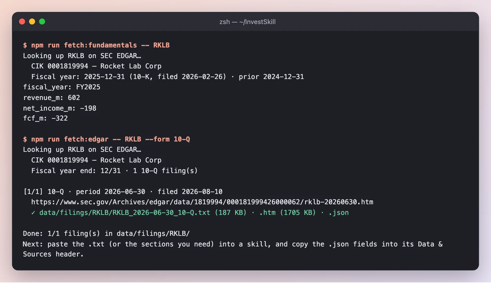

*FY2025 營收 $6.02 億、淨利 −$1.98 億、自由現金流 −$3.22 億（公司申報值），加上完整的 2026 Q2 10-Q（187 KB 純文字）。最新收盤價由我們手動填入資料包。*

**結果：** `data/fixtures/RKLB.md` 和 `data/filings/RKLB/RKLB_2026-06-30_10-Q.txt`，下面每個技能都從這裡出發。每個指令最後都加上同一句：*先用這兩個檔案，只有檔案裡沒有的資料才上網查，每個來源都要標日期；全部內容請用繁體中文輸出。*

---

## 第一部分 · 這是好公司嗎？

### 步驟 1 · `stock-eval`：全面評估

```text
/us-stock-analysis:stock-eval RKLB — start from data/fixtures/RKLB.md and the latest 10-Q; use the web only for data not in them 全部內容請用繁體中文輸出。
```

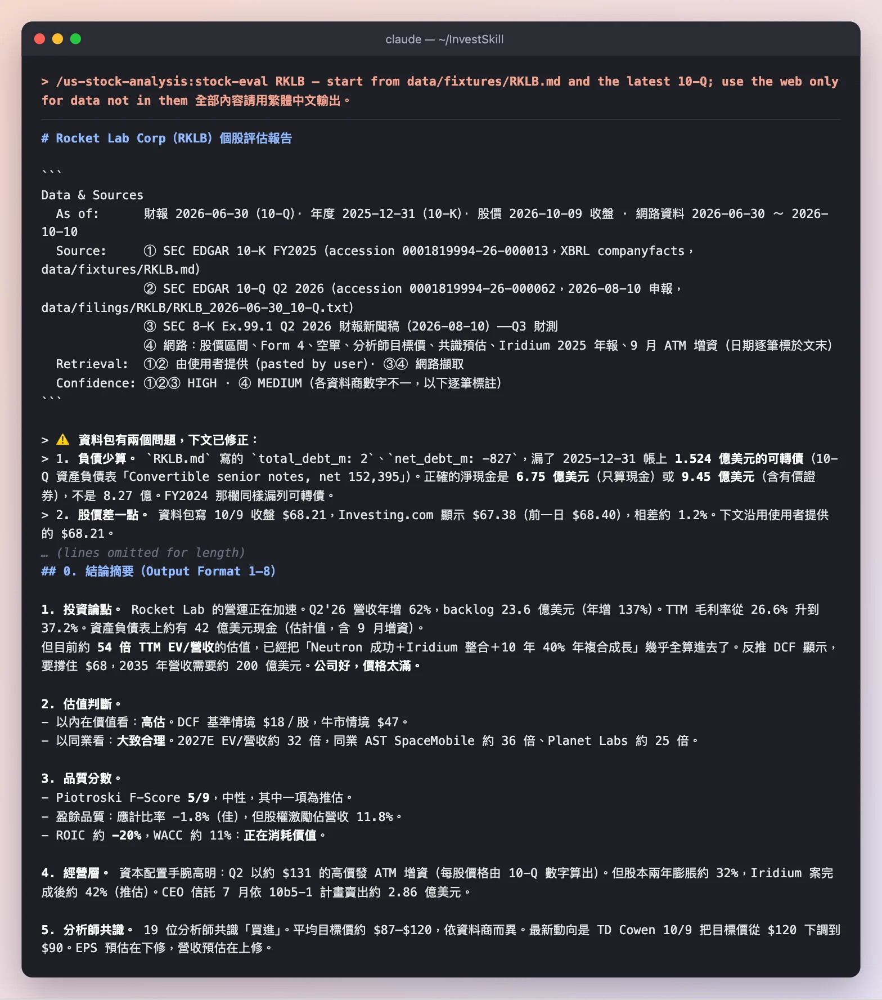

*先交代每個來源的日期與信心，接著直接指出資料包的兩個問題，然後才給結論。*

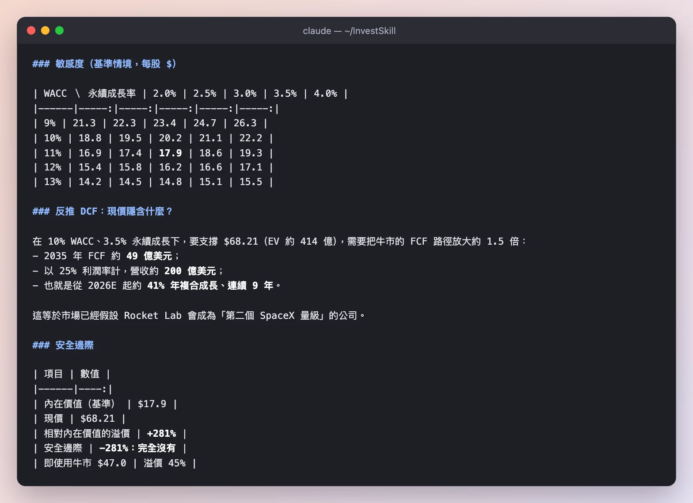

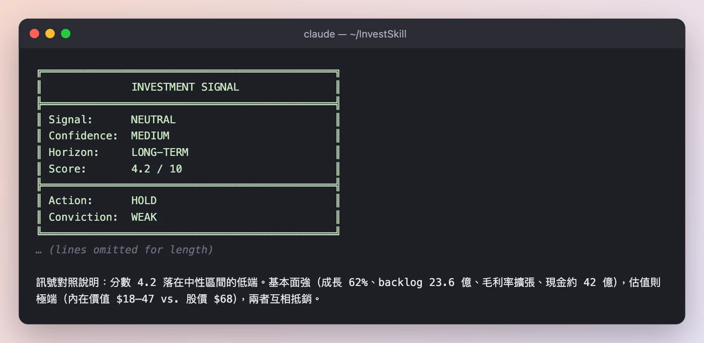

**注意這幾點**

- **它抓出資料包漏掉的負債。** 資料包寫總負債 $2M，但 10-Q 資產負債表上有 **$1.524 億的可轉債**，所以淨現金被高估了。它也發現一個資料商的 10/9 收盤價是 $67.38，和資料包的 $68.21 差 1.2%，並說明自己沿用哪一個。
- **營運在加速：** Q2 營收年增 62%，在手訂單 $23.6 億（年增 137%），毛利率從 26.6% 升到 37.2%。
- **但估值太滿：** DCF 基準情境只有每股 **$18**，反推 DCF 要撐住 $68，需要連續 9 年約 41% 的年複合成長，等於假設它成為「第二個 SpaceX 量級」的公司。

**結果：** **NEUTRAL · 信心 MEDIUM · 4.2 / 10 · HOLD**。「公司好，價格太滿」，建議等 $40–48 再分批。

### 步驟 2 · `competitor-analysis`：護城河有多寬？

```text
/us-stock-analysis:competitor-analysis RKLB — start from data/fixtures/RKLB.md and the latest 10-Q; use the web only for data not in them 全部內容請用繁體中文輸出。
```

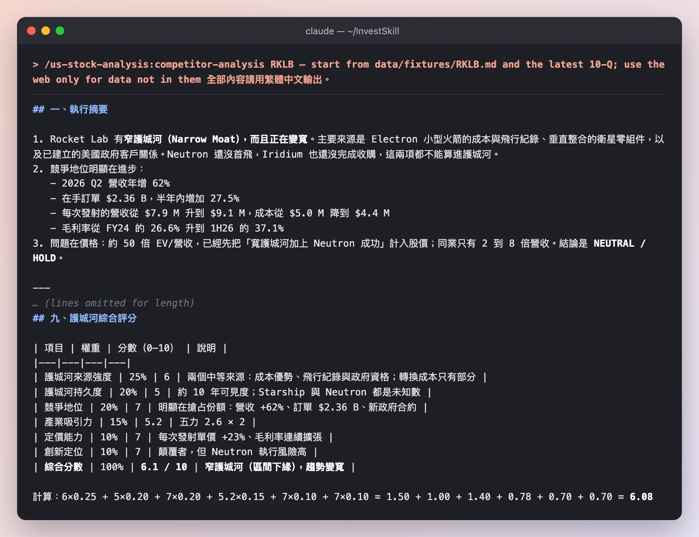

**注意這幾點**

- **只算已經證明的東西。** Neutron 還沒首飛、Iridium 還沒完成收購，所以這兩項都**不算進護城河**。
- **定價能力看得到：** 每次發射的營收從 $790 萬升到 $910 萬，成本從 $500 萬降到 $440 萬。
- **護城河不等於買進：** 約 50 倍 EV/營收，已經先把「寬護城河加上 Neutron 成功」算進股價，同業只有 2 到 8 倍。

**結果：** 窄護城河、趨勢變寬（6.1 / 10）→ **NEUTRAL · 5.6 / 10 · HOLD**。

### 步驟 3 · `earnings-call-analysis`：管理層說了什麼？

```text
/us-stock-analysis:earnings-call-analysis RKLB（最近一季法說會）
```

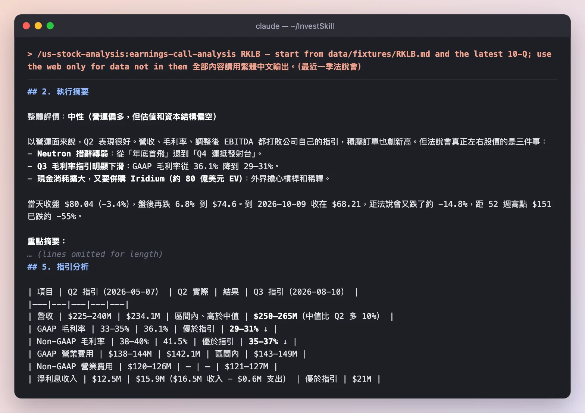

**注意這幾點**

- **數字很好，股價卻跌。** 營收、毛利率、調整後 EBITDA 全部打敗指引，但法說會當天盤後跌 6.8%。真正左右股價的是三件事：Neutron 措辭從「年底首飛」退到「Q4 運抵發射台」、Q3 毛利率指引從 36.1% 降到 29–31%、現金消耗擴大又要收購 Iridium。
- **它比對了措辭變化：** 10-Q 寫「年底發射的窗口正在收窄」，Q1 新聞稿寫的還是「進度如期」。
- **可信度分開評：** 財務指引可信度高，Neutron 時程可信度低（已延期兩次）。

**結果：** **NEUTRAL · 5.5 / 10 · HOLD**。

---

## 第二部分 · 值多少錢？

### 步驟 4 · `stock-valuation`：多種方法，一個區間

```text
/us-stock-analysis:stock-valuation RKLB — start from data/fixtures/RKLB.md and the latest 10-Q; use the web only for data not in them 全部內容請用繁體中文輸出。
```

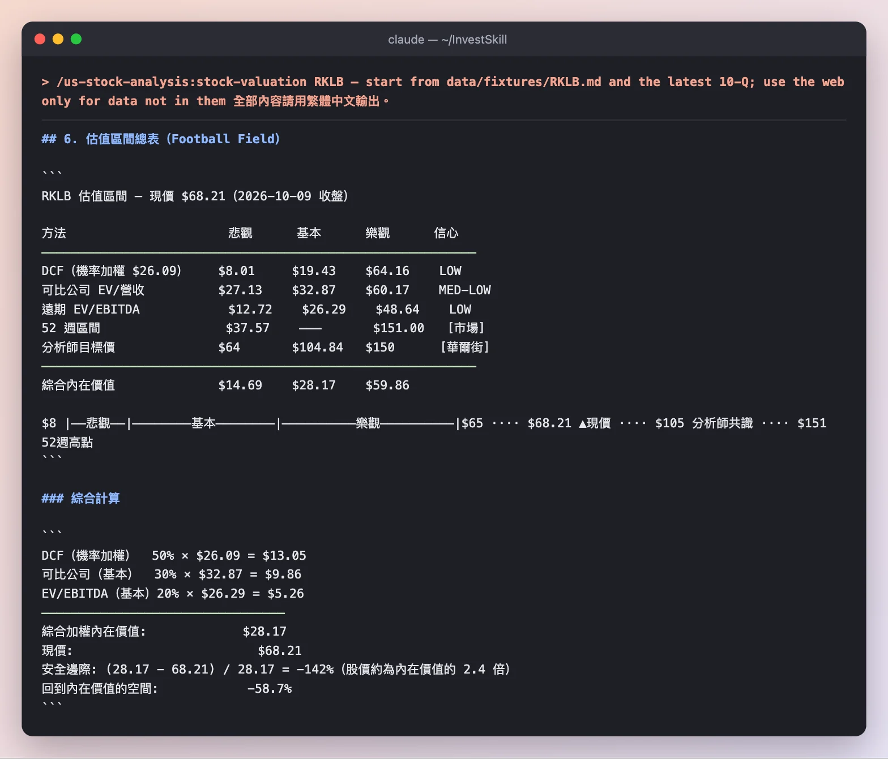

**注意這幾點**

- **三種方法都遠低於股價：** 綜合內在價值 **$28.17**，股價約是它的 2.4 倍。連最樂觀的綜合情境（$59.86）都低於現價。
- **它提醒自己的限制：** 太空股的定價大量來自敘事與動能，過去 12 個月股價在 $37.57 到 $151 之間來回，「估值偏貴不代表短期會下跌」。
- **和步驟 1 的差別：** `stock-eval` 說 HOLD，這裡說 SELL。兩者看的是同一批事實，只是這裡只回答「價格合不合理」。

**結果：** **BEARISH · 2.5 / 10 · SELL**。

### 步驟 5 · `dividend-analysis`：公司怎麼運用現金？

```text
/us-stock-analysis:dividend-analysis RKLB — start from data/fixtures/RKLB.md and the latest 10-Q; use the web only for data not in them 全部內容請用繁體中文輸出。
```

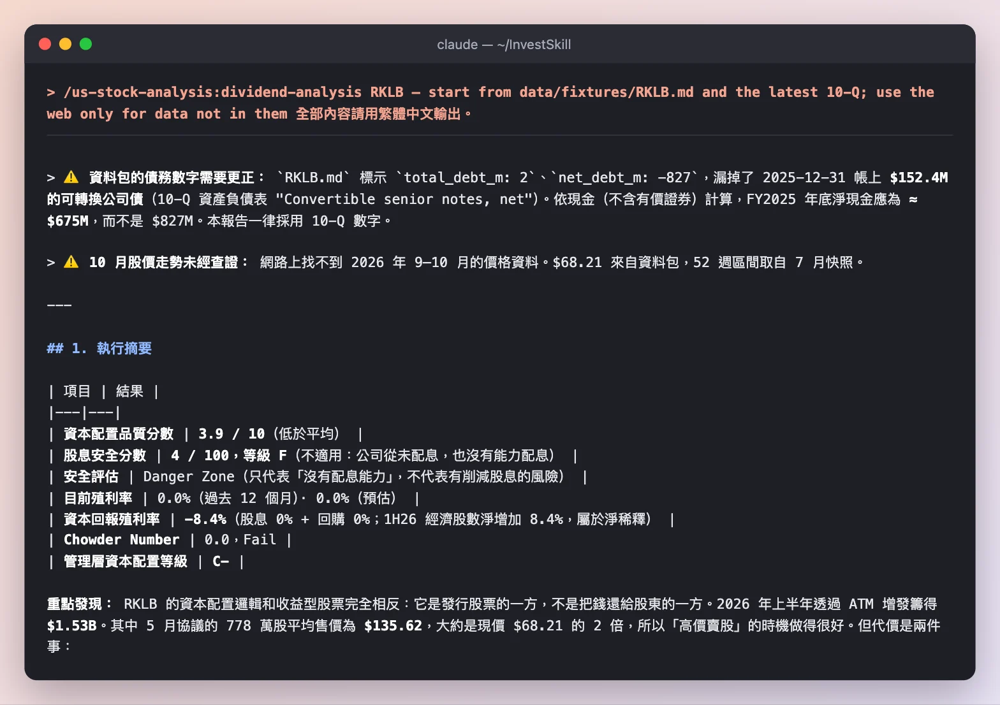

**注意這幾點**

- **它是發股票的一方，不是還錢給股東的一方。** 2026 上半年用 ATM 增發籌了 $15.3 億，5 月那批均價 $135.62，大約是現價的 2 倍，時機抓得很好。
- **代價是稀釋：** 經濟股數 18 個月增加 **26.7%**，資本回報殖利率是 **−8.4%**。
- **兩個技能查到不同的新聞。** 這份報告寫 Iridium 收購背後有「$36 億過橋貸款」，但步驟 1 的 `stock-eval` 找到 9/15 的新聞：公司已經用 ATM 募資 $19.4 億，並**終止了過橋貸款**。上網查資料的技能，結果取決於它找到哪一篇。這正是要標日期、要驗證的原因。

**結果：** 資本配置 **3.9 / 10（等級 C−）** → **BEARISH · SELL**。它特別說明：這只代表「不適合收益型配置」，不是看空成長論點。

---

## 第三部分 · 市場在說什麼？

### 步驟 6 · `technical-analysis`：走勢圖

```text
/us-stock-analysis:technical-analysis RKLB — start from data/fixtures/RKLB.md and the latest 10-Q; use the web only for data not in them 全部內容請用繁體中文輸出。
```

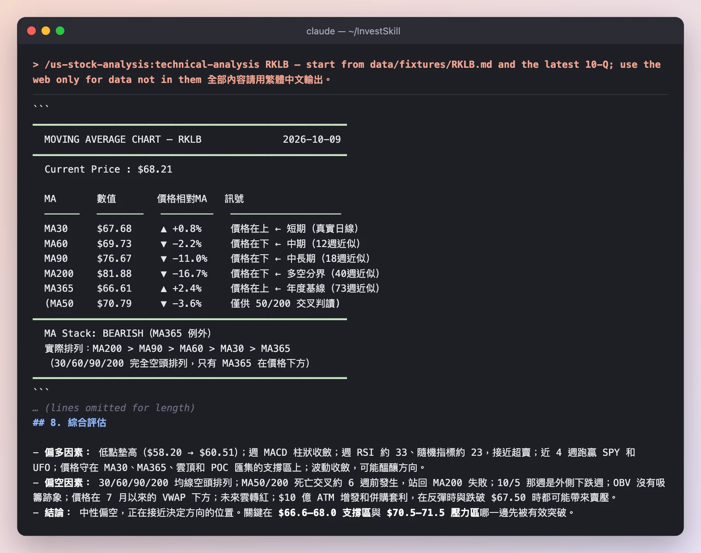

**注意這幾點**

- **它標出哪些數字是近似值。** 只有 MA30 是用真實日線算的，MA60 以上是用週線近似，圖上逐一標註。
- **空頭排列：** MA30/60/90/200 完全空頭排列，MA50/200 死亡交叉約 6 週前發生，股價從 52 週高點 $151 跌了約 55%。
- **但接近決定方向：** 週 RSI 約 33、接近超賣，低點墊高。關鍵是 **$66.6–68.0 支撐**和 **$70.5–71.5 壓力**哪一邊先被突破。

**結果：** **NEUTRAL · 4.2 / 10 · HOLD**（中性偏空）。

### 步驟 7 · `insider-trading`：內部人在買還是賣？

```text
/us-stock-analysis:insider-trading RKLB — start from data/fixtures/RKLB.md and the latest 10-Q; use the web only for data not in them 全部內容請用繁體中文輸出。
```

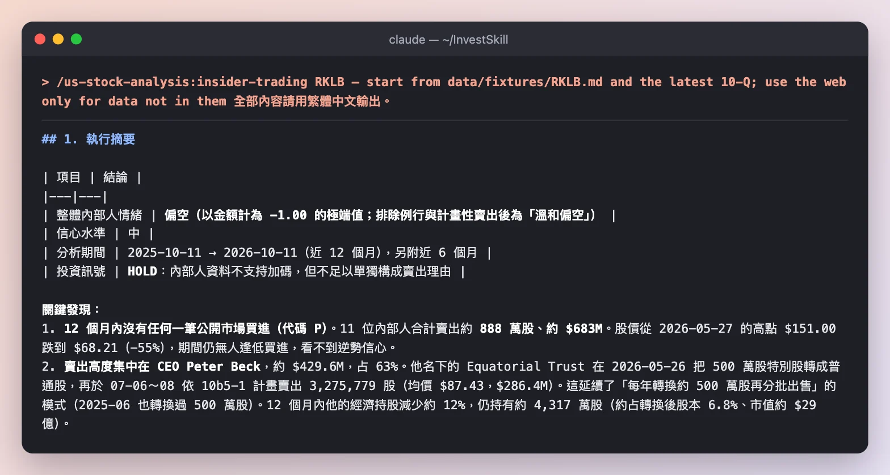

**注意這幾點**

- **零買進：** 12 個月內 11 位內部人賣出約 888 萬股、約 **$683M**，股價跌了 55% 也沒有人逢低買進。
- **它看出賣出的型態：** CEO 的信託每年把約 500 萬股特別股轉成普通股再依 10b5-1 計畫分批賣出；CFO 的新計畫涵蓋全部既得選擇權。
- **它點出值得追蹤的時序，但不下結論：** CFO 和一名董事在 6/3 簽新的 10b5-1 計畫，25 天後公司宣布收購 Iridium。報告寫明「沒有證據顯示違規」。

**結果：** **BEARISH · 3.5 / 10 · HOLD**：不支持加碼，但不足以單獨構成賣出理由。

### 步驟 8 · `short-interest`：空方擠不擠？

```text
/us-stock-analysis:short-interest RKLB — start from data/fixtures/RKLB.md and the latest 10-Q; use the web only for data not in them 全部內容請用繁體中文輸出。
```

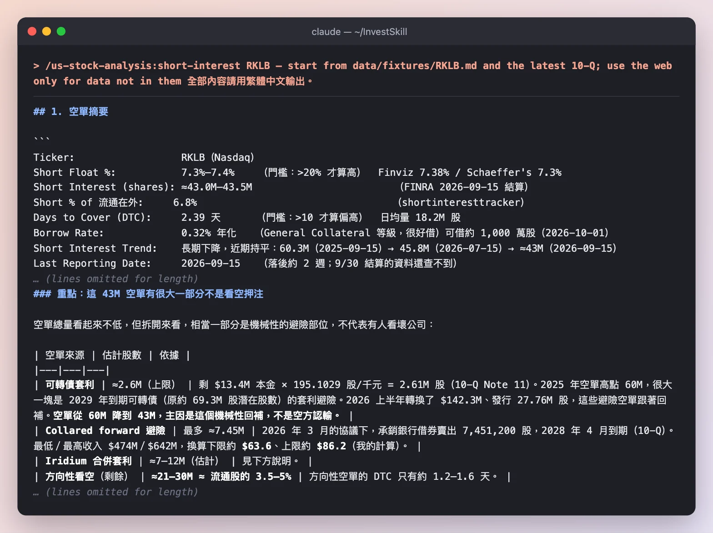

**注意這幾點**

- **它把空單拆開來看。** 43M 股空單裡，有可轉債套利、collared forward 避險、Iridium 合併套利，真正的方向性看空只占流通股約 3.5–5%。
- **它算出一個反直覺的結構：** RKLB 跌破 $67.50 時，合併套利者的避險部位會變大，需要**再加空**，等於跌勢會自己增加空單。
- **空單從 60M 降到 43M，主因是可轉債轉換後的機械性回補，不是空方認輸。**

**結果：** **NEUTRAL · 4.5 / 10 · HOLD**，軋空機率低。

---

## 第四部分 · 可能出什麼錯？

### 步驟 9 · `bear-case`：紅隊

```text
/us-stock-analysis:bear-case RKLB — start from data/fixtures/RKLB.md and the latest 10-Q; use the web only for data not in them 全部內容請用繁體中文輸出。
```

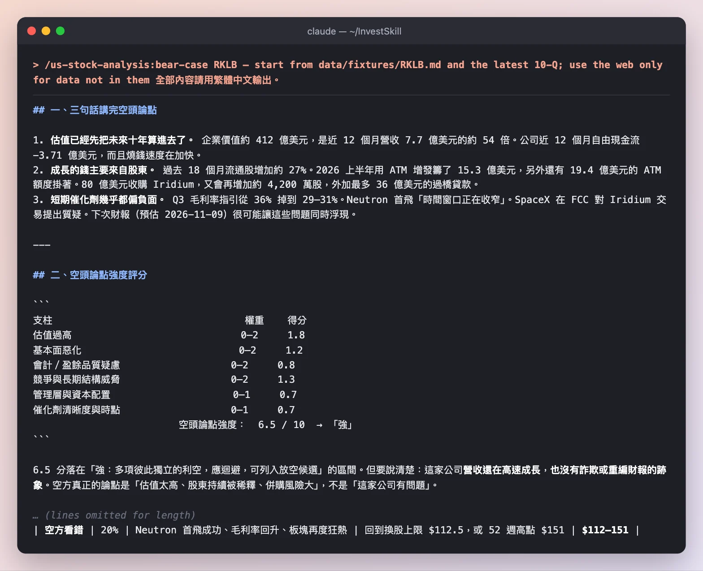

**注意這幾點**

- **這次空方比 PLTR 強：** 6.5 / 10（「強」），而 PLTR 只有 5.0。除了估值（1.8 / 2），基本面（1.2）和競爭威脅（1.3）也有分數。
- **它把話說清楚：** 營收還在高速成長，也沒有詐欺或重編財報的跡象。空方的論點是「估值太高、股東持續被稀釋、併購風險大」，不是「這家公司有問題」。
- **但不建議直接放空：** 機率加權約 $55（−19%），看錯時漲幅可能超過 100%。比較合理的做法是不持有，或用選擇權價差表達看法。

**結果：** 空頭強度 **6.5 / 10** → **BEARISH · 3.5 / 10 · SELL**。

### 步驟 10 · `fact-check`：回頭驗證第一份報告

```text
/us-stock-analysis:fact-check output/rklb/01-stock-eval.md — verify every figure against data/fixtures/RKLB.md and the 10-Q; mark web-only figures unverifiable 全部內容請用繁體中文輸出。
```

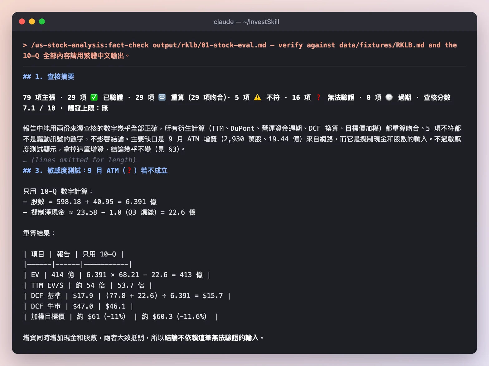

*只用兩份 SEC 檔案離線查核。步驟 1 從網路找到的數字一律標 ❓ 無法驗證，意思是「沒查」，不是「錯」。*

**注意這幾點**

- **能查的幾乎都對：** 29 項重算全部吻合，包括 TTM、DuPont、DCF 換算和目標價加權。
- **它做了一個聰明的測試。** 9 月 ATM 增資（2,930 萬股、19.44 億）只來自網路、無法驗證，而它又是現金和股數的輸入。查核把這筆拿掉重算：增資同時增加現金和股數，兩者大致抵銷，加權目標價從約 $61 變成約 $60.3，**結論不依賴這筆無法驗證的數字**。
- **5 項不符都不是關鍵數字：** 例如「毛利率從 26.6% 升到 37.2%」裡的 26.6% 其實是 FY2024（FY2025 是 34.4%），趨勢方向仍然正確；一個「約 3,000 萬」的負債數字疑似標錯列名。

**步驟 10 的結果：** **查核分數 7.1 / 10。** 原報告的 NEUTRAL / HOLD 照抄不變；輸入數字大致可信。

---

## 最後得到了什麼

| 技能 | 訊號 | 分數 |
|------|------|------|
| `stock-eval` | NEUTRAL · HOLD | 4.2 |
| `competitor-analysis` | NEUTRAL · HOLD | 5.6 |
| `earnings-call-analysis` | NEUTRAL · HOLD | 5.5 |
| `stock-valuation` | **BEARISH · SELL** | 2.5 |
| `dividend-analysis` | **BEARISH · SELL** | 3.9 |
| `technical-analysis` | NEUTRAL · HOLD | 4.2 |
| `insider-trading` | BEARISH · HOLD | 3.5 |
| `short-interest` | NEUTRAL · HOLD | 4.5 |
| `bear-case` | **BEARISH · SELL** | 3.5 |
| `fact-check` | （照抄）NEUTRAL · HOLD | 查核 7.1 |

**這份示範告訴我們**

1. **和 PLTR 比，結論明顯更偏空。** 兩家公司都在高速成長、估值都很高，但 RKLB 還在燒錢、持續稀釋，又有一筆 $80 億的收購。十個技能裡有四個給出 BEARISH，PLTR 只有一個。
2. **技能會修正資料。** 兩個技能各自發現資料包漏掉 $1.524 億可轉債。資料包是起點，不是標準答案。
3. **上網的技能可能查到不同的新聞。** 步驟 1 找到「過橋貸款已終止」，步驟 5 沒找到。每個網路數字都有日期，你才分得出哪個比較新。
4. **原始訊號需要拆解。** 7.4% 的空單看起來不低，拆開後多半是避險；內部人賣出看起來很多，拆開後多半是計畫性賣出。

---

## 自己跑一次

```bash
export EDGAR_USER_AGENT="Your Name you@example.com"
npm run fetch:fundamentals -- RKLB        # 接著在 price: 那一行填上今天的股價
npm run fetch:edgar -- RKLB --form 10-Q

# 在 Claude Code 裡，每個技能後面都加上同一句
/us-stock-analysis:stock-eval RKLB — start from data/fixtures/RKLB.md and the latest 10-Q in data/filings/RKLB/; use the web only for data not in them, and cite each source with its date 全部內容請用繁體中文輸出。
```

這裡的每次執行都用 `claude -p "<指令>" --allowedTools Read,WebSearch,WebFetch`。把 `stock-eval` 換成上面任何一個技能即可。其他 AI 工具可以貼上 [`prompts/`](https://github.com/yennanliu/InvestSkill/tree/main/prompts) 裡對應的檔案。其他示範請看[示範總覽](full-demo-zh-tw.html)。

---

## 完整輸出

上面每次執行的完整、未經修改的輸出。

<details>
<summary><strong>步驟輸出：<code>stock-eval</code></strong></summary>

~~~~text
# Rocket Lab Corp（RKLB）個股評估報告

```
Data & Sources
  As of:      財報 2026-06-30（10-Q）· 年度 2025-12-31（10-K）· 股價 2026-10-09 收盤 · 網路資料 2026-06-30 ～ 2026-10-10
  Source:     ① SEC EDGAR 10-K FY2025（accession 0001819994-26-000013，XBRL companyfacts，data/fixtures/RKLB.md）
              ② SEC EDGAR 10-Q Q2 2026（accession 0001819994-26-000062，2026-08-10 申報，data/filings/RKLB/RKLB_2026-06-30_10-Q.txt）
              ③ SEC 8-K Ex.99.1 Q2 2026 財報新聞稿（2026-08-10）——Q3 財測
              ④ 網路：股價區間、Form 4、空單、分析師目標價、共識預估、Iridium 2025 年報、9 月 ATM 增資（日期逐筆標於文末）
  Retrieval:  ①② 由使用者提供（pasted by user）· ③④ 網路擷取
  Confidence: ①②③ HIGH · ④ MEDIUM（各資料商數字不一，以下逐筆標註）
```

> ⚠️ **資料包有兩個問題，下文已修正：**
> 1. **負債少算。** `RKLB.md` 寫的 `total_debt_m: 2`、`net_debt_m: -827`，漏了 2025-12-31 帳上 **1.524 億美元的可轉債**（10-Q 資產負債表「Convertible senior notes, net 152,395」）。正確的淨現金是 **6.75 億美元**（只算現金）或 **9.45 億美元**（含有價證券），不是 8.27 億。FY2024 那欄同樣漏列可轉債。
> 2. **股價差一點。** 資料包寫 10/9 收盤 $68.21，Investing.com 顯示 $67.38（前一日 $68.40），相差約 1.2%。下文沿用使用者提供的 $68.21。

---

## 0. 結論摘要（Output Format 1–8）

**1. 投資論點。** Rocket Lab 的營運正在加速。Q2'26 營收年增 62%，backlog 23.6 億美元（年增 137%）。TTM 毛利率從 26.6% 升到 37.2%。資產負債表上約有 42 億美元現金（估計值，含 9 月增資）。
但目前約 **54 倍 TTM EV/營收**的估值，已經把「Neutron 成功＋Iridium 整合＋10 年 40% 年複合成長」幾乎全算進去了。反推 DCF 顯示，要撐住 $68，2035 年營收需要約 200 億美元。**公司好，價格太滿。**

**2. 估值判斷。**
- 以內在價值看：**高估**。DCF 基準情境 $18／股，牛市情境 $47。
- 以同業看：**大致合理**。2027E EV/營收約 32 倍，同業 AST SpaceMobile 約 36 倍、Planet Labs 約 25 倍。

**3. 品質分數。**
- Piotroski F-Score **5/9**，中性，其中一項為推估。
- 盈餘品質：應計比率 −1.8%（佳），但股權激勵佔營收 11.8%。
- ROIC 約 **−20%**，WACC 約 11%：**正在消耗價值**。

**4. 經營層。** 資本配置手腕高明：Q2 以約 $131 的高價發 ATM 增資（每股價格由 10-Q 數字算出）。但股本兩年膨脹約 32%，Iridium 案完成後約 42%（推估）。CEO 信託 7 月依 10b5-1 計畫賣出約 2.86 億美元。

**5. 分析師共識。** 19 位分析師共識「買進」。平均目標價約 $87–$120，依資料商而異。最新動向是 TD Cowen 10/9 把目標價從 $120 下調到 $90。EPS 預估在下修，營收預估在上修。

**6. 三大風險。**
- Neutron 首飛延到 2027。
- Iridium 案的監管與整合（約 80 億美元 EV、約 16 倍 OEBITDA）。
- 高倍數股票遇到成長或毛利不如預期（Q3 GAAP 毛利率財測降到 29–31%）。

**7. 12 個月目標價。**
- 空頭 $35（30%）
- 基準 $60（45%）
- 多頭 $93（25%）
- **機率加權約 $61，比現價低約 11%。**

**8. 建議進場區。** 分批，**$40–48**。$48 以下才接近牛市 DCF 的價值；$40 附近接近 52 週低點 $37.57。在現價 $68 不建議追高。

---

## 1. 公司概況

| 項目 | 內容 |
|------|------|
| 業務 | 端到端太空公司，分兩個部門。**發射服務**：Electron 小型火箭、HASTE 次軌道高超音速測試、開發中的 Neutron 中型可回收火箭。**太空系統**：衛星平台、零組件、光學、雷射通訊、太空機器人。 |
| 營收組成（Q2'26） | 太空系統 1.895 億（81%，年增 94%）· 發射 4,460 萬（19%，年減 4%，主因 HASTE 改按完工比例認列）（10-Q） |
| 規模 | Electron 累計 87 次成功任務，送出超過 250 顆衛星。2025 年發射次數全球第二。2025 年發射 21 次，2026 上半年 12 次（10-Q） |
| 每次發射經濟效益 | Q2'26 每次營收 910 萬、成本 440 萬；去年同期為 790 萬與 500 萬（10-Q） |
| Backlog | **23.559 億美元**（太空系統 14.158 億、發射 9.402 億），45% 在 12 個月內認列（10-Q） |
| 客戶集中度 | 「政府客戶」佔 2026 上半年營收 **42%**；MDA 佔應收帳款 11%（10-Q） |
| 近期併購 | GEOST（2025-08，2.92 億）· Mynaric（2026-04，1.61 億，全數用股票支付）· Motiv（2026-05，4,450 萬）· **Iridium（待完成，EV 約 80 億，預計 2027 年完成）**（10-Q） |
| Q2 之後的新合約 | Space Force 次軌道飛彈防禦發射 12 次，2.66 億（7/21）；SB-AMTI Flatellite 衛星計畫 3.97 億，含選擇權（7/30）（10-Q MD&A） |

### Iridium 交易重點（10-Q 附註 1、MD&A、風險因子）

- **價格與支付方式。** 每股 $54 = 現金 $27 加上 RKLB 股票。換股比例有上下限（collar）：
  - RKLB 10 日 VWAP ≤ $67.50 時，固定 0.4000。
  - 介於 $67.50 和 $112.50 之間時，比例 = $27 ÷ VWAP。
  - VWAP ≥ $112.50 時，固定 0.2400。
- **為什麼重要：** 現價 $68.21 幾乎就在 collar 下緣。再跌的話，換股比例會鎖在 0.4，賣方拿到的股票價值會低於 $27，對 Iridium 股東投票形成壓力。
- **資金需求。** 需要超過 30 億美元現金，支付股票對價、償還部分 Iridium 債務和交易費用。另外約 18 億美元的 Iridium 定期貸款可能需要再融資。
- **融資進度。** 原本有 36 億美元過橋貸款承諾。據 2026-09-15 新聞稿，公司已用 ATM **發行 2,930 萬股、募得約 19.44 億美元**，並**終止過橋貸款**（[QuiverQuant 9/15](https://www.quiverquant.com/news/Rocket+Lab+Completes+$1.944+Billion+ATM+Offering+to+Fully+Finance+Pending+Iridium+Acquisition)）。
- **時間表。** 截止日 2027-06-28，最多可延兩次到 2027-12-28。需要通過 HSR、FCC、外國投資審查。
- **Iridium 基本面（2025）。** 營收 8.717 億、OEBITDA 4.953 億、淨槓桿 3.4 倍；2026 年 OEBITDA 財測 4.8–4.9 億（[Iridium 8-K，2026-02-12](https://www.sec.gov/Archives/edgar/data/1418819/000141881926000008/pressreleaseq42025.htm)）。
- **收購倍數。** 80 億 ÷ 4.953 億 ≈ **16.2 倍 OEBITDA**。

---

## 2. 財務體質

### 損益（百萬美元）

TTM = FY25 − 1H25 + 1H26。

| 項目 | FY2024 | FY2025 | TTM 2026-06 | 1H26 | 1H25 |
|------|-------:|-------:|-----------:|-----:|-----:|
| 營收 | 436 | 602 | **769.3** | 434.4 | 267.1 |
| 營收成長 | — | **+38.0%** ✅ | — | **+62.7%** | — |
| 毛利 | 116 | 207 | 286.5 | 161.1 | 81.6 |
| 毛利率 | 26.6% | **34.4%** ✅ | **37.2%** | 37.1% | 30.6% |
| 研發 | 174 | 271 | 312.7 | 162.9 | 121.2 |
| 銷管 | 132 | 165 | 197.4 | 111.6 | 79.2 |
| 營業利益 | −190 | −229 | **−223.7** | −113.5 | −118.8 |
| 營業利益率 | −43.5% | −38.0% | −29.1% | −26.1% | −44.5% |
| 淨利 | −190 | −198 | **−165.3** | −94.3 | −127.0 |
| 稀釋 EPS | −0.38 | −0.37 | — | −0.15 | −0.25 |

*FY2025 的淨利有 2,800 萬美元所得稅利益墊高，稅前虧損其實是 −2.26 億。*

### 現金流（百萬美元）

| 項目 | FY2024 | FY2025 | TTM | 1H26 |
|------|-------:|-------:|----:|-----:|
| 營業現金流 | −49 | −166 | −222.9 | −134.4 |
| 資本支出 | 67 | 156 | 148.4 | 53.1 |
| **自由現金流** | −116 | **−322** ✅ | **−371.3** | −187.5 |
| 股權激勵 | 57 | 71 | 81.5 | 47.7 |
| 折舊攤銷 | 34 | 44 | 62.5 | 35.9 |

1H26 營業現金流惡化的主因是營運資金：應收 −6,300 萬、存貨 −7,330 萬、其他非流動資產 −4,030 萬；合約負債 +7,880 萬只抵掉一部分。這些變化反映製造型合約在擴張，也有部分來自併購（10-Q 現金流量表）。

### 資產負債（2026-06-30，10-Q）

| 項目 | 2026-06-30 | 2025-12-31 |
|------|----------:|----------:|
| 現金＋有價證券 | **23.876 億** | 10.988 億 |
| 可轉債（4.25%，2029 年到期） | 1,310 萬 | **1.524 億**（資料包漏列） |
| 長期借款＋融資租賃 | 約 3,000 萬 | 約 3,000 萬 |
| **淨現金** | **約 23.6 億** | 約 9.2 億 |
| 合約負債（客戶預付款） | 3.512 億 | 1.954 億 |
| 股東權益 | 34.922 億 | 17.219 億 |

**擬制現金（推估）：** 6/30 的 23.9 億，加上 9 月 ATM 約 19.2 億（扣 1–2% 費用），減掉 Q3 約 1 億的現金消耗，**約 42 億美元**。Iridium 交易完成後約剩 12 億，另外承擔約 18 億的 Iridium 定期貸款。合併後以 OEBITDA 約 4.25 億估算，淨槓桿約 1.5 倍（推估）。

### 營運槓桿

| 期間 | 營收（M） | 營收成長 | EBIT（M） | 增量營業利益率 |
|------|---------:|--------:|---------:|------------:|
| FY24 → FY25 | 436 → 602 | +38% | −190 → −229 | **−23%**（虧損擴大） |
| 1H25 → 1H26 | 267 → 434 | +63% | −119 → −113 | **+3.2%** |
| Q2'25 → Q2'26 | 144.5 → 234.1 | +62% | −59.6 → −57.5 | +2.3% |

虧損時 DOL 沒有意義。1H26 營業費用成長 37%，低於營收成長 63%，營運槓桿剛開始出現，但幅度還很小。

### 營運資金週期

| 指標 | FY2024 | FY2025 | TTM 2026-06 |
|------|------:|------:|-----------:|
| DSO | 30.1 | 23.6 | 53.6 |
| DIO | 135.7 | 146.4 | **201.7** |
| DPO | 60.5 | 67.2 | 56.3 |
| CCC | 105.3 | 102.8 | **199.0** |
| 營運性 NWC（不含現金） | — | 1,460 萬 | 6,530 萬 |

TTM 的 CCC 被併購扭曲：Mynaric 和 Motiv 的資產負債表整筆併入，營收只算進幾個月，所以會偏高。下季要看 DIO 是否回落到 150 天以下。
增量 NWC ÷ 增量營收：(65.3 − 14.6) ÷ (769 − 602) ≈ 30%，**高於 15% 的警戒線**。

### DuPont 拆解（FY2025，以平均資產與平均權益計）

| 因子 | FY2025 | FY2024（年底值） |
|------|------:|------:|
| 稅負（淨利 ÷ 稅前） | 0.876 | 1.005 |
| 利息負擔（稅前 ÷ EBIT） | 0.987 | 0.995 |
| EBIT 利潤率 | −38.0% | −43.5% |
| 資產週轉率 | 0.343 | 0.368 |
| 權益乘數 | 1.67 | 3.10 |
| **ROE** | **−18.8%** | −49.7% |

ROE 改善靠的是兩件事：EBIT 利潤率變好，以及大量增資把權益乘數從 3.1 降到 1.7。資產週轉率下降，因為現金和併購資產膨脹的速度比營收快。

---

## 3. 估值指標

股數基準（經濟股數）：普通股 5.982 億 + 可轉換參與型特別股 0.410 億 + 9 月 ATM 0.293 億 = **約 6.68 億股**。
- 市值：6.68 億 × $68.21 ≈ **456 億美元**。只用資料包的 5.98 億股算是 408 億，少算約 12%。
- **EV ≈ 456 − 42（擬制淨現金）≈ 414 億美元。**

| 指標 | 目前 | 一年前 | 5 年平均 | 產業平均 |
|------|------|------|------|------|
| P/E（TTM） | 無意義（虧損） | 無意義 | 無意義 | — |
| P/E（預估） | 無意義（2026E EPS 約 −$0.18） | — | — | — |
| PEG | 無意義 | — | — | — |
| P/B | 約 8.6 倍（擬制權益約 53 億） | n/a | n/a | — |
| P/S（TTM） | **約 59 倍** | n/a | n/a | — |
| EV/S（TTM） | **約 54 倍** | n/a | n/a | — |
| EV/S（2026E 約 8.8 億） | 約 47 倍 | — | — | — |
| EV/S（2027E 約 12.8 億） | **約 32 倍** | — | — | AST 約 36 倍、PL 約 25 倍 ¹ |
| EV/EBITDA | 無意義（調整後 EBITDA 為負） | — | — | — |
| EV/FCF | 無意義（FCF −3.71 億） | — | — | — |
| 殖利率／配息率 | 0% / — | — | — | — |

¹ 出處為 2026-06-04 某 S-4 申報文件的可比公司表（[SEC](https://www.sec.gov/Archives/edgar/data/0002145371/000121390026106599/ea0301326-03.htm)），日期較舊、欄位排版有錯位，**僅供參考**。「一年前」與「5 年平均」沒有可靠資料，不予填寫。

---

## 4. 關鍵比率（TTM／2026-06-30）

| 比率 | 目前 | 產業平均 | 評估 |
|------|------|------|------|
| ROE | −6.3% | 航太國防約 15–20% | 差 |
| ROA | −5.1% | — | 差 |
| ROIC | **約 −20%** | — | 消耗價值 |
| 毛利率 | 37.2%（非 GAAP Q2 為 41.5%） | 航太約 20–30% | **佳**，趨勢向上 |
| 營業利益率 | −29.1% | — | 差，但在改善 |
| 淨利率 | −21.5% | — | 差 |
| 流動比率 | **5.48** | — | 極強 |
| 速動比率 | **4.75** | — | 極強 |
| 負債權益比 | 約 0.8% | — | 幾乎沒有負債 |
| 利息保障倍數 | 無意義（利息收入 1,650 萬遠高於利息支出 58 萬，Q2） | — | 不構成風險 |
| 資產週轉率 | 0.24 | — | 低（現金堆積所致） |

---

## 5. 同業比較

| 公司 | 定位 | 2027E EV/S | 備註 |
|------|------|------:|------|
| **RKLB** | 發射＋衛星製造（＋Iridium 通訊） | 約 32 倍 | 唯一已量產的獨立小型發射商 |
| AST SpaceMobile | 衛星直連手機 | 約 36 倍 ¹ | 營收剛起步 |
| Planet Labs | 對地觀測數據 | 約 25 倍 ¹ | 接近 EBITDA 損益兩平 |
| SpaceX（SPCX，2026 年 6 月上市） | 發射龍頭＋Starlink | 約 19 倍 2027E 營收 ² | 規模與獲利能力遠勝 |
| Iridium（收購標的） | 衛星通訊 | 約 9 倍營收 / 16 倍 OEBITDA | 成熟、有現金流 |

² [Motley Fool，2026-09-24](https://www.fool.com/investing/2026/09/24/spacex-poised-to-reclaim-190-by-end-of-2026/)。

**解讀：** 跟熱門太空股比，RKLB 的倍數不算離群。但它的遠期倍數比**已經獲利的龍頭 SpaceX 還高**，價格裡含有明顯的「題材溢價」。

---

## 6. 品質評分

### Piotroski F-Score（FY2025 對比 FY2024）

| # | 條件 | 數據 | 得分 |
|---|------|------|:---:|
| 1 | ROA > 0 | −8.5% | 0 |
| 2 | CFO > 0 | −1.66 億 | 0 |
| 3 | ROA 改善 | −16.0% → −8.5% | 1 |
| 4 | CFO/TA > ROA | −7.1% > −8.5% | 1 |
| 5 | 長期負債比下降 | 可轉債大量轉股 | 1 |
| 6 | 流動比率改善 | FY25 為 4.08；FY24 流動資產不在資料包中 ❓ | 1（推估） |
| 7 | 未發行新股 | 稀釋股數 4.96 億 → 5.31 億 | 0 |
| 8 | 毛利率改善 | 26.6% → 34.4% | 1 |
| 9 | 資產週轉率改善 | 0.368 → 0.259 | 0 |
| | **合計** | | **5/9（中性）** |

### 盈餘品質

- **應計比率** = (−198 + 166) ÷ 1,754 = **−1.8%**。數字為負代表現金面比帳面淨利好，是正面訊號，但兩者都是虧損。
- **獲利含金量（CFO ÷ 淨利）**：雙方都是負數，沒有意義。
- **非經常性項目**：
  - FY25 所得稅利益 2,800 萬。
  - Q2'26 累計追補調整使營收增加 810 萬（佔 Q2 營收 3.5%），其中單一合約貢獻 590 萬。
  - Q2'25 則是調降 640 萬。
- **營收認列風險：中等。** 1H26 有 58% 營收按完工比例認列，靠的是成本估計。另外 MDA 合約延遲交付，可能面臨違約金（10-Q）。
- **股權激勵**佔營收 11.8%（FY25）。

### ROIC／WACC

| 項目 | TTM 2026-06 |
|------|----:|
| EBIT | −2.237 億 |
| 有效稅率 | 約 0%（有評價準備） |
| NOPAT | −2.237 億 |
| 投入資本 = 權益 34.92 + 負債 0.30 − 現金與有價證券 23.88 | **11.34 億** |
| **ROIC** | **−19.7%** |

| WACC 項目 | 數值 |
|------|----:|
| 無風險利率（10 年期美債，**假設值**，未擷取即時數據） | 約 4.2% |
| Beta（**假設值**，歷史上約 2） | 2.0 |
| 股權風險溢酬 | 5.5% |
| 照 CAPM 公式算出的股權成本 | **約 15.2%** |
| 負債權重 | 約 0% |
| **WACC：CAPM 結果約 15%；本報告基準刻意用寬鬆的 11%** | **11%** |

- EVA ≈ (−19.7% − 11%) × 11.34 億 ≈ **−3.5 億美元／年**。
- ROIC 與 WACC 的差距約 −31 個百分點。

刻意用寬鬆的 WACC，是為了讓「高估」這個結論偏保守：用 CAPM 的 15%，內在價值只會更低。

---

## 7. DCF（RKLB 單獨，不含 Iridium）

**方法。** FY2026E 營收 8.8 億（接近共識 8.5–9.2 億）。直接假設 FCF 利潤率逐年改善。2026 年只剩 Q4 的現金消耗要折現。
- 擬制淨現金：42 億美元。
- 股數：6.68 億。
- Iridium 以「依收購成本計價」處理，NPV 視為 0。不過用 $68 的高價股票支付，其實對現有股東的內在價值有利。

| 假設 | 基準 | 牛市 | 空頭 |
|------|------|------|------|
| 營收成長 2027–2031 | 42%→22% | 60%→35% | 28%→12% |
| 營收成長 2032–2035 | 18%→10% | 30%→15% | 10%→5% |
| 2035 年營收 | 56 億 | **130 億** | 28 億 |
| FCF 利潤率路徑 | −12%（2027）→ 0%（2028）→ 21%（2035） | −8% → 4% → 25% | −20% → −8% → 12% |
| WACC | 11% | 10% | 12% |
| 永續成長率 | 3.0% | 3.5% | 2.5% |
| EV | 77.8 億 | 271.8 億 | 15.0 億 |
| 終值佔 EV 比重 | 74% | 79% | 84% |
| **每股內在價值** | **$17.9** | **$47.0** | **$8.5**（現金底約 $6.3） |

*Neutron 的大規模營收和衛星星系業務都在牛市情境裡。*

### 敏感度（基準情境，每股 $）

| WACC ＼ 永續成長率 | 2.0% | 2.5% | 3.0% | 3.5% | 4.0% |
|------|-----:|-----:|-----:|-----:|-----:|
| 9% | 21.3 | 22.3 | 23.4 | 24.7 | 26.3 |
| 10% | 18.8 | 19.5 | 20.2 | 21.1 | 22.2 |
| 11% | 16.9 | 17.4 | **17.9** | 18.6 | 19.3 |
| 12% | 15.4 | 15.8 | 16.2 | 16.6 | 17.1 |
| 13% | 14.2 | 14.5 | 14.8 | 15.1 | 15.5 |

### 反推 DCF：現價隱含什麼？

在 10% WACC、3.5% 永續成長下，要支撐 $68.21（EV 約 414 億），需要把牛市的 FCF 路徑放大約 1.5 倍：
- 2035 年 FCF 約 **49 億美元**；
- 以 25% 利潤率計，營收約 **200 億美元**；
- 也就是從 2026E 起約 **41% 年複合成長、連續 9 年**。

這等於市場已經假設 Rocket Lab 會成為「第二個 SpaceX 量級」的公司。

### 安全邊際

| 項目 | 數值 |
|------|----:|
| 內在價值（基準） | $17.9 |
| 現價 | $68.21 |
| 相對內在價值的溢價 | **+281%** |
| 安全邊際 | **−281%：完全沒有** |
| 即使用牛市 $47.0 | 溢價 45% |

### 倍數法補充（12 個月目標價）

用 2027E 營收 12.8 億，加上擬制淨現金 42 億，除以 6.68 億股：

| 情境 | 2027E EV/S | 每股價值 | 機率 |
|------|------:|------:|-----:|
| 空頭（Neutron 延後、題材退燒） | 15 倍 | **$35** | 30% |
| 基準（維持同業中位數） | 28 倍 | **$60** | 45% |
| 多頭（Neutron 首飛成功、Iridium 順利） | 45 倍 | **$93** | 25% |
| **機率加權** | | **約 $61** | |

---

## 8. 經營層評估

**資本配置**

- **增資擇時優異。** 依 10-Q 數字計算：Q1'26 ATM 發 636 萬股、淨得 4.449 億（約 $70／股）；Q2'26 發 815 萬股、淨得 10.678 億（**約 $131／股**）；9 月再發 2,930 萬股、毛額 19.44 億（約 $66／股）。在高價時大量發股，是對股東有利的資本配置。
- **稀釋幅度大。** 2024 年底經濟股數 5.04 億，到 2026 年 9 月約 6.68 億（**+32%**）。Iridium 完成後約 7.15 億（**+42%**）。Iridium 新發股數約 4,700 萬，是用「EV 80 億減淨負債約 17 億，再除以 $54」推估出約 1.17 億股 IRDM，乘上 0.4 得來 ❓。
- **併購頻繁。** 18 個月內做了 4 筆。目前商譽 2.99 億、無形資產 3.20 億。GEOST、Mynaric 的公允價值還在衡量期內，可能調整。Mynaric 在 Q2 貢獻營收 1,320 萬，卻帶來營業虧損 1,320 萬，**目前是拖累**。
- **研發紀律。** Neutron 從 2021 年宣布至今還沒首飛。10-Q 寫「年底發射窗口正在收窄」。

**財測準確度**

8 季完整資料不可得，不予捏造。已知的只有 Q2'26：
- 營收 2.341 億，高於共識約 200 萬（[MarketBeat 等，2026-10](https://www.marketbeat.com/stocks/NASDAQ/RKLB/)）。
- 調整後 EBITDA −880 萬，優於財測 −2,000 至 −2,600 萬（8-K）。
- EPS −$0.08，低於共識 $0.02，當日股價跌 9.9%。

**內部人交易（Form 4）**

- CEO Peter Beck 的 Equatorial Trust 在 **2026-07-06 至 07-08** 賣出約 **327.6 萬股、約 2.864 億美元**，成交價 $81.59–$101.57，依 2026-03-27 訂立的 10b5-1 計畫執行（[Investing.com](https://www.investing.com/news/insider-trading-news/rocket-lab-ceo-peter-beck-sells-2864m-in-company-stock-93CH-4782872)）。
- 據報 Beck 仍保留約 90% 持股（[Yahoo Finance](https://finance.yahoo.com/markets/stocks/articles/rklb-stock-comes-back-earth-074135721.html)）。實際持股比例未經查證。
- 過去 6 個月共有 97 筆內部人賣出，沒有公開市場買進（QuiverQuant，9/15）。
- **評估：** 屬計畫性賣出，資訊含量有限。但時間點就在 Iridium 公告後的高點，沒有任何買進訊號。

**薪酬結構：** 沒有查到最新的 proxy 資料，不予評論。

---

## 9. 分析師共識

| 項目 | 數值 |
|------|------|
| 評等 | 19 位分析師，共識「買進」（[Public.com，2026-10-10](https://public.com/stocks/rklb/forecast-price-target)） |
| 目標價（6/30 後） | Citizens $130 · Cantor $122 · Needham $120 · BofA $115 · TD Cowen **$90**（10/9 從 $120 下調）· Berenberg $83 · Raymond James $80 · Morgan Stanley 牛市目標 $293 |
| 平均目標價 | **約 $87**（含新納入覆蓋的機構）至約 $120（6/30 後的中位數），依資料商而異 |
| 相對 $87 的上漲空間 | 約 +28% |

共識顯示的潛在漲幅，和本報告機率加權的 −11% 差距很大。主因是分析師普遍用遠期營收倍數，並把 Neutron 和 Iridium 的綜效算進去。

**預估修正方向**

| 項目 | 較早 | 最新 | 方向 |
|------|------|------|------|
| FY2026 營收 | 8.51 億（2026 年 4 月，Seeking Alpha） | 9.19 億（2026-07-15，[Simply Wall St](https://simplywall.st/stocks/us/capital-goods/nasdaq-rklb/rocket-lab)） | ↑ |
| FY2026 EPS | −$0.10（4 月） | 約 −$0.18 | ↓ |
| FY2027 營收 | — | 約 11.8–12.8 億 | 分歧 |

ERM（盈餘修正動能）沒有逐筆修正數據，無法計算。方向上是營收上修、獲利下修，**屬中性偏弱**。

**空單：** 4,348 萬股，佔流通股 **7.31%**，回補天數 2.61 天（Yahoo，結算日 2026-09-15）。屬中等水準，沒有軋空結構。

---

## 10. 風險矩陣

### 營運風險

| 風險 | 等級 | 說明 |
|------|:---:|------|
| 產業景氣循環 | 中 | 國防與政府預算支撐，但商業衛星資本支出有循環性 |
| 競爭強度 | **高** | SpaceX 共乘（Transporter）壓縮小型發射的定價；Neutron 正面迎戰 Falcon 9 |
| 被顛覆的威脅 | 中 | Starship 若大幅降低每公斤成本，Neutron 的價格優勢會被侵蝕 |
| 客戶集中度 | **高** | 政府客戶佔營收 42% |
| 供應商集中度 | 中 | MDA 合約已因供應鏈問題延遲 |
| 監管 | **高** | Iridium 案需要 HSR、FCC 和外國投資審查；紐西蘭發射場的許可 |
| 訴訟／ESG | 低 | 10-Q 表示目前沒有重大訴訟 |

### 財務風險

| 風險 | 等級 | 說明 |
|------|:---:|------|
| 槓桿 | 低（目前）→ 中（交易完成後） | 交易完成後承擔約 18 億 Iridium 債務；合併淨槓桿約 1.5 倍（推估） |
| 流動性 | 低 | 流動比率 5.5 倍，擬制現金約 42 億 |
| 再融資 | 低 | 過橋貸款已終止；可轉債只剩 1,340 萬 |
| 持續燒錢 | 中 | TTM FCF −3.71 億；CFO 表示 Neutron 首飛成功後一季，調整後 EBITDA 才會轉正，FCF 轉正還要再 18–24 個月 |
| 表外項目 | 低 | 有 Capped call（上限 $8.04，最多可收約 2.02 億） |

### 估值風險

| 情境 | 每股價值 | 隱含倍數 |
|------|------:|------|
| 牛市內在價值 | $47.0 | — |
| 基準內在價值 | $17.9 | — |
| 空頭內在價值 | $8.5 | — |
| 現價 | $68.21 | 約 54 倍 TTM EV/S |
| 相對空頭情境的溢價 | **+700%** | |

- **倍數壓縮情境：** 2027E EV/S 從 32 倍降到 15 倍，對應約 $35（−49%）。
- **營收不如預期：** 高倍數股票對財測下修很敏感。Q2 只差 $0.02 EPS，股價就跌了 9.9%。

### 總經風險

| 因子 | 影響 | 曝險 |
|------|:---:|------|
| 利率 | **高** | 現金流集中在遠期，屬長存續期資產 |
| 美元／匯率 | 中 | 業務遍及紐西蘭、德國、加拿大；Q2 有匯兌損失 200 萬 |
| 原物料 | 低 | 碳纖維、推進劑 |
| 關稅／貿易 | 中 | 跨國供應鏈 |
| 地緣政治 | 中（偏正面） | 飛彈防禦、Space Force 合約受惠於國防支出 |
| 監管／反壟斷 | **高** | Iridium 案 |

---

## 11. 視覺化資料表

```
Year    Revenue ($M)    Revenue Growth %    Net Income ($M)    EPS ($)
FY2024  436             n/a                 -190               -0.38
FY2025  602             38.0%               -198               -0.37
TTM-26  769             n/a                 -165               n/a

Year    Gross Margin %    Operating Margin %    Net Margin %
FY2024  26.6%            -43.5%                -43.6%
FY2025  34.4%            -38.0%                -32.9%
TTM-26  37.2%            -29.1%                -21.5%

Component                   Amount ($M, 1H26)   Notes
Operating Cash Flow         -134.4              營運資金吃掉 1.27 億
Capital Expenditures        -53.1
Free Cash Flow              -187.5
M&A (cash)                  -44.3               Motiv；Mynaric 以股票支付
ATM Proceeds (net)          +1,512.9
Net Cash Change             +1,304.4
```

*2020–2023 的數字不在資料包內，不予填寫。*

---

## 參考資料

1. SEC 10-K FY2025，Rocket Lab，accession 0001819994-26-000013，2026-02-26 申報（data/fixtures/RKLB.md）— https://www.sec.gov/Archives/edgar/data/1819994/000181999426000013/0001819994-26-000013-index.htm
2. SEC 10-Q Q2 2026，accession 0001819994-26-000062，2026-08-10 申報（data/filings/RKLB/RKLB_2026-06-30_10-Q.txt）— https://www.sec.gov/Archives/edgar/data/1819994/000181999426000062/rklb-20260630.htm
3. SEC 8-K Ex.99.1，Q2 2026 財報新聞稿，2026-08-10 — [sec.gov](https://www.sec.gov/Archives/edgar/data/0001819994/000181999426000061/rklb-08102026ex991.htm)
4. 股價與 52 週區間（$37.57–$151.00），2026-10-09 — [Investing.com](https://www.investing.com/equities/vector-acquisition) · [CNBC](https://www.cnbc.com/quotes/RKLB) · [24/7 Wall St，2026-10-06](https://247wallst.com/investing/2026/10/06/rocket-lab-just-gained-17-in-a-month-is-it-too-late-to-buy-rklb-stock-now/)
5. 9 月 ATM 19.44 億、過橋貸款終止，2026-09-15 — [QuiverQuant](https://www.quiverquant.com/news/Rocket+Lab+Completes+$1.944+Billion+ATM+Offering+to+Fully+Finance+Pending+Iridium+Acquisition)
6. Form 4／CEO 賣股，2026-07 — [Investing.com](https://www.investing.com/news/insider-trading-news/rocket-lab-ceo-peter-beck-sells-2864m-in-company-stock-93CH-4782872) · [Yahoo Finance](https://finance.yahoo.com/markets/stocks/articles/rklb-stock-comes-back-earth-074135721.html) · [MarketBeat](https://www.marketbeat.com/instant-alerts/insider-selling-rocket-lab-nasdaqrklb-ceo-sells-9401416001-in-stock-2026-07-08/)
7. 空單，結算日 2026-09-15 — [Yahoo Finance key statistics](https://finance.yahoo.com/quote/RKLB/key-statistics/) · [Stockanalysis](https://stockanalysis.com/stocks/rklb/statistics/)
8. 分析師目標價 — [Public.com，2026-10-10](https://public.com/stocks/rklb/forecast-price-target) · [Investing.com／Morgan Stanley](https://www.investing.com/news/analyst-ratings/morgan-stanley-reiterates-rocket-lab-stock-rating-on-iridium-deal-93CH-4781057) · [QuiverQuant](https://www.quiverquant.com/news/Rocket+Lab+Stock+(RKLB)+Opinions+on+Iridium+Acquisition+and+Analyst+Reports) · [Stocktwits](https://stocktwits.com/news-articles/markets/equity/rklb-stock-in-focus-cantor-stays-bullish-as-iridium-acquisition-funding-falls-into-place/cZMRlCoRBI4)
9. 共識預估 — [Simply Wall St，2026-07-15](https://simplywall.st/stocks/us/capital-goods/nasdaq-rklb/rocket-lab) · [Seeking Alpha](https://seekingalpha.com/symbol/RKLB/earnings/estimates)
10. Q2 法說會 — [Globe and Mail 逐字稿](https://www.theglobeandmail.com/investing/markets/stocks/RKLB/pressreleases/3895366/rocket-lab-rklb-q2-2026-earnings-call-transcript/) · [TrendSpider](https://trendspider.com/blog/rklb-stock-q2-earnings-neutron-delay/)
11. Iridium 2025 年報，2026-02-12 — [SEC 8-K](https://www.sec.gov/Archives/edgar/data/1418819/000141881926000008/pressreleaseq42025.htm)
12. 同業倍數（2026-06-04 S-4，排版有誤，僅供參考）— [SEC](https://www.sec.gov/Archives/edgar/data/0002145371/000121390026106599/ea0301326-03.htm) · SpaceX — [Motley Fool，2026-09-24](https://www.fool.com/investing/2026/09/24/spacex-poised-to-reclaim-190-by-end-of-2026/)

---

## Thesis Invalidation

本報告訊號為**中性（偏空的估值、偏多的基本面）**。以下列出兩個方向的翻轉條件。

**轉為偏多（BULLISH）的條件：**
- Neutron 首次軌道飛行成功，且 2027 上半年完成第二次發射。
- 季度調整後 EBITDA 轉正，同時非 GAAP 毛利率連續兩季 ≥ 38%。
- 股價回落到 **$48 以下**（接近牛市 DCF 價值），而基本面沒有惡化。

**轉為偏空（BEARISH）的條件：**
- F-Score 跌破 3，或 ROIC 與 WACC 的差距連續兩季擴大。
- Neutron 首飛延到 **2027 年 6 月之後**，或首飛失敗。
- backlog 季減超過 10%，或 Q3 營收低於財測下緣 2.5 億。
- Iridium 案被監管機關要求重大補救措施，或 Iridium 股東否決。
- 單季自由現金流消耗超過 2.5 億。

**以下情況請重跑本分析：**
- [ ] 下次財報（預估 2026-11-09）
- [ ] 股價較 $68.21 變動 ±15%（低於 $58 或高於 $78）
- [ ] 60 天後（2026-12-10）
- [ ] 重大事件：Neutron 首飛、Iridium 股東投票或 HSR／FCC 決定、新的大型國防合約

```
╔══════════════════════════════════════════════╗
║              INVESTMENT SIGNAL               ║
╠══════════════════════════════════════════════╣
║ Signal:      NEUTRAL                         ║
║ Confidence:  MEDIUM                          ║
║ Horizon:     LONG-TERM                       ║
║ Score:       4.2 / 10                        ║
╠══════════════════════════════════════════════╣
║ Action:      HOLD                            ║
║ Conviction:  WEAK                            ║
╚══════════════════════════════════════════════╝
```

Score Guide: 8.0–10.0 Strongly Bullish | 6.0–7.9 Moderately Bullish | 4.0–5.9 Neutral | 2.0–3.9 Moderately Bearish | 0.0–1.9 Strongly Bearish
Confidence: HIGH (strong data, clear signals) | MEDIUM (mixed signals) | LOW (limited data, conflicting signals)
Horizon: SHORT-TERM (1 week–3 months) | MEDIUM-TERM (3 months–1 year) | LONG-TERM (1+ years)

訊號對照說明：分數 4.2 落在中性區間的低端。基本面強（成長 62%、backlog 23.6 億、毛利率擴張、現金約 42 億），估值則極端（內在價值 $18–47 vs. 股價 $68），兩者互相抵銷。
「HOLD」的意思是：已持有者不必急著賣，但不在 $68 加碼；新資金等 $40–48 區間再分批進場。

**Disclaimer:** Educational analysis only. Not financial advice.
~~~~

</details>

<details>
<summary><strong>步驟輸出：<code>stock-valuation</code></strong></summary>

~~~~text
# Rocket Lab（RKLB）多方法估值報告

```
Data & Sources
  As of:      財報數字 2025-12-31（FY2025 10-K）及 2026-06-30（Q2 10-Q）· 股價 2026-10-09 收盤
  Source:     SEC EDGAR 10-K FY2025（accession 0001819994-26-000013，XBRL companyfacts）
              SEC EDGAR 10-Q 2026-06-30（accession 0001819994-26-000062，2026-08-10 申報）
              SEC 8-K Ex.99.1 Q2 2026 財報新聞稿（2026-08-10）
              Iridium Q2 2026 財報新聞稿（2026-07-22）
              網路資料：股價區間、分析師目標價、同業市值、增資、放空比例（各自日期見文末）
  Retrieval:  財報數字＝使用者提供（scripts/fetch-fundamentals.js、fetch-edgar.js）
              其他＝網路檢索
  Confidence: 申報數字 HIGH · 網路市場數據 MEDIUM · Beta、10Y 殖利率、2026-09-30 現金估計 LOW
```

> ⚠️ **資料品質注意事項**
> 1. **資料包的負債數字少算了。** 資料包列 total debt 只有 $2M，因此淨現金（net cash）是 $827M（資料包數值）。但 10-Q 資產負債表顯示，2025-12-31 另有**可轉換優先票據 $152.4M**（XBRL 沒有把它標成 debt）。改用 10-Q 數字，FY25 底淨現金應為：現金 $828.7M ＋ 有價證券 $270.2M − 可轉債 $152.4M − 借款 $1.7M ≈ **$945M**。
> 2. **2026-09-30 的現金是我估的。** 方法是 6/30 現金及有價證券 $2,388M，加 9 月增資淨額約 $1,920M，扣 Q3 估計燒錢約 $100M。得到現金約 $4.21B、淨現金約 **$4.18B**。Q3 實際數字要等 11 月財報。
> 3. **以下資料沒查到：** 10 年期公債殖利率只找到 2026-04-30 的 4.40%（YCharts，已過時）。RKLB 的 Beta、Form 4 內部人交易、選擇權鏈也沒找到。放空資料最新只到 2026-06-30。Q2 法說會逐字稿只確認存在，沒有逐字讀過。

---

## 1. 業務摘要

Rocket Lab 是垂直整合的太空公司，分兩大事業：
- **發射服務**：Electron 至 2026-06-30 已成功發射 87 次。中型可回收火箭 Neutron 目標 2026 Q4 送上發射台，但 10-Q 自己寫了「年底首飛的窗口正在收窄」。
- **太空系統**：衛星平台與零組件，近期併購了 GEOST、Mynaric、Motiv。

**Q2 2026 營運數字**
- 營收 $234.1M，年增 62%。
- GAAP 毛利率 36.1%。
- 在手訂單 $2,356M，其中 45% 預計在 12 個月內認列。
- 2026 年 7 月另外拿到美國太空軍兩份合約：$266M 與 $397M（含選擇權）。

**Iridium 併購（關鍵事件）**
- 2026-06-28 簽約，每股 Iridium 換 $27 現金加 RKLB 股票。換股比例設有區間：RKLB 股價 ≤ $67.50 時固定 0.40 股，≥ $112.50 時固定 0.24 股，中間浮動。
- 公司說法是企業價值約 $8.0B，預計 2027 年完成交割。
- 公司已在 9 月用增資籌措現金，並取消了 $3.6B 過橋貸款（Motley Fool, 2026-09-22）。

**FY2025 基準（資料包，10-K）**

| 項目 | 數值 |
|---|---|
| 營收 | $602M |
| 營收成長（revenue growth） | +38.0% |
| 毛利率（gross margin） | 34.4% |
| 營業利益 | −$229M |
| 營業現金流 | −$166M |
| 資本支出 | $156M |
| 自由現金流（FCF） | **−$322M** |

---

## 2. 方法選擇理由

| 方法 | 是否採用 | 理由 |
|---|---|---|
| DCF | ✅ 權重 50% | 主要方法。但 FCF 仍為負，終值佔比高，所以信心為 LOW |
| 可比公司（EV/營收） | ✅ 權重 30% | 尚未獲利的太空股，市場普遍用營收倍數定價 |
| 遠期 EV/EBITDA | ✅ 權重 20% | 目前 EBITDA 為負，改用 2030E EBITDA 再折現回今天 |
| P/E | ❌ | EPS 為負（FY25 −$0.37；H1'26 −$0.15） |
| 剩餘收益模型 | ❌ | 不是金融業，帳面價值意義低 |
| 股利折現模型 | ❌ | 沒有發放股利 |

---

## 3. DCF 分析

### 基礎指標

TTM 指 FY25 減 H1'25 再加 H1'26。

```
營收 (TTM):                     $769M
營業現金流 (TTM):               −$223M
資本支出 (TTM):                 $148M
自由現金流 FCF (TTM):           −$371M（FCF 率 −48%）
股票薪酬 SBC (TTM):             $82M
扣除 SBC 的經濟 FCF:            −$453M
股數（含特別股、9 月增資、可轉債）:  約 671M
  明細：普通股 598M（2026-08-05）＋ A 輪特別股 41M ＋ 9 月增資 29.3M ＋ 可轉債 2.6M
淨現金（估計至 2026-09-30）:     約 $4,178M
有效稅率:                       不適用（持續虧損）
```

**一個值得注意的資本配置細節：** Q2 依 5 月股權發行協議賣出 7.78M 股，均價約 **$135.6**；9 月增資均價約 **$66**。管理層在高價時確實大量發行了股票。

### WACC 建構

```
無風險利率 Rf              4.40%   YCharts 2026-04-30，已過時，LOW
Beta                       1.30    假設值。歷史 Beta 明顯更高，這裡取成熟期的正規化值
股權風險溢酬 ERP           5.0%
規模溢酬                   0%      市值約 $46B
股權成本 Ke = 4.4% + 1.3 × 5.0% ≈ 10.9%，取 11.0%
負債權重                   約 0%（交割後 Iridium $1.8B 定期貸款約佔 3.6%，影響可忽略）
WACC（基本情境）            11.0%   ｜ 樂觀 9.5% ｜ 悲觀 12.5%
```

### 三情境假設

起點是 2026E 營收約 $980M，由 H1 實際 $434M、Q3 指引中值 $257.5M、Q4 估計約 $288M 相加。

```
                        樂觀        基本        悲觀
機率:                   20%         60%         20%
營收 CAGR Y1-5:         44.8%       32.4%       22.0%
營收 CAGR Y6-10:        20.4%       12.5%       8.6%
FCF 率 Y5 (2031):       22%         14%         7%
FCF 率 Y10 (2036):      28%         20%         13%
WACC:                   9.5%        11.0%       12.5%
永續成長率:              3.5%        3.0%        2.5%
2036E 營收:             $15.8B      $7.2B       $4.0B
Iridium 估值倍數:        12x         10x         8x  OEBITDA $485M
```

**情境敘事**
- **樂觀**：Neutron 2027 年進入高頻發射；太空系統大規模承接星座與國防合約；Iridium 綜效實現。
- **基本**：Neutron 晚 2–3 季上線，在手訂單照節奏轉成營收。
- **悲觀**：Neutron 一再延誤或首飛失敗；毛利率停在 30% 左右（Q3 指引 GAAP 毛利率 29–31%）；併購整合拖累。

### 基本情境 10 年 FCF

```
年度   營收($M)   FCF率   FCF($M)   折現因子   現值($M)
2027   1,401     −12%    −168      0.901      −152
2028   1,948      −2%     −39      0.812       −32
2029   2,591       6%     155      0.731       114
2030   3,290      11%     362      0.659       238
2031   3,981      14%     557      0.593       331
2032   4,698      16%     752      0.535       402
2033   5,402      18%     972      0.482       468
2034   6,051      19%   1,150      0.434       499
2035   6,656      20%   1,331      0.391       520
2036   7,188      20%   1,438      0.352       506
────────────────────────────────────────────────────
FCF 現值合計 (2027–2036):                     $2,895M
終值 = 1,438 × 1.03 / (11% − 3%):             $18,509M
終值現值:                                      $6,519M
RKLB 單獨企業價值:                             $9,414M
終值佔企業價值:                                69%（接近 70% 警戒線）
```

**從企業價值換算到每股（併購後擬制）**

```
RKLB 單獨企業價值                        $9,414M
＋ 淨現金                                $4,178M
− Iridium 現金對價（107M 股 × $27）＋ 費用  $2,989M
＋ Iridium 企業價值（10x OEBITDA）        $4,850M
− Iridium 淨負債                          $1,591M
＝ 擬制股權價值                           $13,862M
÷ 擬制股數（671M ＋ 42.4M 新發股）         713.3M
＝ 每股價值                               $19.43
```

RKLB 單獨計算為每股 $20.26，所以這筆併購在基本情境下每股約減損 −$0.83。原因是成交價約 15x OEBITDA，高於我估的合理 10x。但大約 4 成對價是用估值偏高的股票支付，抵銷了一部分溢價。

| 情境 | 企業價值 | 終值佔比 | 單獨每股 | **擬制每股** |
|---|---|---|---|---|
| 樂觀 | $40,350M | 76% | $66.37 | **$64.16** |
| 基本 | $9,414M | 69% | $20.26 | **$19.43** |
| 悲觀 | $2,236M | 73% | $9.56 | **$8.01** |
| **機率加權（20/60/20）** | | | | **$26.09** |

### 敏感度表（基本情境，擬制每股）

```
              永續成長率
WACC      2.0%     2.5%     3.0%     3.5%     4.0%
 9.0%    $23.31   $24.33   $25.52   $26.92   $28.61
10.0%    $20.49   $21.20   $22.02   $22.96   $24.05
11.0%    $18.34   $18.85  [$19.43]  $20.09   $20.84   ← 基本情境
12.0%    $16.65   $17.03   $17.45   $17.93   $18.46
13.0%    $15.28   $15.57   $15.89   $16.25   $16.64
```

**解讀：** 整張表沒有任何一格高於現價 $68.21，套用本框架的判讀就是「在所有合理 DCF 假設下都偏貴」。真正影響結論的是營收規模，不是折現率。

### 反推 DCF：現價隱含了什麼

維持基本情境的利潤率與 WACC 不變，要撐起 $68.21，RKLB 單獨企業價值需要約 $44.2B，是基本情境的 4.7 倍。這相當於 **2036 年營收約 $340 億、FCF 約 $68 億，等於連續 10 年每年成長約 42%**。

換個角度：即使用樂觀情境的參數（28% FCF 率、9.5% WACC），2036 年營收也要約 $17B，才剛好等於現價。**現價大約落在我的樂觀情境上緣。**

---

## 4. 可比公司分析

> 市場數據多為 2026-09-29 至 10-10 期間的第三方資料。多數只有市值、沒有淨現金，所以下表用 P/S 近似 EV/營收，信心 MEDIUM–LOW。

```
公司       市值         倍數                      依據
RKLB      約 $45.8B    EV/NTM 營收 約 33x         NTM 營收估 $1.25B；EV/TTM 54x；EV/2026E 42x
PL        $6.25B      約 14.4x FY27E            FY27 營收指引 $430–441M（2026-09）
FLY       約 $4.0B     P/S 約 12.7x              Motley Fool 2026-09-29
RDW       約 $2.4–2.7B 約 5.4x 2026E             2026 營收指引 $450–500M
IRDM      —            EV/營收 約 4.3x，EV/EBITDA 9–10x  第三方，日期不一
ASTS      約 $15.3B    約 90x 2026E 營收          尚無商業營收（離群值）
LUNR      未取得市值    —                        2026 營收指引 $900M–1B
──────────────────────────────────────────────────────────
同業中位數 EV/營收（PL、FLY、RDW、IRDM、ASTS）：約 12.7x
```

| 情境 | 倍數 | 隱含企業價值 | 擬制每股 |
|---|---|---|---|
| 悲觀 | 12.7x（同業中位數） | $15.9B | $27.13 |
| 基本 | 15.2x（中位數 ＋20% 品質溢價） | $19.0B | **$32.87** |
| 樂觀 | 30x（高成長星座股區間） | $37.5B | $60.17 |

RKLB 是這群公司中規模最大、執行紀錄最好的一家，給溢價合理。但即使給中位數 2.4 倍的 30x，結果仍低於現價。

## 5. 遠期 EV/EBITDA

目前 EBITDA 為負：TTM GAAP EBITDA 約 −$161M；Q2 調整後 EBITDA −$8.8M；Q3 指引 −$17M 至 −$23M。因此改用 2030E EBITDA，套用成熟期倍數，再折現 4 年回到今天。

```
情境   2030E 營收   EBITDA 率   EBITDA   倍數   折現後企業價值   擬制每股
悲觀   $2,242M     16%         $359M    25x    $5.6B           $12.72
基本   $3,290M     22%         $724M    30x    $14.3B          $26.29
樂觀   $4,625M     26%         $1,203M  35x    $29.3B          $48.64
```

---

## 6. 估值區間總表（Football Field）

```
RKLB 估值區間 — 現價 $68.21（2026-10-09 收盤）

方法                      悲觀      基本      樂觀      信心
───────────────────────────────────────────────────────────
DCF（機率加權 $26.09）    $8.01     $19.43    $64.16    LOW
可比公司 EV/營收          $27.13    $32.87    $60.17    MED-LOW
遠期 EV/EBITDA            $12.72    $26.29    $48.64    LOW
52 週區間                 $37.57    ───       $151.00   [市場]
分析師目標價              $64       $104.84   $150      [華爾街]
───────────────────────────────────────────────────────────
綜合內在價值              $14.69    $28.17    $59.86

$8 |──悲觀──|────────基本────────|──────────樂觀──────────|$65 ···· $68.21 ▲現價 ···· $105 分析師共識 ···· $151 52週高點
```

### 綜合計算

```
DCF（機率加權）  50% × $26.09 = $13.05
可比公司（基本）  30% × $32.87 = $9.86
EV/EBITDA（基本）20% × $26.29 = $5.26
─────────────────────────────────
綜合加權內在價值:             $28.17
現價:                         $68.21
安全邊際: (28.17 − 68.21) / 28.17 = −142%（股價約為內在價值的 2.4 倍）
回到內在價值的空間:            −58.7%
```

**安全邊際判讀：** 溢價超過 50%，落在「非常昂貴、本益比壓縮風險顯著」的區間。

---

## 7. 風險調整預期報酬

這裡假設股價收斂到內在價值，**不是 12 個月股價預測**。

```
情境    機率    價值      相對現價    貢獻
樂觀    20%    $59.86    −12.2%     −2.4%
基本    60%    $28.17    −58.7%     −35.2%
悲觀    20%    $14.69    −78.5%     −15.7%
─────────────────────────────────────────
機率加權預期報酬:                   −53.4%
風險報酬比:  不適用（三個情境都低於現價）
```

**反方提醒：** 太空股的定價大量來自敘事與動能，可能長期偏離內在價值。過去 12 個月股價在 $37.57 至 $151 之間來回。估值偏貴不代表短期會下跌。

---

## 8. 關鍵估值風險（最可能改變結論的假設）

1. **Neutron 時程與成功率。** 這是樂觀和基本情境的分水嶺。首飛成功並在 2027 年進入高頻發射，樂觀情境的機率就應上調。
2. **太空系統的星座與國防訂單。** 在手訂單 $2.36B，加上 Q3 新簽約超過 $1B（含選擇權）。若 2027 年營收指引超過 $1.8B，基本情境明顯低估。
3. **Iridium 的成交價與整合。** 約 15x OEBITDA，市場原本給 9–10x。另外，Iridium 2026 年 OEBITDA 指引 $480–490M 已低於 2025 年的 $495M，而且已撤回指引。成長性不高，又背 $1.8B 定期貸款。
4. **毛利率回落。** Q3 GAAP 毛利率指引 29–31%，低於 Q2 的 36.1%。
5. **持續稀釋。** 2026 年至今已透過股權發行籌資約 $3.5B。換股區間在 $67.50 以下固定為 0.40 股，所以股價越低，發給 Iridium 股東的股數越多。
6. **主要客戶集中。** 政府客戶佔 H1 營收 42%；MDA 合約有延遲交付與違約金風險。

---

## 9. 分析師共識比較

```
共識目標價（平均）:   $104.84（Public.com，19 位分析師，2026-10-10）
                      Yahoo 平均 $106.57
最高 / 最低:          $150 / $64（Yahoo, 2026-10-09）
近期調整:             TD Cowen 目標價從 $120 降到 $90，維持 Buy（2026-10-09）
樂觀極端:             Morgan Stanley 樂觀情境 $293（2026 年 6 月下旬）
評級:                 共識 Buy（個別買進/持有/賣出家數未取得）

本模型綜合內在價值:   $28.17，比共識低 73%
```

**差異來源：** 華爾街實際上在定價「Neutron ＋ 星座 ＋ Iridium 頻譜」的長期選擇權價值。本模型的樂觀情境（2036 年營收 $15.8B）大約只到現價水準。所以兩邊的分歧不在折現率，而在 **2030 年代 RKLB 營收會是 $70 億還是 $300 億以上**。

**放空資料：** 42.6M 股，佔流通股 7.41%，回補天數 1.27 天（結算日 2026-06-30，Benzinga/Equibles，已過時）。軋空題材有限。

---

## Thesis Invalidation（論點失效條件）

**本次訊號為 BEARISH，以下任一情況成立即失效：**
- 三種估值方法同時顯示 >20% 上漲空間。依本模型，股價大約要跌到 $23 以下，或基本情境要大幅上修。
- Neutron 首飛成功，**而且**公司給出 2027 年營收指引超過 $1.8B。兩者都成立時，等於基本情境的營收被證實低估超過 25%。
- 在手訂單超過 $4B，且 2027 年任一季 FCF 轉正（不含增資）。

**下列情況出現時重跑本分析：**
- [ ] 下次財報。MarketBeat 估 2026-11-09，另一來源寫 11-16，皆未經公司確認
- [ ] 股價較 $68.21 變動 ±15%，即低於 $58 或高於 $78
- [ ] 已過 60 天（2026-12-10）
- [ ] 重大事件：Neutron 首飛、Iridium 監管審批（HSR／FCC）結果、新一輪增資

```
╔══════════════════════════════════════════════╗
║              INVESTMENT SIGNAL               ║
╠══════════════════════════════════════════════╣
║ Signal:      BEARISH                         ║
║ Confidence:  MEDIUM                          ║
║ Horizon:     LONG-TERM                       ║
║ Score:       2.5 / 10                        ║
╠══════════════════════════════════════════════╣
║ Action:      SELL                            ║
║ Conviction:  MODERATE                        ║
╚══════════════════════════════════════════════╝
```

Score Guide: 8.0–10.0 Strongly Bullish | 6.0–7.9 Moderately Bullish | 4.0–5.9 Neutral | 2.0–3.9 Moderately Bearish | 0.0–1.9 Strongly Bearish
Confidence: HIGH (strong data, clear signals) | MEDIUM (mixed signals) | LOW (limited data, conflicting signals)
Horizon: SHORT-TERM (1 week–3 months) | MEDIUM-TERM (3 months–1 year) | LONG-TERM (1+ years)

訊號說明：SELL 指以估值角度不宜追價，持有者可考慮減碼，不代表預期短期必跌。信心給 MEDIUM 而非 HIGH，是因為 FCF 為負、終值佔比約 70% 的公司，DCF 本身可靠度有限；而且 Beta 與無風險利率資料過時。不過三種方法的方向一致，所以也不是 LOW。

**Disclaimer:** Educational analysis only. Not financial advice.

---

**資料來源（附日期）：**
- SEC 10-K FY2025（2026-02-26）：https://www.sec.gov/Archives/edgar/data/1819994/000181999426000013/0001819994-26-000013-index.htm
- SEC 10-Q 2026-06-30（2026-08-10）：https://www.sec.gov/Archives/edgar/data/1819994/000181999426000062/0001819994-26-000062-index.htm
- [RKLB Q2 2026 財報新聞稿 8-K Ex.99.1（2026-08-10）](https://www.sec.gov/Archives/edgar/data/1819994/000181999426000061/rklb-08102026ex991.htm)
- [Iridium Q2 2026 財報（2026-07-22）](https://investor.iridium.com/2026-07-22-Iridium-Announces-Second-Quarter-2026-Results)
- [Motley Fool：RKLB 增資 $1.9B 的稀釋計算（2026-09-22）](https://www.fool.com/investing/2026/09/22/rocket-lab-sold-usd1-9-billion-of-new-stock-to-pay-for-iridium-here-s-the-dilution-math/)
- [Investing.com：RKLB 股價與 52 週區間（2026-10-09）](https://www.investing.com/equities/vector-acquisition)
- [Public.com：分析師共識（2026-10-10）](https://public.com/stocks/rklb/forecast-price-target)
- [Yahoo Finance：RKLB 報價、TD Cowen 調降目標價（2026-10-09）](https://finance.yahoo.com/quote/RKLB/)
- [Quiver Quant：Iridium 併購後的分析師目標價（2026 年 6 月下旬）](https://www.quiverquant.com/news/Rocket+Lab+Stock+(RKLB)+Opinions+on+Iridium+Acquisition+and+Analyst+Reports)
- [GovCon Wire：Iridium Q2 2026](https://www.govconwire.com/articles/iridium-q2-2026-earnings-rocket-lab)
- [Selborne Research：太空股 EV/營收（2026 年 8 月）](https://selborneresearch.com/guides/defence/space-stock-valuation-ev-sales/)
- [NYU Stern Damodaran 營收倍數（2026 年 1 月）](https://pages.stern.nyu.edu/~adamodar/New_Home_Page/datafile/psdata.html)
- [Motley Fool：AST SpaceMobile 估值（2026-10-10）](https://www.fool.com/investing/2026/10/10/ast-spacemobile-has-37-billion-in-liquidity-and-no/)
- [Motley Fool：ASTS vs FLY（2026-09-29）](https://www.fool.com/coverage/better-buy/2026/09/29/ast-spacemobile-vs-firefly-aerospace-which-space-infrastructure-stock-is-a-better-buy-in-2026/)
- [Yahoo Finance：Planet Labs（2026-10-09）](https://finance.yahoo.com/quote/PL/)
- [Seeking Alpha：Planet FY2027 營收指引](https://seekingalpha.com/news/4600912-planet-forecasts-fy2027-revenue-of-425m-441m-as-it-targets-rule-of-40)
- [Yahoo Finance：Redwire 關鍵統計（2026-10-10）](https://finance.yahoo.com/quote/RDW/key-statistics/)
- [Investing.com：Intuitive Machines Q2 2026](https://www.investing.com/news/company-news/intuitive-machines-q2-2026-slides-record-revenue-18b-backlog-93CH-4858373)
- [YCharts：10 年期公債殖利率（最後更新 2026-04-30）](https://ycharts.com/indicators/10_year_treasury_rate)
- [Benzinga：RKLB 放空資料](https://kr.benzinga.com/quote/RKLB/short-interest)、[Equibles](https://equibles.com/stocks/rklb/shortinterest)（結算日 2026-06-30）
- [MarketBeat：下次財報日期估計](https://www.marketbeat.com/stocks/NASDAQ/RKLB/)

**計算方式說明：** 這個環境不允許我寫入或執行腳本，所以 DCF、敏感度表和每股換算都是逐步手算。上面每一步都列出了中間數字，可以自行核對。
~~~~

</details>

<details>
<summary><strong>步驟輸出：<code>competitor-analysis</code></strong></summary>

~~~~text
# Rocket Lab（RKLB）競爭護城河分析

```
Data & Sources
  As of:      財報數字：2025-12-31（FY2025 10-K）與 2026-06-30（10-Q）· 股價：2026-10-09 收盤 · 網路資料：截至 2026-10-11
  Source:     ① SEC EDGAR 10-K FY2025（accession 0001819994-26-000013，申報日 2026-02-26），XBRL companyfacts
              ② SEC EDGAR 10-Q 2026-06-30（accession 0001819994-26-000062，申報日 2026-08-10）
              ③ NASDAQ 收盤價 $68.21（2026-10-09），股數 598 M（10-Q 封面，2026-08-05）
              ④ 網路：同業財報、52 週區間、做空比率、Form 4、法說會逐字稿、發射次數（逐項附日期，見文末 References）
  Retrieval:  ①②③ 由使用者提供（data/fixtures/RKLB.md、data/filings/RKLB/…10-Q.txt）· ④ 網路檢索
  Confidence: 申報數字 HIGH · 同業與市場數據 MEDIUM（彙整網站數字彼此有出入）· 標示「記憶」的項目 LOW
```

> **我自己算的數字（以申報資料推算，非公司揭露）**
> - 市值 = $68.21 × 598 M ≈ **$40.8 B**
> - 現金加有價證券約 $2.36 B（10-Q：現金 $2.1 B，有價證券 $258.1 M），可轉債 $13.4 M → **EV ≈ $38.4 B**
> - TTM 營收 = FY25 $602 M − 1H25 $267.1 M + 1H26 $434.4 M = **$769.3 M**
> - **EV / TTM 營收 ≈ 50x**

---

## 一、執行摘要

1. Rocket Lab 有**窄護城河（Narrow Moat），而且正在變寬**。主要來源是 Electron 小型火箭的成本與飛行紀錄、垂直整合的衛星零組件，以及已建立的美國政府客戶關係。Neutron 還沒首飛，Iridium 也還沒完成收購，這兩項都不能算進護城河。
2. 競爭地位明顯在進步：
   - 2026 Q2 營收年增 62%
   - 在手訂單 $2.36 B，半年內增加 27.5%
   - 每次發射的營收從 $7.9 M 升到 $9.1 M，成本從 $5.0 M 降到 $4.4 M
   - 毛利率從 FY24 的 26.6% 升到 1H26 的 37.1%
3. 問題在價格：約 50 倍 EV/營收，已經先把「寬護城河加上 Neutron 成功」計入股價；同業只有 2 到 8 倍營收。結論是 **NEUTRAL / HOLD**。

---

## 二、護城河辨識

| 護城河來源 | 是否具備 | 證據（附來源） |
|---|---|---|
| **成本優勢** | ✅ 中等 | 2026 Q2 每次發射營收 $9.1 M、成本 $4.4 M，發射毛利約 52%；1H26 為 $9.2 M / $4.9 M（10-Q）。自有發射場、3D 列印電動渦輪泵引擎、碳纖維箭體（10-Q Overview）。 |
| **無形資產**（飛行紀錄、政府資格） | ✅ 中等 | 截至 2026-06-30 共 87 次成功任務、送 250 多顆衛星入軌；2025 年發射次數全球第二（10-Q）。2026 年 7 月拿到美國太空軍兩份合約：$266 M 次軌道發射、$397 M SB-AMTI Flatellite 衛星（10-Q Recent Developments）。 |
| **轉換成本** | ⚠️ 部分 | 衛星零組件（反應輪、星追蹤器、太陽能板、光通訊）有太空驗證紀錄，客戶更換供應商要重新驗證。Beck 在 Q2 法說會稱零組件是「big moat」（Yahoo Finance 法說會摘要，2026-08）。 |
| **網路效應** | ❌ 無 | 發射與衛星製造屬專案型業務，沒有網路效應。若 Iridium 收購完成，會帶進 66 顆衛星星系與超過 250 萬用戶（Q2 法說會，Motley Fool 2026-08-17）。 |
| **有效規模** | ⚠️ 弱 | 小型專屬發射市場不大，對手陸續退出或延後：Stoke 延到 2027（Yahoo/Insider Monkey 2026-10-06）；Firefly Alpha 2026 年只發射 3 次（Firefly Q2，2026-08-11）。 |

- **寬度：窄護城河**，預估可維持約 10 到 15 年。
- **趨勢：變寬中**，理由有三：
  - 收購一路補齊垂直整合：Sinclair、PSC、SolAero、ASI、GEOST、Mynaric、Motiv
  - 拿到第一批政府 GEO 衛星合約，超過 $160 M
  - 每次發射單價上升
- **必須說清楚的限制：**
  - ROIC 仍為負：FY25 營業虧損 −$229 M，TTM 約 −$224 M
  - 依照框架，ROIC 長期高於 WACC 才算確認的護城河，目前做不到。這是「營收面」的護城河，還不是「報酬率面」的護城河。

---

## 三、波特五力分析

| 力量 | 分數（1–5，5 = 對公司最有利） | 評估 |
|---|---|---|
| 產業內競爭 | **2** | SpaceX 2025 年發射 165 次 Falcon 9（Space.com），規模壓倒性。2026-06 上市，目前市值約 $2.2 T（Investing.com/TradingView，2026-10-11）。衛星製造端的對手有 Firefly、Redwire、Intuitive Machines、York，以及大型國防承包商。 |
| 新進入者威脅 | **3** | 資本門檻高、失敗率高，新進者多半延誤（Stoke 延到 2027，Neutron 本身也延誤）。但 SpaceX IPO 募了約 $75 B（CNBC 2026-06-12），資金充足的對手確實存在。 |
| 供應商議價力 | **3** | 垂直整合降低對外依賴。但 MDA 17 顆衛星平台合約因供應鏈延誤可能被求償違約金（10-Q Note 3），代表仍受關鍵供應商牽制。 |
| 買方議價力 | **2** | 單一政府客戶占 1H26 營收 **42%**，MDA 占應收帳款 11%（10-Q Note 3）。合約通常允許客戶付費後終止（10-Q Backlog）。 |
| 替代品威脅 | **3** | Falcon 9 共乘（Transporter）是 Electron 最主要的替代品，但報導指 SpaceX 2028 年後不再賣新的 Falcon 9 共乘（Yahoo/Insider Monkey 2026-10-06）。中長期還要面對 Starship 的大幅降價。 |
| **產業吸引力** | **2.6 / 5** | 一般產業，偏不利：頭部高度集中、政府買方強勢、資本密集。 |

---

## 四、市占率分析

- **發射次數：**
  - Electron 2024 年 16 次、2025 年 21 次、1H26 12 次，2026 全年約 24 次（10-Q）
  - Falcon 9 2025 年 165 次（Space.com）
  - 全球 2025 年約 321 到 329 次（McDowell，彙整來源）
  - 推算 Electron 約占全球發射次數 **6 到 7%**，SpaceX 約 **51%**
- **集中度：** 依發射次數估算，全球 HHI 超過 2,600，屬於**高度集中**。依營收計算的市占無法取得。
- **小型專屬發射這個利基：** Electron 實際上是主導者，排第二的 Firefly Alpha 2026 年只排 3 次。
- **Space Systems：**
  - 1H26 營收 $326.2 M，年增 76%，成長來自衛星製造與收購（10-Q）
  - 占總營收 75%，Rocket Lab 實質上已是**以衛星為主的公司**
- **市占成長方式：** 自然成長與併購並行。2026-06-30 的在手訂單中，Space Systems $1,415.8 M、Launch $940.2 M；10-Q 明說部分增量來自收購。

---

## 五、同業比較

| 指標 | **RKLB** | Firefly（FLY） | Redwire（RDW） | Intuitive Machines（LUNR） | SpaceX（SPCX） |
|---|---|---|---|---|---|
| Q2'26 營收 | $234.1 M | $117.7 M | $117.1 M | $206.2 M | n/a |
| Q2 營收年增 | +62% | +659%（低基期） | +89.6% | 約 +310% | n/a |
| 毛利率 | 36.1%（Q2 GAAP） / 37.2%（TTM） | n/a | 27.8%（Q2） | n/a | n/a |
| 營業利益率 | −24.6%（Q2） / −29.1%（TTM） | n/a | n/a | n/a | n/a |
| 淨利率 | −21.1%（Q2） | −78.4%（Q2） | n/a | n/a | n/a |
| ROIC / ROE | 負值（FY25 ROE 約 −19%） | 負值 | 負值 | n/a | n/a |
| 研發占營收 | 40.6%（TTM） | n/a | n/a | n/a | n/a |
| 在手訂單 | **$2.36 B** | $1.5 B | $542 M | $1.8 B | n/a |
| 2026 營收指引 / 估計 | 約 $949 M¹ | $420–450 M | $450–500 M | $900 M–1.0 B | n/a |
| 訂單 / 2026 營收 | 2.5x | 3.4x | 1.1x | 1.9x | n/a |
| 市值（約 2026-10-09） | **$40.8 B** | $3.3–3.5 B | $2.4–2.6 B | $2.1–3.1 B | 約 $2.2 T |
| 市值 / 2026 營收 | **約 43x** | 約 8x | 約 5x | 約 2–3x | n/a |

¹ 計算方式：1H26 實際 $434.4 M ＋ Q3 指引中值 $257.5 M（Q2 法說會）＋ Q4 假設與 Q3 持平。**這是我的假設，公司沒有給全年指引。**

**解讀：**
- RKLB 的強項：毛利率在同業中最高，虧損率最低，在手訂單絕對值最大。
- 營收面最接近的是 LUNR，2026 年營收指引相近，但 RKLB 市值是它的 13 到 19 倍。
- 市場付的溢價主要買的是三件事：Neutron 的選擇權、長期上看「下一個 SpaceX」，以及發射加衛星的垂直整合。
- 員工人均營收、NPS、留存率：資料中都沒有揭露，標示 n/a。

---

## 六、創新與顛覆評估

**Rocket Lab 是顛覆者，不是被顛覆者。** Electron 已證明可以高頻發射，還有回收第一級、邁向重複使用的可能（10-Q）。

**Neutron 是最大的不確定性：**
- 時程一再延誤：2024 → 2025 → 2026 年底，現在可能延到 2027（Spaceflight Now 2026-08-10）
- 2026 年 1 月第一級燃料箱在靜水壓測試中破裂（Spaceflight Now 2026-08-10）
- 10-Q 原文：「the window for an end-of-year launch date is narrowing」
- 正面因素：Archimedes 引擎已完成 400 多次熱試車（Q2 法說會）；至少 7 次 Neutron 商業發射已簽約到 2029（Yahoo/Insider Monkey 2026-10-06）；$397 M 的 Flatellite 合約指定用 Neutron 發射

**Iridium 收購（2026-06-28 簽約，預計 2027 年完成）：**
- **條件：** 每股 $27 現金加股票，股票部分有換股上下限。RKLB 10 日均價 ≤ $67.50 時換股比例為 0.4000，≥ $112.50 時為 0.2400；企業價值約 **$8.0 B**；需要超過 $3.0 B 現金，另需約 $1.8 B 再融資；已取得 $3.6 B 過橋貸款承諾（10-Q Note 1、MD&A）。
- **對護城河的影響：** 帶進 L 頻段頻譜與 FCC 執照（監管型無形資產）、約 $870 M 年營收（Q2 法說會），以及經常性服務收入。這是唯一可能讓公司跨進「寬護城河」的資產。
- **代價：**
  - 現價 $68.21 只略高於 $67.50 的下限，股價再跌就以 0.4000 換股，稀釋增加
  - 從淨現金約 $2.3 B 轉為明顯的淨負債
  - 需要 FCC、HSR，以及智利、法國、西班牙、瑞士、阿聯酋等多國核准（10-Q Item 1A）

**AI 或平台轉移風險：** 最大的平台轉移是 Starship。若它把每公斤發射成本壓到很低，Electron 的定價優勢會被侵蝕。

---

## 七、定價能力

- **每次發射營收：** 1H 從 $7.5 M 升到 $9.2 M（+23%）；同期每次成本從 $5.3 M 降到 $4.9 M（−8%）（10-Q）。公司說原因是客戶組合與任務複雜度，不完全是漲價。不過發射次數同時增加（10 次升到 12 次）、價格沒有被壓低，算是**溢價能力的證據**。
- **毛利率趨勢：** FY24 26.6% → FY25 34.4% → 1H26 37.1%（GAAP，10-K / 10-Q）。營收成長的同時毛利率擴張，代表有定價能力或規模效益。
- **Q3 指引非 GAAP 毛利率 35 到 37%**，低於 Q2 的 41.5%（Q2 含一次性關稅退款，法說會）。毛利改善不是直線上升。
- **反面證據：** MDA 合約可能被求償違約金；Space Systems 多為固定價格合約，成本超支要由公司吸收（10-Q）。

---

## 八、管理層在競爭環境中的表現

| 面向 | 評價 |
|---|---|
| 資本配置 | 1H26 透過 ATM 募資淨額 **$1,512.9 M**（10-Q 現金流量表），稀釋股本換取打仗用的資金。稀釋後股數 FY25 531 M → 2026-08 598 M（+12.6%）。併購以垂直整合為主，整合紀錄大致順利，但 Iridium 的規模遠超過以往任何一筆。 |
| 策略一致性 | 「端到端太空公司」的策略自 2020 年起很一致，Iridium 是延伸。Beck：「the large space companies of the future are going to have the ability to launch their own satellites…on their own rocket」（Q2 法說會，Yahoo 摘要 2026-08）。 |
| 執行與承諾的落差 | **Neutron 一再延期是扣分項**；Electron 發射頻率與營收則達成或超越指引。 |
| 內部人交易 | CFO Adam Spice 2026-09-02 依 10b5-1 計畫賣出約 14 萬股，均價約 $62.63（insidertrades.com 2026-09-05）；2026 年 1 月賣出約 137 萬股，均價約 $75.50（MarketBeat）。CEO Beck 也有零星 10b5-1 出售。**全為預先排定的計畫賣出，沒有公開市場買進。**數字來自彙整網站，應以 EDGAR Form 4 原件核對。 |

---

## 九、護城河綜合評分

| 項目 | 權重 | 分數（0–10） | 說明 |
|---|---|---|---|
| 護城河來源強度 | 25% | 6 | 兩個中等來源：成本優勢、飛行紀錄與政府資格；轉換成本只有部分 |
| 護城河持久度 | 20% | 5 | 約 10 年可見度；Starship 與 Neutron 都是未知數 |
| 競爭地位 | 20% | 7 | 明顯在搶占份額：營收 +62%、訂單 $2.36 B、新政府合約 |
| 產業吸引力 | 15% | 5.2 | 五力 2.6 × 2 |
| 定價能力 | 10% | 7 | 每次發射單價 +23%、毛利率連續擴張 |
| 創新定位 | 10% | 7 | 顛覆者，但 Neutron 執行風險高 |
| **綜合分數** | 100% | **6.1 / 10** | **窄護城河（區間下緣），趨勢變寬** |

計算：6×0.25 + 5×0.20 + 7×0.20 + 5.2×0.15 + 7×0.10 + 7×0.10 = 1.50 + 1.00 + 1.40 + 0.78 + 0.70 + 0.70 = **6.08**

---

## 十、投資意涵

- **估值：** 依框架，窄護城河只值得「適度溢價」。實際上 RKLB 的市值是 2026 年營收的約 43 倍，同業只有 2 到 8 倍，股價隱含的是**寬護城河加上 Neutron 成功加上 Iridium 順利整合**三件事同時成立。
- **股價位置：** 52 週區間 $37.57 到 $151.00，現價 $68.21，距高點約 −55%（Investing.com / Motley Fool，2026-10-09～10）。大幅修正後，估值仍然很高。
- **做空比率：** 2026-06-30 交割日為流通股的 7.41%，回補天數約 1.3 天（Benzinga）；另一來源稱 2026-08-31 為 7.6%（Yahoo/Insider Monkey 2026-10-06）。屬中等，不構成軋空條件。
- **選擇權鏈：** 本次未取用，護城河分析不需要。如需隱含波動率，請另跑 `options-analysis`。

**多方論點（競爭面）：**
- Neutron 在 2026 Q4 到 2027 上半年成功首飛，切入 SpaceX 退出共乘後留下的中型發射市場
- Iridium 帶來頻譜與經常性收入，讓 Rocket Lab 成為唯一能「自己造、自己發射、自己營運」的上市小型太空公司
- 管理層說 Neutron 首飛成功後的下一季，調整後 EBITDA 將轉正（Q2 法說會）

**空方論點（競爭面）：**
- Neutron 再延期到 2027 下半年以後
- Starship 大幅降低每公斤發射成本
- 單一政府客戶占營收 42%，議價力在買方
- Iridium 收購帶來債務加稀釋的雙重壓力
- 估值沒有任何安全邊際

---

## 論點失效條件

**若訊號轉為 BULLISH，以下任一條件成立即失效：**
- 資金充足的對手進入核心市場（例如 SpaceX 推出小型專屬發射或延長共乘），或失去占營收 15% 以上的關鍵客戶
- Neutron 首飛失敗，或首飛延到 2027-06-30 以後
- 單季毛利率跌破 30%（GAAP），或在手訂單較前一季減少超過 10%

**若訊號轉為 BEARISH，以下任一條件成立即失效：**
- 宣布可擴大護城河的收購（例如 Iridium 順利以低於預期的稀釋完成），或主要競爭對手破產或退出
- Neutron 成功入軌，且 2027 年排定 5 次以上發射
- TTM 營業利益率轉正，或自由現金流轉正

**以下情況發生時，請重跑本分析：**
- [ ] 下一次財報（2026 Q3，約 2026 年 11 月）
- [ ] 股價偏離 $68.21 達 ±15%（低於 $58 或高於 $78）
- [ ] 已過 60 天（2026-12-10）
- [ ] 重大事件（Neutron 首飛、Iridium 監管核准或破局、管理層異動）

╔══════════════════════════════════════════════╗
║              INVESTMENT SIGNAL               ║
╠══════════════════════════════════════════════╣
║ Signal:      NEUTRAL                         ║
║ Confidence:  MEDIUM                          ║
║ Horizon:     LONG-TERM                       ║
║ Score:       5.6 / 10                        ║
╠══════════════════════════════════════════════╣
║ Action:      HOLD                            ║
║ Conviction:  MODERATE                        ║
╚══════════════════════════════════════════════╝

Score Guide: 8.0–10.0 Strongly Bullish | 6.0–7.9 Moderately Bullish | 4.0–5.9 Neutral | 2.0–3.9 Moderately Bearish | 0.0–1.9 Strongly Bearish
Confidence: HIGH (strong data, clear signals) | MEDIUM (mixed signals) | LOW (limited data, conflicting signals)
Horizon: SHORT-TERM (1 week–3 months) | MEDIUM-TERM (3 months–1 year) | LONG-TERM (1+ years)

分數對應說明：護城河綜合分數 6.1（窄護城河、變寬中）只衡量競爭地位。訊號分數下修到 5.6，原因有三：約 43 倍營收的估值已提前反映寬護城河；Neutron 首飛是二元風險；Iridium 收購會帶來槓桿與稀釋。所以結論是 NEUTRAL / HOLD，不是 BULLISH。信心度為 MEDIUM，因為同業毛利率與 ROIC 多數無法取得，且市場數據來自彼此有出入的彙整網站。

**Disclaimer:** Educational analysis only. Not financial advice.

---

### References

**使用者提供的申報資料**
1. RKLB 10-K FY2025，申報日 2026-02-26：https://www.sec.gov/Archives/edgar/data/1819994/000181999426000013/0001819994-26-000013-index.htm（data/fixtures/RKLB.md）
2. RKLB 10-Q 2026-06-30，申報日 2026-08-10：https://www.sec.gov/Archives/edgar/data/1819994/000181999426000062/rklb-20260630.htm（data/filings/RKLB/RKLB_2026-06-30_10-Q.txt）

**股價、市值與做空**
3. [Investing.com — RKLB 報價，2026-10-09](https://www.investing.com/equities/vector-acquisition)
4. [Motley Fool — Firefly vs Rocket Lab，2026-10-10](https://fool.com/coverage/better-buy/2026/10/10/firefly-aerospace-vs-rocket-lab-which-industrials-stock-is-a-better-buy-in-2026)
5. [Benzinga — RKLB 做空比率（2026-06-30 交割）](https://kr.benzinga.com/quote/RKLB/short-interest)
6. [Yahoo Finance / Insider Monkey — Falcon 9 共乘退出、做空 7.6%，2026-10-06](https://finance.yahoo.com/markets/stocks/articles/rocket-lab-capitalize-falcon-9-114141160.html)

**法說會**
7. [Motley Fool — RKLB Q2 2026 法說會逐字稿，2026-08-17](https://www.fool.com/earnings/call-transcripts/2026/08/17/rocket-lab-rklb-q2-2026-earnings-call-transcript/)
8. [Yahoo Finance — RKLB Q2 2026 法說會重點，2026-08](https://finance.yahoo.com/markets/stocks/articles/rocket-lab-corp-rklb-q2-050032558.html)

**Neutron 進度與發射次數**
9. [Spaceflight Now — Neutron 首飛窗口收窄，2026-08-10](https://spaceflightnow.com/2026/08/10/window-for-2026-launch-debut-of-rocket-labs-neutron-rocket-is-narrowing-as-development-continues/)
10. [Space.com — SpaceX 2025 年發射 165 次](https://space.com/space-exploration/private-spaceflight/spacex-shatters-its-rocket-launch-record-yet-again-167-orbital-flights-in-2025)

**同業**
11. [Firefly Q2 2026 新聞稿，2026-08-11](https://investors.fireflyspace.com/news-releases/news-release-details/firefly-aerospace-announces-second-quarter-2026-financial)
12. [Redwire Q2 2026 新聞稿，2026-08](https://ir.rdw.com/news-events/press-releases/detail/240/redwire-corporation-reports-second-quarter-2026-financial)
13. [Intuitive Machines Q2 2026 新聞稿，2026-08-13](https://www.globenewswire.com/news-release/2026/08/13/3344411/0/en/intuitive-machines-reports-second-quarter-2026-financial-results-continues-record-backlog-expansion-with-quarter-end-backlog-of-1-8-billion.html)
14. 同業股價與市值（約 2026-10-08～09）：[heygotrade FLY](https://www.heygotrade.com/en/us-stock/fly/)、[heygotrade RDW](https://www.heygotrade.com/en/us-stock/rdw/)、[Yahoo LUNR](https://finance.yahoo.com/quote/LUNR/)
15. [CNBC — SpaceX IPO，2026-06-12](https://www.cnbc.com/2026/06/12/spacex-ipo-spcx-live-updates.html)；[Investing.com — SPCX，2026-10-11](https://www.investing.com/equities/spacex)

**內部人交易**
16. [InsiderTrades — CFO Form 4 出售，2026-09-05](https://www.insidertrades.com/alerts/nasdaq-rklb-insider-buying-and-selling-2026-09-05/)
~~~~

</details>

<details>
<summary><strong>步驟輸出：<code>earnings-call-analysis</code></strong></summary>

~~~~text
# Rocket Lab（RKLB）2026 年第二季法說會分析

```
Data & Sources
  As of:      財報數字 2026-06-30（Q2 2026 10-Q）· 年度基準 2025-12-31（FY2025 10-K）
              股價 2026-10-09 收盤 $68.21 · 流通股數 598M（2026-08-05 封面）
  Source:     ① SEC EDGAR 10-Q（2026-08-10 申報，accession 0001819994-26-000062）
              ② SEC XBRL 數據包 data/fixtures/RKLB.md（FY2025 10-K，accession 0001819994-26-000013）
              ③ 8-K Ex.99.1 財報新聞稿：Q2（2026-08-10）、Q1（2026-05-07）
              ④ 法說會逐字稿：Investing.com（2026-08-10 電話會議，二手來源）
              ⑤ 網路：賣空（shortinteresttracker，2026-09-15）、Form 4 彙整（Quiver/StockTitan，2026-10-07）、
                 新聞（Yahoo 2026-09-25、Stocktwits 2026-06-29、Earnings Whispers）
  Retrieval:  ①② 使用者提供（scripts/fetch-*.js 下載）· ③④⑤ 網路擷取
  Confidence: 申報數字 HIGH · 逐字稿引述 MEDIUM（二手轉錄，部分分析師姓名對應有誤）
              · 賣空、內部人、目標價 MEDIUM（彙整站，未逐筆對照 EDGAR）· 選擇權鏈：未取得
```

---

## 1. 法說會基本資料

| 項目 | 內容 |
|---|---|
| 公司 / 代號 | Rocket Lab Corp / NASDAQ: RKLB |
| 季度 | 2026 財年第二季（截至 2026-06-30） |
| 法說會時間 | 2026-08-10，太平洋時間下午 2 點（美東 5 點），盤後舉行 |
| 出席高層 | Peter Beck（創辦人兼執行長）、Adam Spice（財務長） |
| 逐字稿來源 | Investing.com 轉錄稿（二手來源）。財報數字以 8-K 新聞稿和 10-Q 為準 |
| 下次財報 | 預估 2026-11-09 盤後（Earnings Whispers 推估，公司尚未公告） |

---

## 2. 執行摘要

整體評價：**中性（營運偏多，但估值和資本結構偏空）**

以營運面來說，Q2 表現很好。營收、毛利率、調整後 EBITDA 都打敗公司自己的指引，積壓訂單也創新高。但法說會真正左右股價的是三件事：
- **Neutron 措辭轉弱**：從「年底首飛」退到「Q4 運抵發射台」。
- **Q3 毛利率指引明顯下滑**：GAAP 毛利率從 36.1% 降到 29–31%。
- **現金消耗擴大，又要併購 Iridium（約 80 億美元 EV）**：外界擔心槓桿和稀釋。

當天收盤 $80.04（−3.4%），盤後再跌 6.8% 到 $74.6。到 2026-10-09 收在 $68.21，距法說會又跌了約 −14.8%，距 52 週高點 $151 已跌約 −55%。

**重點摘要：**
1. **營收與利潤率皆優於指引**：
   - 營收 $234.1M，YoY +62%，高於 $225–240M 指引中值。
   - GAAP 毛利率 36.1%（指引 33–35%），Non-GAAP 41.5%（指引 38–40%）。
   - 調整後 EBITDA −$8.8M（指引 −$20M 到 −$26M）。
2. **積壓訂單 $2,355.9M 創新高**：
   - 比 2025 年底的 $1,847.3M 增加 27.5%，YoY +137%（新聞稿）。
   - 其中 45% 預計在 12 個月內認列，約 $1.06B。
   - 增量有一部分來自併購帶進的訂單，不全是自然接單。
3. **Neutron 時程措辭退讓**：10-Q 寫的是「年底發射的窗口正在收窄」（the window for an end-of-year launch date is narrowing）。Q1 新聞稿寫的還是「今年稍晚首飛，進度如期」。
4. **Q3 指引**：營收 $250–265M（中值比 Q2 多約 10%，略高於共識 $253.8M）。但 GAAP 毛利率降到 29–31%，調整後 EBITDA 虧損擴大到 −$17M 到 −$23M。
5. **Iridium 併購**：每股 $54，一半現金（$27）一半股票，EV 約 $8.0B。需要超過 $3.0B 現金，另外可能還要約 $1.8B 再融資，並取得 $3.6B 擔保過橋貸款承諾。預計 2027 年完成。

**投資含義：持有（HOLD）**

---

## 3. 管理層語氣評等

| 面向 | 評等 |
|---|---|
| 信心水準 | **中高**：談需求和產業結構非常篤定，談 Neutron 時程明顯保守 |
| 透明度 | **良好**：毛利率下滑有主動解釋原因，但併購融資結構沒有說清楚 |

**語氣特徵與引述（Investing.com 逐字稿）：**
- **談需求，用詞篤定**：
  - Beck：「I have personally never seen launch so constrained pretty much ever.」
  - Spice 形容客戶問的是「何時」而不是「要不要」：「when, not if」。
- **談 Neutron，轉為風險管理語言**：
  - 「While the window for an end-of-year launch is narrowing, the work we're doing now is about risk trading」
  - 「making sure that when Neutron flies, it enters service as a system」
  - 這屬於把日期承諾換成品質承諾的典型措辭，是**警示訊號**。
- **談 Iridium，用宏大敘事**：「the most successful space companies will be the ones that have the keys to space」「growth, growth」。但幾乎沒有談融資、增值稀釋或槓桿。
- **談獲利時程，區間很寬**：Spice 說 Neutron 投入營運這個「轉折點」之後一季，調整後 EBITDA 才轉正；現金流轉正要「18 to 24 months after that pivot」。轉折點的日期本身又不確定。

---

## 4. 關鍵主題（依重要性排序）

### ① Neutron 時程：最關鍵的變數
- **說明**：10-Q 寫的是第一級箱體生產「aligned with the target delivery of Neutron to the launch pad in Q4 2026」，實際發射時間取決於「first stage qualification and other critical tests occurring later in 2026」。
- **管理層立場**：首飛要成功，也要能直接進入量產和高頻發射，不搶日期。
- **投資關聯**：
  - 前兩次延誤已經很明確：2025 年 11 月延到 2026 年，2026 年 1 月第一級箱體水壓測試失敗。
  - 「運抵發射台」不等於「發射」。依 Beck 自己的說法，第一級全燃料測試是「the last big milestone before flight」。
  - 據此判斷，首飛落入 2027 年的機率不低。這是分析推論，公司沒有宣布延期，截至 2026-10-11 也查無延期報導。
- **相關財務**：10-Q 寫明「Additional delays… may require more research, development and capital expenditures」。

### ② Iridium 併購：轉型，還是過度擴張？
- **條款（10-Q Note 1）**：
  - 每股 $27 現金，外加 RKLB 股票。
  - 換股比率有上下限：RKLB 低於 $67.50 時固定 0.4000；高於 $112.50 時固定 0.2400；中間區間浮動，確保股票部分價值 $27。
  - 現價 $68.21 只略高於下限 $67.50。股價再跌，Iridium 股東拿到的 RKLB 股數就固定在 0.4000，股票部分價值不再有 $27 保障。對 RKLB 來說稀釋股數已到上限，不會再增加。
- **管理層立場**：Beck 強調 L-band 頻譜、PNT（定位、導航、授時）升級和政府業務，並說寬頻「is the wrong spectrum」，不打算和 Starlink 正面競爭。
- **融資**：
  - 10-Q：$3.6B、364 天擔保過橋貸款，之後會換成「debt, equity or a combination」。
  - 據 Quiver（2026-10-07），之後已改為債股混合融資，並透過 ATM 以約 2,930 萬股募得 **$1.944B** 毛額（換算每股約 $66）。
- **投資關聯**：一家仍在燒錢的成長股，要接下訂閱制、資本密集的衛星營運商，還要負擔 Iridium 下一代星系的更換資本支出。10-Q 自己點名，債務可能排擠 Neutron 的資金。

### ③ 太空系統業務成為營收主力，但結構拉低毛利
- Q2 太空系統營收 $189.5M（+94%），佔 81%。
- 依 10-Q 推算的毛利率：太空系統約 34.6%（成本 $124.0M），發射服務約 42.8%（$44.6M 營收、$25.5M 成本）。
- Spice 說 Q3 毛利下滑是因為太空系統「shift in mix」：成熟的商用元件比重變低，SDA Tranche 2/3 等政府衛星專案毛利只有「mid-30s」。
- 政府專案營收認列約呈「10/40/40/10」四年曲線（Spice 回覆 Deutsche Bank）。也就是說，新得標的大案（$397M SB-AMTI、$160M+ GEO）會在未來 1–2 年墊高營收，但壓低毛利率。

### ④ 發射單位經濟改善
- 每次發射營收 $9.1M（去年同期 $7.9M），成本 $4.4M（去年同期 $5.0M）。
- 但 Q2 發射營收 −4%，原因是 HASTE 採隨時間認列，有部分營收已在先前季度認列。
- 發射積壓 $940.2M、超過 90 次發射。7 月又簽下 $266M 的 Space Force 亞軌道飛彈防禦合約（12 次發射，另有 6 次選擇權）。
- 新推出 GHOST 可移動發射系統，Kodiak 場址的資本支出「mostly funded under the contracts」（Spice）。

### ⑤ 現金消耗與資本配置
- Non-GAAP 自由現金流 Q2 −$110.1M，Q1 −$77.4M。上半年營業現金流 −$134.4M，資本支出 $53.1M。
- 營運資金吃掉 $135.9M：存貨 +$73.3M、應收帳款 +$63.0M。Spice 歸因於 Neutron 收尾建置和 Motiv 供應鏈補貨。
- 上半年 ATM 淨募資 $1,512.9M，6/30 現金加有價證券約 **$2.39B**。

---

## 5. 指引分析

| 項目 | Q2 指引（2026-05-07） | Q2 實際 | 結果 | Q3 指引（2026-08-10） |
|---|---|---|---|---|
| 營收 | $225–240M | $234.1M | 區間內、高於中值 | **$250–265M**（中值比 Q2 多 10%） |
| GAAP 毛利率 | 33–35% | 36.1% | 優於指引 | **29–31%** ↓ |
| Non-GAAP 毛利率 | 38–40% | 41.5% | 優於指引 | **35–37%** ↓ |
| GAAP 營業費用 | $138–144M | $142.1M | 區間內 | $143–149M |
| Non-GAAP 營業費用 | $120–126M | — | — | $121–127M |
| 淨利息收入 | $12.5M | $15.9M（$16.5M 收入 − $0.6M 支出） | 優於指引 | $21M |
| 調整後 EBITDA | −$20M 到 −$26M | **−$8.8M** | 大幅優於指引 | **−$17M 到 −$23M** ↓ |
| 基本加權股數 | — | 629.7M（不含特別股） | — | 641M（含約 41M 特別股） |

- **和共識比較**：
  - Q2 營收比共識多約 $2M（+0.9%），EPS −$0.08，比共識 −$0.06 差。
  - EPS 落差主要來自 $5.3M 所得稅費用：稅前每股約 −$0.070，稅後 −$0.078。
  - Q3 營收指引中值 $257.5M，略高於共識 $253.8M（Benzinga）。
- **可信度**：
  - 財務指引：**高**。連續幾季營收落在區間內，利潤率保守，習慣先壓低預期再超越。
  - Neutron 時程：**低**。已延期兩次，措辭還在退讓。

---

## 6. Q&A 重點

**前五大提問主題（依出現頻率）：**
1. **Neutron**（Cantor、Piper Sandler、Morgan Stanley、TD、ROTH）：
   - Beck 點名第一級測試是最後的主要風險。
   - Spice 說 Neutron 定價 $50–55M，「more pricing upside than downside」。
   - 管理層對需求毫不擔心。
2. **Iridium 綜效與成長**（Cantor、Craig-Hallum、Deutsche Bank、Stifel）：大方向講 PNT、政府業務和頻譜價值，但說下一代星系「too early to detail」。
3. **太空系統毛利與產品組合**（Needham、Stifel）：毛利率從 30 幾 % 到 70% 以上都有。Mynaric 要幾季才能拉到太空系統的平均水準。
4. **現金消耗**（Morgan Stanley）：歸因於 Neutron 和 Motiv 補貨，屬一次性性質，但沒有給全年自由現金流數字。
5. **HASTE 和 GHOST 經濟效益**（Baird、Citizens JMP）：$266M 合約裡的基礎設施資金不會改變 HASTE 的毛利結構。

**新揭露的資訊**：Neutron 定價、現金流轉正的時間框架（轉折點後 18–24 個月）、政府專案認列曲線、GHOST 計畫 2027 年亞軌道首發。

**迴避或沒說清楚的地方：**
- **Iridium 融資**：債和股的比例、增值或稀釋效果、合併後槓桿目標，逐字稿裡完全沒有。這是本次法說會最大的資訊缺口。
- **Neutron 是否可能進入 2027**：沒有分析師逼問，管理層也沒有主動回答。
- **提問整體偏溫和**：沒有分析師直接挑戰估值或稀釋。

---

## 7. 警訊與疑慮

| 警訊 | 嚴重度 | 說明 |
|---|---|---|
| Neutron 時程措辭退讓 | 🔴 高 | 已延期兩次。從「首飛」退到「運抵發射台」，2026 年首飛機率下降 |
| 大規模股權稀釋 | 🔴 高 | 見下方說明 |
| 內部人持續賣股 | 🟠 中高 | 見下方說明 |
| 毛利率結構性下滑 | 🟠 中 | 見下方說明 |
| 現金消耗擴大 | 🟠 中 | 見下方說明 |
| 併購疊加整合風險 | 🟡 中 | 見下方說明 |
| 一次性項目 | 🟢 低 | 上半年 RSU 取消認列 $11.2M 一次性股權報酬。Q2 營收含「契約終止及研究」收入 $5.7M，品質較低 |
| 法律 | 🟢 已解除 | Neutron 相關證券集體訴訟於 2026-04-16 以「with prejudice」駁回，原告沒有上訴 |

**大規模股權稀釋：**
- Q2 加權股數 629.7M，比去年同期 515.1M 多 22%。
- 上半年流通股從 543.6M 增加到 598.2M。
- 之後 ATM 又發行約 29.3M 股。
- Iridium 換股：現價下換股比率約 0.3958（$27 ÷ $68.21）。Iridium 流通股約 1.05 億股是模型記憶，可信度 LOW，待查證。據此估算約再增加 4,200 萬股 RKLB。

**內部人持續賣股：**
- 依 Quiver（2026-10-07）的六個月內部人表：賣出 100 筆、買進 0 筆。
- 其中與 Beck 相關的家族信託在 7/6–7/8 賣出 3,275,779 股，估值約 $286M。
- CFO 的賣出屬 10b5-1 計畫（6/3 建立，涵蓋 2,522,826 股、2028 年 8 月到期的選擇權）。
- 有計畫不等於沒有訊號：Iridium 消息公布、股價大漲後，執行長家族信託隨即大額賣出，觀感不佳。

**毛利率結構性下滑：**
- GAAP 毛利率 Q1 38.2% → Q2 36.1% → Q3 指引 30%。
- 政府衛星大案佔比上升會持續壓低毛利。

**現金消耗擴大：**
- Non-GAAP 自由現金流 Q1 −$77M → Q2 −$110M。
- 管理層說資本支出「to remain elevated」。

**併購疊加整合風險：**
- 2026 年 4 月 Mynaric、5 月 Motiv，再加上 Iridium，一年內三起併購。
- 10-Q 承認雙方商業模式差異很大：專案制 vs. 訂閱制。

---

## 8. 季對季變化

| 面向 | Q1 2026（5 月） | Q2 2026（8 月） | 變化 |
|---|---|---|---|
| Neutron 措辭 | 「on track for its debut launch later this year」 | 「target delivery… to the pad in Q4 2026」「window… narrowing」 | 🔻 明顯退讓 |
| 毛利率方向 | GAAP 38.2%，Q2 指引 33–35% | GAAP 36.1%，Q3 指引 29–31% | 🔻 連續兩季指引下修 |
| 調整後 EBITDA | −$11.8M | −$8.8M；Q3 指引約 −$20M | 🔺 實際改善，🔻 指引變差 |
| 敘事重心 | 營運執行、Neutron | Iridium、「tier-1 space power」、平台化 | 🔄 轉向併購擴張 |
| 積壓訂單 | 約 $2.2B | $2.36B | 🔺 持續成長 |

- **履約紀錄**：營收、營業費用和利潤率指引全部達成或超越，屬於「保守指引、穩定超越」型。
- **重大專案時程（Neutron）**：反覆過度承諾。

---

## 9. 投資建議

| 項目 | 結論 |
|---|---|
| 整體方向 | **中性** |
| 信心 | 中 |
| 時間框架 | 中期（3–12 個月），關鍵在 Neutron 首飛和 Iridium 融資定案 |

**估值快照（依數據包與 10-Q 推算）：**
- 市值：598M 股 × $68.21 ≈ **$40.8B**。依含特別股的 641M 股計約 $43.7B。
- 淨現金（6/30）：現金 $2,129.5M + 有價證券 $258.1M − 可轉債與借款約 $14.8M ≈ **$2.37B**。不含 Q3 ATM 新募的 $1.944B。
- EV ≈ **$38.4B**。
- 近 12 個月營收：FY25 $602M + H1'26 $434.4M − H1'25 $267.1M = **$769.3M**，EV/近 12 個月營收約 **50 倍**。
- 以 Q3 指引中值年化（約 $1.03B）計，約 **37 倍**。

**多方理由：**
- 營收連續兩季 YoY 超過 60%，積壓訂單約 3.1 倍近 12 個月營收。
- 發射單位毛利改善，發射運力供不應求。
- 帳上現金充裕，可轉債幾乎全部轉換，利息負擔近零。
- 股價已從高點回落約 55%，部分 Neutron 風險已反映。賣空比例約 6.8%，回補天數 2.39 天（2026-09-15），不算擁擠。

**空方理由：**
- Neutron 可能第三次延期。
- 毛利率結構性下滑，現金消耗擴大。
- Iridium 帶來債務、稀釋和整合三重風險。
- 內部人只賣不買，50 倍營收的估值容錯空間很小。

**建議操作：**
- 已持有者：**HOLD**。
- 新資金：等以下三項之一明朗後再分批進場。
  1. Neutron 第一級測試通過並公布確切首飛日期。
  2. Iridium 永久融資條款定案，並揭露槓桿目標。
  3. Q3 財報（約 11/9）確認毛利率落在 29–31% 區間或更好。

依法說會後的價格判斷，市場正在為「Neutron 2027」加上「Iridium 稀釋」計價。

---

## 10. 重要引述（Investing.com 逐字稿，2026-08-10）

1. **Beck（成長）**：「We achieved a record $234 million in Q2 revenue, up almost $90 million or 62% versus the same quarter last year.」→ 規模擴張無庸置疑。
2. **Beck（Neutron）**：「Production currently lines up with our target delivery of Neutron to the pad in Q4 2026.」→ 目標從「發射」換成「運抵發射台」。
3. **Beck（Neutron）**：「While the window for an end-of-year launch is narrowing, the work we're doing now is about risk trading」→ 為延期預先鋪墊。
4. **Beck（風險）**：「the stage testing is always the thing that gets your adrenaline running because you have fully fueled…」→ 最大技術風險還沒排除。
5. **Beck（市場）**：「I have personally never seen launch so constrained pretty much ever.」→ 需求面最強的論點。
6. **Beck（Iridium）**：「the most successful space companies will be the ones that have the keys to space」→ 併購的策略理由。
7. **Spice（Neutron 定價）**：「We brought Neutron to market with a $50 million to $55 million ASP」→ 每次發射的營收是 Electron 的 5–6 倍。
8. **Spice（獲利時程）**：「it is going to probably be 18 to 24 months after that pivot that we get to cash flow positivity」→ 現金流轉正最快也要到 2028 年左右。
9. **Spice（毛利）**：「These forecasted GAAP and non-GAAP gross margins are accounting for a shift in mix within our Space Systems business」→ Q3 毛利下滑屬結構性。
10. **Spice（資本支出）**：「As we progress towards Neutron's first flight, we expect capital expenditures to remain elevated」→ 燒錢短期不會收斂。

---

## 參考資料

1. **[SEC]** RKLB 10-Q（截至 2026-06-30，2026-08-10 申報）：[EDGAR](https://www.sec.gov/Archives/edgar/data/1819994/000181999426000062/rklb-20260630.htm)。本地檔案 `data/filings/RKLB/RKLB_2026-06-30_10-Q.txt`。
2. **[SEC]** RKLB FY2025 10-K XBRL 數據包（2026-10-11 擷取）：`data/fixtures/RKLB.md`，[10-K 索引](https://www.sec.gov/Archives/edgar/data/1819994/000181999426000013/0001819994-26-000013-index.htm)。
3. **[SEC]** Q2 2026 財報新聞稿，8-K Ex.99.1（2026-08-10）：[連結](https://www.sec.gov/Archives/edgar/data/1819994/000181999426000061/rklb-08102026ex991.htm)。同文亦見 [GlobeNewswire](https://www.globenewswire.com/news-release/2026/08/10/3342195/0/en/rocket-lab-announces-second-quarter-2026-financial-results-posts-record-revenue-and-record-backlog-guides-to-another-record-revenue-quarter-in-q3-2026.html)、[公司 IR](https://investors.rocketlabcorp.com/news-releases/news-release-details/rocket-lab-announces-second-quarter-2026-financial-results-posts)。
4. **[SEC]** Q1 2026 財報新聞稿，8-K Ex.99.1（2026-05-07）：[連結](https://www.sec.gov/Archives/edgar/data/0001819994/000181999426000027/rklb-05072026ex991.htm)。
5. **[逐字稿]** Investing.com，Q2 2026 法說會逐字稿（2026-08-10）：[連結](https://www.investing.com/news/transcripts/earnings-call-transcript-rocket-lab-q2-2026-revenue-tops-forecasts-shares-fall-93CH-4850558)。
6. **[逐字稿]** Equibles，Q2 2026 指引表：[連結](https://equibles.com/stocks/rklb/calls/2026-q2)。
7. **[新聞]** Quartz，Q2 2026 財報報導（2026-08-11）：[連結](https://qz.com/rocket-lab-q2-2026-earnings-revenue-record-loss-081126)。
8. **[內部人]** Quiver Quant，Iridium 融資與內部人賣股（2026-10-07）：[連結](https://www.quiverquant.com/news/Rocket+Lab+Slides+as+Investors+Weigh+Iridium+Deal+Financing+and+Insider+Sale+Overhang)。
9. **[內部人]** StockTitan，Form 4 摘要：[CFO 賣出 140,157 股](https://www.stocktitan.net/sec-filings/RKLB/form-4-rocket-lab-corp-insider-trading-activity-49b017bdbe7e.html)、[信託賣出 3,275,779 股](https://www.stocktitan.net/sec-filings/RKLB/form-4-rocket-lab-corp-insider-trading-activity-88b792454463.html)。另見 [secform4.com](https://www.secform4.com/insider-trading/1819994.htm)。
10. **[賣空]** shortinteresttracker.com（結算日 2026-09-15）：[連結](https://shortinteresttracker.com/stock/RKLB)。另見 [theonlineinvestor（2026-08-14）](https://www.theonlineinvestor.com/short-interest/rklb/)、[curvedtrading（2026-07-15）](https://curvedtrading.com/stocks/rklb/short-interest/)。
11. **[新聞]** Iridium 股東通過併購（Yahoo Finance，2026-09-25）：[連結](https://finance.yahoo.com/markets/stocks/articles/irdm-shareholders-approve-acquisition-rklb-221211560.html)。
12. **[新聞]** Iridium 併購公告日股價反應（Stocktwits，2026-06-29）：[連結](https://stocktwits.com/news-articles/markets/equity/rklb-stock-jumps-13-percent-analyst-says-rocket-labs-iridium-deal-is-not-a-starlink-competitor-play/cZ19KtCR7LL)。併購新聞稿見 [PR Newswire](https://www.prnewswire.com/news-releases/rocket-lab-to-acquire-iridium-in-historic-deal-creating-a-fully-vertically-integrated-space-powerhouse-primed-for-growth-302813075.html)。
13. **[股價與評等]** 52 週區間與 Barclays、TD Cowen、Piper 評等（2026-10-09 前後）：[Schaeffer's](https://www.schaeffersresearch.com/content/news/2026/10/09/rocket-lab-stock-eyes-rebound-after-bullish-coverage)、[Motley Fool（2026-10-05）](https://www.fool.com/investing/2026/10/05/down-more-than-50-from-its-high-is-rocket-lab-stock-a-good-buy-right-now/)、[MarketBeat](https://www.marketbeat.com/articles/rocket-labs-sell-off-is-fadingis-it-finally-safe-to-buy/)。
14. **[Neutron 歷史]** Neutron 延期紀錄：[SpaceNews（2025-11）](https://spacenews.com/rocket-lab-delays-first-neutron-launch-to-2026/)、[Yahoo Finance](https://finance.yahoo.com/news/rocket-lab-falls-neutron-delayed-120244462.html)、[Universe Magazine](https://universemagazine.com/en/no-earlier-than-late-2026-rocket-lab-postponed-the-first-flight-of-the-neutron-rocket/)。
15. **[財報日]** Q3 財報日推估：[Earnings Whispers](https://beta.earningswhispers.com/go/x/RKLB)。

**未取得**：選擇權鏈與隱含波動率；同業比較沒有納入本次法說會分析。

---

## 論點失效條件

**若訊號轉為偏多：以下情況會讓中性訊號升級為偏多**
- Neutron 在 2026-12-31 前完成首飛，並且成功入軌。
- Q3 GAAP 毛利率 ≥31%（指引上緣），同時 Non-GAAP 自由現金流消耗收斂到 ≤$80M。
- Iridium 永久融資的新股權比例低於現金對價的 30%，且合併後淨槓桿低於 3 倍 EBITDA。

**若訊號轉為偏空：以下情況會讓中性訊號降級為偏空**
- 管理層正式宣布 Neutron 首飛延到 2027 年第二季以後，或再次發生重大測試失敗。
- Q4 營收指引低於 Q3 實際值，或全年營收指引下修超過 10%；或執行長、財務長在 30 天內宣布離職。
- Iridium 遭監管附加重大條件，或融資條件惡化：過橋貸款展期，或為併購另行增發超過 5,000 萬股。

**以下情況發生時重新執行本分析：**
- [ ] 下次財報（預估 2026-11-09）
- [ ] 股價較現價 $68.21 變動 ±15%（低於約 $58 或高於約 $78）
- [ ] 經過 60 天
- [ ] 重大事件：Neutron 第一級測試結果、Iridium 監管核准（HSR / FCC / DCSA）、高層異動

╔══════════════════════════════════════════════╗
║              INVESTMENT SIGNAL               ║
╠══════════════════════════════════════════════╣
║ Signal:      NEUTRAL                         ║
║ Confidence:  MEDIUM                          ║
║ Horizon:     MEDIUM-TERM                     ║
║ Score:       5.5 / 10                        ║
╠══════════════════════════════════════════════╣
║ Action:      HOLD                            ║
║ Conviction:  MODERATE                        ║
╚══════════════════════════════════════════════╝

**評分指引**：8.0–10.0 強烈看多｜6.0–7.9 溫和看多｜4.0–5.9 中性｜2.0–3.9 溫和看空｜0.0–1.9 強烈看空
**信心**：高（數據充足、訊號明確）｜中（訊號分歧）｜低（數據有限、訊號矛盾）
**時間框架**：短期（1 週–3 個月）｜中期（3 個月–1 年）｜長期（1 年以上）

5.5 分的構成：營運執行和積壓訂單偏多（約 +1.5），被三個因素抵消：Neutron 措辭退讓（約 −0.5）、毛利率與現金消耗指引轉弱（約 −0.5）、Iridium 稀釋與內部人賣股（約 −0.5），結果落在中性區間的上半段。

**免責聲明：** 僅供教育用途之分析，並非投資建議。
~~~~

</details>

<details>
<summary><strong>步驟輸出：<code>dividend-analysis</code></strong></summary>

~~~~text
# Rocket Lab (RKLB): 資本配置分析（股息、回購、併購、債務與自由現金流運用）

```
Data & Sources
  As of:      財報數字：FY2025（2025-12-31）· 1H26（2026-06-30）· 股價：2026-10-09 收盤
  Source:     ① SEC EDGAR 10-K FY2025（accession 0001819994-26-000013），XBRL companyfacts 資料包 data/fixtures/RKLB.md
              ② SEC EDGAR 10-Q（期末 2026-06-30，申報日 2026-08-10，accession 0001819994-26-000062）
              ③ NASDAQ 收盤價 $68.21（2026-10-09，取自資料包）
              ④ FRED DGS10 十年期美債殖利率 5.22%（2026-10-08，最新一筆）
              ⑤ Iridium 2025 營收與 Operational EBITDA（2026-06-29 併購新聞稿的轉載報導）
              ⑥ Iridium 流通股數 105.7M（Iridium Q1 2026 10-Q，2026-04-16）
              ⑦ 52 週區間 $37.57–$151.00（Equibles／VCP Scanner，2026 年 7 月快照）
  Retrieval:  ①②③ 使用者提供 · ④⑤⑥⑦ 網路檢索
  Confidence: ①② HIGH · ③ HIGH · ④ HIGH · ⑤ MEDIUM（公司自報的非 GAAP 數字）
              ⑥ MEDIUM（可能已過時） · ⑦ LOW（52 週低點可能已滾出區間）
```

> ⚠️ **資料包的債務數字需要更正：** `RKLB.md` 標示 `total_debt_m: 2`、`net_debt_m: -827`，漏掉了 2025-12-31 帳上 **$152.4M 的可轉換公司債**（10-Q 資產負債表 "Convertible senior notes, net"）。依現金（不含有價證券）計算，FY2025 年底淨現金應為 **≈ $675M**，而不是 $827M。本報告一律採用 10-Q 數字。

> ⚠️ **10 月股價走勢未經查證：** 網路上找不到 2026 年 9–10 月的價格資料。$68.21 來自資料包，52 週區間取自 7 月快照。

---

## 1. 執行摘要

| 項目 | 結果 |
|---|---|
| **資本配置品質分數** | **3.9 / 10**（低於平均） |
| **股息安全分數** | **4 / 100，等級 F**（不適用：公司從未配息，也沒有能力配息） |
| **安全評估** | Danger Zone（只代表「沒有配息能力」，不代表有削減股息的風險） |
| **目前殖利率** | 0.0%（過去 12 個月）· 0.0%（預估） |
| **資本回報殖利率** | **−8.4%**（股息 0% + 回購 0%；1H26 經濟股數淨增加 8.4%，屬於淨稀釋） |
| **Chowder Number** | 0.0，Fail |
| **管理層資本配置等級** | **C−** |

**重點發現：** RKLB 的資本配置邏輯和收益型股票完全相反：它是發行股票的一方，不是把錢還給股東的一方。2026 年上半年透過 ATM 增發籌得 **$1.53B**。其中 5 月協議的 778 萬股平均售價為 **$135.62**，大約是現價 $68.21 的 2 倍，所以「高價賣股」的時機做得很好。但代價是兩件事：
- 經濟股數 18 個月增加 **26.7%**（504.5M → 639.1M）。
- 正在進行的 **Iridium 收購（企業價值 $8.0B，約 16.2 倍 EBITDA）**，將讓公司從淨現金 $2.37B 轉為可能的淨負債，背後是 **$3.6B 的有擔保過橋貸款**。

對追求股息或資本回報的投資人來說，RKLB 不適合納入配置。

---

## 2. 股息安全分析

```
FCF 配息率:           不適用（未配息；TTM FCF = −$371M）
FCF 覆蓋倍數:         不適用（FCF 為負）
Debt-to-EBITDA:       不適用（TTM GAAP EBITDA ≈ −$161M；但帳上淨現金 $2.37B）
利息保障倍數:         不適用（EBIT 為負）；Q2 利息收入 $16.5M 遠高於利息支出 $0.6M
壓力測試（EPS −20%）: 不適用，沒有股息可削減
壓力測試（EPS −40%）: 不適用
安全分數:             4/100  等級 F
```

**計分拆解（滿分 100）：**

| 項目 | 配分 | 得分 | 依據 |
|---|---|---|---|
| FCF 配息率 | 25 | 0 | FCF 為負 |
| FCF 覆蓋倍數 | 20 | 0 | 低於 1.0x |
| Debt/EBITDA | 20 | 0 | EBITDA 為負，依規則給 0（實際上是淨現金） |
| 獲利穩定度 | 20 | 4 | 連年淨虧損：FY24 −$190M、FY25 −$198M、1H26 −$94M |
| 配息歷史 | 15 | 0 | 從未配息 |

**改做流動性壓力測試（比股息壓力測試更有意義）：**

| 項目 | 數字 |
|---|---|
| 現金＋有價證券（2026-06-30） | $2,129.5M + $172.7M + $85.4M = **$2,387.6M** |
| TTM FCF | FY25 −$322M − 1H25（−$138.2M）＋ 1H26（−$187.5M）＝ **−$371.3M** |
| 獨立營運的現金跑道 | **約 77 個月**：以目前燒錢速度，不需要再融資 |
| 收購 Iridium 後 | 需要動用 **超過 $4.8B 現金**（超過 $3.0B 的收購現金＋約 $1.8B Iridium 定期貸款再融資），跑道的結論會被推翻（見第 6 節） |

---

## 3. 股息成長指標

```
1 / 3 / 5 / 10 年 DGR:  不適用（從未配息）
Aristocrat 狀態:        否（連續配息 0 年）
Chowder Number:         0.0%（Fail；成長股門檻 12%）
配息率趨勢:             不適用
```

特別股條款（10-Q Note 12）：Sir Peter Beck 持有的 4,095 萬股特別股沒有固定股息，只有在普通股配息時「按轉換後比例同步分配」。也就是說，公司章程沒有任何配息承諾。

---

## 4. 股票回購記分卡（實際上是「增發記分卡」）

```
回購殖利率（TTM）:     0.0%（從未回購）
淨股數變化:            FY25 +16.9%；1H26 +8.4%（年化約 +17%）
SBC 抵銷率:            不適用（沒有回購可以抵銷）；SBC 佔營收約 11%
價格紀律:              在估計內在價值「之上」賣股（對既有股東有利的時機）
EPS 增厚效果:          −8.4%（6 個月的每股稀釋）
回購等級:              不適用，增發紀律等級 C
```

**經濟股數變化**（普通股流通股＋特別股，特別股可 1:1 轉換）：

| 時點 | 經濟股數 | 變化 |
|---|---|---|
| 2024-12-31 | 504.45M | — |
| 2025-12-31 | 589.53M | **+16.9%** |
| 2026-06-30 | 639.13M | **+8.4%**（半年） |

**1H26 新增 4,961 萬股的來源**（10-Q 股東權益變動表）：

| 來源 | 股數 | 佔比 |
|---|---|---|
| 可轉債轉股（$142.3M 本金，轉換價 $5.13） | 27.76M | 56% |
| ATM 增發 | 14.51M | 29% |
| 員工股權計畫 | 5.06M | 10% |
| 收購 Mynaric（全換股） | 2.28M | 5% |

**ATM 的定價紀律**（10-Q Note 12）：

| 協議 | 股數 | 總募資 | 平均價 | 相對現價 $68.21 |
|---|---|---|---|---|
| 2025 年 3 月（1H25） | 15.14M | $396.6M | $26.19 | −62% |
| 2026 年 3 月 | 6.73M | $474.0M | $70.47 | +3% |
| **2026 年 5 月** | **7.78M** | **$1,055.6M** | **$135.62** | **+99%** |
| 1H26 合計 | 14.51M | $1,529.6M | $105.42 | +55% |

另外還有一筆 **collared forward（領式遠期）**：745 萬股，2028 年 4 月到期，預期收款 $474–642M，換算每股約 $63.6–$86.2。

**解讀：**
- 管理層在股價接近 52 週高點（約 $151）時，大量賣出每股 $135 的股票。對既有股東來說，這是「反向回購」做得好的例子。
- 可轉債轉股是用 $5.13 換 $68 的股票。這雖然讓債務變成股權（去槓桿），但每股價值的稀釋是真實的。
- 2024 年買入的 **capped call** 仍有最高 **$201.9M 的非稀釋現金流入**（2028-12 至 2029-01 結算；現價遠高於上限價 $8.04，因此預計可拿到全額）。這是值得肯定的避險設計。
- 內部人：媒體報導 CEO Peter Beck 曾出售股票（Parameter.io 報導約 $110M，Seeking Alpha 報導創辦人申報出售 $22M），**但報導日期未確認，需以 Form 4 查證**。若內部人在公司增發期間也在賣股，代表誘因不完全一致，這是黃燈訊號。

---

## 5. 併購紀錄

| 交易 | 完成日 | 對價 | 結構 | 商譽影響 |
|---|---|---|---|---|
| GEOST | 2025-08-12 | $292.1M | 現金 $136.2M + 股票 $137.7M + 或有對價 $18.3M（最高 $50M earnout） | FY25 商譽 $71M → $206M |
| Mynaric | 2026-04-14 | $160.8M | 幾乎全換股（2.28M 股） | 1H26 商譽 → $299M |
| Motiv | 2026-05-26 | $44.5M | 現金 $38.9M + 或有對價 $5.7M（最高 $20M 股票 earnout） | 同上 |
| **Iridium（待完成）** | 預計 2027 | **企業價值約 $8.0B**；每股 $54 = $27 現金 + 浮動股票 | **$3.6B 有擔保過橋貸款**，期限 364 天 | 將大幅增加 |

**Iridium 交易的倍數：**
- EV／2025 Operational EBITDA $495M ≈ **16.2x**；EV／營收 $871.7M ≈ **9.2x**。依評分框架屬於 **Premium（12–18x），需要強而有力的策略理由**。
- 換股比率有雙向 collar：
  - RKLB 股價 ≤ $67.50 時，比率固定 0.4000；
  - 介於 $67.50 和 $112.50 之間時，比率 = $27 ÷ 股價；
  - ≥ $112.50 時，比率固定 0.2400。
- 現價 $68.21 時比率 ≈ 0.3958，以 105.7M 股 Iridium 計算，RKLB 需發行 **約 4,180 萬股（相當於經濟股數 +6.5%）**；若股價跌破 $67.50，發行量上限約 4,230 萬股。
- 現價恰好落在 collar 下緣附近。若 RKLB 股價繼續下跌，股票部分的貶值由 Iridium 股東承擔，這一點對 RKLB 有利。
- 用自身 **約 54 倍 EV/營收** 的股票，去買 9.2 倍營收的資產，就「收購貨幣」而言是聰明的。但另一半對價是現金與債務，這部分沒有這個優勢。
- Iridium 目前每季配息 $0.15，每年約 $63M。合併後 RKLB 沒有宣布任何配息政策，**Iridium 股東將失去這筆股息**（這是推論，合併後政策待確認）。

**超付風險分數：**

| 風險因子 | 計分 | 說明 |
|---|---|---|
| 商譽減損史 | 0 | 10-Q 全文沒有出現「impairment」字樣 |
| 平均倍數高於產業中位數 20% 以上 | +2 | Iridium 16.2x |
| 在市場高點進行收購 | +1 | 2026 年 6 月，接近股價高點 |
| 頻繁的大型交易（5 年內超過 3 筆主要交易） | +1 | 12 個月內 4 筆 |
| 交易後毛利率下滑 | 0 | 1H26 毛利率 37.1%，高於 FY25 的 34.4% |
| 收購後管理層流動 | 0 | 無資料 |
| **總分** | **4 / 8** | **Caution，接近 Dealmaker Risk** |

**有機成長與併購成長：**
- 1H26 營收年增 +62.7%（$267.1M → $434.4M）。10-Q 沒有拆分併購貢獻，無法精算有機成長佔比。
- 在手訂單從 $1,847.3M 增至 **$2,355.9M（+27.5%）**，公司說明部分來自併購。
- **併購等級：C**（小型補強合理，Iridium 是改變公司體質的高風險押注）。

---

## 6. 債務管理評估

```
淨負債 / EBITDA:       目前淨現金 $2.37B（EBITDA 為負，比率不適用）
管理層目標槓桿:        未揭露
槓桿趨勢:              目前去槓桿（可轉債 $155.7M → $13.4M），Iridium 交割後將「再槓桿」
最近到期牆:            過橋貸款 $3.6B（364 天，有擔保），交割後需立刻再融資
信用評級:              10-Q 未揭露；網路查無確認（待查）
契約餘裕:              過橋貸款的契約條件未揭露
債務等級:              目前 B+，交割後可能降到 C/D
```

**Iridium 交割後的淨槓桿情境（估算）：**

假設：
- 交割前淨現金：$2.37B 扣除約 $0.4B 燒錢，剩約 $1.97B。
- 現金需求約 $4.8B。
- 合併 EBITDA ≈ Iridium $495M + RKLB TTM GAAP EBITDA −$161M（營業損失 −$223.7M + 折舊攤銷 $62.4M）≈ **$334M**。

| 情境 | 新股權融資 | 交割後淨負債 | 淨負債 / EBITDA | 科技業標準（>2.0x 偏高） |
|---|---|---|---|---|
| A：全部用債務融資 | $0 | ≈ $2.83B | **≈ 8.5x** | 嚴重偏高 |
| B：用完 5 月 ATM 剩餘額度 | ≈ $1.94B | ≈ $0.89B | ≈ 2.7x | 偏高 |
| C：B ＋ collar forward 最低收款 | ≈ $2.41B | ≈ $0.42B | ≈ 1.3x | 中等 |

> 註：RKLB 的公司自訂 Adj. EBITDA 優於 GAAP 數字，用它計算比率會較低，但本次資料中沒有這個數字。5 月 ATM 剩餘額度（$3.0B − $1.06B ≈ $1.94B）是 2026-06-30 時點的數字，**Q3 的使用量要等 Q3 10-Q 才知道**。

**結論：** 管理層幾乎一定會用更多股權來降低槓桿（情境 B 或 C）。也就是說，無論選哪條路，股東都要承擔「再稀釋」或「高槓桿」其中一種代價。

---

## 7. 自由現金流運用拆解（1H26，現金來源與去向）

```
資金來源:
  ATM 淨募資              $1,512.9M   (98.5%)
  ESPP／選擇權            $   10.1M   ( 0.7%)
  有價證券淨到期          $   12.1M   ( 0.8%)
資金去向:
  營運現金流（燒錢）       $  134.4M
  資本支出                $   53.1M
  併購現金                $   44.3M
  股息 / 回購 / 還債       $    0
  現金累積                $1,304.4M   ← 為 Iridium 預先籌資
```

**資本回報殖利率與同業比較：**
- RKLB：股息 0% + 回購 0% = **0%**，加計淨稀釋後為 −8.4%（半年）。
- 太空成長同業（ASTS、PL、FLY 等）普遍不配息也不回購（**依模型記憶，Confidence LOW，未經本次查證**）。
- 即將被收購的 Iridium 原本有股息（$0.60／年），並有 $500M 回購授權（至 2027 年底）。

**管理層資本配置等級：**

| 面向 | 分數 | 等級 | 關鍵依據 |
|---|---|---|---|
| 股息安全與成長 | 1.5/10 | F | 從未配息，FCF 為負 |
| 回購紀律（以增發紀律評） | 4.5/10 | C | 高價賣股時機佳，但 18 個月稀釋 26.7% |
| 併購紀錄 | 4.0/10 | C− | 補強收購合理；Iridium 16.2x、$3.6B 有擔保過橋 |
| 債務管理 | 6.0/10 | B− | 可轉債轉股去槓桿、capped call 設計佳；交割後再槓桿 |
| FCF 運用效率 | 5.0/10 | C | 把高估值股票換成現金很有效率，但 FCF 持續為負 |
| **總評** | **4.2/10** | **C−** | |

---

## 8. 資本配置品質分數

```
Component                        Weight   Score (0-10)   Weighted
Dividend Safety Score              20%       2.0           0.40
Dividend Growth Quality            10%       1.0           0.10
Buyback Discipline                 20%       4.5           0.90
M&A Track Record                   20%       4.0           0.80
Debt Management Quality            15%       6.0           0.90
FCF Deployment Efficiency          15%       5.0           0.75
━━━━━━━━━━━━━━━━━━━━━━━━━━━━━━━━━━━━━━━━━━━━━━━━━━━━━━━━━━━━━━━━
Capital Allocation Quality Score  100%                     3.85 → 3.9 / 10
```

這個框架天生是為「回饋股東型」公司設計的，所以會懲罰處於投資期的成長股。3.9 分應該解讀成：**以資本回報角度看，股東只拿到稀釋，拿不到現金。** 它不是對 RKLB 營運的評價：營收 +62.7%、毛利率 37.1%、在手訂單 $2.36B 都是強勁的。

---

## 9. 殖利率陷阱評估

殖利率為 0%，**不存在殖利率陷阱**。相對地，要注意的是「稀釋陷阱」：

| 警訊 | 狀態 |
|---|---|
| FCF 連續惡化 | ☑（FY24 −$116M → FY25 −$322M → TTM −$371M） |
| 發行股權支應營運與併購 | ☑（1H26 籌資 $1.53B） |
| 新增大額有擔保債務 | ☑（$3.6B 過橋，待動用） |
| 營收衰退 | ☐（+62.7%） |
| 信評下調 | ☐（無資料） |
| 商譽減損 | ☐（無） |
| 管理層語氣轉變 | ☐（Neutron 的語氣是「時程窗口正在收窄」，屬於營運風險，不是配息風險） |

**判定：需持續監控（Monitoring Required）。** 監控的是稀釋與槓桿，不是股息。

---

## 10. 同業比較

| 指標 | RKLB | Iridium（被收購方） | 太空成長同業* | 國防大廠* |
|---|---|---|---|---|
| 股息殖利率 | 0% | 有（$0.60／年） | 0% | 有 |
| 回購殖利率 | 0%（淨稀釋） | 有（$500M 授權） | 0%（多為淨稀釋） | 有 |
| FCF | −$371M（TTM） | 正 | 多為負 | 正 |
| 連續加息年數 | 0 | 2023 年起 | 0 | 多年 |
| 資本配置分數 | 3.9 | — | — | — |

\* 同業欄依模型記憶定性填寫（Confidence LOW），未經本次查證，請自行用最新資料核對。

---

## 11. 收益預測

```
以 $10,000 按現價 $68.21 買入（≈146.6 股）:
  年收益（第 1 年）:    $0
  年收益（第 5 年）:    $0（沒有任何配息政策或指引）
  年收益（第 10 年）:   無法預測
  第 10 年成本殖利率:   0%
  DRIP 價值:            不適用
  與 10 年期美債比較:   0% − 5.22% = −5.22pp（無任何收益溢價）
```

稅務：沒有股息，也就沒有合格股息持有期的問題。報酬完全來自資本利得。

---

## 12. 資本配置的主要風險

| # | 風險 | 機率 |
|---|---|---|
| 1 | Iridium 永久融資條件不佳，留在有擔保過橋貸款上，或被迫在低價大規模增發 | **高** |
| 2 | 交割後淨負債 / EBITDA 超過 4x（情境 A），侵蝕 Neutron 與 Iridium 星系更新的資本支出 | 中 |
| 3 | 持續 ATM 增發加上 Iridium 換股，未來 12 個月經濟股數再增加 10–15% | **高** |
| 4 | Neutron 首飛延後（10-Q 說 2026 年底的發射窗口「正在收窄」），研發與資本支出超出預算 | 中 |
| 5 | 監管審查（HSR、FCC、DCSA、多國）拖到 2027-12-28 最終期限，交易破局；破局費條款未在 10-Q 中揭露 | 低至中 |

---

## 13. 監控觸發點

- **Q3 2026 財報**（預計 2026 年 11 月，日期待公司公告）：Q3 的 ATM 動用量、FCF、在手訂單、Neutron 時程。
- **Iridium 交易里程碑**：S-4 生效、Iridium 股東會投票、HSR 等待期屆滿、FCC 同意，以及永久融資的債／股比例（關鍵指標）。
- **換股 collar**：RKLB 的 10 日 VWAP 是否跌破 $67.50。跌破後換股比率固定為 0.4，RKLB 的發行股數上限約 4,230 萬股。
- **可轉債**：剩餘 $13.4M，2026 Q3 持有人可轉換。
- **Collar forward**：2028 年 4 月到期，收款 $474–642M。
- **Capped call**：2028-12 至 2029-01 結算，最高 $201.9M。
- **股息或回購**：目前沒有任何訊號。若出現首次回購授權，是重大政策轉向。

---

## References

1. Rocket Lab 10-K FY2025, filed 2026-02-26: https://www.sec.gov/Archives/edgar/data/1819994/000181999426000013/0001819994-26-000013-index.htm（經 `data/fixtures/RKLB.md`）
2. Rocket Lab 10-Q（期末 2026-06-30）, filed 2026-08-10: https://www.sec.gov/Archives/edgar/data/1819994/000181999426000062/0001819994-26-000062-index.htm（經 `data/filings/RKLB/RKLB_2026-06-30_10-Q.txt`）
3. FRED DGS10, retrieved 2026-10-11: [fred.stlouisfed.org](https://fred.stlouisfed.org/series/DGS10)
4. Iridium 併購條款與 2025 EBITDA, 2026-06-29: [Bloomberg Law](https://news.bloomberglaw.com/tech-and-telecom-law/rocket-lab-to-buy-iridium-for-8-billion-to-expand-network-1)、[TechCrunch](https://techcrunch.com/?p=3137128)、[WDEZ](https://wdez.com/2026/06/29/rocket-lab-to-buy-satellite-communications-firm-iridium-in-8-billion-deal/)
5. Iridium 10-Q Q1 2026（股數、股息）: [SEC](https://www.sec.gov/Archives/edgar/data/0001418819/000141881926000026/irdm-20260331.htm)；Q2 2026: [SEC](https://www.sec.gov/Archives/edgar/data/0001418819/000141881926000045/irdm-20260630.htm)
6. 52 週區間（2026 年 7 月快照）: [Equibles](https://equibles.com/stocks/RKLB)、[VCP Scanner](https://www.vcpscanner.com/technical/rklb)
7. 內部人賣股報導（日期未確認）: [Parameter.io](https://parameter.io/rocket-lab-rklb-stock-why-analysts-stay-bullish-despite-ceos-110m-share-sale/)、[Seeking Alpha](https://seekingalpha.com/news/4011016-rocket-labs-stock-declines-after-founder-files-to-sell-22m-in-shares)
8. ATM 與 Piper Sandler 報導（日期未確認）: [Yahoo Finance](https://finance.yahoo.com/markets/stocks/articles/why-rocket-lab-rklb-stock-041255807.html)、[Webull](https://www.webull.com/news/15238711443678208)

---

## Thesis Invalidation

**目前訊號為 BEARISH（資本回報角度），出現以下情況時論點失效：**
- 宣布首次股息或回購授權，**且** TTM FCF 轉正（FCF 配息率低於 50%）。
- Iridium 永久融資以股權為主，交割後淨負債 / 合併 EBITDA **低於 2.0x**，且過橋貸款完全沒有動用。
- 連續 2 季 FCF 為正，且經濟股數年增率降到 **3% 以下**。

**以下情況需要重新執行本分析：**
- [ ] Q3 2026 財報（2026 年 11 月）
- [ ] 股價較 $68.21 變動 ±15%（低於 $58 或高於 $78）
- [ ] 60 天後（2026-12-10）
- [ ] Iridium 交易重大進展（S-4 生效、股東投票、監管裁決、永久融資公告）

╔══════════════════════════════════════════════╗
║              INVESTMENT SIGNAL               ║
╠══════════════════════════════════════════════╣
║ Signal:      BEARISH                         ║
║ Confidence:  MEDIUM                          ║
║ Horizon:     LONG-TERM                       ║
║ Score:       3.9 / 10                        ║
╠══════════════════════════════════════════════╣
║ Action:      SELL                            ║
║ Conviction:  WEAK                            ║
╚══════════════════════════════════════════════╝

Score Guide: 8.0–10.0 Strongly Bullish | 6.0–7.9 Moderately Bullish | 4.0–5.9 Neutral | 2.0–3.9 Moderately Bearish | 0.0–1.9 Strongly Bearish
Confidence: HIGH (strong data, clear signals) | MEDIUM (mixed signals) | LOW (limited data, conflicting signals)
Horizon: SHORT-TERM (1 week–3 months) | MEDIUM-TERM (3 months–1 year) | LONG-TERM (1+ years)

訊號對應說明：本訊號只從「資本配置與股東現金回報」角度評估。BEARISH／SELL 代表 RKLB 不適合收益型或資本回報型配置：沒有股息、沒有回購，18 個月稀釋 26.7%，而且 Iridium 交割後將再槓桿。它**不是**對 RKLB 成長論點（營收 +62.7%、在手訂單 $2.36B、Neutron）的看空結論；成長論點應另以 stock-eval 或 stock-valuation 評估。信心度為 MEDIUM，因為申報數據完整，但 Iridium 的永久融資結構、Q3 ATM 使用量與 10 月股價走勢都還沒有確認。

**Disclaimer:** Educational analysis only. Not financial advice.
~~~~

</details>

<details>
<summary><strong>步驟輸出：<code>technical-analysis</code></strong></summary>

~~~~text
# Rocket Lab（RKLB）技術分析 — 2026-10-11

```
Data & Sources
  As of:      價格 2026-10-09（週五收盤）· 財報 FY2025 10-K（2025-12-31）· 2026 Q2 10-Q（2026-06-30）
  Source:     ① SEC EDGAR 10-K FY2025（accession 0001819994-26-000013），經 data/fixtures/RKLB.md
              ② SEC EDGAR 10-Q 2026-06-30（accession 0001819994-26-000062，2026-08-10 申報）
              ③ Yahoo Finance chart API：RKLB 2 年週線 OHLCV＋最近 30 個日收盤（擷取日 2026-10-11）
              ④ Yahoo Finance：SPY、UFO 6 個月週線（擷取日 2026-10-11）
              ⑤ 網路：空單餘額（FINRA 2026-07-15 結算日，Curved Trading/Benzinga）、
                 選擇權快照（itiger，日期不明／2026-07）、新聞（MarketBeat 10-06、Benzinga 10 月、Public.com 10-10）
  Retrieval:  ①② pasted by user · ③④⑤ web/tool retrieval
  Confidence: 申報數字 HIGH · 價格 HIGH · 衍生指標 MEDIUM（週線近似，見下方說明）· 空單／選擇權 LOW（資料過期）
```

> **方法說明（請先讀）：** 這次環境不允許執行本地程式，只取得了**週線 OHLCV**和**最近 30 個日收盤**（2026-08-28 至 10-09），所有指標都是手算的。MA30、日線 RSI、日線布林通道用真實日收盤計算。**MA50／60／90／200／365 用週收盤近似**，分別取 10／12／18／40／73 週。跟真正的日線 SMA 可能差 1–2%，交叉日期誤差約 ±1 週。RSI 用 Cutler（簡單平均）法。成交量分布（Volume Profile）是把每週成交量平均攤在當週高低區間推估出來的。
> 資料不一致：Investing.com 顯示 10-09 收盤 $67.38，Yahoo 和資料包都是 **$68.21**，本文採用 $68.21。

---

## 0. 基本面背景（摘自申報文件，只作背景，不計入技術評分）

| 項目 | 數值 | 來源 |
|---|---|---|
| 市值 | 598M 股 × $68.21 ≈ **$408 億** | 資料包（股數截至 2026-08-05） |
| Q2'26 營收 | $234.1M，YoY **+62%**（$144.5M → $234.1M） | 10-Q |
| Q2'26 淨損 | −$49.3M（EPS −$0.08） | 10-Q |
| TTM 營收 | 602 + 434.4 − 267.1 ≈ **$769M** → P/S ≈ 53x | 10-K＋10-Q 推算 |
| 未完成訂單（Backlog） | $2,355.9M（2025 年底為 $1,847.3M，+27.5%），約 45% 在 12 個月內認列 | 10-Q |
| 現金 | $21 億現金＋$2.58 億有價證券 | 10-Q |
| **Iridium 併購** | 2026-06-28 簽約。每股 Iridium 換 $27 現金＋RKLB 股票。**換股比率上下限：RKLB ≤ $67.50 時固定 0.4000；≥ $112.50 時固定 0.2400**。另有 $36 億過橋貸款，預計 2027 年完成 | 10-Q |
| Neutron | 一級箭體儲槽「對準 2026 Q4 送上發射台」，但管理層寫「年底發射的時間窗正在收窄」 | 10-Q |
| ATM 增發 | 2026-03 簽訂最高 $10 億的增發協議 → 反彈時有潛在賣壓 | 10-Q |

**$67.50 為什麼值得注意（推論）：** 股價低於 $67.50 時換股比率固定在 0.4000，Iridium 股東拿到的股票價值會隨 RKLB 下跌而縮水。這時併購套利者「做多 IRDM／放空 RKLB」的避險需求最高。所以**跌破 $67.50 可能引來額外的套利空單**。這是推論，沒有直接數據佐證。

---

## 1. 均線圖（必備第一節）

```
━━━━━━━━━━━━━━━━━━━━━━━━━━━━━━━━━━━━━━━━━━━━━━━━━━━━━━
  MOVING AVERAGE CHART — RKLB              2026-10-09
━━━━━━━━━━━━━━━━━━━━━━━━━━━━━━━━━━━━━━━━━━━━━━━━━━━━━━
  Current Price : $68.21

  MA       數值       價格相對MA   訊號
  ──────   ────────   ─────────   ───────────────────
  MA30     $67.68     ▲ +0.8%     價格在上 ← 短期（真實日線）
  MA60     $69.73     ▼ -2.2%     價格在下 ← 中期（12週近似）
  MA90     $76.67     ▼ -11.0%    價格在下 ← 中長期（18週近似）
  MA200    $81.88     ▼ -16.7%    價格在下 ← 多空分界（40週近似）
  MA365    $66.61     ▲ +2.4%     價格在上 ← 年度基線（73週近似）
  (MA50    $70.79     ▼ -3.6%     僅供 50/200 交叉判讀)
━━━━━━━━━━━━━━━━━━━━━━━━━━━━━━━━━━━━━━━━━━━━━━━━━━━━━━
  MA Stack: BEARISH（MA365 例外）
  實際排列：MA200 > MA90 > MA60 > MA30 > MA365
  （30/60/90/200 完全空頭排列，只有 MA365 在價格下方）
━━━━━━━━━━━━━━━━━━━━━━━━━━━━━━━━━━━━━━━━━━━━━━━━━━━━━━
```

**近 18 週（約 90 個交易日）走勢，週收盤：**

```
Price ($)
105 ┤    ●     ·  ·  ·
100 ┤ ●  ·  ·  ●        ·  ·
 95 ┤               -  -  -  ·  -  -  -
 90 ┤ ·  -  -  -  -              ·        -  -
 85 ┤ -     ●                 ●     ·           -  -
 80 ┤═══════════════ ● ════════════ ● ═══ ·  · ═════════ - ═══   ← MA200 ≈ $78→$82
 75 ┤                              ●        ·     ●  ●  -
 70 ┤               ●                          ·  ·  ·  ●      ← 現價 $68.21
 65 ┤                  ●  ●           ●  ●  ●  ●
    └─┬────────┬────────┬────────┬────────┬────────┬────────→
     6/08     6/29     7/20     8/10     8/31     9/21   10/05

圖例：● 週收盤  · MA60（12週）  - MA90（18週）  ═ MA200（40週）
（圖中格位以 $5 為一級四捨五入，交錯位置會互相遮蓋，精確值以上表為準）
```

### 均線交叉事件

| 事件 | 日期（週線近似） | 距今 | 現況 |
|---|---|---|---|
| **MA50 下穿 MA200（經典死亡交叉）** | **2026-08-24 那週**（MA50 從 $80.5 降到 $76.3，MA200 約 $80.9） | **約 6 週／34 個交易日** | ← **最近一次交叉事件**，持續中 |
| 價格再度跌破 MA200 | 2026-08-17 那週（收 $72.57，MA200 $80.33） | 約 7 週 | 8 月初曾站回 MA200 兩週（收 $82.83、$80.25），後來失守，**站回失敗** |
| 價格首次跌破 MA200 | 2026-07-13 那週（收 $67.62，MA200 $78.49） | 約 13 週 | — |
| MA30 下穿 MA60（短期死亡交叉） | 2026-07-06 那週 | 約 13 週 | 持續中，但差距縮小到 $2.05（−2.9%）。**收盤若站穩 ~$71 以上，2–3 週內可能出現短期黃金交叉** |

---

## 2. MA 交易建議

```
╔══════════════════════════════════════════════════════════════════╗
║              MA-BASED TRADE RECOMMENDATION — RKLB                ║
╠══════════════════════════════════════════════════════════════════╣
║  Current Price : $68.21                                          ║
╠══════════════════════════════════════════════════════════════════╣
║  OPERATION      │ ENTRY PRICE   │ TARGET        │ STOP-LOSS      ║
║  ───────────────┼───────────────┼───────────────┼─────────────── ║
║  HOLD（觀望）    │ —             │ —             │ 持有者：$66.0  ║
║  條件式 BUY      │ $70.6（確認後）│ $76.7 / $81.9 │ $66.0          ║
╠══════════════════════════════════════════════════════════════════╣
║  Rationale: 價格夾在 MA30/MA365（下方支撐）與 MA60/MA50（上方壓力）║
║             之間，均線空頭排列，沒有明確方向                      ║
║  Basis:     MA30 $67.68＋MA365 $66.61 是支撐；                    ║
║             MA60 $69.73／MA50 $70.79 是壓力                       ║
║  R/R Ratio: 1 : 2.5（條件式：$70.6 進，$66.0 停損，$81.9 目標）   ║
║  Horizon:   SWING（2–8 週）                                       ║
╚══════════════════════════════════════════════════════════════════╝
```

**一句話：** RKLB 現在是 **HOLD**。價格壓在 MA30（$67.68）與 MA60（$69.73）之間，和 MSFT 範例的「夾在兩條均線之間」相同。在**日收盤站上 MA60 和 7 月低點起算的 VWAP（約 $70.5）**之前，不建新倉。

**觸發條件：**
- 守住 $66.6–68.0 支撐區後，日收盤站上 $70.6，就是條件式買點。目標 MA90 $76.7，再看 MA200 $81.9；停損 $66.0（支撐區下緣）。風險 $4.6，報酬 $6.1／$11.3，R/R 為 1:1.3／**1:2.5**。
- 直接追突破 $78.3（10/6 高點）：停損 $69.4，目標 $86.8／$94.3，R/R 只有 1:0.8／1:1.6，**不建議**。
- 週收盤跌破 $66.0 就轉成 AVOID。MA30 仍在 MA60 下方，空方結構成立，但空單餘額與選擇權資料都過期，不建議據此放空。

---

## 3. 趨勢與型態

**主要趨勢：中期下跌，短期打底。**
- 自 2026-05-27 高點 $151.00 至今跌 **−54.8%**。
- 高點一路下降：$151.00（5 月）→ $107.60（6/29 那週）→ $86.83（8/10 那週）→ $78.28（10/6）。
- 低點開始墊高：$58.20（7/27 那週）→ $60.51（9/14 那週）。

| 型態 | 起 | 迄 | 狀態 | 目標 | 說明 |
|---|---|---|---|---|---|
| 雙底候選（$58.20／$60.51） | 2026-07-27 | 進行中 | 形成中，未確認 | 頸線 $86.83 + 高度 $28.63 ≈ **$115** | 要週收盤站上 $86.83 才算確認 |
| 下降三角形（高點下降＋底部 $58–61 走平） | 2026-06 | 進行中 | 與上面互斥 | 跌破 $58.20 → 先看 52 週低點 $37.57 一帶 | 跌破 $58.20 才成立 |
| **外側下跌週（Outside down week）** | 2026-10-05 那週 | 已完成 | 偏空 K 線 | — | 本週高 $78.28 高於前週高 $76.09，收盤 $68.21 低於前週低 $69.40，上影線很長 |
| 日線：10/6 長上影線，之後連跌三天 | 10/06 | 10/09 | — | — | 10/9 振幅只有 $66.98–69.25，實體小，**在支撐區出現紡錘線（觀察是否止跌）** |

缺口分析：沒有取得日線開盤價，無法判讀，略過。

---

## 4. 技術指標

| 類別 | 指標 | 數值 | 解讀 |
|---|---|---|---|
| 趨勢 | 週 MACD（12,26,9） | MACD −3.88／訊號 −2.20／柱狀 −1.68 | 零軸下方、偏空。**柱狀從四週前 −3.89 收斂到 −1.68，下跌動能減弱**。8/17 那週翻負 |
| 趨勢 | 一目均衡表 Tenkan／Kijun（週） | $73.67／$104.60 | Tenkan 在 Kijun 下方，TK 偏空；價格在兩線之下 |
| 趨勢 | ADX | 無法計算 | 缺少日線高低價 |
| 動能 | RSI(14) 日線 | **≈ 47** | 中性 |
| 動能 | RSI(14) 週線 | **≈ 33** | 接近超賣，但還沒到 30 |
| 動能 | 隨機指標 %K（14 日，用週線高低近似） | ≈ 23 | 接近超賣區 |
| 動能 | Williams %R（14 週） | −77 | 偏弱，接近 −80 超賣線 |
| 動能 | ROC | 4 週 +8.4%；12 週 +0.9%；自高點 −54.8% | 短線回穩，中期仍弱 |
| 量能 | OBV（週） | 近 14 週淨 −534M 股；近 4 週淨 +6.5M | 高點後是出貨型態；近一個月走平，**沒有看到吸籌** |
| 量能 | 成交量 | 近 10 週平均 95.5M/週（≈19.1M/日），52 週平均 109.3M/週（−13%） | 量縮整理。9 月下旬反彈週量能放大（107–112M），10/5 那週回落時量能也不小（104.6M），**$75–78 有賣壓** |
| 量能 | VWAP（自 7/27 低點起算，週線近似） | **≈ $70.55**（自 9/14 起算 ≈ $70.12） | 價格在兩條 VWAP 下方，7 月以來買進的人平均是虧損的，**$70–70.5 是壓力** |
| 波動 | 布林通道（20 日） | 上軌 $77.02／中軌 $69.72／下軌 $62.42；%B 0.40；帶寬 20.9% | 10/6 摸到 $78.28（超出上軌）後回落到中軌下方，均值回歸 |
| 波動 | ATR(14 週) | $11.68（17% 的股價）；近 6 週平均 TR $7.79 | **波動收斂中**。日 ATR 估計約 $3.0–3.5（4.5–5%） |

### 一目均衡表狀態（週線）

| 條件 | 狀態 |
|---|---|
| 價格與雲的位置 | 雲帶 $58.90–$67.99，價格 $68.21 **只略高於雲頂**（勉強算雲上） |
| 目前雲色 | 綠（A > B），偏多 |
| TK 交叉 | Tenkan < Kijun，偏空 |
| 延遲線（Chikou） | $68.21 對 26 週前的 $68.05，幾乎持平，中性 |
| 未來雲（26 週後） | 先行 A $89.14 < 先行 B $94.29 → **紅雲，未來會出現看空的雲翻轉（Kumo twist）** |
| **合計** | **約 2/5 → 混合／轉折期，中性偏空** |

---

## 5. 支撐與壓力

| 類型 | 價位 | 強度 | 匯集因素 |
|---|---|---|---|
| 壓力 R4 | $86.8 / $89–94 | 強 | 8 月高點；未來雲 $89–94；Fib 50% $94.29 |
| 壓力 R3 | **$80.9–81.9** | 強 | MA200 $81.88；52 週區間 Fib 61.8% $80.90 |
| 壓力 R2 | **$75.3–78.3** | 中強 | 週樞紐 R1 $75.33；MA90 $76.67；布林上軌 $77.02；10/6 高點 $78.28 |
| 壓力 R1 | **$69.7–71.5** | 中 | MA60 $69.73；VWAP ~$70.5；MA50 $70.79；樞紐 P $71.16；9–10 月波段 Fib 38.2% $71.49；整數 $70 |
| ▶ 現價 | **$68.21** | | |
| 支撐 S1 | **$66.6–68.0** | 中強（六項匯集） | MA365 $66.61；波段 Fib 61.8% $67.30；併購換股下限 $67.50；MA30 $67.68；雲頂 $67.99；POC 約 $68 |
| 支撐 S2 | $64.0–64.3 | 中 | 週樞紐 S1 $64.03；波段 Fib 78.6% $64.31 |
| 支撐 S3 | **$58.2–61.8** | 強 | 雙底 $58.20／$60.51；52 週 Fib 78.6% $61.84；樞紐 S2 $59.86；整數 $60 |
| 支撐 S4 | $37.6–49 | — | 52 週低點 $37.57（2025-11）；$50 以下是成交量稀薄區（LVN） |

**Fibonacci：**
- 52 週區間 $37.57 → $151.00：23.6% $124.23｜38.2% $107.67｜50% $94.29｜61.8% $80.90｜78.6% $61.84。現價在 61.8% 和 78.6% 之間，屬於深度回撤。
- 9–10 月波段 $60.51 → $78.28：38.2% $71.49｜50% $69.40｜**61.8% $67.30**｜78.6% $64.31。

**週樞紐（用 10/5 那週 H $78.28 / L $66.98 / C $68.21）：** P $71.16｜R1 $75.33｜R2 $82.46｜S1 $64.03｜S2 $59.86

### 成交量分布（52 週，由週線推估，屬近似值）
- **POC ≈ $66–70**：價格正好在 POC 上，屬於平衡區，容易區間震盪。
- **價值區（VA，約 70% 成交量）≈ $56–$88**：VAL 約 $56，VAH 約 $88。
- **HVN（成交密集區）**：$60–75，有磁吸效果。
- **LVN（成交稀薄區）**：$105–130（5 月急漲急跌時快速穿過），以及 $50 以下。跌破 $56 可能加速下跌。
- 形狀：雙峰分布（$60–75 主峰，$100–140 次峰），市場處於轉換期。

---

## 6. 多時間框架（MTF，用波段交易設定）

| 時間框架 | 趨勢方向 | 關鍵訊號 | 支撐 | 壓力 | 對齊 |
|---|---|---|---|---|---|
| 月線（趨勢） | 中性偏空 | 自高點 −55%，但仍在 MA365 $66.6 上方，也高於一年前水準（2025-10 約 $64） | $58.2 | $94.3 | 中性 |
| 週線（型態） | **偏空** | 高點下降、MACD < 0、在 40 週線下、外側下跌週 | $58.2–60.5 | $81.9 | 空 |
| 日線（進場） | 中性 | 站上 MA30、RSI 47、低點墊高、近 4 週相對強度轉強；但 $78.28 被打回 | $66.6 | $70.5 | 中性 |
| **總計** | | **對齊分數：1/3（衝突）** | | | |

依技能規則，對齊 ≤ 1/3 不建新倉。要等日線站上 $70.6 才升到 2/3，這就是第 2 節的觸發條件。

---

## 7. 市場環境與相對強度

| 期間 | RKLB | SPY | UFO（太空 ETF） | 解讀 |
|---|---|---|---|---|
| 4 週（9/11 → 10/9） | **+8.4%** | +1.9% | −3.0% | 短線轉強，跑贏大盤和同業 |
| 13 週（7/17 → 10/9） | +0.9% | +4.7% | −3.8% | 落後大盤，但強於太空類股 |
| 自 5/29 那週高點 | −52.5% | +2.9% | −35.7% | 太空類股整體退燒，RKLB 跌得更深（高 beta） |

（SPY／UFO 週收盤來自 Yahoo，擷取日 2026-10-11）

### 籌碼與情緒（資料過期，僅供參考）
- **空單餘額：** 2026-07-15 結算日約 4,580 萬股，回補天數 2.4 天（[Curved Trading](https://curvedtrading.com/stocks/rklb/short-interest/)）；6/30 約佔流通股 7.4%（[Benzinga](https://kr.benzinga.com/quote/RKLB/short-interest)）。2/27 時只有 1,960 萬股，期間跨過 6/28 的 Iridium 公告（可能有套利空單，屬推論）。回補天數低，**軋空潛力有限**。沒有找到 9 月的數據。
- **選擇權：** 有一筆日期不明的快照：IV 73.9%、IV 百分位 6.8%、Call/Put 量比 3.40（當時股價約 $69.70）；另一筆在 7 月：IV 105.6%、IV 百分位 92.4%（[itiger](https://www.itiger.com/news/1100443716)）。**沒有取得 10 月的 P/C、最大痛點（Max Pain）或 GEX**，請自行到選擇權資料商確認。
- **分析師：** TD Cowen 在 2026-10-09 把目標價從 $120 下調到 $90（TipRanks via [CNBC](https://www.cnbc.com/quotes/RKLB)）；[Public.com](https://public.com/stocks/rklb/forecast-price-target) 統計 19 位分析師的共識為「買進」（10-10）。
- **新聞：** 10 月初因與 Synspective 簽下 20 次 Electron 發射合約而上漲，之後回落（[Benzinga](https://www.benzinga.com/trading-ideas/movers/26/10/62170255/rocket-lab-stock-pulls-back-whats-going-on)）；10/6 盤中高點 $78.28（[MarketBeat](https://www.marketbeat.com/instant-alerts/price-rocket-lab-nasdaq-rklb-shares-up-28-time-to-buy-2026-10-06/)）。
- **內部人 Form 4：** 本分析沒有查。
- **事件風險：** Q3 財報預估在 **2026-11-09** 左右（MarketBeat 估計），落在本分析的時間範圍內。網路報導的 Q3 營收指引是 $250–265M，10-Q 裡沒有這個數字，需要再核對。以日 ATR 約 5% 推算，財報日可能出現兩位數的漲跌幅。

---

## 8. 綜合評估

- **偏多因素：** 低點墊高（$58.20 → $60.51）；週 MACD 柱狀收斂；週 RSI 約 33、隨機指標約 23，接近超賣；近 4 週跑贏 SPY 和 UFO；價格守在 MA30、MA365、雲頂和 POC 匯集的支撐區上；波動收斂，可能醞釀方向。
- **偏空因素：** 30/60/90/200 均線空頭排列；MA50/200 死亡交叉約 6 週前發生，站回 MA200 失敗；10/5 那週是外側下跌週；OBV 沒有吸籌跡象；價格在 7 月以來的 VWAP 下方；未來雲轉紅；$10 億 ATM 增發和併購套利，在反彈時與跌破 $67.50 時都可能帶來賣壓。
- **結論：** 中性偏空，正在接近決定方向的位置。關鍵在 **$66.6–68.0 支撐區**與 **$70.5–71.5 壓力區**哪一邊先被有效突破。

---

## 參考資料

1. SEC EDGAR 10-K FY2025，2026-02-26 申報 — https://www.sec.gov/Archives/edgar/data/1819994/000181999426000013/0001819994-26-000013-index.htm（經 `data/fixtures/RKLB.md`，2026-10-11 產生）
2. SEC EDGAR 10-Q 2026-06-30，2026-08-10 申報 — https://www.sec.gov/Archives/edgar/data/1819994/000181999426000062/rklb-20260630.htm（`data/filings/RKLB/RKLB_2026-06-30_10-Q.txt`）
3. Yahoo Finance chart API：RKLB 週線與日線、SPY、UFO — https://query1.finance.yahoo.com/v8/finance/chart/RKLB（擷取日 2026-10-11）
4. [Investing.com — RKLB](https://www.investing.com/equities/vector-acquisition)（10-09 報價，與 Yahoo 有 $0.83 差異）
5. [MarketBeat，2026-10-06](https://www.marketbeat.com/instant-alerts/price-rocket-lab-nasdaq-rklb-shares-up-28-time-to-buy-2026-10-06/) · [MarketBeat RKLB](https://www.marketbeat.com/stocks/NASDAQ/RKLB/)（財報日估計）
6. [Benzinga，2026-10](https://www.benzinga.com/trading-ideas/movers/26/10/62170255/rocket-lab-stock-pulls-back-whats-going-on)
7. [24/7 Wall St.，2026-10-06](https://247wallst.com/investing/2026/10/06/rocket-lab-just-gained-17-in-a-month-is-it-too-late-to-buy-rklb-stock-now/)
8. [Public.com 分析師共識，2026-10-10](https://public.com/stocks/rklb/forecast-price-target) · [CNBC RKLB](https://www.cnbc.com/quotes/RKLB)
9. [Curved Trading 空單，FINRA 2026-07-15](https://curvedtrading.com/stocks/rklb/short-interest/) · [Benzinga 空單，2026-06-30](https://kr.benzinga.com/quote/RKLB/short-interest) · [Equibles](https://equibles.com/stocks/rklb/shortinterest)
10. [itiger 選擇權快照（日期不明／2026-07）](https://www.itiger.com/news/1100443716) · [Market Rebellion IV 報告，2026-08-10](https://marketrebellion.com/news/daily-iv-report/mid-session-iv-report-august-10-2026/)

---

## Thesis Invalidation

本次訊號為 **NEUTRAL（偏空）**。以下情況出現時要改變判斷：

**改判 BULLISH，如果：**
- 週收盤站上 $78.28（10/6 高點）和 MA90 $76.67，且成交量高於 10 週均量（95.5M/週）。
- 價格站回 MA200（約 $81.9），同時 MA30 上穿 MA60（短期黃金交叉），成交量配合。
- 基本面意外利多：Q3 營收大幅超出 $250–265M 指引並上修，或 Neutron 首飛時程確定。

**改判 BEARISH，如果：**
- 日收盤跌破 $66.6（MA365／支撐區下緣），且成交量放大。換股比率下限 $67.50 被跌破，可能引來套利空單。
- 週收盤跌破 $58.20，下降三角形確認，先看 $50 以下的成交稀薄區，再看 52 週低點 $37.57。
- Neutron 延到 2027、Iridium 併購的融資條件惡化，或啟動大規模 ATM 增發。

**下列情況出現時重跑本分析：**
- [ ] 下一次財報（預估 2026-11-09 左右）
- [ ] 股價偏離 $68.21 達 ±15%（≤ $58 或 ≥ $78.4）
- [ ] 經過 60 天（2026-12-10）
- [ ] 重大事件：Neutron 首飛或延期、Iridium 股東會、S-4 生效、永久融資定案

╔══════════════════════════════════════════════╗
║              INVESTMENT SIGNAL               ║
╠══════════════════════════════════════════════╣
║ Signal:      NEUTRAL                         ║
║ Confidence:  LOW                             ║
║ Horizon:     SHORT                           ║
║ Score:       4.2 / 10                        ║
╠══════════════════════════════════════════════╣
║ Action:      HOLD                            ║
║ Conviction:  WEAK                            ║
╚══════════════════════════════════════════════╝

Score Guide: 8.0–10.0 Strongly Bullish | 6.0–7.9 Moderately Bullish | 4.0–5.9 Neutral | 2.0–3.9 Moderately Bearish | 0.0–1.9 Strongly Bearish
Confidence: HIGH (strong data, clear signals) | MEDIUM (mixed signals) | LOW (limited data, conflicting signals)
Horizon: SHORT-TERM (1 week–3 months) | MEDIUM-TERM (3 months–1 year) | LONG-TERM (1+ years)

訊號對照：4.2 分落在 Neutral 區間的下緣，反映週線空頭排列與日線低點墊高互相抵消。信心評為 LOW，原因有三：中長期均線用週線近似；選擇權與空單資料停在 2026 年 7 月；11 月財報在 Short 時間範圍內，屬於二元事件風險。

**Disclaimer:** Educational analysis only. Not financial advice.
~~~~

</details>

<details>
<summary><strong>步驟輸出：<code>insider-trading</code></strong></summary>

~~~~text
# Rocket Lab（RKLB）內部人交易分析

```
Data & Sources
  As of:      Form 4 交易 2025-10-11 → 2026-10-11（最後一筆 2026-10-01，申報日 2026-10-02）
              股價 2026-10-09 收盤 $68.21 · 流通股數 2026-08-05 為 598,350,482 股
              財報 FY2025 10-K（2025-12-31）· 10-Q（2026-06-30，申報日 2026-08-10）
  Source:     SEC EDGAR 10-K FY2025（accession 0001819994-26-000013，XBRL companyfacts）
              SEC EDGAR 10-Q Q2'26（0001819994-26-000062）：Item 5 的 10b5-1 揭露、Note 12/13
              SEC EDGAR 發行人內部人交易表（own-disp，CIK 0001819994），取得日 2026-10-11
              Form 4 成交均價：StockTitan 申報摘要（2026-07-08、2026-10-02）、QuantisNow 彙整（取得日 2026-10-11）
              52 週區間：CNBC / Yahoo 報價頁（2026-10-09）
  Retrieval:  data/fixtures/RKLB.md 與 10-Q 文字檔 = pasted by user；Form 4 與價格 = web/tool retrieval
  Confidence: 股數與日期 HIGH（EDGAR 一手資料）· 美元金額 MEDIUM（均價來自彙整站，
              約 $6.1M（<1%）為以當日價位推估）· 內部人總持股比例 LOW（未取得委託書 DEF 14A）
```

> 方法說明：EDGAR 的交易表只有股數，沒有價格。每股均價取自 Form 4 摘要（StockTitan / QuantisNow）。2025-11-20～26 有幾筆沒有價格，以當週約 $40.65 推估，並標為「推估」。以下金額單位為美元。

---

## 1. 執行摘要

| 項目 | 結論 |
|---|---|
| 整體內部人情緒 | **偏空（以金額計為 −1.00 的極端值；排除例行與計畫性賣出後為「溫和偏空」）** |
| 信心水準 | 中 |
| 分析期間 | 2025-10-11 → 2026-10-11（近 12 個月），另附近 6 個月 |
| 投資訊號 | **HOLD**：內部人資料不支持加碼，但不足以單獨構成賣出理由 |

**關鍵發現：**
1. **12 個月內沒有任何一筆公開市場買進（代碼 P）**。11 位內部人合計賣出約 **888 萬股、約 $683M**。股價從 2026-05-27 的高點 $151.00 跌到 $68.21（−55%），期間仍無人逢低買進，看不到逆勢信心。
2. **賣出高度集中在 CEO Peter Beck**，約 $429.6M，占 63%。他名下的 Equatorial Trust 在 2026-05-26 把 500 萬股特別股轉成普通股，再於 07-06～08 依 10b5-1 計畫賣出 3,275,779 股（均價 $87.43，$286.4M）。這延續了「每年轉換約 500 萬股再分批出售」的模式（2025-06 也轉換過 500 萬股）。12 個月內他的經濟持股減少約 12%，仍持有約 4,317 萬股（約占轉換後股本 6.8%、市值約 $29 億）。
3. **CFO Adam Spice 的賣出量最大也最機械化**。2026-01-05 行使並賣出 1,365,665 股（$103.1M），約占其普通股加選擇權的 26%。2026-06-03 的新 10b5-1 計畫涵蓋其全部 2,522,826 股既得選擇權（行使價 $1.09，2028-08 到期）：09-02 與 10-01 各賣 140,157 股。照這個節奏，還有 2,242,511 股（現價約 $1.5 億）會在 2027-08 前持續賣出。
4. **時序需要追蹤**：多位董事與高管在 2026-05-26～28 歷史高點附近賣出，董事 Slusky 在 $149.40 賣出且彙整資料未標 10b5-1。CFO 與一名董事在 06-03 重新簽訂 10b5-1 計畫，25 天後（06-28）公司宣布以約 $80 億企業價值收購 Iridium。**沒有證據顯示違規**，但屬於應持續關注的型態。
5. **公司本身也在大量發股**：2026 上半年透過 ATM 出售約 1,451 萬股、募得 $15.3 億（均價約 $105），另有 745 萬股的 collared forward。May 2026 的發股計畫額度達 $30 億（10-Q Note 12）。內部人與公司都在高檔賣股。

---

## 2. 交易總表

```
期間：近 12 個月（2025-10-11 → 2026-10-11）
公開市場賣出（S）：45 筆（以人與日彙總）   約 8,880,130 股   約 $683.0M
公開市場買進（P）：0 筆                    0 股              $0
非市場交易：23 筆（獎酬 A ×10、行使 M ×3、特別股轉換 C ×1、贈與 G ×9）
淨內部人活動：−$683.0M
淨情緒分數：(0 − 683.0) / (0 + 683.0) = −1.00（極度偏空）
賣出股數占流通股：8.88M / 598.35M ≈ 1.48%

近 6 個月（2026-04-11 → 2026-10-11）：21 筆賣出，約 4,250,043 股，約 $389.8M，0 筆買進，分數 −1.00
```

**每月賣出金額（$M）**

| 月份 | 金額 | 主要來源 |
|---|---|---|
| 2025-11 | 9.3 | 扣稅賣出（其中約 $6.1M 為推估）；Olson 60,400 股 |
| **2025-12** | **146.2** | Beck 信託 250 萬股（$141.1M） |
| **2026-01** | **121.2** | Spice $103.1M、Saintil $9.4M、Klein $7.3M |
| 2026-02 | 0 | 靜默期 |
| 2026-03 | 16.5 | 03-02 扣稅賣出 |
| 2026-04 | 0 | 靜默期 |
| 2026-05 | 62.0 | 高點附近：扣稅賣出、Slusky、Kampani |
| 2026-06 | 14.4 | Kampani 88,000 股、Slusky 40,000 股 |
| **2026-07** | **286.4** | Beck 信託 3,275,779 股 |
| 2026-08 | 8.3 | 08-24 扣稅賣出、08-27 計畫賣出 |
| 2026-09 | 8.8 | Spice 計畫賣出 |
| 2026-10 | 9.9 | Spice 計畫賣出 |

**依性質分類（推估）：**
- 10b5-1 計畫或大額行使選擇權後賣出：約 $578M（85%）
- 扣稅賣出（sell-to-cover）：約 $49M（7%）
- 未標示計畫的自主賣出：約 $55.5M（8%）。包括 Slusky $25.7M、Saintil $12.8M、Kampani 06-18 $9.5M、Olson、Armagno、Frank、Clevenger 3,500 股。

---

## 3. 重大交易（前 10 筆）

| 日期 | 內部人 | 職位 | 交易 | 股數 | 金額 | 占持股 | 均價 | 備註 |
|---|---|---|---|---|---|---|---|---|
| 2026-07-06～08 | Equatorial Trust（Beck） | CEO / 董事長 | S | 3,275,779 | $286.4M | 信託普通股 66%／經濟持股約 7% | $87.43 | 10b5-1，2026-03-27 簽訂；三天內股價從約 $101 跌到約 $81 |
| 2025-12-15～16 | Beck（間接持有） | CEO | S | 2,500,000 | $141.1M | 間接普通股 100%／經濟持股約 5% | $56.44 | 2025-06 轉換股數的後續出售；是否屬 10b5-1 ❓ 未查證 |
| 2026-01-05 | Adam Spice | CFO | M+S | 1,365,665 | $103.1M | 約占普通股加選擇權 26% | $75.50 | 行使 731,330 股（$1.09），另賣出約 63 萬股既有持股；10b5-1 ❓ |
| 2026-05-26～27 | Arjun Kampani | 資深副總、法務長 | S | 98,668 | $14.2M | 約 21% | $144.38 | 28,668 股扣稅加 70,000 股計畫賣出，賣在高點當天 |
| 2026-05-12 | Alexander Slusky（Abalone Cove） | 董事 | S | 100,000 | $11.8M | 間接持股 19% | $118.08 | 另贈與 10,000 股 |
| 2026-10-01 | Adam Spice | CFO | M+S | 140,157 | $9.9M | 剩餘選擇權約 6% | $70.82 | 10b5-1，2026-06-03 簽訂，按月執行 |
| 2026-06-18 | Arjun Kampani | 法務長 | S | 88,000 | $9.5M | 約 25% | $107.98 | 彙整資料未標 10b5-1 |
| 2026-01-13～14 | Merline Saintil | 董事 | S | 108,500 | $9.4M | 約 28% | $86.97 | 自主賣出 |
| 2026-05-28 | Alexander Slusky | 董事 | S | 60,000 | $9.0M | 間接持股約 14% | $149.40 | **離 $151 歷史高點 1～2 天**，未標 10b5-1 |
| 2026-09-02 | Adam Spice | CFO | M+S | 140,157 | $8.8M | 剩餘選擇權約 6% | $62.63 | 10b5-1，在 90 天冷卻期屆滿後第一天賣出 |

**判讀：**
- **偏多訊號：無。**沒有公開市場買進。唯一正面的是 Beck 在 2026-03-30 自願註銷全部未歸屬 RSU（392,155 股），10-Q Note 13 寫明「著重長期股東價值」，是強化利益一致的表態。
- **偏空訊號：**CEO、CFO 與董事同時是淨賣方；CFO 一次賣出超過 25% 持股；歷史高點附近出現群聚賣出。
- **中性訊號：**扣稅賣出（11-24、03-02、05-26、08-24 四個歸屬日）、Spice 的按月計畫賣出、贈與家族信託（Saintil 261,903 股、Frank 91,373 股、Spice 等）。

---

## 4. 依職位分類

| 類別 | 人數 | 賣出金額 | 占比 | 評估 |
|---|---|---|---|---|
| 高階主管（CEO、CFO、COO、法務長、總裁、會計長） | 6 | 約 $637.5M | 93.3% | 訊號價值最高。但約 9 成來自計畫性或大額流動性安排（Beck 信託、Spice 選擇權） |
| 董事 | 5 | 約 $45.5M | 6.7% | **大多為自主賣出、未標計畫**，訊號價值反而較高。沒有任何獨立董事買進 |
| 10% 以上大股東 | Beck 信託 | 已計入 CEO | — | Equatorial Trust 是 Beck 的家族信託 |
| 其他（副總級） | 1 | 約 $0.05M | ~0% | 會計長 Ricupati 669 股扣稅 |

**各人持股變化（12 個月，依 Form 4 申報後持股計算）：**
- Beck：約 4,924 萬股降到約 4,317 萬股（−12%）。包括 40,951,250 股特別股、信託普通股 1,724,221 股、直接持有 491,930 股。
- Spice：普通股加選擇權約 531 萬股降到約 365 萬股（−31%）。普通股 1,155,967 股加信託 250,000 股，近月未動，賣出的都是新行使的股份。
- Klein（營運長）：1,316,005 股降到 925,737 股（−30%）
- **Kampani（法務長）：約 489,629 股降到 250,917 股（−49%，期間還獲配 77,189 股）**
- Saintil（董事）：約 423,529 股降到 264,385 股（−38%）
- Slusky（董事，間接）：534,675 股降到 334,675 股（−37%）
- Olson（董事）：約 −20%；Armagno（董事）：約 −18%

---

## 5. 持股趨勢

**目前結構**
- Beck 約占轉換後股本 **6.8%**（4,317 萬股 ÷（598.35M 普通股 + 40.95M 特別股））
- 其他每位董事與高管都低於 0.3%。內部人合計約 7～8%（推估，信心 LOW，待 DEF 14A 確認）
- 依框架屬於「低持股（<10%）」。但 Beck 持股市值約 $29 億，絕對金額上的利益一致仍然很強。

**Beck 經濟持股季度趨勢**

```
季末           持股（百萬股）   較前期
2025-10-11（起點） ~49.2           —
2025-12-31        ~46.9          −4.9%（信託賣出 250 萬股）
2026-03-31        ~46.4          −0.9%（註銷未歸屬 RSU、扣稅賣出）
2026-06-30        ~46.4           0.0%（05-26 轉換 500 萬股特別股，持股總數不變）
2026-09-30        ~43.2          −7.0%（信託賣出 3,275,779 股）
```

**結構性重點（10-Q Note 12）：**特別股不再代表 Beck 至少 5% 的實益持股時，會自動轉成普通股；他也會因此失去特別股專屬的董事提名權。特別股目前約占 6.4%（40.95M ÷ 639.3M）。若 Beck 繼續每年轉換約 500 萬股，再加上 ATM 增發與 Iridium 合併要發的新股（10-Q 列為重大發股），這個比例會往 5% 門檻逼近。值得長期追蹤。

---

## 6. 時序與型態分析

**相對股價（52 週區間 $37.57～$151.00）**
- **2025-11-21 的 52 週低點 $37.57**：之後幾天（11-22～26）內部人只有扣稅賣出（約 $40），**沒有人在低點買進**。
- **2026-05-26～27 的歷史高點 $151**：05-26 有四位高管扣稅賣出（約 $142.57），Beck 信託同日轉換 500 萬股；05-27 Kampani 賣 70,000 股；05-28 Slusky 在 $149.40 賣 60,000 股、Klein 在約 $147 賣出。依框架，「高點賣出」偏向獲利了結、空方意義較低，但群聚程度偏高。
- **Beck 信託 7 月賣出**：均價 $87.43，比現價 $68.21 高 28%；12 月均價 $56.44，則比現價低 17%。依時間點看，CEO 這幾次賣出時點都不差。

**相對資訊事件**
- **2026-03-27**：Beck 信託與 Spice 同日簽訂 10b5-1 計畫。
- **2026-06-03**：Spice 終止 03-27 的計畫（一股未賣），**同日**另簽新計畫，涵蓋全部 2,522,826 股既得選擇權；董事 Possenriede 同日簽約（上限 21,000 股，2026-12-03 到期）。
- **2026-06-28**：公司宣布收購 Iridium（每股 $27 現金加股票，企業價值約 $80 億，另有 $36 億過橋貸款承諾）。
- **2026-07-06**：Beck 信託開始賣出，距宣布收購 8 天，距簽約 101 天，符合 90 天冷卻期。
- 解讀：依 SEC 2023 年修訂的 Rule 10b5-1，簽訂或修改計畫時必須證明「未持有重大未公開資訊」並遵守冷卻期。在一樁轉型級併購宣布前 25 天終止並重簽計畫，**本身並不違法，也沒有違規證據**，但正是框架要求注意的「計畫簽訂與終止型態」。

**季節性**：扣稅賣出集中在 2 月底、5 月底、8 月底、11 月底的 RSU 歸屬日，屬於例行。2 月與 4 月完全沒有賣出，與財報封閉期吻合。

**型態判讀**
| 型態 | 是否出現 | 說明 |
|---|---|---|
| 多位內部人 1～2 週內群聚買進 | ❌ | 0 筆買進 |
| 多位內部人群聚賣出 | ✅ | 2026-05-26～06-02 共 6 人 |
| CEO 或 CFO 賣出持股 >25% | ⚠️ 部分 | Spice 01-05 一次約 26%；Beck 12 個月 −12% |
| 首次賣出 | ❌ | 都是既有賣方 |
| 下跌中仍持續賣出 | ⚠️ | Spice 9 至 10 月在 $62～72 按計畫賣出，屬機械性 |
| 例行計畫或扣稅賣出 | ✅ | 約 92% 金額屬此類或大額流動性安排 |

---

## 7. 警訊與疑慮

| 警訊 | 嚴重度 | 依據 |
|---|---|---|
| 12 個月 0 筆買進，股價從高點跌 55% 仍無人買 | **中** | EDGAR 交易表全期無代碼 P |
| 法務長 Kampani 持股 −49%，06-18 的 88,000 股未標計畫 | **中** | 依 Form 4 申報後持股計算 |
| 2026-06-03 終止並重簽計畫，25 天後宣布 Iridium 併購 | **中**（屬治理觀察項目，非違規指控） | 10-Q Item 5 |
| 董事 Slusky 在歷史高點附近自主賣出（$118～$149，合計 $25.7M），一個月後宣布併購 | 中低 | 彙整資料未標 10b5-1 ❓ 建議核對原始 Form 4 註腳 |
| 待出售存量：Spice 剩 2,242,511 股選擇權（約 $1.5 億），Beck 信託剩 1,724,221 股普通股（約 $1.18 億），可能續由計畫賣出 | 中低（供給壓力） | 10-Q Item 5、Form 4 |
| 晚報 Form 4（超過 2 個營業日） | 未發現 | 抽查的申報日都在交易後 1～2 日 |
| 封閉期內交易 | 未發現 | 2 月、4 月無交易 |

**建議追蹤**：Beck 信託計畫的到期日與剩餘額度、2027 年是否再轉換 500 萬股、Possenriede 計畫（2026-12 到期）是否執行、Iridium 股東投票前後的 Form 4。

---

## 8. 同業比較

這次**沒有取得同業 Form 4 的量化資料**，以下只做定性說明，不提供分數。高成長、尚未獲利的航太股（例如 ASTS、LUNR、PL）上漲期間，創辦人與早期高管普遍是淨賣方。RKLB 的特殊之處在於 CEO 持股透過特別股結構管理，並有「每年轉換約 500 萬股」的固定節奏，比一般零星賣出更可預測。如需比較，建議對同業執行同一個 skill。

---

## 9. 歷史對照

- Beck 在 2025-06-17 轉換 500 萬股後，於 2025-09 與 2025-12 分批出售（2025-09 均價約 $54，MarketBeat 2025-09-17）；2026-05-26 再轉換 500 萬股，7 月賣出約三分之二。**兩年都是同樣的流動性節奏**，所以 7 月那筆最大的賣出，訊號價值低於它的金額規模所暗示的。
- 與前一年相比，這 12 個月的變化是：**CFO 從零星扣稅賣出，變成大額行使選擇權後持續賣出**（2026-01 以及 2026-09 起按月賣出）。這些選擇權 2028-08 到期，行使出售的動機合理。
- 內部人訊號的過往表現：12 月與 1 月的賣出價位（$56～$76）之後被 5 月的 $151 大幅超越，07 月的賣出（$87）則領先了後來的下跌。整體準確度好壞參半，不宜單獨作為擇時依據。

---

## 10. 投資意涵

- **整體評估**：分數上是極度偏空（−1.00），但依品質調整後屬**溫和偏空**。主要賣出來自 Beck 的固定流動性安排與 CFO 選擇權到期前的行使。真正值得警惕的是「完全沒有買進」，以及董事與法務長的自主賣出。
- **偏多因子**：Beck 仍持有約 $29 億經濟股權；他自願註銷 392,155 股 RSU；大部分賣出有計畫或扣稅性質；公司帳上資金充足（2026-06-30 現金 $21 億、有價證券 $2.58 億，10-Q）。
- **偏空因子**：0 筆買進；11 人淨賣出；董事在歷史高點附近自主賣出；06-03 重簽計畫的時序；未來 12 個月有約 400 萬股的計畫性供給（約 $2.7 億）；公司同時大量 ATM 增發。
- **建議動作**：**HOLD**。內部人面不支持新建或加碼部位，但它不是基本面賣出理由，應與 `/stock-eval`、`/bear-case`、`/institutional-ownership` 交叉判斷。
- **監控計畫**：每月檢查 EDGAR Form 4。重點包括任何代碼 P 的買進、Beck 信託剩餘 1,724,221 股的去向、Spice 每月 140,157 股是否照常執行、11 月 RSU 歸屬日的扣稅賣出，以及 Iridium 併購進度（S-4、股東投票）。

---

## 11. 使用的資料來源

| # | 來源 | 日期 | 用途 |
|---|---|---|---|
| 1 | `data/fixtures/RKLB.md`：SEC XBRL，10-K FY2025（0001819994-26-000013） | 截至 2025-12-31；股價 2026-10-09 | 財務數據、股價、流通股數 |
| 2 | `data/filings/RKLB/RKLB_2026-06-30_10-Q.txt`（0001819994-26-000062） | 截至 2026-06-30，申報日 2026-08-10 | Item 5 的 10b5-1 計畫、Note 12 特別股與 ATM、Note 13 Beck RSU 註銷、Iridium 合併 |
| 3 | [SEC EDGAR 發行人內部人交易表](https://www.sec.gov/cgi-bin/own-disp?action=getissuer&CIK=0001819994) | 取得日 2026-10-11 | 全部 Form 4 的股數、代碼、申報後持股 |
| 4 | [SEC EDGAR Form 4 申報清單](https://www.sec.gov/cgi-bin/browse-edgar?action=getcompany&CIK=0001819994&type=4&dateb=&owner=include&count=100) | 申報日 2025-06-03～2026-10-02，共 85 份 | 期間內約 62 份 Form 4 |
| 5 | [StockTitan：Equatorial Trust Form 4](https://www.stocktitan.net/sec-filings/RKLB/form-4-rocket-lab-corp-insider-trading-activity-88b792454463.html) | 申報日 2026-07-08 | 各筆均價、10b5-1 簽訂日 |
| 6 | [StockTitan：Spice Form 4](https://www.stocktitan.net/sec-filings/RKLB/form-4-rocket-lab-corp-insider-trading-activity-49b017bdbe7e.html) | 申報日 2026-10-02 | 行使價 $1.09、均價、剩餘選擇權 |
| 7 | [QuantisNow：RKLB 內部人交易](https://www.quantisnow.com/insiders/RKLB) | 取得日 2026-10-11 | 各筆均價與金額 |
| 8 | [CNBC RKLB 報價](https://www.cnbc.com/quotes/RKLB)、[Yahoo Finance](https://finance.yahoo.com/quote/RKLB/) | 2026-10-09 | 52 週區間 $37.57～$151.00、下次財報 2026-11-09 |
| 9 | [Motley Fool：Down More Than 50% From Its High](https://www.fool.com/investing/2026/10/05/down-more-than-50-from-its-high-is-rocket-lab-stock-a-good-buy-right-now/) | 2026-10-05 | 自高點回落的背景 |
| 10 | [MarketBeat：Beck 2025-09 賣出](https://www.marketbeat.com/instant-alerts/insider-selling-rocket-lab-nasdaqrklb-ceo-sells-1063558-shares-of-stock-2025-09-17) | 2025-09-17 | 歷史對照（期間外） |

---

## Thesis Invalidation

**目前訊號為 BEARISH，以下情況出現時論點失效：**
- CEO 或 CFO 在 30 天內新增公開市場買進超過 $1M
- 任一獨立董事公開市場買進超過 $500K，或 30 天內有 2 位以上內部人出現代碼 P 的買進
- Beck 信託終止 10b5-1 計畫且剩餘 1,724,221 股未售出，或 2027 年上半年沒有再轉換特別股

**下列情況出現時重新執行本分析：**
- [ ] 下次財報（預計 2026-11-09）及 11 月底 RSU 歸屬後的扣稅賣出
- [ ] 股價較 $68.21 變動 ±15%（低於 $58 或高於 $78）
- [ ] 經過 60 天（2026-12-10）
- [ ] 重大事件：Iridium 股東投票或監管決定、高層異動、新的 10b5-1 計畫揭露（下一份 10-Q）

╔══════════════════════════════════════════════╗
║              INVESTMENT SIGNAL               ║
╠══════════════════════════════════════════════╣
║ Signal:      BEARISH                         ║
║ Confidence:  MEDIUM                          ║
║ Horizon:     MEDIUM-TERM                     ║
║ Score:       3.5 / 10                        ║
╠══════════════════════════════════════════════╣
║ Action:      HOLD                            ║
║ Conviction:  WEAK                            ║
╚══════════════════════════════════════════════╝

**Score Guide**: 8.0–10.0 Strongly Bullish | 6.0–7.9 Moderately Bullish | 4.0–5.9 Neutral | 2.0–3.9 Moderately Bearish | 0.0–1.9 Strongly Bearish
**Confidence**: HIGH (strong data, clear signals) | MEDIUM (mixed signals) | LOW (limited data, conflicting signals)
**Horizon**: SHORT-TERM (1 week–3 months) | MEDIUM-TERM (3 months–1 year) | LONG-TERM (1+ years)

訊號對應說明：淨情緒公式得出 −1.00，屬「極度偏空」區間。但約 92% 的賣出金額是 10b5-1 計畫、扣稅賣出，或 CEO 每年固定的特別股轉換出售，所以分數上調到 3.5，落在溫和偏空區間。內部人資料只反映「無人看好到願意自掏腰包買進」，不足以單獨構成賣出依據，因此訊號為 BEARISH，但動作是 HOLD、信念 WEAK。

**Disclaimer:** Educational analysis only. Not financial advice.
~~~~

</details>

<details>
<summary><strong>步驟輸出：<code>short-interest</code></strong></summary>

~~~~text
# RKLB（Rocket Lab Corp）空單分析報告

```
Data & Sources
  As of:      財報 2025-12-31（10-K）· 2026-06-30（10-Q）· 股數 2026-08-05 · 收盤價 2026-10-09
              · FINRA 空單 2026-09-15 結算 · 借券費率 2026-10-01 · 均線 2026-10-07
  Source:     SEC EDGAR 10-K FY2025（0001819994-26-000013）、10-Q 2026-06-30；
              FINRA/Nasdaq 空單（經 Finviz、shortinteresttracker 轉載）；
              Schaeffer's（2026-10-09）、swingtradebot（2026-10-07）、Form 4 彙整、S-4、Motley Fool（2026-09-22）
  Retrieval:  pasted by user（data/fixtures/RKLB.md、10-Q 全文）＋ web/tool retrieval（市場資料）
  Confidence: 財報數字 HIGH · 空單、借券與股數 MEDIUM · 選擇權與均線 MEDIUM-LOW（各來源有出入）
```

> ⚠️ **資料包要更正一處：** `RKLB.md` 寫 `total_debt_m: 2`，但 10-Q 資產負債表上 2025-12-31 還有 **$152.4M 可轉債**（Convertible senior notes, net）。XBRL 沒把這筆歸到債務，所以 FY2025 的淨現金被高估了約 $150M。到 2026-06-30，可轉債只剩 $13.4M 本金，這個差異已經不影響現在的判斷。

---

## 1. 空單摘要

```
Ticker:                  RKLB（Nasdaq）
Short Float %:           7.3%–7.4%    （門檻：>20% 才算高）  Finviz 7.38% / Schaeffer's 7.3%
Short Interest (shares): ≈43.0M–43.5M                        （FINRA 2026-09-15 結算）
Short % of 流通在外:     6.8%                                 （shortinteresttracker）
Days to Cover (DTC):     2.39 天      （門檻：>10 才算偏高）  日均量 18.2M 股
Borrow Rate:             0.32% 年化   （General Collateral 等級，很好借）可借約 1,000 萬股（2026-10-01）
Short Interest Trend:    長期下降，近期持平：60.3M（2025-09-15）→ 45.8M（2026-07-15）→ ≈43M（2026-09-15）
Last Reporting Date:     2026-09-15   （落後約 2 週；9/30 結算的資料還查不到）
```

**股本與市值**（依 10-Q 加上網路資料推算）：
- 普通股 598.35M（2026-08-05 封面）＋ 9 月 ATM 增發約 29.3M ≈ **627.6M**。
- 另有創辦人 Peter Beck 信託持有的 Series A 可轉換特別股 40.95M，可隨時 1:1 轉成普通股。
- 完全稀釋後約 668.6M 股 × $68.21 ≈ **$45.6B**。

### 重點：這 43M 空單有很大一部分不是看空押注

空單總量看起來不低，但拆開來看，相當一部分是機械性的避險部位，不代表有人看壞公司：

| 空單來源 | 估計股數 | 依據 |
|---|---|---|
| **可轉債套利** | ≈2.6M（上限） | 剩 $13.4M 本金 × 195.1029 股/千元 = 2.61M 股（10-Q Note 11）。2025 年空單高點 60M，很大一塊是 2029 年到期可轉債（原約 69.3M 股潛在股數）的套利避險。2026 上半年轉換了 $142.3M、發行 27.76M 股，這些避險空單跟著回補。**空單從 60M 降到 43M，主因是這個機械性回補，不是空方認輸。** |
| **Collared forward 避險** | 最多 ≈7.45M | 2026 年 3 月的協議下，承銷銀行借券賣出 7,451,200 股，2028 年 4 月到期（10-Q）。最低／最高收入 $474M／$642M，換算下限約 **$63.6**、上限約 **$86.2**（我的計算）。 |
| **Iridium 合併套利** | ≈7–12M（估計） | 見下方說明。 |
| **方向性看空**（剩餘） | **≈21–30M ≈ 流通股的 3.5–5%** | 方向性空單的 DTC 只有約 1.2–1.6 天。 |

**合併套利空單怎麼估：**
- Iridium 每股換 $27 現金加 RKLB 股票，換股比例有 collar：RKLB 在 $67.50 以下固定換 0.40 股，在 $67.50–$112.50 之間換股部分固定值 $27，在 $112.50 以上固定換 0.24 股（S-4）。
- 換股比例用的是交割前（預計 2027 年中）的 VWAP，所以套利者手上的部位其實像一組選擇權。用 IV 61%、T ≈ 0.75 年估算，**每股 IRDM 的避險 delta ≈ 0.22 股 RKLB**。
- Iridium 約有 106M 股（Fool）。假設 30–50% 在套利者手上，對應 RKLB 空單約 7–12M 股。這個比例是假設，不是實際資料。

**結論：** 會因為回補而被軋的方向性空單很少。另外有一個結構會**順著跌勢增加空單**：RKLB 跌破 $67.50 時，套利者的 delta 會往 0.40 靠近，需要再加空。

---

## 2. 軋空評分

```
Component                     Condition                         Points
Short float > 20%             NO（7.4%）                        0/3
DTC > 10 days                 NO（2.39 天）                     0/2
Recent positive catalyst      NO（7 月太空軍合約已反映，Q2 財報後股價下跌）  0/2
Price above 50-day MA         NO（$68.21 < 50DMA ≈ $70.3）      0/1
Float < 50M shares            NO（約 589M）                     0/1
Borrow rate > 5%              NO（0.32%）                       0/1
                              TOTAL SCORE:                      0/10

Squeeze Probability: Low（低）
```

高機率軋空要同時滿足三個條件，RKLB 一個都沒有：空單比例 >15% 且 DTC >7、有能逼空方回補的催化劑、下檔有底。

---

## 3. 空方論點

**主要論點：** 這是估值加供給的組合。
- RKLB 從 2026-05-27 的歷史高點 $151 跌到 $68.21，跌了 **55%**。
- 但完全稀釋市值仍約 $45.6B。TTM 營收約 $769M（FY2025 $602M − 2025 上半年 $267.1M ＋ 2026 上半年 $434.4M），換算約 **59 倍 P/S**。
- 現金流仍是負的：2026 上半年 FCF = OCF −$134.4M − capex $53.1M = **−$187.5M**。
- 公司一直靠發股籌資：2026 上半年 ATM 收入 $1.53B，9 月再透過 ATM 發約 29.3M 股、得 $1.94B。
- Iridium 交割時還要發 25–42M 股，S-4 自己也寫「可自由交易、可能造成賣壓」。

**催化因素：**
1. **Neutron 延期。** 10-Q 寫「年底首飛的時間窗正在收窄」。2026 年 1 月第一節燃料箱在液壓測試破裂。
2. **毛利率指引下修。** Q3 non-GAAP 毛利率指引 35–37%，Q2 實際 41.5%，財報後股價跌了約 3–10%。
3. **內部人賣股。** CEO Beck 在 7/6–7/8 賣了約 $286.4M；CFO Spice 每月依 10b5-1 計畫賣 140,157 股（9/2、10/1）。

**來源與可信度：** 沒有找到 Hindenburg、Muddy Waters 之類知名放空機構發表的報告。空方論點屬於基本面加估值類型，可信度中等，以避險與估值部位為主，**不涉及會計疑慮**。

---

## 4. 反方論點

- **成長與在手訂單：** Q2 營收年增 62%。Backlog 從 $1.85B 增加到 **$2.36B**（+28%，含併購）。7 月拿到兩份太空軍合約，潛在價值合計 $663M（$266M ＋ $397M）。
- **資產負債表：** 6/30 現金加有價證券約 $2.39B，加上 9 月 ATM 的 $1.94B，預估約 $4.3B，未扣 Q3 現金消耗和 Iridium 的 $2.9B 現金對價。可轉債剩 $13.4M，$3.6B 過橋貸款已取消。**財務壓力不大，不太可能因資金問題被迫賤價發股。**
- **單位經濟改善：** 每次發射收入 $9.1M，成本 $4.4M（Q2）。2026 上半年發射 12 次。
- **可能逼空方回補的催化劑：** Neutron 在維吉尼亞發射台的整合靜態點火與首飛、預計 2026-11-09 的 Q3 財報（MarketBeat 估計日期）、Iridium 的監管核准進度。
- **底部參考：** 帳面淨值約 $3.49B（6/30），只占市值不到 10%，**實際上沒有基本面的底**。技術面的參考是 $63.6–$67.5 一帶（forward 下限加 collar 下緣）。

---

## 5. 選擇權市場

- **Call/Put 成交量比（50 日）：3.31**，是一年區間的最高值（Schaeffer's，2026-10-09）。換算 Put/Call 約 0.30，散戶與多方在逢低買 call。這是偏多的情緒，但**不構成軋空條件**，因為空方本身不擁擠。
- **隱含波動 SVI 61%**，位於一年區間最低的百分位；SVS 96/100，代表過去一年實際波動一再超過選擇權的定價。目前選擇權相對便宜。
- **IV skew（25-delta put − call）：沒有取得資料**，無法判斷。30 日平均 P/C 也沒取得。
- **異常交易：** 沒找到具體的大單紀錄。

---

## 6. 技術面

| 項目 | 數值 | 來源與日期 |
|---|---|---|
| 收盤價 | $68.21 | Nasdaq 2026-10-09 |
| 50 日均線 | ≈$70.3（在價格上方） | swingtradebot 2026-10-07 |
| 200 日均線 | ≈$81.7（在價格上方） | 同上 |
| 52 週區間 | $37.57 – $151.00 | Investing.com |

- **壓力：** $70–72（50 日均線）、$80（Q2 財報當天收盤 $80.04）、$82（200 日均線）、120 日均線（8 月時壓住反彈）。
- **支撐：** $67.50（collar 下緣，跌破後套利避險 delta 加速往 0.40 靠近）、$66（9 月 ATM 平均發行價）、$63.6（推算的 forward 下限）、$64.39（8/28 低點）。
- **型態判斷：** 價格在兩條均線之下，連跌兩天（10/8 跌 4.9%）。**看不到軋空啟動的跡象**，比較像高檔供給消化後的整理或延續下跌。
- **空方成本：** 5 月高點之後建立的方向性空單大多是獲利狀態，沒有受困空單。

---

## 7. 風險報酬

**做多押軋空：不適用。** 評分 0/10，沒有軋空的結構。

**做多押催化劑**（以下機率為示意假設）：
- 目標 $81（200 日均線、財報前的水準），+18.8%
- 停損 $63，跌破 forward 下限與 collar，−7.6%
- 情境：35% 漲到 $81、40% 在 $66–72 盤整（約 0%）、25% 跌到 $60（−12%）
- 期望報酬 ≈ **+3.6%**，賠率普通，部位應控制在 1–3%。

**做空押方向：**
- 目標 $57–60
- 回補條件：收盤站上 $82，或 Neutron 靜態點火成功
- 最大損失情境：Neutron 首飛成功加上 Iridium 順利交割，帶動重新評價，往 $112.5（collar 上緣）以上走，損失 +65% 以上
- 優勢是借券成本只有 0.32%，持有成本很低。

---

## 8. 監控觸發點

- **空單變化：** FINRA 10/15 結算（約 10/23 公布）。若方向性空單**增加超過 15M 股**、空單比例突破 12%，且 DTC 超過 5，軋空評分才會往上調。若空單增加但同時 IRDM 價差收窄，那只是套利部位增加，不要誤判成看空。
- **借券費率：** 超過 **5%** 要提高警覺，超過 15% 代表回補壓力。目前 0.32%。
- **事件：** Q3 財報（預估 11/9）、Neutron 靜態點火與首飛（Q4）、Iridium 的 HSR、FCC、DCSA 審查，以及 IRDM 價差（10/1 約 12.8%）。
- **價格：** 收盤 >$72 且量增，代表站回 50 日均線，是技術面確認。跌破 $67.50 再跌破 $63.6，代表套利加空與 forward 避險共振的風險升高。

---

## 參考資料

1. SEC 10-K FY2025（2026-02-26）— https://www.sec.gov/Archives/edgar/data/1819994/000181999426000013/0001819994-26-000013-index.htm
2. SEC 10-Q 2026-06-30（本地 `data/filings/RKLB/RKLB_2026-06-30_10-Q.txt`）— https://www.sec.gov/Archives/edgar/data/0001819994/000181999426000062/rklb-20260630.htm
3. Iridium 合併 S-4（collar 條款）— https://www.sec.gov/Archives/edgar/data/0001819994/000175392626001452/g085840_s4.htm
4. [Finviz 空單資料](https://finviz.com/stock?t=RKLB&ty=si)、[shortinteresttracker](https://shortinteresttracker.com/stock/RKLB)（FINRA 2026-09-15；借券費率 2026-10-01）、[Nasdaq 空單頁](https://www.nasdaq.com/market-activity/stocks/rklb/short-interest)
5. [Schaeffer's，2026-10-09](https://www.schaeffersresearch.com/content/news/2026/10/09/rocket-lab-stock-eyes-rebound-after-bullish-coverage)（C/P 比、SVI、空單、歷史高點）
6. [swingtradebot，2026-10-07](https://swingtradebot.com/equities/RKLB)、[stockanalysis，2026-10-01](https://stockanalysis.com/stocks/rklb/statistics/)（均線）
7. [Investing.com](https://www.investing.com/equities/vector-acquisition)（52 週區間）、[MarketBeat](https://www.marketbeat.com/stocks/NASDAQ/RKLB/)（財報日期估計）
8. [Motley Fool，2026-09-22](https://www.fool.com/investing/2026/09/22/rocket-lab-sold-usd1-9-billion-of-new-stock-to-pay-for-iridium-here-s-the-dilution-math/)（9 月 ATM $1.94B、Iridium 約 106M 股）
9. [Newmoon Special Situations，2026-10-02](https://newmoonspecialsituations.substack.com/p/iridium-irdm-a-134-gap-in-rocket)（IRDM 價差、股東會投票）
10. Form 4 彙整：[Investing.com，Beck 7 月賣股](https://www.investing.com/news/insider-trading-news/rocket-lab-ceo-peter-beck-sells-2864m-in-company-stock-93CH-4782872)、[MarketScreener，Spice 9/2](https://www.marketscreener.com/news/rocket-lab-insider-sold-shares-worth-8-777-721-according-to-a-recent-sec-filing-ce785bd8db81f420)、[Stocktitan，Spice 10/1](https://www.stocktitan.net/sec-filings/RKLB/form-4-rocket-lab-corp-insider-trading-activity-49b017bdbe7e.html)
11. [Spaceflight Now，2026-08-10](https://spaceflightnow.com/2026/08/10/window-for-2026-launch-debut-of-rocket-labs-neutron-rocket-is-narrowing-as-development-continues/)（Neutron 進度）
12. [InvestingCube](https://www.investingcube.com/shares/rocket-lab-stock-drops-after-q2-earnings-but-citizens-sees-62-upside/)、[parameter.io](https://parameter.io/rocket-lab-rklb-stock-plunges-9-on-weak-q3-margin-forecast/)（Q2 財報反應、Q3 指引）

**同業比較：** 沒有取得 2026 年 9 月同期的資料。LUNR 2026-04-30 空單比例約 28%，ASTS 2026-08-14 結算約 57.5M 股、DTC 4.6 天，日期不同，只能當參考。RKLB 在太空股中屬於空單比例偏低的一檔。

---

## Thesis Invalidation（論點失效條件）

目前訊號是**中性**。以下列出會讓判斷改變的條件：

**轉為看多（軋空條件成形）：**
- 空單比例超過 20%、DTC 超過 10，而且沒有對應的套利或 forward 解釋
- 借券費率從 0.32% 升到 5% 以上
- 收盤站上 $82（200 日均線），且 Neutron 靜態點火或首飛成功

**轉為看空：**
- 收盤跌破 $63.6，而且方向性空單增加超過 10M 股
- Q3 毛利率低於指引下緣 35%，或 Neutron 正式延到 2027 年
- Iridium 交易遭監管阻擋（RKLB 股價可能已部分反映交易會完成）

**Re-run this analysis when:**
- [ ] Next earnings release（預估 2026-11-09）
- [ ] Price moves ±15% from current level（低於 $58 或高於 $78）
- [ ] 60 days have elapsed（2026-12-10）
- [ ] Material news event（Neutron 首飛、Iridium 監管核准或終止、新一輪 ATM）

╔══════════════════════════════════════════════╗
║              INVESTMENT SIGNAL               ║
╠══════════════════════════════════════════════╣
║ Signal:      NEUTRAL                         ║
║ Confidence:  MEDIUM                          ║
║ Horizon:     SHORT-TERM                      ║
║ Score:       4.5 / 10                        ║
╠══════════════════════════════════════════════╣
║ Action:      HOLD                            ║
║ Conviction:  WEAK                            ║
╚══════════════════════════════════════════════╝

Score Guide: 8.0–10.0 Strongly Bullish | 6.0–7.9 Moderately Bullish | 4.0–5.9 Neutral | 2.0–3.9 Moderately Bearish | 0.0–1.9 Strongly Bearish
Confidence: HIGH (strong data, clear signals) | MEDIUM (mixed signals) | LOW (limited data, conflicting signals)
Horizon: SHORT-TERM (1 week–3 months) | MEDIUM-TERM (3 months–1 year) | LONG-TERM (1+ years)

評分說明：軋空評分 0/10，代表沒有軋空的上檔動能。方向性空單只有約 3.5–5%，借券成本也很低，空方不是強烈看空。但股票供給持續偏大：ATM 增發、內部人賣股、Iridium 交割要發的股票，加上套利者在跌勢中被迫加空。兩邊互相抵銷，所以給中性偏弱的 4.5 分。

**Disclaimer:** Educational analysis only. Not financial advice.
~~~~

</details>

<details>
<summary><strong>步驟輸出：<code>bear-case</code></strong></summary>

~~~~text
# 空頭論點：Rocket Lab（RKLB）

> ⚠️ **這是一份刻意只講空方的報告。** 它的用途是把反面證據全部攤開，不是一個平衡的結論。請搭配 `/stock-eval` 或多頭分析一起看，再做決定。

```
Data & Sources
  As of:      財報數據 2025-12-31（10-K）與 2026-06-30（10-Q）· 股數 2026-08-05 · 股價 2026-10-09 收盤
  Source:     ① SEC EDGAR 10-K FY2025（acc. 0001819994-26-000013，XBRL 數據包 data/fixtures/RKLB.md）
              ② SEC EDGAR 10-Q 2026 Q2（acc. 0001819994-26-000062，2026-08-10 提交）
              ③ SEC EDGAR 8-K Q2 財報新聞稿（2026-08-10）、424B3 併購委託書（2026-08-26）、424B5 ATM 公開說明書（2026-08-13）
              ④ 網路：股價區間、Form 4、空單比率、隱含波動率、分析師動態、Iridium 財務（各自日期列於文末）
  Retrieval:  ①② 由使用者提供（pasted by user）· ③④ 網路檢索（web retrieval）
  Confidence: 財報數字 HIGH · 網路市場數據 MEDIUM（各來源數字略有出入，已註明）
```

---

## 一、三句話講完空頭論點

1. **估值已經先把未來十年算進去了。** 企業價值約 412 億美元，是近 12 個月營收 7.7 億美元的約 54 倍。公司近 12 個月自由現金流 −3.71 億美元，而且燒錢速度在加快。
2. **成長的錢主要來自股東。** 過去 18 個月流通股增加約 27%。2026 上半年用 ATM 增發籌了 15.3 億美元，另外還有 19.4 億美元的 ATM 額度掛著。80 億美元收購 Iridium，又會再增加約 4,200 萬股，外加最多 36 億美元的過橋貸款。
3. **短期催化劑幾乎都偏負面。** Q3 毛利率指引從 36% 掉到 29–31%。Neutron 首飛「時間窗口正在收窄」。SpaceX 在 FCC 對 Iridium 交易提出質疑。下次財報（預估 2026-11-09）很可能讓這些問題同時浮現。

---

## 二、空頭論點強度評分

```
支柱                                 權重    得分
估值過高                             0–2     1.8
基本面惡化                           0–2     1.2
會計／盈餘品質疑慮                   0–2     0.8
競爭與長期結構威脅                   0–2     1.3
管理層與資本配置                     0–1     0.7
催化劑清晰度與時點                   0–1     0.7
                         空頭論點強度：  6.5 / 10  → 「強」
```

6.5 分落在「強：多項彼此獨立的利空，應迴避，可列入放空候選」的區間。但要說清楚：這家公司**營收還在高速成長**，**也沒有詐欺或重編財報的跡象**。空方真正的論點是「估值太高、股東持續被稀釋、併購風險大」，不是「這家公司有問題」。

---

## 三、各面向詳細分析

### 1. 估值過高：「股價已經假設一切順利」　嚴重度：高

**估值算法**（截至 2026-10-09，收盤 $68.21）

| 項目 | 數值 | 怎麼算的 |
|---|---|---|
| 經濟股數 | 639.3 M | 普通股 598.35 M（2026-08-05）+ 創辦人信託的可轉換特別股 40.95 M（可一比一轉換、參與分配） |
| 市值 | ≈ **$436 億** | 639.3 M × $68.21 |
| 現金加有價證券 | $23.88 億 | 現金 2,129.5 + 短期 172.7 + 長期 85.4（10-Q，2026-06-30） |
| 有息負債 | ≈ $0.15 億 | 可轉債 13.4 + 借款 1.7（不含租賃） |
| **企業價值（EV）** | ≈ **$412 億** | |
| 近 12 個月營收 | **$7.69 億** | FY25 602 − 25上半年 267.1 + 26上半年 434.4 |
| **EV／近 12 個月營收** | **≈ 54 倍** | |
| EV／年化營收 | ≈ 42 倍 | 用 (Q2 實際 234.1 + Q3 指引中值 257.5) × 2 ≈ 9.8 億年化 |
| 股價／淨值 | ≈ 12.5 倍 | 股東權益 $34.9 億 |
| 本益比 | 不適用 | 近 12 個月淨損 −$1.65 億 |

**反推現金流模型：這個股價隱含了什麼假設？**
假設 2035 年營業利益率 20%、屆時給 25 倍 EV/EBIT、折現率 10%。要撐住今天 412 億美元的 EV，2035 年營業利益需要約 412 × 1.1⁹ ÷ 25 ≈ **39 億美元**，等於營收約 **194 億美元**。從 7.7 億美元出發，要連續約 9.5 年維持**每年約 40% 的複合成長**，而且還沒算進持續增發造成的稀釋。這需要 Neutron 成功、規模化量產、持續拿到國防大單、Iridium 整合順利，幾乎每件事都不能出錯。

**和同業比**：SpaceX 已上市，市值約 2 兆美元，股價營收比約 98 倍（Motley Fool，2026-09-10）。這是整個太空產業的估值錨。真正的風險是，整個板塊的估值都建立在 SpaceX 的溢價之上。一旦板塊估值修正，RKLB 沒有獲利或自由現金流可以撐住股價。

### 2. 基本面惡化：「營收在成長，但單位經濟在變差」　嚴重度：中

**營收這一塊是空方最弱的地方。** Q2 營收年增 62%，訂單積壓 23.6 億美元也是新高。但仔細拆開看：

| 指標 | 數據 | 為什麼值得擔心 |
|---|---|---|
| **毛利率指引下滑** | 會計準則（GAAP）毛利率：Q2 實際 36.1%（84.6/234.1）→ Q3 指引 **29–31%**；非會計準則（non-GAAP）：41.5% → **35–37%** | 季對季掉 5–7 個百分點。「規模帶來毛利擴張」的說法受到直接挑戰。 |
| **調整後 EBITDA 虧損擴大** | Q2 −$8.8 M → Q3 指引 **−$17 至 −$23 M** | 營收成長了，虧損反而擴大。 |
| **發射業務營收下滑** | Q2 發射服務 $44.6 M，**年減 4%** | 公司說是認列時點問題，但這是 Electron 這個核心業務。 |
| **成長有一部分是買來的** | Q2 新增營收 $89.6 M 中，Mynaric 貢獻 $13.2 M、Motiv 貢獻 $1.4 M，而 Mynaric 本身營業虧損 $13.2 M。GEOST（2025-08 併入）的貢獻沒有單獨揭露。 | 扣掉 Mynaric 和 Motiv，成長約 52%，而這還含 GEOST，真正的內生成長更低。 |
| **自由現金流惡化** | 近 12 個月 FCF **−$3.71 億**（FY25 −322 + 25上半年 138.2 − 26上半年 187.5），一年前約 −$2.04 億 | 燒錢速度大約快了 80%。 |
| **營運資金膨脹** | 應收帳款加合約資產：$100.6 M → $207.1 M（半年翻倍）。存貨：$158.4 M → $266.9 M（+69%），另有 $5.8 M 跌價損失 | 應收加合約資產約當 0.88 季營收，2025 下半年約 0.60 季，回收期拉長。 |
| **虧損被利息收入美化** | Q2 利息收入 $16.5 M，來自增發後的大量現金 | Q2 營業虧損 −$57.5 M，比淨損 −$49.3 M 更能反映本業。 |

**資產負債表本身沒有壓力**：淨現金約 23.7 億美元，可轉債只剩 1,340 萬美元。但這是**靠股東掏錢換來的**，不是本業賺來的。Iridium 交易完成後，情況會完全改變（見第 5 點）。

### 3. 會計與盈餘品質：「數字沒有造假，但每股價值一直被稀釋」　嚴重度：中低

先講清楚：**沒有重大內控缺失**，10-Q 的揭露控制被評為有效。2025 年針對 Neutron 進度的證券集體訴訟，**已在 2026-04-16 以「不得再訴」駁回**，原告沒有上訴。這裡要找詐欺，找不到。

但仍有幾個盈餘品質的警訊：

- **一次性追溯調整撐高營收**：Q2 因完工成本估計改變，往上調了 $8.1 M 營收（約佔 Q2 營收 3.5%），其中單一合約 $5.9 M。拿掉這筆，Q2 營業虧損會是約 −$65.6 M。
- **調整後與會計準則數字的差距**：GAAP 和 non-GAAP 毛利率差約 5–6 個百分點。上半年股權薪酬 $47.7 M，其中 $11.2 M 是 Beck 自願放棄 RSU 產生的一次性費用。
- **這是空方在會計面最大的論點：股東被稀釋**
  - 經濟股數：2024 年底 504.5 M → 2026-06-30 **639.1 M（18 個月 +26.7%）**。Q2 加權平均股數年增 22.2%（629.7 M vs 515.1 M）。
  - 2026 上半年 ATM 籌資 **$15.3 億**。Q2 平均賣在約 **$135.6**（1,055.6 ÷ 7.78 M 股），Q1 約 $70.5。
  - 還有 7.45 M 股的領口式遠期交易（2028-04 到期）、13.1 M 股選擇權與 RSU，股票激勵計畫每年自動增加 5% 額度（目前可授予 91.4 M 股）。
  - 2026-08-13 又啟動 **$19.4 億** ATM（424B5），以現價約等於再發 **2,850 萬股（約 4.5%）**。
- **MDA 合約延遲交付**（17 顆衛星平台）：客戶可能求償違約金，10-Q 說金額「目前無法確定」。

### 4. 競爭與長期威脅：「最大的對手就是整個產業的定價者」　嚴重度：中高

- **SpaceX 同時在兩個戰場競爭。** 發射端，Falcon 9 的共乘方案（Transporter）長期壓低小型發射的價格，而 Neutron 要進入的中型市場也是 SpaceX 的主場。通訊端，SpaceX 在 FCC 對 Iridium 交易提出審查要求，RKLB 當天跌 6% 到 $63.82（2026-08-29）。另有報導指 FCC 已核准 SpaceX 的手機直連衛星網路。Iridium 的窄頻和手機直連業務，正面對 Starlink 的直接競爭。
- **Neutron 的時程風險。** 10-Q 原話：第一級儲槽生產「目前對齊 2026 Q4 送上發射台」，但「年底前發射的時間窗口正在收窄」，還要看「2026 稍晚的第一級鑑定測試結果」。2026-05 有報導提到儲槽測試失敗。Neutron 自 2021 年宣布以來已多次延期，**是研發費用增加的最大來源**（上半年研發 +34%）。
- **客戶集中度**：上半年「政府客戶」佔營收 **42%**，對預算、續約決定與政策變動很敏感。
- **Iridium 本身是低成長資產**：近四季營收 $8.84 億、年增約 3%，FCF $2.88 億、年減 12%（TIKR，2026-09-26）。Beck 自己也稱它是「相對慢成長的業務」。

### 5. 管理層與資本配置：「高價收購、用股票付錢」　嚴重度：中高

**Iridium 交易的條件**（10-Q 附註 1、委託書 2026-08-26）

| 項目 | 數據 |
|---|---|
| 每股對價 | $27 現金 + 股票（換股比例有上下限：RKLB ≤ $67.50 時為 0.4000，≥ $112.50 時為 0.2400） |
| 企業價值 | 約 **$80 億** |
| 估值倍數 | 2025 年 Iridium 營運 EBITDA $4.95 億 → 約 **16.2 倍**，買的是一個 3% 成長的公司 |
| 現金需求 | 10-Q：對價、償還收購相關債務與費用超過 $30 億，另外可能需要約 $18 億再融資 Iridium 的定期貸款 |
| 融資方式 | 364 天期、**$36 億有擔保過橋貸款**（德銀、富國） |
| 增發股數 | Iridium 流通股 105,981,552 股 × 0.4000 = **最多約 4,240 萬股**；以 $68.21 計算約 0.3958 → 約 4,195 萬股（約 6.6%） |
| 時程 | Iridium 股東已在 2026-09-24 以 99.6% 通過；仍需 HSR 反壟斷審查、FCC、六國審批，預計 2027 年完成，最晚可延到 2027-12-28 |

**空方的重點：** RKLB 現價 $68.21，**幾乎就在換股比例下限 $67.50**。股價再往下跌，RKLB 就要發出最大數量的股票，股價越低稀釋越重，這對 RKLB 股東是不利的設計。如果主要靠債務融資，合併後的總債務可能來到 $36–54 億，而合併 EBITDA 大約只有 $4.2 億（Iridium 4.95 億扣掉 RKLB 每年約 0.6–0.8 億的調整後 EBITDA 虧損）。依結構不同，**總債務／EBITDA 可能在 8–13 倍**。這是我的估算區間，實際要看 ATM 籌到多少錢。

**內部人動向**
- Beck 家族信託（Equatorial Trust）在 2026-07-06 至 07-08 賣出 **327.6 萬股，約 $2.86 億**（Stocktitan Form 4）。
- 財務長 Adam Spice 依 10b5-1 計畫在 2026-09-02 與 2026-10-01 各賣 140,157 股（10-01 均價約 $70.82）。他的計畫涵蓋最多 252 萬股選擇權股份，到 2027-08。
- 2026 年內部人交易**全部是賣出**，沒有任何人在市場上買進。

**對管理層公平的說法：** Q2 在約 $135 用 ATM 大量籌資，事後看非常精明，等於幫公司在高點換到現金。Beck 也自願放棄了所有未歸屬的 RSU。

### 6. 下跌催化劑與時間表　嚴重度：中

| 時間 | 催化劑 | 可能的影響 |
|---|---|---|
| **0–6 個月** | **Q3 財報（預估 2026-11-09，日期未確認）**：毛利率指引已先降到 29–31%，加上 Q4 指引 | 上次財報 EPS 不如預期，股價跌 9.9%；選擇權在財報前定價的月度波動約 ±17% |
| 0–6 個月 | **Neutron 2026 年首飛落空**，正式延到 2027 年 | 敘事受打擊，研發與資本支出可能持續超支 |
| 0–6 個月 | **ATM 持續賣壓**：$19.4 億額度 + 7.45 M 股領口式遠期 | 只要股價反彈，就可能被增發壓回去 |
| 6–18 個月 | **FCC／HSR 審查**，SpaceX 異議、可能被要求附條件 | 時程延後、可能要賣掉部分資產，或以 Iridium 業務資產作為貸款擔保的再融資 |
| 6–18 個月 | 交易完成：約 4,200 萬股新股可自由交易，加上 $36 億過橋貸款要換成長期融資 | 新股賣壓與利息負擔 |
| 長期結構 | 板塊估值隨 SpaceX 一起修正；成長從 60% 往 25–30% 正常化 | 營收倍數下修 |

**近期市場訊號**：TD Cowen 在 2026-10-09 把目標價從 $120 下修到 $90。

### 7. 下跌空間估算　嚴重度：見下方

詳見下一節。

---

## 四、空方目標價與風險報酬

**基本假設**：先只算 RKLB 本業，Iridium 另外以「溢價付款」調整。稀釋後股數取約 650 M（目前 639 M 加上部分 ATM 與股票激勵）。

| 情境 | 機率 | 假設 | 計算 | 每股 |
|---|---|---|---|---|
| **偏空基本情境** | 40% | 毛利率停在 30% 出頭，Neutron 延到 2027，倍數修正到 20 倍年化營收 | 9.8 億 × 20 = 196 億 + 淨現金約 20 億 − Iridium 溢價約 21 億* ≈ 195 億 ÷ 650 M | **≈ $30** |
| **嚴重空頭** | 15% | Neutron 重大挫敗或首飛失敗，板塊估值崩跌，用最大比例換股加上更多 ATM | 9.8 億 × 10 = 98 億 + 18 億 − 21 億 ≈ 95 億 ÷ 690 M | **≈ $14** |
| 盤整 | 25% | 執行大致符合預期，但估值不再擴張 | — | ≈ $68 |
| **空方看錯** | 20% | Neutron 首飛成功、毛利率回升、板塊再度狂熱 | 回到換股上限 $112.5，或 52 週高點 $151 | **$112–151** |

\* Iridium 溢價的算法：付出 EV $80 億，若以 12 倍 EBITDA 合理估值約 $59 億，差額約 $21 億的價值從 RKLB 股東轉給 Iridium 股東。這是假設性估計。

- **機率加權期望值** ≈ 0.40×30 + 0.15×14 + 0.25×68 + 0.20×(取 120) ≈ **$55**，約 **−19%**。
- **下跌到偏空情境目標** −56%；**看錯時的上漲空間** +65% 到 +121%。
- **結論**：避開這檔股票的理由比放空的理由強。**直接放空的風險報酬並不好**：股價已經從 2026-05-27 的高點 $151 跌了 55%，年化波動率約 67–70%（2026-09-29/30），空單比率約 7%，而且看錯時漲幅可以超過 100%。比較合理的做法是**不持有，或用選擇權價差表達看法**（隱含波動率排名目前在低檔，買保護的成本相對便宜）。
- **基本面底部**：每股淨現金約 $3.7，每股淨值約 $5.5，訂單積壓 $23.6 億。這些和 $68 的股價差距很大，代表**淨值撐不住股價**，支撐完全來自敘事和成長預期。

---

## 五、什麼會證明空方看錯（必列）

1. **Neutron 在 2026 Q4 到 2027 Q1 首飛成功**，而且很快拿到美國國防部國家安全發射（NSSL）或大型星座的多發合約。這是最大的論點殺手，會讓「中型發射第二供應商」的價值重新被定價。
2. **毛利率在 Q4 回到 35% 以上（GAAP）**，證明 Q3 只是產品組合或整合造成的暫時現象，同時調整後 EBITDA 轉正的時間提前。
3. **Iridium 交易能以股票為主、低槓桿完成**，或附帶的綜效（衛星製造、頻譜、直連通訊）很快反映在營收上。如果 RKLB 在交易完成前回到 $112.5 以上，換股比例會降到下限 0.24，稀釋大幅縮小。
4. **國防訂單持續加速**：2026-07 已拿下 Space Force 兩份合約（$2.66 億 + $3.97 億），太空發展署（SDA）與飛彈防禦相關的預算若繼續擴大，政府客戶集中度反而會變成護城河。
5. **板塊重新評價**：SpaceX 以約 2 兆美元掛牌，給所有太空股一個極高的估值錨，資金可能持續流入。

**最強的多頭反駁，以及空方怎麼回應：**

- **「訂單 $23.6 億、營收 +62%，這是真實成長。」** 空方同意成長是真的，問題在價格。54 倍營收加上每年 20% 以上的股數膨脹，讓每股價值的成長遠低於營收成長。
- **「現金 $24 億，不缺錢。」** 這筆錢是 ATM 換來的，而且大部分已經被 Iridium 的現金對價預訂了（424B5 的資金用途寫得很清楚）。

**放空本身的最大風險**：高波動（IV 約 70%）、軋空風險（空單比率 7%、回補天數 2.4 天，屬於中度）、Neutron 首飛造成的跳空上漲，以及 SpaceX 帶動的板塊性追價。建議同時參考 `/short-interest` 和 `/options-analysis`。

---

## 論點失效條件

訊號為**偏空（BEARISH）**時，出現以下情況代表論點失效：

- 毛利率或營收成長再次加速，超出市場預期並上修財測：**Q4 GAAP 毛利率 ≥ 35%** 且全年營收指引上修
- 論點殺手發生：**Neutron 首飛成功**、取得 NSSL 認證或大型多發合約、Iridium 以低槓桿完成，或出現軋空
- 估值已經把空方情境價格反映完：**EV／年化營收降到 ≤ 20 倍**（約每股 $33 以下），下跌空間基本用完

**出現以下任一情況時，重跑這份分析：**
- [ ] 下次財報（預估 2026-11-09）
- [ ] 股價較 $68.21 變動 ±15%（≤ $58 或 ≥ $78）
- [ ] 經過 60 天（2026-12-10）
- [ ] 重大事件：Neutron 首飛或延期公告、FCC／HSR 對 Iridium 交易的決定、新一輪 ATM 或債券發行

```
╔══════════════════════════════════════════════╗
║              INVESTMENT SIGNAL               ║
╠══════════════════════════════════════════════╣
║ Signal:      BEARISH                         ║
║ Confidence:  MEDIUM                          ║
║ Horizon:     MEDIUM-TERM                     ║
║ Score:       3.5 / 10                        ║
╠══════════════════════════════════════════════╣
║ Action:      SELL                            ║
║ Conviction:  MODERATE                        ║
╚══════════════════════════════════════════════╝
```

Score Guide: 8.0–10.0 Strongly Bullish | 6.0–7.9 Moderately Bullish | 4.0–5.9 Neutral | 2.0–3.9 Moderately Bearish | 0.0–1.9 Strongly Bearish
Confidence: HIGH (strong data, clear signals) | MEDIUM (mixed signals) | LOW (limited data, conflicting signals)
Horizon: SHORT-TERM (1 week–3 months) | MEDIUM-TERM (3 months–1 year) | LONG-TERM (1+ years)

**分數怎麼換算：** 空頭論點強度 6.5/10（強），換算成跨技能共用的多頭刻度約為 3.5/10，屬於中度偏空。**空頭論點越強，分數越低。** 信心度給 MEDIUM 而不是 HIGH，原因有三：營收確實在高速成長、沒有任何會計造假的跡象，而且 Neutron 首飛是一個方向不確定的二元事件。這份報告刻意只講空方，**採取任何行動前請先搭配 `/stock-eval`**。

**Disclaimer:** Educational analysis only. Not financial advice.

---

### 資料來源（依日期）

- SEC 10-K FY2025（2026-02-26 提交）：[索引](https://www.sec.gov/Archives/edgar/data/1819994/000181999426000013/0001819994-26-000013-index.htm)，經 `data/fixtures/RKLB.md` 提供
- SEC 10-Q 2026 Q2（2026-08-10 提交）：[原文](https://www.sec.gov/Archives/edgar/data/0001819994/000181999426000062/rklb-20260630.htm)，經 `data/filings/RKLB/RKLB_2026-06-30_10-Q.txt` 提供
- [8-K Q2 財報新聞稿與 Q3 指引（2026-08-10）](https://www.sec.gov/Archives/edgar/data/0001819994/000181999426000061/rklb-08102026ex991.htm)
- [424B5 ATM 公開說明書，$19.4 億（2026-08-13）](https://www.sec.gov/Archives/edgar/data/0001819994/000175392626001459/g085845_424b5.htm)
- [424B3 Iridium 併購委託書（2026-08-26）](https://www.sec.gov/Archives/edgar/data/0001819994/000175392626001639/g085904_424b3.htm)
- [Foreign Policy Journal：SpaceX 向 FCC 提出異議，RKLB 跌 6%（2026-08-29）](https://www.foreignpolicyjournal.com/2026/08/29/spacex-fcc-challenge-sends-rocket-lab-nasdaq-rklb-shares-down-6-dragging-broader-space-sector-lower/)
- [Motley Fool：SpaceX 股價營收比 98 倍（2026-09-10）](https://www.fool.com/investing/2026/09/10/spacex-trades-at-98-times-sales-heres-what-amazons/)
- [Virginia Business：Iridium 股東通過併購（2026-09）](https://virginiabusiness.com/iridium-stockholders-approval-rocket-lab-acquisition-aerospace/)；[KeepTrack（2026-09-26）](https://keeptrack.space/space-brief/space-brief-2026-09-26)
- [TIKR／Yahoo：Iridium 近四季 FCC 與 RKLB 近四季 FCF（2026-09-26）](https://finance.yahoo.com/markets/stocks/articles/iridium-vote-done-number-rocket-092610362.html)
- [New Moon Special Situations：Iridium 2025 OEBITDA $4.95 億（2026-10）](https://newmoonspecialsituations.substack.com/p/iridium-irdm-a-134-gap-in-rocket)
- [Optionsamurai：30 日 IV 70.2%（2026-09-30）](https://optionsamurai.com/ticker/rklb/implied-volatility)；[Apexvol：IV 67.5%（2026-09-29）](https://apexvol.com/options/rklb)；[Optionslam：財報隱含波動](https://www.optionslam.com/earnings/weekly/RKLB)
- 空單比率約 7%（結算日 2026-09-15）：[Short Interest Tracker](https://shortinteresttracker.com/stock/RKLB)、[Finviz](https://finviz.com/stock?t=RKLB&ty=si)、[Schaeffer's（2026-10-09）](https://www.schaeffersresearch.com/content/news/2026/10/09/rocket-lab-stock-eyes-rebound-after-bullish-coverage)。MarketBeat 的 13.66% 與其他來源差距大，未採用。
- Form 4：[Stocktitan，信託賣出 327.6 萬股（2026-07）](https://www.stocktitan.net/sec-filings/RKLB/form-4-rocket-lab-corp-insider-trading-activity-88b792454463.html)、[Stocktitan，CFO 賣出](https://www.stocktitan.net/sec-filings/RKLB/form-4-rocket-lab-corp-insider-trading-activity-49b017bdbe7e.html)、[MarketBeat（2026-10-02）](https://www.marketbeat.com/instant-alerts/insider-rocket-lab-nasdaq-rklb-cfo-adam-spice-sells-140157-shares-of-stock-2026-10-02/)
- 股價、52 週區間（$37.57–$151.00，高點 2026-05-27）、TD Cowen 下修目標價、財報日期：[CNBC](https://www.cnbc.com/quotes/RKLB)、[Investing.com](https://www.investing.com/equities/vector-acquisition)、[MarketBeat](https://www.marketbeat.com/stocks/NASDAQ/RKLB/)、[Pluang（2026-10-08/09）](https://pluang.com/en/news-feed/rocket-lab-turun-tajam-analis-ramal-harga-dobel)

**資料限制：** Iridium 的債務與合併後的試算財報沒有逐項核對，委託書這部分沒有讀完，所以槓桿倍數是估算區間。2026-10-08 的下跌原因沒有找到確認來源。Q3 財報日期目前只是預估。
~~~~

</details>

<details>
<summary><strong>步驟輸出：<code>fact-check</code></strong></summary>

~~~~text
# 事實查核報告：`output/rklb/01-stock-eval.md`（Rocket Lab，RKLB）

```
Data & Sources
  As of:      財報 2026-06-30（10-Q）· 年度 2025-12-31（10-K XBRL）· 股價 2026-10-09 收盤（資料包）
  Source:     ① data/fixtures/RKLB.md：SEC 10-K FY2025 XBRL companyfacts，accession 0001819994-26-000013，2026-02-26 申報
              ② data/filings/RKLB/RKLB_2026-06-30_10-Q.txt（＋ .json 中繼資料）：SEC 10-Q Q2 2026，accession 0001819994-26-000062，2026-08-10 申報
  Retrieval:  pasted by user（離線查核，依指示未瀏覽網路）
  Confidence: ①② 申報數字 HIGH · 股價為使用者提供，未獨立驗證 · 網路來源的數字未查核（❓）
```

> ⚠️ **本次沒有擷取即時報價。** 依指示不瀏覽網路，所以股價 $68.21 只對照了資料包（使用者提供）。報告中所有來自網路的數字，包括 9 月 ATM 增資、Form 4、分析師、空單、共識預估、Iridium 財報、8-K 財測，都標為 ❓。❓ 只代表「離線無法驗證」，不代表錯誤。這次沒有用到任何訓練資料中的估計值。

---

## 1. 查核摘要

**79 項主張 · 29 項 ✅ 已驗證 · 29 項 🔁 重算（29 項吻合）· 5 項 ⚠️ 不符 · 16 項 ❓ 無法驗證 · 0 項 🕒 過期 · 查核分數 7.1 / 10 · 觸發上限：無**

報告中能用兩份來源查核的數字幾乎全部正確，所有衍生計算（TTM、DuPont、營運資金週期、DCF 換算、目標價加權）都重算吻合。5 項不符都不是驅動訊號的數字，不影響結論。主要缺口是 9 月 ATM 增資（2,930 萬股、19.44 億）來自網路，而它是擬制現金和股數的輸入。不過敏感度測試顯示，拿掉這筆增資，結論幾乎不變（見 §3）。

---

## 2. 驅動訊號的主張

| # | 主張 | 判定 | 來源／說明 |
|---|------|------|-----------|
| A | Q2'26 營收年增 62%、backlog 23.559 億 | ✅ | 234,066 ÷ 144,498 − 1 = 62.0%［2］p.6、［7］p.37；backlog 2,355,949 千美元［5］p.12 |
| B | TTM EV/營收約 54 倍、P/S 約 59 倍 | 🔁 吻合 | 414 ÷ 7.693 = 53.8×；456 ÷ 7.693 = 59.3× |
| C | DCF 每股：基準 $17.9、牛市 $47.0、空頭 $8.5 | 🔁 吻合（由 EV 換算）／❓（EV 本身） | (77.8 + 42) ÷ 6.68 = 17.93；(271.8 + 42) ÷ 6.68 = 46.98；(15.0 + 42) ÷ 6.68 = 8.53。逐年 FCF 沒有揭露，無法重建 EV 77.8／271.8／15.0 億 |
| D | 機率加權目標價約 $61（較現價 −11%） | 🔁 吻合 | 0.30×35 + 0.45×60 + 0.25×93 = 60.75；60.75 ÷ 68.21 − 1 = −10.9%。2027E 營收 12.8 億為共識估計 ❓ |
| E | 擬制淨現金約 42 億、經濟股數約 6.68 億 | 🔁 算術吻合；輸入 ❓ | 6/30 現金＋有價證券 2,387.6 百萬✅［1］p.19。9 月 ATM 2,930 萬股／19.44 億 ❓（網路） |

---

## 3. 敏感度測試：9 月 ATM（❓）若不成立

只用 10-Q 數字計算：
- 股數 = 598.18 + 40.95 = 6.391 億
- 擬制淨現金 ≈ 23.58 − 1.0（Q3 燒錢）= 22.6 億

重算結果：

| 項目 | 報告 | 只用 10-Q |
|------|------|-----------|
| EV | 414 億 | 6.391 × 68.21 − 22.6 = 413 億 |
| TTM EV/S | 約 54 倍 | 53.7 倍 |
| DCF 基準 | $17.9 | (77.8 + 22.6) ÷ 6.391 = $15.7 |
| DCF 牛市 | $47.0 | $46.1 |
| 加權目標價 | 約 $61（−11%） | 約 $60.3（−11.6%） |

增資同時增加現金和股數，兩者大致抵銷，所以**結論不依賴這筆無法驗證的輸入**。

---

## 4. 查核明細帳

來源縮寫：F = 資料包 RKLB.md，Q = 10-Q，p. = 10-Q 頁碼。

| # | 主張（報告位置） | 判定 | 來源·位置 | 備註 |
|---|---|---|---|---|
| 1 | 10-K accession、2026-02-26 申報（表頭） | ✅ | F 第 3、38 行；Q p.10 | |
| 2 | 10-Q accession、2026-08-10 申報（表頭） | ✅ | .json | |
| 3 | 資料包漏列 2025-12-31 可轉債 1.524 億（警示 1） | ✅ | Q p.5「Convertible senior notes, net 152,395」vs F total_debt 2 | 報告的抓錯正確 |
| 4 | 正確淨現金 6.75 億／9.45 億（警示 1） | 🔁 吻合 | 828.7 − 152.4 − 1.7 = 674.5；1,098.8 − 152.4 − 1.7 = 944.7 | |
| 5 | FY2024 欄同樣漏列可轉債（警示 1） | 🔁 吻合（推論） | Q p.32：2025-06-30 可轉債對應股數 69,261,530，約等於 3.55 億本金 × 195.1，2024 年底應仍全額流通；F FY24 debt 只有 56 | |
| 6 | 股價 $68.21（2026-10-09 收盤） | ✅（使用者提供） | F 第 13 行 | 未獨立驗證 |
| 7 | Investing.com $67.38／前日 $68.40 | ❓ | — | 網路 |
| 8 | Q2 營收年增 62% | ✅ | Q p.6、p.40 | |
| 9 | Backlog 23.559 億（太空 14.158 億、發射 9.402 億，45% 在 12 個月內認列） | ✅ | Q p.12、p.38 | |
| 10 | Backlog 年增 137% | ❓ | — | 10-Q 只給 2025-12-31 的 18.473 億（較年初 +27.5%），沒有 2025-06-30 數字 |
| 11 | 「TTM 毛利率從 26.6% 升到 37.2%」（§0） | ⚠️ | F：26.6% 是 FY2024 | 期間標示錯誤，見 §5 |
| 12 | 太空系統 1.895 億（81%，+94%）／發射 4,460 萬（19%，−4%） | ✅ | Q p.32 | 189.48 ÷ 97.85 = +93.6%；44.59 ÷ 46.65 = −4.4% |
| 13 | 發射營收下滑「主因 HASTE **改按**完工比例認列」 | ⚠️［unsupported］ | Q p.40 | 10-Q 說的是認列時點：HASTE 本來就按期間認列，部分已在前幾季認列，並沒有「改變」認列方法 |
| 14 | Electron 87 次任務、超過 250 顆衛星、2025 年發射次數全球第二、2025 年 21 次、1H26 12 次 | ✅ | Q p.34、p.37 | |
| 15 | 每次發射營收 9.1／成本 4.4（Q2'26）；7.9／5.0（Q2'25） | ✅ | Q p.37 | |
| 16 | 政府客戶佔營收 42%、MDA 佔應收 11% | ✅ | Q p.13 | |
| 17 | GEOST 2.92 億、Mynaric 1.61 億（股票）、Motiv 4,450 萬 | ✅ | Q p.14–17 | Mynaric 另有名目現金 |
| 18 | Iridium：EV 80 億、$54 = $27 現金＋股票、collar、需超過 30 億現金、約 18 億定期貸款、36 億過橋貸款、截止日與延期、HSR/FCC/外資審查 | ✅ | Q p.9–10、p.44、p.48–50 | |
| 19 | Space Force 2.66 億（7/21）、SB-AMTI 3.97 億（7/30） | ✅ | Q p.35 | |
| 20 | $68.21 接近 collar 下緣 $67.50 | 🔁 吻合 | | |
| 21 | 9 月 ATM 2,930 萬股、19.44 億，過橋貸款終止 | ❓ | — | 驅動訊號的輸入；發生在 10-Q 期後 |
| 22 | Iridium 2025 營收 8.717 億、OEBITDA 4.953 億、淨槓桿 3.4 倍、2026 財測 | ❓ | — | Iridium 8-K 未提供 |
| 23 | 16.2 倍 OEBITDA、約 9 倍營收 | 🔁 吻合（輸入 ❓） | 80 ÷ 4.953 = 16.15；80 ÷ 8.717 = 9.2 | |
| 24 | FY24/FY25 營收、毛利、研發、銷管、營業利益、淨利、EPS | ✅ | F 損益表 | |
| 25 | FY25 營收成長 +38.0%、毛利率 34.4% | ✅ | F | 與資料包 expect 一致 |
| 26 | 1H26／1H25 損益各行 | ✅ | Q p.6 | |
| 27 | TTM：營收 769.3、毛利 286.5、毛利率 37.2%、研發 312.7、銷管 197.4、EBIT −223.7、淨利 −165.3 及各利潤率 | 🔁 吻合 | 例：602 − 267.07 + 434.41 = 769.35 | 毛利重算為 286.4，屬四捨五入差 |
| 28 | FY25 所得稅利益 2,800 萬、稅前虧損 −2.26 億 | ✅ | F | |
| 29 | FY 現金流：OCF、資本支出、FCF −116／−322、股權激勵、折舊攤銷 | ✅ | F | |
| 30 | 1H26：OCF −134.4、資本支出 53.1、股權激勵 47.7、折舊攤銷 35.9 | ✅ | Q p.8 | |
| 31 | TTM：OCF −222.9、資本支出 148.4、FCF −371.3、股權激勵 81.5、折舊攤銷 62.5 | 🔁 吻合 | | |
| 32 | 營運資金項目：應收 −63.0、存貨 −73.3、其他非流動 −40.3、合約負債 +78.8 | ✅ | Q p.8 | |
| 33 | 「營運資金吃掉 1.27 億」（§11） | ⚠️ | Q p.8 各行加總，及 p.46 MD&A：**1.359 億** | |
| 34 | 現金＋有價證券 23.876／10.988 億、可轉債 1,310 萬／1.524 億、合約負債、股東權益 | ✅ | Q p.5、p.19 | |
| 35 | 「長期借款＋融資租賃 約 3,000 萬」（兩個日期） | ⚠️ | Q p.5：1.7 + 14.5 = **1,620 萬**（6/30）；1.7 + 14.7 = **1,640 萬**（12/31） | 見 §5 |
| 36 | 淨現金約 23.6 億（6/30）／約 9.2 億（12/31） | 🔁 吻合（6/30）；12/31 偏差約 1.5% | 2,387.6 − 13.1 − 16.2 = 2,358；12/31 正確為 930 | |
| 37 | 擬制現金約 42 億 | 🔁 吻合（輸入 ❓） | 2,388 + 約 1,915 − 100 ≈ 4,203 | |
| 38 | 增量營業利益率 −23%／+3.2%／+2.3% | 🔁 吻合 | 例：5.344 ÷ 167.35 = 3.19% | |
| 39 | 1H26 營業費用成長 37% | 🔁 吻合 | 274.55 ÷ 200.46 − 1 = 36.96% | |
| 40 | DSO／DIO／DPO／CCC（三期） | 🔁 吻合 | 例：TTM DIO = 266.9 ÷ 482.9 × 365 = 201.8 | |
| 41 | 營運性 NWC 1,460 萬／6,530 萬；增量比約 30% | 🔁 吻合 | 流動資產（不含現金與證券）− 流動負債 = 14.5／65.4 | 報告沒寫出定義 |
| 42 | DuPont 各因子、ROE −18.8%／−49.7% | 🔁 吻合 | 0.876 × 0.987 × (−0.380) × 0.343 × 1.667 = −18.8% | |
| 43 | 經濟股數約 6.68 億 | 🔁 吻合 | 598.18✅ + 40.95✅（p.5）+ 29.3❓ | |
| 44 | 市值 456 億；只用 5.98 億股算是 408 億，「少算約 12%」 | 🔁 吻合 | | 12% 是 456 ÷ 408 − 1；以正確值為分母則少算 10.5% |
| 45 | EV 414 億 | 🔁 吻合 | | |
| 46 | EV/S：2026E 47 倍、2027E 32 倍 | 🔁 吻合（估計值 ❓） | 414 ÷ 8.8、414 ÷ 12.8 | |
| 47 | P/B 約 8.6 倍 | 🔁 吻合 | 456 ÷ 53 | 擬制權益為推估 |
| 48 | 共識預估：FY26 營收 8.51→9.19 億、EPS −0.10→−0.18、FY27 營收、2026E EPS −0.18 | ❓ | — | 網路 |
| 49 | 同業倍數：AST 36 倍、Planet Labs 25 倍、SpaceX 19 倍，以及 SpaceX 2026 年 6 月上市 | ❓ | — | 網路 |
| 50 | ROE −6.3%、ROA −5.1%、流動比率 5.48、速動比率 4.75、負債權益比約 0.8%、資產週轉率 0.24 | 🔁 吻合 | 例：速動 =（2,895.8 − 266.9 − 119.5）÷ 528.2 = 4.75 | ROE／ROA 以平均值計 |
| 51 | Q2 利息收入 1,650 萬、利息支出 58 萬、匯兌損失 200 萬 | ✅ | Q p.6 | |
| 52 | 非 GAAP Q2 毛利率 41.5% | ❓ | — | 8-K 未提供 |
| 53 | 產業基準：ROE 15–20%、航太毛利率 20–30% | ❓ | — | |
| 54 | Piotroski 5/9（含各項數據） | 🔁 吻合 | ROA −198 ÷ 2,324 = −8.5%；流動比率 1,365.5 ÷ 334.5 = 4.08 | 第 6 項報告已自行標為推估 |
| 55 | 應計比率 −1.8%、股權激勵佔營收 11.8%、1H26 有 58% 營收按完工比例認列 | 🔁 吻合 | 252.4 ÷ 434.4 = 58.1% | |
| 56 | 累計追補 +810 萬（3.5%）、單一合約 590 萬、Q2'25 −640 萬；MDA 違約金風險 | ✅ | Q p.12 | |
| 57 | ROIC −19.7%（投入資本 11.34 億）、CAPM 股權成本 15.2%、EVA −3.5 億 | 🔁 吻合 | | 投入資本用期末值，因現金堆積而偏小 |
| 58 | DCF 每股價值與現金底 $6.3 | 🔁 吻合 | 42 ÷ 6.68 = 6.29 | |
| 59 | DCF 的 EV、終值佔比、2035 營收 56／130／28 億、敏感度表 | ❓ | — | 逐年路徑沒有揭露。線性插值得 59／137／29 億，方向相符，但無法精確重建 |
| 60 | 反推 DCF：FCF 49 億、營收約 200 億、41% 年複合成長連續 9 年 | 🔁 吻合 | 130 × 25% × 1.5 = 48.75；(200 ÷ 8.8)^(1/9) − 1 = 41.5% | |
| 61 | 溢價 +281%、牛市 +45%、空頭 +700% | 🔁 吻合 | 68.21 ÷ 17.9 − 1 = 281% | 安全邊際以內在價值為分母 |
| 62 | 倍數法 $35／$60／$93、加權 $61、壓縮情境 −49% | 🔁 吻合 | (12.8 × 28 + 42) ÷ 6.68 = 59.9 | |
| 63 | 「28 倍 = 維持同業中位數」 | ⚠️ | 報告自己的同業表：36／25／19 倍，中位數 25 倍；只取 AST、PL 的平均為 30.5 倍 | 內部不一致 |
| 64 | ATM 每股價格：Q1 約 $70、Q2 約 $131 | 🔁 吻合 | 444,922 ÷ 6,358,097 = $69.98；1,067,832 ÷ 8,152,223 = $130.99（Q p.7） | |
| 65 | 2024 年底 5.04 億股 → +32% → +42% | ✅／🔁 吻合 | 504,453,785（Q p.7）；668.5 ÷ 504.5 = +32.5% | |
| 66 | Iridium 新發約 4,700 萬股 | 🔁 吻合（輸入 ❓） | (80 − 17) ÷ 54 × 0.4 = 46.7 百萬 | 報告已自行標 ❓ |
| 67 | 商譽 2.99 億、無形資產 3.20 億；衡量期；Mynaric Q2 營收 1,320 萬、營業虧損 1,320 萬 | ✅ | Q p.5、p.16、p.18 | |
| 68 | Neutron 2021 年宣布、「年底發射窗口正在收窄」 | ✅ | Q p.34–35 | |
| 69 | Q2 營收 2.341 億、EPS −$0.08 | ✅ | Q p.6 | |
| 70 | 優於共識約 200 萬；調整後 EBITDA −880 萬優於財測；股價當日 −9.9% | ❓ | — | 8-K 與網路來源未提供 |
| 71 | CEO 信託賣出 327.6 萬股、2.864 億美元、$81.59–$101.57 | ❓ | — | Form 4 未提供 |
| 72 | 「依 2026-03-27 訂立的 10b5-1 計畫」 | ❓（⚑ 須複查） | Q p.52 | 見 §6 |
| 73 | Beck 仍保留約 90% 持股；過去 6 個月 97 筆賣出 | ❓ | — | |
| 74 | 19 位分析師共識「買進」、各家目標價、平均 $87–$120、相對 $87 漲幅 +28% | ❓（+28% 算術吻合） | — | |
| 75 | 空單 4,348 萬股、7.31%、回補天數 2.61 天 | ❓ | — | |
| 76 | Q3 財測（GAAP 毛利率 29–31%、營收下緣 2.5 億）、CFO 的 EBITDA／FCF 時程、下次財報日 | ❓ | — | |
| 77 | 沒有重大訴訟 | ✅ | Q p.48 | 集體訴訟已於 2026-04-16 駁回且不得再訴 |
| 78 | 可轉債剩 1,340 萬；capped call 上限 $8.04、最多約 2.02 億 | ✅ | Q p.45 | 標為「表外項目」不妥，見 §6 |
| 79 | 1H26 併購 −44.3、ATM 淨額 +1,512.9、現金淨增 +1,304.4 | ✅ | Q p.8、p.46 | |

---

## 5. 不符項目詳述

| # | 原文 | 來源值 | 差異 | 可能原因 | 對結論的影響 |
|---|------|--------|------|---------|-------------|
| 11 | TTM 毛利率從 26.6% 升到 37.2% | 26.6% 是 FY2024；FY2025 為 34.4% | 期間標示 | 年度和 TTM 混用 | 無，趨勢方向正確 |
| 13 | HASTE「改按」完工比例認列 | 10-Q 只說是認列時點，HASTE 本來就按期間認列 | 定性用詞 | 誤解 MD&A | 無 |
| 33 | 營運資金吃掉 1.27 億 | **1.359 億** | −890 萬（−6.5%） | 可能漏了部分項目（例如非流動租賃負債 −650 萬） | 無 |
| 35 | 長期借款＋融資租賃 約 3,000 萬 | **1,620 萬**（6/30）、**1,640 萬**（12/31） | 約 +85% | 「約 3,000 萬」剛好等於 6/30 的總負債（可轉債 1,310 萬 + 1,620 萬 = 2,930 萬），疑似標錯列名 | 6/30 淨現金 23.6 億仍正確。12/31 淨現金應為 **9.3 億**，不是 9.2 億 |
| 63 | 28 倍 = 同業中位數 | 自家同業表中位數 25 倍 | 3 倍 | 沒寫明計算基礎 | 若用 25 倍，基準目標價為 (320 + 42) ÷ 6.68 = **$54**，加權價約 $58（−15%），偏空方向不變 |

---

## 6. 報告一致性檢查

- **訊號與分數一致。** 4.2 分在中性區間（4.0–5.9），與 NEUTRAL 相符。
- **報告表頭誠實。** 四類來源分開列出，網路資料標為 MEDIUM，有支撐，沒有誇大。小瑕疵：③ 8-K 標為 HIGH 但屬於網路擷取，本次無法驗證。
- **內部矛盾（輕微）：**
  - 12/31 淨現金：警示框寫 9.45 億，表格寫約 9.2 億（源自 #35 的錯列）。
  - 反推 DCF：§0 寫「10 年 40%」，§7 寫「9 年 41%」，以 §7 為準。
  - 資產週轉率：DuPont 用平均資產得 0.343，F-Score 用期末值得 0.259。兩者定義不同，報告有分別標示，可以接受，但讀者容易混淆。
  - 可轉債：1,310 萬（帳面淨額）和 1,340 萬（本金）都正確，只是基礎不同。
- **⚑ 10b5-1 日期需要複查。** 在 10-Q Item 5，2026-03-27 是 **CFO Adam Spice** 原本訂立、並於 6/3 終止（未賣出任何股份）的計畫日期，不是 Beck 的。Beck 的計畫若在 Q1 訂立，應揭露在 Q1 10-Q 或 Form 4 附註中，本次兩者都沒有。這不代表報告錯，但有混淆兩人的可能，必須用 Form 4 確認。
- **「表外項目：Capped call」。** 10-Q p.46 明寫公司沒有表外安排；capped call 是作為 APIC 的減項入帳（p.25）。數字正確，分類不妥。
- **「EPS −$0.08，低於共識 $0.02」用詞模糊。** 讀起來像「共識是 +$0.02」。§10 寫「只差 $0.02」，似乎指共識 −$0.06。數字本身 ❓。
- **引用：** 參考資料 1、2 的 accession 和 URL 與資料包、.json 完全一致。參考資料 3–12 為網路連結，離線無法開啟，不做判斷。**沒有發現捏造的引用。**

---

## 7. 修正後段落與引用對照

採註記差異形式：只列出修改的段落，其餘 ✅／🔁 數字依下方的引用對照補上標註。需要完整修正版的話，我可以另外產出。

**§0 第 1 點**
> TTM 毛利率從 ~~26.6% 升到 37.2%~~ **FY2024 的 26.6% 升到 TTM 37.2%（FY2025 為 34.4%）**［F］［2］(recomputed)。backlog 23.6 億美元［5］（年增 137% [?]）。

**§1 營收組成**
> 發射 4,460 萬（19%，年減 4%，主因 ~~HASTE 改按完工比例認列~~ **認列時點：兩次 HASTE 任務按期間認列，部分營收已在前幾季認列**）［7］

**§2 資產負債表**

| 項目 | 2026-06-30 | 2025-12-31 |
|---|---:|---:|
| 長期借款＋非流動融資租賃 | ~~約 3,000 萬~~ **1,620 萬**［1］ | ~~約 3,000 萬~~ **1,640 萬**［1］ |
| 淨現金 | 約 23.6 億［1］(recomputed) | ~~約 9.2 億~~ **約 9.3 億**［1］(recomputed) |

註：-  「約 3,000 萬」為 6/30 總負債（含可轉債 1,310 萬），原表列名錯誤。

**§7 倍數法**
> 基準（~~維持同業中位數~~ **介於同業 25–36 倍之間；本報告同業表的中位數為 25 倍**）28 倍

**§11**
> Operating Cash Flow −134.4　營運資金吃掉 ~~1.27 億~~ **1.36 億**［4］

**§8 內部人**
> 依 2026-03-27 訂立的 10b5-1 計畫執行 [?]（註：10-Q Item 5 的 2026-03-27 是 CFO Spice 已終止計畫的日期，須以 Form 4 確認 Beck 的計畫日期）

**§10 財務風險**
> 表外項目 → **或有攤薄緩衝（已計入權益）**：Capped call 上限 $8.04，最多約 2.02 億［9］

**引用對照：**

| 報告位置 | 引用 |
|---|---|
| 表頭與警示 | ［F］［1］ |
| §1 公司概況 | ［5］［6］［7］［8］ |
| §2 損益 | ［F］［2］ |
| §2 現金流 | ［F］［4］ |
| §2 資產負債 | ［1］ |
| §3 估值 | 股數［1］［3］、價格［F］ |
| §6 品質評分 | ［F］［1］［2］［5］ |
| §8 經營層 | ［3］［8］［9］［10］ |
| §10 風險 | ［9］［11］ |

所有網路來源的數字一律加註 [?]，原文保留不變。

### 參考資料（本次查核實際使用）

- ［F］Rocket Lab Corp，10-K FY2025（截至 2025-12-31）XBRL companyfacts，accession 0001819994-26-000013，2026-02-26 申報。來自 `data/fixtures/RKLB.md`（使用者提供，2026-10-11 產生）。股價 $68.21（2026-10-09）亦取自此檔，未獨立驗證。
- 以下［1］–［11］皆出自 Rocket Lab Corp 10-Q（截至 2026-06-30），accession 0001819994-26-000062，2026-08-10 申報。來自 `data/filings/RKLB/RKLB_2026-06-30_10-Q.txt`（使用者提供）：
  - ［1］Condensed Consolidated Balance Sheets，p.5；Note 5，p.19
  - ［2］Statements of Operations，p.6；MD&A 經營成果表，p.39–43
  - ［3］Statements of Changes in Stockholders' Equity，p.7
  - ［4］Statements of Cash Flows，p.8；MD&A Cash Flows，p.45–46
  - ［5］Note 3 Revenues（追補調整、MDA、backlog、客戶集中度），p.11–13
  - ［6］Note 1（Iridium 合併協議、過橋貸款），p.9–10；MD&A Liquidity，p.44
  - ［7］MD&A Overview／Recent Developments／Key Metrics，p.34–38；Note 18 Segments，p.32–33
  - ［8］Note 4 Business Combinations，p.13–18；Note 10 Goodwill，p.23
  - ［9］Note 11 Loan Agreements，p.24–25；MD&A Indebtedness，p.45
  - ［10］Part II Item 5（10b5-1 計畫），p.52
  - ［11］Part II Item 1／1A（法律程序、Iridium 風險因子），p.48–51

---

## 8. 查核分數

| 構面 | 權重 | 分數 | 依據 |
|---|---:|---:|---|
| 覆蓋率 | 30% | 6.1 | 58／79 = 73% 為 ✅ 或 🔁 吻合 |
| 驅動訊號主張的準確度 | 30% | 7.0 | 沒有不符；但 DCF 的 EV 與 9 月 ATM 無法離線驗證。敏感度測試顯示結論穩健 |
| 重算 | 15% | 8.0 | 29／29 吻合；DCF 逐年路徑無法重建 |
| 來源品質 | 15% | 7.0 | 已驗證項目都是 Tier 1，定位到頁；報告本身多只寫「10-Q」，沒有頁碼 |
| 時效 | 10% | 9.0 | 股價距報告日 1 天；10-Q 是最新一期申報 |
| **合計** | | **7.1** | **觸發上限：無** |

---

## Thesis Invalidation

以下情況會推翻本次判定：
- 9 月 ATM 的 8-K 或 424B 顯示股數或金額與網路報導不同。影響有限：敏感度測試顯示 EV 和目標價幾乎不變。
- Form 4 顯示 Beck 的賣股並非依 10b5-1 計畫，或計畫日期不同。這會讓 §8 的「計畫性賣出、資訊含量有限」失去依據。
- 公司申報 10-Q/A 或 8-K 重編 Q2 數字。屆時所有 ✅ 改為 🕒，需重新查核。

**以下情況請重跑本查核：**
- [ ] Q3 10-Q 申報後（約 2026-11 上旬）
- [ ] 使用者提供 8-K Ex.99.1、9 月 ATM 8-K、Form 4，可將 #21、#52、#70–72、#76 由 ❓ 轉為可驗證
- [ ] 報告修訂或重新產生後
- [ ] 股價資料超過 90 天（2027-01-07）

```
╔══════════════════════════════════════════════╗
║              INVESTMENT SIGNAL               ║
╠══════════════════════════════════════════════╣
║ Signal:      NEUTRAL                         ║
║ Confidence:  MEDIUM                          ║
║ Horizon:     LONG-TERM                       ║
║ Score:       7.1 / 10                        ║
╠══════════════════════════════════════════════╣
║ Action:      HOLD                            ║
║ Conviction:  WEAK                            ║
╚══════════════════════════════════════════════╝
```

Score Guide: 8.0–10.0 Strongly Bullish | 6.0–7.9 Moderately Bullish | 4.0–5.9 Neutral | 2.0–3.9 Moderately Bearish | 0.0–1.9 Strongly Bearish
Confidence: HIGH (strong data, clear signals) | MEDIUM (mixed signals) | LOW (limited data, conflicting signals)
Horizon: SHORT-TERM (1 week–3 months) | MEDIUM-TERM (3 months–1 year) | LONG-TERM (1+ years)

**說明：** 上方訊號原樣引用原報告（NEUTRAL／HOLD／WEAK／LONG-TERM，原報告分數 4.2），本次沒有重新推導。Score 7.1 是**查核分數**，代表報告的輸入數字大致可信，不是對這檔股票的看法。

**Disclaimer:** Educational analysis only. Not financial advice. Verification is limited to the sources available at run time; an unverifiable claim is neither confirmed nor refuted.
~~~~

</details>

---

**免責聲明：** 僅供教育用途，不構成投資建議。數字以文中標示的日期為準，之後會過時。
